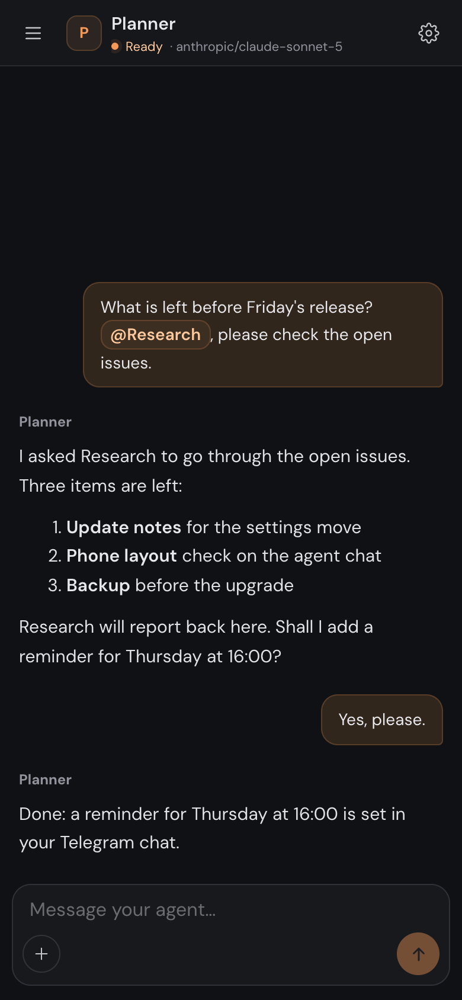

# AgentPier

**Your coding CLIs and personal agents, on your own machine.**

Self-hosted workspace for coding CLIs (Codex, Claude Code, OpenCode) and persistent
personal agents. Native terminals and chat on desktop and phone, reviewed pipelines,
and agents that work as a team.

[Deutsch](README.de.md) · [Docs index](docs/README.md) ·
[Contributing](CONTRIBUTING.md) · [Security](SECURITY.md) · [License](LICENSE)




## What you get

- **Native CLI sessions:** real tmux-backed terminals with each CLI's own login,
  models and prompts, plus a chat view that shows replies while they are written,
  completes the CLI's own slash commands, skills and plugin commands, recovers on the
  phone and takes dictation
  ([slash commands](docs/native-chat-delivery.md#slash-command-completion),
  [live updates](docs/native-chat-delivery.md#live-chat-updates),
  [reload and resume](docs/session-reload.md), [mobile delivery](docs/mobile-delivery.md),
  [dictation](docs/assistant-gateway.md#live-dictation-in-the-chats)).
- **Inbox:** every CLI question and approval, pipeline gate and agent request that
  waits on you, with live counts, answered in place or in one list; Claude Code
  approvals offer Always allow per account and show plans before you approve them
  ([inbox](docs/inbox.md#claude-code-approvals-and-plans)).
- **Pipelines with review:** reusable profiles, isolated Git worktrees, parallel
  reviewers whose verdicts are joined, bounded review loops, checks, a risk gate for sensitive paths, a token budget per run, a run queue per project with a concurrency limit and human approval,
  plus a built-in software factory from spec to pull request
  ([pipelines](docs/pipelines.md#software-factory)).
- **Agents and teams:** persistent agents whose leads ask and delegate to their
  members on request, by suggestion or on their own and share their project folders,
  coding projects and MCP servers with them or set up routines on them that report
  back, members that agree among themselves and report to their lead, Agency agents
  as templates for
  agents and members, work goals that keep an agent going until the job is done, optional nightly dreaming that tidies each agent's memory, hooks that let monitoring and other systems wake an agent, with @-mentions, Telegram, skills (bundled ones plus an owner-managed skill catalog with a scan before every install), routines, check-ins, files in both
  directions, images created through ChatGPT, PDFs read with the agent's own model (or an optional fallback), read or read-and-write access to project folders and GitHub through your
  token profiles, and coding sessions they start and steer themselves in their own worktrees, escalating questions to you ([agents](docs/agents.md), [coding sessions](docs/assistant-workflows.md#coding-sessions)).
- **Users:** add family members who sign in with their own password and chat
  privately with their own or shared agents, locked away from shell, coding and the
  rest of your workspace; you read their chats only when you switch it on
  ([users](docs/users.md)).
- **Central MCP servers:** add a server once and bind it to agents and to your coding
  CLIs, with OAuth sign-in from AgentPier and per-agent folders for local servers
  ([MCP](docs/mcp.md)).
- **SSH and SFTP:** SSH and SFTP hosts with a pinned host key (SFTP with a password
  or a key) that coding CLIs and agents use, with approvals for changes and deletes,
  whole-folder transfers, syncs and live activity rows; agents can propose a new SSH
  access that you confirm after checking its host key ([SSH](docs/ssh-access.md),
  [SFTP](docs/sftp-access.md)).
- **Secrets:** named secrets, such as API tokens, that you grant to agents and coding
  sessions as a file, never as an environment variable ([secrets](docs/secrets.md)).
- **Connections:** model access (provider connections and ChatGPT for agents),
  services for agents, MCP servers, SSH/SFTP accesses, secrets and GitHub connections
  in one place, created once and granted where they are used, each with **Used by**
  ([providers](docs/providers.md)). Native CLI accounts, skills, plugins and subagents
  are under **CLIs and extensions** ([shared CLI extensions](docs/shared-cli-extensions.md)).
- **Files and knowledge:** a file explorer, private artifacts, shared project memory
  and AgentBus between sessions ([files](docs/file-explorer.md),
  [artifacts](docs/artifacts.md), [memory](docs/memory.md),
  [AgentBus](docs/agentbus-integration.md)).
- **Phone-first:** install as an app, push notifications, and delivery and upload
  recovery ([notifications](docs/notifications.md), [mobile recovery](docs/mobile-recovery.md)).
- **Operations:** backups, updates with Stable and Preview channels, an activity log,
  and a system status on the start page with disk, CPU and RAM, AgentPier's own share,
  a low-disk warning and cleanups for old update backups, transcripts and agent
  dependencies ([backups](docs/backups.md),
  [release channels](docs/release-channels.md), [system status](docs/system-status.md)).

## Requirements

- macOS 14 or later (Apple Silicon or Intel), or Linux on x64 or arm64. Intel Macs are supported, but the full native agent qualification covers Apple Silicon and Linux only.
- Node.js `^22.23.4 || ^24.22.1 || >=26.12.1` (22.23.4+, 24.22.1+ or 26.12.1+; Node 23 and 25 are not supported; bundled in release packages), Git and tmux.
- Optional: Tailscale for remote access, and a Chromium-based browser for the agents'
  browser tool (Brave or Chromium for visible agent browser windows; AgentPier can
  install a managed Chrome for Testing for them with one click).
- At least one coding CLI or model provider. Provider accounts and their costs are
  your own.

## Install

**macOS, install script.** Installs prerequisites and the login service:

```sh
(agentpier_tmp=$(mktemp -d) && trap 'rm -rf "$agentpier_tmp"' EXIT && curl --fail --show-error --location --proto '=https' --proto-redir '=https' --tlsv1.2 https://github.com/Ranger-Marketing-Vertriebs-GmbH/agent-pier/releases/latest/download/install-agentpier.sh -o "$agentpier_tmp/install.sh" && /bin/sh "$agentpier_tmp/install.sh")
```

**macOS, Homebrew:**

```sh
brew install ranger-marketing-vertriebs-gmbh/tap/agentpier-installer && agentpier-install
```

Both open AgentPier at **http://127.0.0.1:4380**. Options:
[installation guide](docs/installation.md#one-command-installation-on-macos).

**Linux.** Download the `.aprelease` package for your architecture from the
[releases](https://github.com/Ranger-Marketing-Vertriebs-GmbH/agent-pier/releases)
and install it with `sh scripts/install.sh --archive <package> --service` from a
checkout. See the [Linux guide](docs/linux.md) and the
[exact commands](docs/operations.md#installer-and-exact-commands).

**From source (macOS or Linux):**

```sh
git clone https://github.com/Ranger-Marketing-Vertriebs-GmbH/agent-pier.git
cd agent-pier
npm ci
npm run build
npm start
```

## First steps

1. Open **http://127.0.0.1:4380** and create the workspace user. Later visits need the
   [login](docs/login.md). Finish this before you share access.
2. Open the sidebar **Menu** (group **Set up**): sign in to a coding CLI under
   **CLIs and extensions › Accounts**, or add a provider connection under
   **Connections › Model access**. Missing CLIs can be installed from the overview or
   under **CLIs and extensions › Installation**. **Search** (⌘K or Ctrl+K) finds every
   page, agent and action, also by its old name.
3. Choose **+** in the sidebar's **Sessions** group (on a phone, **+ › Session** in the
   header), pick a CLI, an account and a project folder, and start. Next time the
   dialog preselects the CLI and account you last started with. The native terminal
   handles CLI logins and menus; the chat shows the saved conversation.
4. Optional: open **Agents** from the **Menu**, choose **Enable agents** and create one
   with **New agent** ([agents guide](docs/agents.md)).

Choose German or English under **Settings › General › Language**.
Stopping the web server leaves CLI sessions running; stop a session in the interface
to end its CLI process.

## Update

Installed versions update under **Settings → Operations → Updates**, on the
**Stable** or **Preview** channel ([release channels](docs/release-channels.md)). A
failed start returns to the previous version. Coding CLIs update from the overview
([CLI updates](docs/cli-updates.md)); a CLI AgentPier installed cannot start sessions
below its minimum version until it is updated. A source checkout updates with `git pull`,
`npm ci` and `npm run build` ([updating](docs/installation.md#6-updating)).

> **Upgrading from 1.x**
>
> - There is no rollback to 1.x after the update, and backups made by 2.0 cannot be
>   restored on 1.x. Take a backup before updating if you might go back.
> - Sign in again once to OAuth MCP servers used from managed Codex accounts.
> - Lead agents now ask and instruct their members without an approval prompt.
> - Settings moved: shared credentials are under **Connections**, CLI accounts and
>   extensions under **CLIs and extensions**, the agent service under **Agents ›
>   Runtime**, the rest in the Settings tabs; old links still work.
> - Backups copy CLI profiles by allowlist, include histories (AgentPier's sessions,
>   chats and AgentBus messages, and CLI histories) only encrypted with a passphrase,
>   and restored hook scripts need `chmod +x` again.
>
> Details: [Upgrading from 1.x](docs/installation.md#upgrading-from-1x).

## Guides

The [docs index](docs/README.md) lists every guide.

| Area    | Guides                                                                                                                                                                                                                                                                                                          |
| ------- | --------------------------------------------------------------------------------------------------------------------------------------------------------------------------------------------------------------------------------------------------------------------------------------------------------------- |
| Use     | [Inbox](docs/inbox.md) · [Providers](docs/providers.md) · [Pipelines](docs/pipelines.md) · [Files](docs/file-explorer.md) · [Artifacts](docs/artifacts.md) · [MCP](docs/mcp.md) · [SSH](docs/ssh-access.md) · [SFTP](docs/sftp-access.md) · [Secrets](docs/secrets.md) · [Notifications](docs/notifications.md) |
| Agents  | [Agents](docs/agents.md) · [Users](docs/users.md) · [Workflows](docs/assistant-workflows.md) · [Model connections](docs/assistant-model-connections.md) · [Runtime updates](docs/assistant-runtime-updates.md)                                                                                                  |
| Operate | [macOS](docs/installation.md) · [Linux](docs/linux.md) · [Remote access](docs/remote-access.md) · [Backups](docs/backups.md) · [Operations](docs/operations.md) · [System status](docs/system-status.md) · [Sandbox](docs/sandbox.md)                                                                           |
| Develop | [Architecture](docs/architecture.md) · [UI guide](docs/ui-guide.md) · [Settings pattern](docs/settings-pattern.md) · [Testing](docs/testing.md) · [Frontend](web/README.md) · [Contributing](CONTRIBUTING.md)                                                                                                   |

## Data and security boundaries

AgentPier is a trusted personal workspace, not an isolation boundary between users.
Its data lives in `.data/` for a source checkout and in
`~/Library/Application Support/AgentPier` for a macOS installation. The data holds
credentials, profiles, session metadata and conversations with private file
permissions, but is not encrypted at rest. The login protects the web workspace;
[remote access](docs/remote-access.md) explains Tailscale Serve and the network mode.
[Users](docs/users.md) you add reach only their own app and their agents' chats, never
your workspace, files or settings; the operating-system user and its data stay yours.

Coding CLIs and agents run as your operating-system user. The optional
[nono sandbox](docs/sandbox.md) confines CLI sessions only, not agents. An agent with
shell access works with your logins, files and keys; local MCP servers run commands
on the host; an agent's own Telegram bot answers the people you allow; and a lead
agent's questions and tasks run on its members without approval. See
[SECURITY.md](SECURITY.md).

## Development

```sh
npm ci
npm run check
npx playwright install chromium webkit
npm run test:e2e
AGENTPIER_TEST_BROWSER=webkit npm run test:e2e
```

For frontend development, run `AGENTPIER_DEV=1 npm start` for the backend and
`npm run dev` in a second terminal. Vite serves on port 5173 and proxies `/api` and
`/auth` to the backend on 4380; `AGENTPIER_DEV=1` lets the backend accept that dev
origin. In a pipeline stage with a leased port block, both follow `AGENTPIER_PORT`
(see [Ports and browser sessions](docs/pipelines.md#ports-and-browser-sessions)).

Bug reports, documentation improvements and focused pull requests are welcome.
Start with [CONTRIBUTING.md](CONTRIBUTING.md), the [testing guide](docs/testing.md)
and the [frontend architecture](web/README.md). Report vulnerabilities privately
using [SECURITY.md](SECURITY.md).

## License

AgentPier is licensed under [Apache-2.0](LICENSE). Bundled AgentBus retains its
[MIT license](vendor/agentbus/LICENSE). Dependencies and provider marks retain
their respective notices and rights; see [third-party notices](THIRD_PARTY_NOTICES.md).
