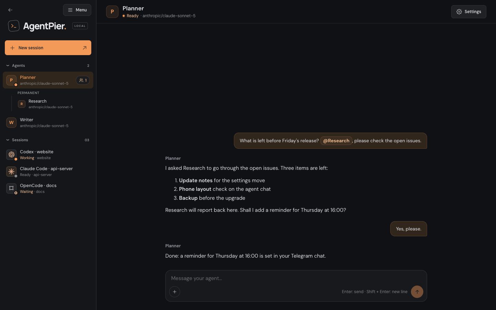
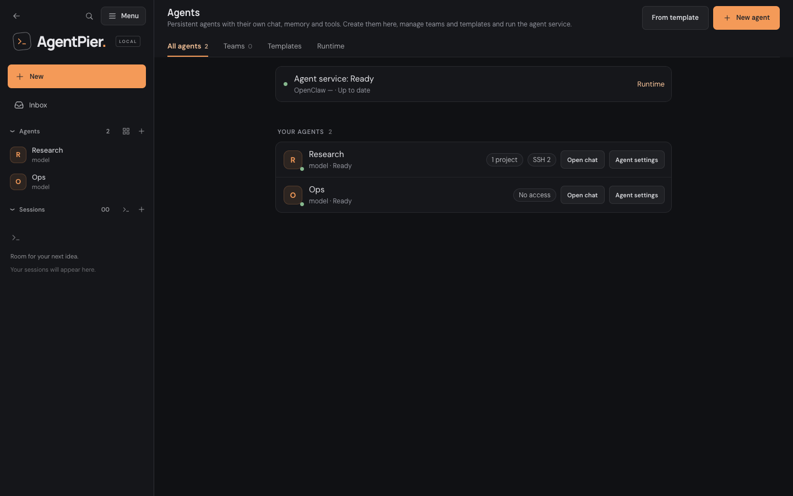
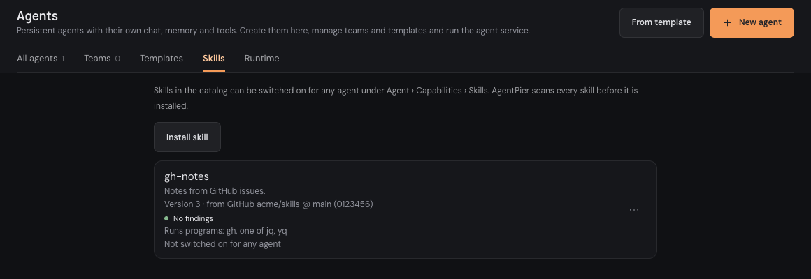
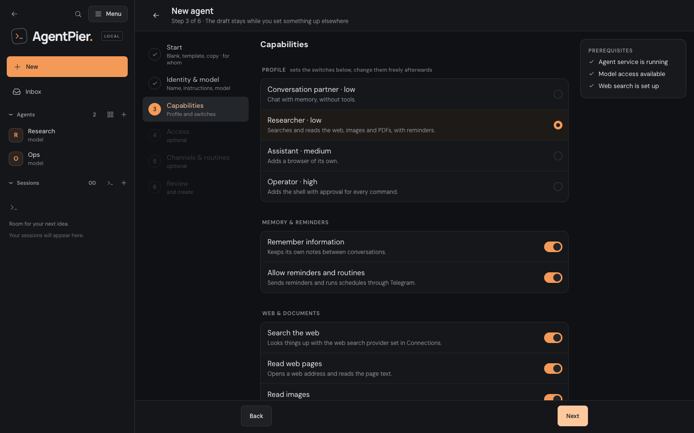
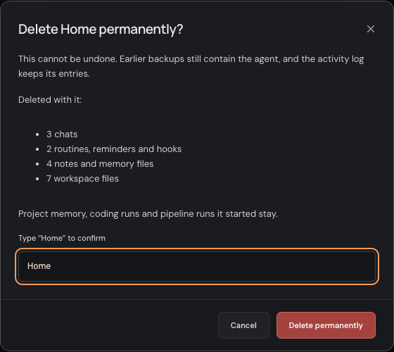
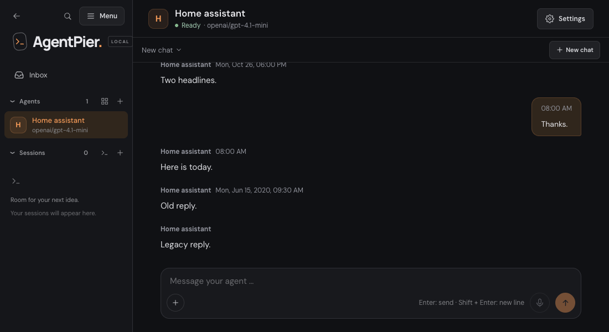
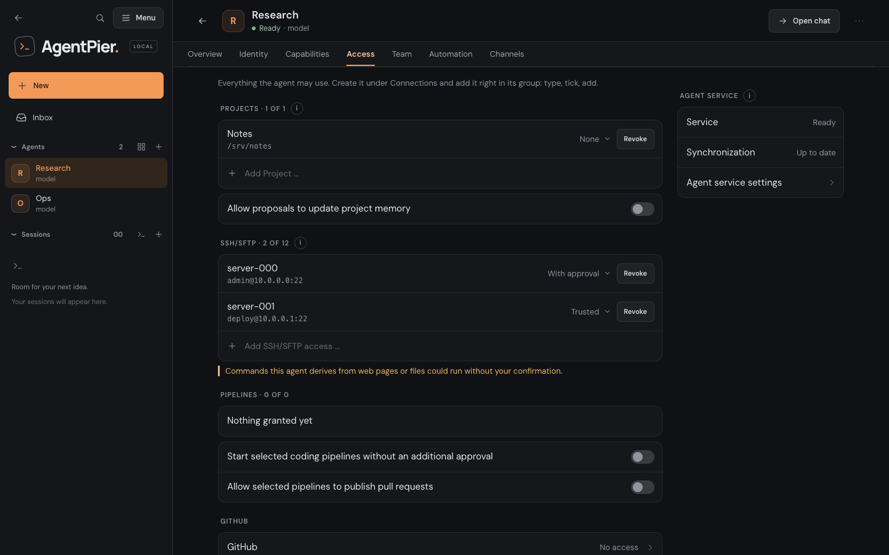

# Agents

Agents are persistent assistants that keep their own chat, notes and tools. AgentPier
runs them in one managed [OpenClaw](https://docs.openclaw.ai/) service on
your host. This guide covers what you set up and where. The design and the exact
limits are in the [Gateway design](assistant-gateway.md),
[model connections](assistant-model-connections.md) and
[agent workflows](assistant-workflows.md).

## Turn agents on

Everything about agents is in **Agents** in the sidebar **Menu** (group **Set up**).
While agents are off, the entry stays and leads to **Agents are off** with **Enable
agents**.

1. Choose **Enable agents**, or open **Agents › Runtime** and switch on **Enable
   agents** under **Function**, then save. AgentPier downloads the pinned OpenClaw
   runtime and its own Node.js into the data directory; nothing is installed globally,
   and the page shows the progress. Installers can do this in advance with
   `--with-assistants` (see [installation](installation.md#managed-assistant-runtime)).
   **Settings › General › Features** shows whether agents are on and links to
   **Agents › Runtime**.
2. **Agents › Runtime › Agent service** shows the service, its synchronization and its
   runtime version. Start, stop or restart the service there, and prepare, activate or
   roll back OpenClaw updates under **OpenClaw updates**
   ([runtime updates](assistant-runtime-updates.md)). The same tab holds the host-wide
   **Teams** limit, [Dreaming](#dreaming) and **Storage** (the agents' installed
   dependencies, with the same clean-up as the system status dialog).
3. **Agents › Runtime › Advanced · for all agents** offers a short, allow-listed set of
   OpenClaw settings for all agents: **Time limit per task**, **Thinking level**,
   **Time zone**, **Image quality**, **Maximum image size** and **Media file
   retention**. Each one is marked **Immediate** or **Restart needed**. AgentPier
   offers only settings that do not touch security, access or management, and applies
   them only to the runtime version they were approved for; an older runtime starts
   with OpenClaw's defaults. When an AgentPier update approves them for a new runtime
   version, saved values stay stored but inactive until you activate that version under
   **Agent service**, and again after a rollback before commit; the page names the
   installed version meanwhile. The activity log records each change as
   `setting.updated` with the setting and its old and new value. The old addresses
   `/settings/assistants` and `/settings/assistants-advanced` open this tab.

While agents are off, AgentPier shows no agents in the sidebar and runs no agent
connections or background work. When the agent service is stopped, the sidebar dims
the agents with **offline** and **Agents** shows a banner with **Start service** and
**Diagnostic**.

## The agents page

On a phone: [agents page](screenshots/agents-hub-phone.png). The Runtime tab:
[agent service, updates and advanced settings](screenshots/agents-runtime-desktop.png)
([on a phone](screenshots/agents-runtime-phone.png)).

**Agents** (`/agents`) has five tabs:

- **All agents:** a **Readiness** card (agent service and runtime version with
  **Update ready**, web search not set up, approvals waiting in the inbox), **Your
  agents** with model, status and what each may use, **Agents of users** with
  **Manage users**, and **Archive** with archived agents and members (**Restore**,
  reset the browser profile, **Delete permanently**; see
  [Archive and delete](#archive-and-delete)). An agent without provider access shows
  **Provider access missing** and **Choose model**.
- **Teams:** the teams of all leads, active or archived, with proposals, team cards,
  coding requests and member requests, and the host-wide limit of concurrently active
  members ([teams](#teams-asks-and-tasks)).
- **Templates:** the Agency catalog (search, category, refresh, paging, preview with
  the scan verdict, source, revision and license). A preview offers **Create personal
  agent** (opens the wizard with the template) and **Install as subagent in a CLI …**
  (see [shared CLI extensions](shared-cli-extensions.md)). Blocked entries cannot be
  used.
- **Skills:** the owner's skill catalog for all agents ([skill catalog](#skill-catalog)).
- **Runtime:** see [Turn agents on](#turn-agents-on).

## Skill catalog

**Agents › Skills** (`/agents?tab=skills`) is the owner's catalog of extra skills for
all agents. Only the owner installs, updates and removes catalog skills and switches
them on; restricted users never do ([users](users.md#what-stays-locked)).

- **Install skill** takes a `SKILL.md`, a ZIP or a public GitHub link. The check
  scans the source without writing anything, with the same offline scan as CLI skills
  ([skill import scan](shared-cli-extensions.md#skill-import-scan)), and previews the
  files, the findings and the programs the skill runs. **Add to catalog** installs
  exactly what was checked. Warnings need your confirmation; a blocked skill can be
  installed only as an explicit override.
- **Updates.** **Upload new version** on a catalog skill, or **Check for update** on a
  GitHub skill (its panel is titled **Update skill**), installs a new version. Agents
  that use the skill get it at their next turn. If the new version brings warnings you
  have not accepted for the previous version, or is blocked, you confirm again; the
  preview shows "New since version N". An uploaded file or a repository that now names
  a different skill is refused, so an update never becomes a second skill. There are no
  automatic update checks.
- **Remove** names the agents that use the skill, switches it off for all of them and
  deletes its files.
- **Name clashes.** A skill whose name a bundled skill, a plugin skill or a skill in
  the shared skill folders already carries is refused. If a runtime update later
  bundles a skill of that name, the catalog skill shows "Shadowed by a bundled skill"
  and stays off until you remove it; a skill of that name the agent service reports
  from another source shows "Shadowed by another installed skill of the same name". A
  skill of the same name in one agent's own folders is not refused at install: the
  catalog skill shows as off for that agent only, on its **Skills** page.
- "Not available right now — AgentPier will check it again" appears, here and on the
  agent's **Skills** page, when the running agent service does not report the skill or
  its last integrity check could not run.
- Each skill shows its version, its source (upload, or GitHub repository, ref and
  commit), the programs it runs and on how many agents it is on. A skill that needs
  settings installs but is never switched on ("Needs settings — not supported yet").
  "Damaged — install it again" appears when the live copy and its stored copy both
  fail the integrity check.

Per agent, the owner switches catalog skills under **Agent › Capabilities › Skills**.
The runtime, the integrity checks and the shell caveat are described in
[assistant gateway](assistant-gateway.md#skills).

## Create an agent

Agents need a model. Set one up under **Connections › Model access**: connect
**ChatGPT for agents** with a device-code sign-in, or add a provider connection
(OpenRouter, Ollama, llama.cpp or another OpenAI-compatible endpoint). The wizard can
also do this on the way (**+ Connect model**).

**New agent** on the agents page, the **+** in the sidebar's **Agents** group (also in
the phone drawer, and shown with a hint while you have no agents yet) or **+ › Agent**
in the phone header and the collapsed sidebar opens the wizard (`/agents?new=1`). Its six steps sit in a rail on
the left on a computer and one per screen with a progress bar on a phone; **Back** and
**Next** are always there, and steps 4 and 5 offer **Skip**:

1. **Start:** **Blank**, **From template** (an Agency role, checked first) or
   **Duplicate** (an existing agent). When users exist, **For whom?** creates the
   agent for a person, as their own or a shared agent ([Users](#users)); such agents
   get chat only, and shell, coding, pipelines, SSH, GitHub, secrets and teams stay
   locked.
2. **Identity & model:** **Name**, **Instructions**, provider access and **Model**
   (a custom model ID and refreshing the list work as in the agent's settings). For
   ChatGPT accounts the list shows the models your account can use and says when it
   could not be refreshed. **+ Connect model** opens ChatGPT sign-in or a provider
   connection in a side sheet; the draft stays.
3. **Capabilities:** a profile sets the switches below, which stay editable:
   **Conversation partner** (low risk: memory only), **Researcher** (low: memory,
   reminders and routines, web search, reading pages, images and PDFs),
   **Assistant** (medium: Researcher plus a browser) and **Operator** (high: Assistant
   plus the shell **With approval**). **Create images** needs a ChatGPT account, and a
   service that is not set up says so with **set up here** instead of blocking.
4. **Access** (optional): add projects (with folder level and coding), MCP servers,
   pipelines, SSH/SFTP accesses (with mode), a GitHub level and token profile, and
   secrets with the same inline add field as the agent's **Access** tab. Nothing is
   preselected; what is missing can be created in a side sheet without leaving the
   wizard.
5. **Channels & routines** (optional): a Telegram bot token (pair your private chat
   afterwards), **Check in on its own** and a first daily routine. Hooks are created
   after the agent exists, because creating one reveals a secret.
6. **Review:** every choice, open prerequisites (for example a missing web search
   provider) and **Create agent**.

On a phone the wizard shows one step per screen ([first step](screenshots/agent-wizard-phone.png)).

One click creates the agent, then its capabilities, access, MCP servers, team policy,
Telegram, check-ins and routine through the same endpoints as the settings, in that
order. When a later step fails, the agent stays: the wizard lists each step as done
or failed with **Try again** per failed step, **Open chat** and **Later in the
settings**, and never resends a step on its own. Otherwise the agent's chat opens. The
agent appears in the sidebar under **Agents**.

**From template** fills Name and Instructions from an Agency agent (a role description
from [msitarzewski/agency-agents](https://github.com/msitarzewski/agency-agents), MIT
licensed); **Agents › Templates** and the preview of a subagent under **CLIs and
extensions › Extensions › Subagents** offer the same as **Create personal agent**. Its
model and tool settings are not imported: you choose the model, and tools and access
stay off until you grant them. AgentPier scans the entry first: a blocked one cannot be
used, and warnings are shown before you create the agent. The agent's **Identity** tab
names the template with its source, revision and license.

**Duplicate** (in the wizard's first step, in the agent's **Overview › Manage** and in
the ⋯ menu of its settings header) opens the wizard prefilled with "Copy of <name>":
instructions, model, capability switches, shell level, enabled bundled skills, access
(projects with their levels, pipelines with their two switches, MCP servers, SSH with
mode, GitHub level and token profile, secrets) and team policy. Memory, chats,
attachments, Telegram, hooks, reminders, routines, always allowed commands, the
browser profile, users and the template's provenance are not copied. Review every step
before **Create agent**.

### Archive and delete

Every agent can be archived: your own agents, permanent team members and agents of
users. **Archive** sits in the ⋯ menu of the agent's settings header and under
**Overview › Manage**. An archived agent stops completely: it takes no turns, its
routines and reminders are paused, its check-ins and hooks do not run, cron jobs it
created itself are paused in the agent service, nothing is delivered over Telegram and
it holds no MCP servers. While the agent service is not running, its own jobs are
paused at its next start. All its data stays: chats,
memory, workspace, settings and access. It moves to **Agents › All agents ›
Archive**; **Restore** brings it back with the same settings and enables the jobs it
created itself again. Routines and reminders stay paused after a restore until you
resume them. A user's own agent whose user was deleted cannot be restored, only
deleted.

- An agent that is still answering, or a team member still at work, cannot be
  archived; wait or stop it first. Disconnect an agent's own Telegram bot for other
  people before you archive it.
- A lead with temporary team members asks first and archives them with it. Its
  permanent members stay.
- Only you archive, restore or delete agents. Users never do, also not on their own
  or shared agents.

Only an archived agent can be deleted for good: **Delete permanently** in
**Agents › Archive** or in the archived agent's ⋯ menu. The confirmation lists what is
lost (chats, routines, reminders and hooks, notes and memory files, workspace files,
and a lead's temporary members) and stays off until you type the agent's name exactly.
A delete removes:

- the agent with its settings, its chats with their OpenClaw transcripts, its workspace
  with attachments, notes and memory, dreaming's memory copies and shared files;
- its routines, reminders, check-ins and hooks with their cron jobs, its Telegram
  channel with pending deliveries, its browser profile, its access grants and lead
  shares, waiting approvals and its SSH and SFTP job records;
- its records of the coding sessions it started (the sessions themselves stay);
- its OpenClaw agent state (`state/agents/<runtime agent>`) and its Gateway entry.

Project memory and the pipeline and coding runs it started stay (coding sessions keep
running as yours), as do worktrees, shared projects, the activity log (its entries
name only ids and counts) and backups made before
([Backups](backups.md#what-a-backup-holds)). A delete is refused while the agent
answers or its settings are being applied, and for a lead that still has permanent
members (delete those first). The agent service must be running. A delete that
failed or was interrupted shows in **Agents › Archive** as **Deletion pending** (with
the code of its last failure); it is never restored and never runs. **Delete
permanently** there retries it after the name confirmation, and every start of the
agent service tries again.

### Message times

Every message in an agent's chat shows when it was sent, next to the speaker's name (at
the top of your own bubble): the time for today, the weekday, date and time for an
earlier day this year, and the year as well for older messages. Hover the time for the
full date. Messages without a stored time show none. Your messages that came through
Telegram, and a lead agent's requests, show the time in the line below the bubble. In a
lead's chat the lead's messages carry their time too, and the centred notices about
members asking each other end with theirs.

## Agent settings

**Settings** in the agent's chat header (or on its row on the agents page)
opens seven tabs: **Overview**, **Identity**, **Capabilities**, **Access**, **Team**,
**Automation** and **Channels**. The header has **Open chat** and a ⋯ menu with
**Duplicate**, **Archive** or **Restore**, and for an archived agent **Delete
permanently** ([Archive and delete](#archive-and-delete)). Each tab keeps its own
draft and save bar; leaving with unsaved changes asks first. A temporary team member
shows Overview, Identity, Capabilities and Access; an agent of users has no Team tab.
Old links with `tab=profile`, `tab=work`, `tab=routines` or `tab=telegram` open the
matching new tab.

On a phone: [Overview tab](screenshots/agent-settings-phone.png).

### Overview

**Waiting for your approval** and **Actions and coding tasks** (everything the agent
proposed and what waits for your decision, see
[agent workflows](assistant-workflows.md)); **At a glance**, one read-only row per tab
that opens it; **Chat attachments** ([attachments](#attachments)); for a team member
the member group (where it came from, its history, **Stop member**, **Keep as permanent
agent**); and **Manage** with **Duplicate**, **Archive** or **Restore** and, once
archived, **Delete permanently**.
On a phone the agent service summary sits here too.

### Identity

Name, instructions and model, **Manage connections** (opens **Connections › Model
access**), the template note and the revision. A team member also shows where it came
from and whether its instructions changed since it was created. A temporary member has
**Follow the lead's model** switched on unless it has a model of its own: its Identity
tab then shows the lead's model. Switch it off to pick a model of its own; switch it on
again to follow the lead. A permanent member, and a temporary member with a model of
its own, also shows whether its model changed since it took it over from the lead.

### Capabilities

- **Memory & reminders:** **Remember information** keeps the agent's own notes
  between conversations; **Memory** opens and searches them. **Allow reminders and
  routines** lets it send reminders and run routines
  ([routines, reminders and check-ins](#routines-reminders-and-check-ins)).
- **Web & documents:** **Search the web**, **Read web pages**, **Use a browser** (a
  persistent browser profile of the agent's own; needs Chrome, Brave, Edge or
  Chromium on the host), **Read images**, **Read PDFs** and **Create images**
  (through a ChatGPT account connected under **Connections › Model access** as **ChatGPT for agents**;
  without one the switch is disabled and says so). The search provider is set once
  under **Connections › Services for agents › Web search** (DuckDuckGo, Brave Search or
  Perplexity through OpenRouter). **Read PDFs** reads PDF files in the agent's
  workspace with the agent's own model when it accepts images, scanned pages
  included. For agents whose model does not, an optional fallback model reads them,
  chosen under **Connections › Services for agents › PDF reading** from the model
  connections and ChatGPT accounts; without one, such an agent reads only the text of
  PDFs, not scanned pages or pages without text. PDFs never go to another provider;
  with several ChatGPT accounts any signed-in one may read them.
  **Read images** also lets the
  agent look at PNG, JPEG, GIF and WebP files (up to 6 MiB) in the project folders
  you gave it, when its model takes images; each such view is recorded in the
  activity log with the file's path and size.
- **Agent browser** (while **Use a browser** is on): **Visible browser** opens a
  regular window instead of a headless one, so shop and product pages that block
  headless browsers work. AgentPier moves it to the bottom-right corner of the screen
  (macOS leaves a small corner visible) instead of minimizing it, because a minimized
  window stops rendering and the agent's snapshots and clicks time out; to sign in,
  take over the browser in its live view or drag the window in from the corner. It needs a browser app of the agents' own, Brave, Chromium or Chrome for
  Testing, never the owner's Chrome, and on Linux a display. Without one,
  **Install browser** installs a managed Chrome for Testing with progress, then offers
  **Restart agent service**. **Open live view** (or the small preview in the chat header while
  the browser runs) shows the browser live at `/agents/<id>/browser`, wherever its
  window is, with its address and tabs; pick a tab or follow the agent, **Stop
  browser** (its tabs close, its profile stays; the agent's next browser call starts it
  again; it asks first while the agent uses the browser or someone controls it) and
  **Start browser** there. Only the owner sees it, and no pictures are stored. **Take over** there
  (or beside the chat preview) to sign in or solve a check yourself: the agent waits,
  and **Hand back** (or ten minutes without input) gives it back; if the agent tried
  the browser meanwhile, a note in the chat lets it continue. Shift+Escape leaves the
  browser's keyboard; **Take over here** moves control from another device. At most three visible
  browsers run at once, and a browser idle for 15 minutes stops. **Reset browser
  profile** deletes the agent's sign-ins and cookies, also for an archived agent. The chat header shows
  **Browser running** while it runs. Temporary team members get a browser profile
  that is discarded when they end. See "Browser isolation" in
  `docs/assistant-gateway.md`.
- **Uploads with the browser** (while **Use a browser** is on): the agent can upload a
  file from a project folder it may at least read, or from its own workspace, to a
  website, for example a finished episode to YouTube Studio. AgentPier prepares a copy
  for that agent's browser alone (up to 8 GiB, removed after six hours, when AgentPier
  restarts or when the agent loses the browser); files outside those folders stay
  refused, and every upload is recorded in the activity log with the agent, project,
  path, size and the website the agent says it uploads to. The agent uploads without
  asking you, so a page could try to talk it into uploading a file it may read: switch
  on the browser only for agents whose folders you would share that way. See
  [browser uploads from folders](assistant-workflows.md#browser-uploads-from-folders).
- **Shell access:** **Off**, **With approval** or **Full access**. With approval, the
  agent asks before every command that is not always allowed; the request appears in
  the chat and in the paired Telegram chat with **Allow once**, **Always allow** and
  **Deny**. A permanent team member asks in its own chat; when its lead asked or
  delegated the turn, the request also appears in the lead's chat, and deciding in
  either chat settles it in both. In a turn you sent from Telegram, the agent's answer
  after your decision also arrives there. A run the agent starts on its own (for
  example after a background command finished) asks in the paired Telegram chat
  when your latest message to the agent came from Telegram, and its answer arrives
  there too. Every request waiting for approval, and every team
  proposal, also appears under **Agents** in the [inbox](inbox.md). **Always allowed commands** lists what you allowed
  permanently; delete an entry and the agent asks again. Temporary team members get
  shell access only through their lead's **Team members may use shell and SSH**
  (see below).
- **Skills:** lists the skills that ship with OpenClaw and the skills from the
  [skill catalog](#skill-catalog). A skill teaches the agent a tool, mostly a
  command-line program such as `gh`. Switch on the ones this agent may use; each one
  shows whether it is ready or what it is missing, and risky skills show a warning
  first. Catalog rows say "From the skill catalog · Version N". A skill is a hint, not
  a permission: most skills need shell access, and shell access decides what the agent
  can run. A catalog skill that runs programs on an agent without shell access shows
  "Works with limits"; a catalog skill that needs settings (environment variables, API
  keys or configuration) shows "Needs settings — not supported yet" and cannot be
  switched on. A catalog skill whose files are damaged or cannot be checked shows
  that state instead. Skills reach only agents that can read files (**Remember
  information** on); the agent reads the skill's instructions itself. These agent
  skills are separate from the CLI skills under **CLIs and extensions › Extensions**
  ([shared CLI extensions](shared-cli-extensions.md)).

Switching a capability, the visible browser, skills or MCP servers applies while the
agent service keeps running. A few changes still need a brief restart of the agent
service: another web search provider or key, another PDF fallback model, a browser installed
after the service started, a changed model connection that agents use, and a new
Telegram bot for an agent. AgentPier saves such a change at once and shows
**Agent service restart pending**, with what it is for and what it waits for. The
service restarts by itself as soon as no agent is busy; further changes join the same
restart. **Restart now** restarts at once after you confirm; it interrupts all running
agent work and can take about a minute or longer. Revoking access still restarts at
once after you confirm and is refused while an agent is busy: deleting a connection
agents use or changing or removing its key, removing an agent's bot or replacing its
token, and changing or removing the speech key a bot uses. See "Pending restart" in
`docs/assistant-gateway.md`.

### Memory

New agents start with **Remember information** on; you can switch it off unless dreaming
is on (below). An agent remembers only what it writes down: its conversation gets
shortened (compacted) when it grows long, and older turns are cut. With **Remember
information** on, AgentPier tells the agent to write durable facts and plans to
`MEMORY.md` and day notes to `memory/YYYY-MM-DD.md` as soon as you share them, and
never to say it saved something unless the write succeeded. Before a conversation
is shortened, the agent gets one last chance to append to the day note.

When you press **Summarise now** ([long chats](#what-the-agent-is-doing)), AgentPier
first gives the agent a hidden memory step in that chat, because no automatic last
chance comes before a summary you ask for. See below.

Shortening a long conversation can take a few minutes before the agent answers.
Meanwhile the chat shows **Summarising the conversation so far — this can take a few
minutes for long chats.** instead of **Working**, and the header shows **Summarising
conversation**. Afterwards a quiet line such as **Earlier messages were summarised
(about 251k → 18k tokens).** marks the place in the chat. Both appear only in
AgentPier; nothing is sent to the paired Telegram chat.

Only your own messages (in the chat or the paired Telegram chat) and its routines'
runs can change an agent's memory, apart from the agent's own nightly dreaming
(below). Forwarded content, reminders, check-ins and tasks
from a lead agent cannot. When a background command the agent started for one of your
messages (a long render, for example) finishes after its reply, the agent's follow-up
on the result may still change files, memory and granted project folders like that
message did and [hand you files](#files-from-agents): for up to two hours after that
message. Your own newer messages in that chat (also from the paired Telegram chat) and a
lead's follow-ups on its members' results do not end this; the follow-up keeps the
rights of the message that started the command. Forwarded content, a reminder, a
hook, a lead's task or another user's message arriving in between ends it. The same
holds for a command started in a [work goal](#work-until-done) continuation and for one
a lead agent started while handling its member's result. A command started for
forwarded content,
a reminder or a lead's task stays read-only,
and the command's output never counts as your message. When a write is refused, the chat shows a quiet line such as
**Memory not saved: only your own messages can change memory.** Right after the
agent service starts, a message waits a few seconds until memory can be written; if
it still cannot, the chat says the message ran read-only. **Memory** in the agent's
settings shows what was actually saved. Project knowledge that an agent proposes
(**Access › Projects**) waits for your approval; when you decline it or it expires, the agent is
told it was not saved.

#### Dreaming

**Agents › Runtime › Dreaming** switches nightly
dreaming on for all agents at once: **Dream at night**, the hour (default 03:00) and
the time zone, which follows this device when you switch on (**Use my time zone**
adopts it again later). The change applies at once, without restarting the agent
service; if the agent service is starting or does not take it, it applies within a
minute once it is ready. Once a night each agent reviews its own conversations with its own model,
writes dream notes into its memory and may tidy `MEMORY.md`. Every agent dreams,
temporary team members and agents with **Remember information** off included, but
each only over its own chats and into its own memory. A shared agent dreams over all
its users' chats and your own into its shared memory, and its notes can quote them
word for word. A busy agent still dreams that night.

- **Switching on** lists the permanent agents that do not remember information yet
  and, after you confirm, switches **Remember information** on for them. If some of
  them are working right now, dreaming stays off and the settings name them; save
  again when they are done. While dreaming is on, **Remember information** stays on
  for every permanent agent: the switch is locked and says where to turn dreaming off.
  An agent restored from the archive with memory off can still save other settings;
  once you switch its memory on, it stays on.
- **Where it shows:** the notes appear under **Memory** like other notes
  (`memory/dreaming/light/`, `rem/` and `deep/`, one file per night), and the
  **Dream diary** (`DREAMS.md`) shows first, read-only, also in a user's memory view.
  Notes are listed newest first, 200 at a time; **Load N more notes** shows older ones.
  A diary larger than 256 KiB shows its newest entries and says that older ones are
  cut off.
  On a user's own agent you see them only while she has switched on **Owner may
  read chats**, like the rest of its memory; then in full, including notes that quote
  her chats from before she switched it on ([Privacy](users.md#privacy)).
  Dreaming's raw copies of the chats (`memory/.dreams/`) are never shown, and the
  agent's file tools cannot open them.
- **Backups of `MEMORY.md`:** five minutes before the hour AgentPier copies each
  agent's `MEMORY.md` to `assistants/memory-backups/<agent>/` in its data directory and
  keeps the last 7. They never appear in the memory view; host backups keep them
  encrypted like workspaces. To undo a night's rewrite, copy a backup back over the
  agent's `MEMORY.md`.
- **Deleting a chat** removes OpenClaw's archived copy of its transcript and then
  removes it from dreaming's copies, so later nights no longer read it; notes already
  written from it stay. If the removal from dreaming's copies fails, or AgentPier
  stops before it runs, it is not tried again and those copies keep that chat.
- The data directory must not sit behind a symbolic link, or dreaming writes nothing.

Server details: [Dreaming](assistant-gateway.md#dreaming).

### Access

Everything the agent may use, in one tab: **Projects**, **SSH/SFTP**, **MCP servers**,
**Pipelines**, **GitHub** and **Secrets**. You create these once under
**Connections** and grant them here: each group ends in an add field
(**Add <type> …**): type to filter, tick one or more entries (entries the agent already has
show **already granted**), choose a mode where the group has one, then **Add n** and
save. A long group shows its first entries and **n more · Show all**, which opens the
full page with search. When nothing exists yet, the group links to Connections to set
it up. An agent of users gets project folders only; the other groups show a lock.

- **Secrets:** pick the secrets this agent receives (up to
  50). They are delivered as `.agentpier/secrets.env` in its workspace, and its
  AgentPier instructions name that file and how to load it, so it can read their
  values. The file is rewritten before every turn and file tools cannot change it, but
  shell access can ([secrets](secrets.md)).
- **Projects and pipelines:** **Projects** (coding start and folder level per project,
  and whether the agent may propose project knowledge updates) and **Pipelines**
  (which ones, whether it may start them without another approval, and whether it may
  publish pull requests). What it proposed and what waits for your decision is under
  **Overview › Actions and coding tasks** ([agent workflows](assistant-workflows.md)).
  Under each granted project, **Coding sessions** lets the agent start and steer its own
  coding CLI sessions there; the same switch is in **Projects › <project> › Agents**
  ([coding sessions](assistant-workflows.md#coding-sessions)).
- **Direct folder access:** under **Projects**, each allowed project offers
  **None**, **Read** or **Read and write** for its folder. With **Read** the agent
  lists, reads and searches files there; with **Read and write** it also creates and
  changes files, without an approval per change. Its instructions name each folder
  with its path and level. `.git` internals, links leading out of the folder and
  AgentPier's own data stay locked, and every change is recorded in the activity log
  with its path and size, never its content
  ([folder access](assistant-workflows.md#direct-folder-access)). The same access can
  be set from the project: **Projects › <project> › Agents**
  ([agent access per project](assistant-workflows.md#agent-access-from-the-project)).
- **GitHub:** **No access**, **Read** or **Read and write** through one of your token
  profiles from **Connections › GitHub connections** (the host's **Default for agents** is
  preselected). The agent gets the official GitHub MCP server with that profile:
  **Read** offers repositories, issues, pull requests and Actions runs read only;
  **Read and write** also comments on and creates issues and pull requests, merges
  pull requests, pushes, changes and deletes files, runs workflows and creates, forks
  and deletes repositories, all without an approval per change. With shell access, `gh` and `git` in the
  agent's commands use the same profile instead of your own login. With **Read**,
  `git push` to the profile's host fails with a message naming the level, while
  fetch, clone and pull work. This is best effort, not a sandbox: with shell access
  the agent runs as you, other git configuration can get around it, and `gh` is not
  limited. Use a token without write permissions to enforce **Read** on GitHub. The token never
  appears in the agent's instructions, files, chat or the browser (with shell access
  the agent runs as you and could read it like you can); a rotated token reaches the
  agent at once, a deleted profile removes the access. Each profile and level runs
  its own GitHub MCP server for every agent session, about 45 MB of memory each. The page warns when a token's known
  scopes lack `repo`, and AgentPier installs the GitHub MCP server on first use
  ([GitHub for agents](assistant-gateway.md#github-for-agents)). Each change is
  recorded in the activity log.
- **SSH accesses:** the hosts from **Connections › SSH/SFTP accesses** this agent may
  run commands on, each with a mode. **With approval** (the default) shows every
  command in the chat and in the paired Telegram chat with **Allow once** and **Deny**;
  a command with hidden characters or more than 2,000 characters can only be allowed
  in AgentPier. **Trusted** runs without asking in your own chats and in tasks or
  questions from the agent's lead. Every run, trusted or allowed, leaves an activity row
  such as "SSH on opnsense · uptime · Done" in the chat; opening it shows the full
  command (up to 8 KB) with a copy button, the exit code and the duration, never the
  output. Two or more runs in a row (with no text between them) share one row, shut
  by default, such as "SSH activity · 13 calls · proxmox-2" (or "· 3 hosts"); it shows
  "1 failed" for runs that ended with an exit
  code other than 0, timed out or were stopped, and opens to the single rows. A denied
  command leaves none. Stored commands hide recognisable secrets
  (passwords, tokens and keys in flags, headers, URLs and variables) as `•••` and say
  "Secrets hidden"; this is best effort. An approval shows the exact command until you
  decide and it has run. AgentPier keeps the newest 500 trusted runs per agent.
  When you ask an own agent or a permanent member for access to a new server, it can
  propose one: an **SSH access proposal** card shows the login, the purpose and the
  scanned host-key fingerprint to check through a channel you trust. **Confirm
  access** creates the access with a new managed key (or a key of its project you
  pick) and grants it to the agent in **With approval** (or the mode you pick); then
  install the public key the card shows on the server. Details in
  [SSH accesses](ssh-access.md#proposals-from-agents).
  **Trusted incl. routines** also runs in the agent's routines. A routine's or a hook's
  runs leave their rows in that run's entry of the **Events** area, not in the chat
  (see [the event area](#the-event-area)).
- **SFTP hosts** appear in the same list, marked **SFTP**, with the same modes (see
  [SFTP access](sftp-access.md)). The agent lists and downloads without asking. With
  **With approval**, every change on the server (upload, new folder, rename, sync up)
  shows a card in the chat and in the paired Telegram chat with **Allow once**,
  **Always allow for this host** and **Deny**; Telegram offers the buttons only for
  plans of up to 20 paths per list without hidden characters. **Always allow for this
  host** switches that agent's grant to **Trusted** (set it back here to revoke it) and
  appears only on cards for the agent's own grant: not on delete cards and not on a
  temporary member's cards. **Trusted** changes run without asking. Deletes (a delete
  or a sync that deletes extra files) always ask, and routines never delete. At most 3
  SFTP cards wait at once. Local paths are in the agent's workspace unless it names a
  granted project folder; prompt files such as `AGENTS.md` and `SOUL.md`, `skills/`,
  `.agents/` and `attachments/` are never transferred, and a folder download needs a
  subfolder. Every transfer leaves a live activity row (progress, then counts, size and
  duration); consecutive calls share one group, "SFTP activity". A routine's or a
  hook's transfers show in its **Events** entry instead.
  Every command is listed under **Actions and coding tasks** and recorded in the
  activity log by its fingerprint, never its text. Agents cannot add hosts or keys.
- **MCP servers:** the central servers bound to this agent, each with its status and
  **Open** (its entry under **Connections › MCP servers**). Add servers there; the MCP
  wizard's **Connect** step can bind them to agents directly. OAuth servers
  are signed in from AgentPier ([MCP](mcp.md#central-mcp-servers-in-the-coding-clis)).
  A local server can also be installed from an npm or PyPI package under **Connections ›
  MCP servers** ([MCP](mcp.md#installing-a-server-package)). A local server's path setting
  can use an [agent placeholder](mcp.md#agent-placeholders) such as
  `{agent.workspace}`, so each agent reads and writes only in its own folder.
- **Shared by the lead agent** (team members): the project folders, coding
  projects, MCP servers and **Read images** the member's lead shares with it, each
  "via <lead>", with
  **Revoke** ([sharing a lead's access](#sharing-a-leads-access-with-permanent-members)).
- **Granted by the lead agent** (temporary members): what the lead gave the member,
  read only, and its temporary MCP servers ([teams](#teams-asks-and-tasks)). A
  temporary member's Access tab shows only these and the lead's shares.
- **Who uses this agent:** the users who chat with it, each with a level, **Remove**
  and, on a user's own agent, the **Released capabilities** ([Users](#users)).

### Team

- **Team:** **Use team** (**On request**, **Suggest** or **Autonomous**; see
  [when a lead uses its team](#when-a-lead-uses-its-team)), **Allow teams without
  asking each time**, **Team members may use shell and SSH** (off by default; see
  [teams](#teams-asks-and-tasks) below), **Maximum team size** and **Member time limit
  (minutes)**.
- **Shared with members:** what this agent shares of its own access with its members,
  with **Revoke** ([sharing a lead's access](#sharing-a-leads-access-with-permanent-members)).
- **Teams:** the agent's active and archived teams with proposals and member requests
  and, below them, **Questions and tasks** it sent to its members. **Agents › Teams**
  shows the teams of all agents in one place.

The Team tab is hidden for team members and agents of users.

### Automation

**Acting on its own** (check-ins), **Reminders**, **Routines** and **Hooks**; see
[routines, reminders and check-ins](#routines-reminders-and-check-ins) and
[hooks](#hooks).

### Channels

- **Connection:** create a dedicated bot with BotFather, paste its token under
  **Telegram bot token**, choose **Connect Telegram**, then **Pair my private chat**.
  Messages from that chat reach the agent's conversation and are marked "via
  Telegram"; replies go back to Telegram, a long one in full as several messages
  split between paragraphs or lines (beyond about 64,000 characters or 40 messages
  a closing note says the reply was shortened). **Telegram activity** shows deliveries that
  need a decision. Voice messages are transcribed when a Deepgram key is set under
  **Connections › Services for agents › Speech recognition**. Photos, documents and
  videos you send there reach the agent like [attachments](#attachments) (see
  [files from Telegram](#files-from-telegram)). Files the agent shares in
  a Telegram turn reach Telegram too ([files from agents](#files-from-agents)).
- **Telegram for other people:** gives the agent its own bot for people you choose,
  each with a separate conversation. Add each person by numeric Telegram user ID
  under **Allowed people**. The agent never uses shell, local (stdio) MCP servers,
  AgentPier's own tools or session tools for them, so shell must be off, stdio
  servers removed and SSH accesses removed before you connect such a bot. Adding,
  removing or renaming people applies at once while the agent service keeps running;
  connecting a bot needs a restart of the agent service, which then is pending (see
  above); disconnecting a bot, replacing its token or removing the last person
  restarts the agent service after you confirm. Such a bot is run by the agent service
  itself, and AgentPier's [files from Telegram](#files-from-telegram) do not apply to
  it: the bundled OpenClaw version handles its people's photos and files on its own
  (it keeps them in its own media store, never in the agent's `attachments/` folder).
  AgentPier's tests do not cover this.
- **Notifications:** a read-only row leads to **Settings › App and notifications**,
  where each device chooses its push notifications ([notifications](notifications.md)).

## Teams, asks and tasks

An agent can lead a team. By default it proposes a team and waits: approve or decline
the proposal in its chat or in Telegram. `/team <task>` or **Allow a team for this
message** behind **+** in the composer allows one team for one request; **Allow teams
without asking each time** allows them in general. Temporary members get their own
chat, finish with the task and can be kept with **Keep as permanent agent**.
Permanent members stay under their lead in the sidebar.

A lead can base a member on an Agency agent: it searches the catalog with its team
tools and names an entry as the member's template. The member then gets that
template's instructions instead of the lead's, plus its role and assignment; what it
may use still comes only from the lead's grants. The proposal card and the Telegram
approval name each member's template with a link to its source. A template the scan
warned about always waits for your approval, even when teams are allowed without
asking; a blocked one is refused. The member's **Identity** tab keeps the template, also
after **Keep as permanent agent**.

Every member row and chat header shows the model the member actually runs on:

- **Temporary members** use the lead's current model unless they have one of their
  own. Change the lead's model and its following temporary members use the new one
  from their next turn on; the member's own Identity revision does not change. A model
  chosen for a temporary member in an earlier AgentPier version is ignored. When the
  lead's model connection is removed or unavailable, they stop working with the same
  hint as the lead until you choose another model for the lead. Switch off **Follow
  the lead's model** in the member's Identity tab to give it a model of its own; lead
  changes then no longer affect it until you switch it on again.
- **Permanent members** have their own model. A member kept with **Keep as permanent
  agent** takes over the lead's model of that moment; later changes to the lead do not
  affect it. Change it in the member's Identity tab; its lead can change it too (see
  below). A lead's own assignment is not shown as "changed since taken over".

The lead decides what each temporary member gets, and can only give what it has
itself: web search, web pages, browser, images, skills, its MCP servers, a read-only
copy of its memory, reminders, its project folders (each at most at the lead's own
**Read** or **Read and write** level) and its GitHub access (through the lead's token
profile, at most at the lead's level). Without a choice of the lead a member gets memory,
web search and web pages; so do members from teams that started before grants
existed. The team proposal lists what every member gets. While a member works on
its task, and also after it finished as long as the lead can still ask it questions
or give it tasks (it is not archived or kept as a permanent agent), the lead can
grant it more or take grants back; each change shows on
the team card, as a note in the member's chat and the lead's chat, and in the
member's **Access › Granted by the lead agent**, and it is recorded in the
activity log. Grants follow the lead: if it loses a capability, its members lose it
too. You see a member's project folders, MCP servers, shell and SSH from its lead
next to the shares with permanent members, and can revoke them there
([Sharing a lead's access](#sharing-a-leads-access-with-permanent-members)). A reminder a member sets is created on the lead, listed in the lead's settings
and sent to the lead's Telegram chat. Members never get their lead's team tools or
routines; they only ask each other and report to their lead
([Members talking to each other](#members-talking-to-each-other)).

Every temporary member has its own memory that it can write, always on. The lead's
memory grant adds a read-only copy of the lead's memory beside it (in the member's
`memory/lead/` folder), without the lead's dream notes (`memory/dreaming/`); the
member can search both but never writes the lead's. You
can read a member's own memory under **Capabilities › Own memory** in its settings.
When a member is kept as a permanent agent, its own memory stays and the copy of the
lead's is removed.

Shell and SSH need **Team members may use shell and SSH** in the lead's **Team** tab.
With it on, the lead may grant members of teams proposed from then on at most its
own shell level and its SSH accesses; the proposal marks those members with a
warning, and such a proposal always waits for your approval, even when teams are
otherwise allowed without asking. A shell or SSH grant the lead makes later asks
you for approval in the lead's chat and in Telegram. A member's shell request never
offers **Always allow**. Switching the setting off takes shell and SSH away from
running members and cancels waiting requests for good; switching it on again
restores nothing. The members of one team set at most five reminders on the lead,
and each one is noted in the lead's chat. Kept as permanent agents with **Keep as
permanent agent**, members keep only the MCP servers you saw in the proposal and
their own memory (not the copy of the lead's), and otherwise start with their own
settings.

A lead can also keep a useful member as a permanent agent itself. This takes effect
at once; you see a note in both chats and in the member's history, and a Telegram
notice if the lead has a paired chat. The new agent keeps what it worked with as its
own settings (web and image tools, skills, MCP servers, reminders), but never shell,
SSH, project folder or GitHub access, which you set yourself. It keeps only its own memory, which it can write;
the copy of the lead's memory is removed. Its name and
instructions stay, and it stays under its lead. You can archive it at any time, and
delete it once archived ([Archive and delete](#archive-and-delete)).

A lead also talks to its members directly:

- It can **edit** its temporary members while they work or later, as long as it can
  still reach them, and its permanent members that are not archived: their name, role
  and assignment, additional instructions, or their whole instructions, even ones you
  edited yourself, and their model. It does this on its own initiative. Each change
  shows as a note in the member's and the lead's chats and in the member's
  **Access › Granted by the lead agent** history (for a permanent member in its Identity tab instead), which also keeps, for you only, the instructions the last five
  changes replaced. It takes effect from the member's next turn, also in your own
  chats with a permanent member.
- It can **look up models** to give its members: it lists the models of your usable
  sources (ChatGPT accounts, OpenRouter connections with a key, endpoint connections)
  (a ChatGPT account named just "ChatGPT", never by its e-mail address)
  with context window, output limit, reasoning, image input and, for OpenRouter, the
  price per million input and output tokens (unknown otherwise), and it sees what it
  and its members run on now. It cannot do this in routines. It can name a model per
  new member in a team proposal (shown on the approval card) or move an existing
  member to another model, and it tells you what a model costs when the price is
  known. A temporary member with a model assigned this way, even the lead's own
  current one, keeps it when the lead's model changes. Each model change shows as a note in the lead's chat (and in the
  member's task chat, if it has one), as a history entry with the old and new model
  and in the audit log. If an assigned model stops working, the member's turns fail
  visibly; it does not fall back to another model.

- It can **ask** any of its members a question and **delegate** a task to a permanent
  member. The answer comes back to the lead, and to Telegram when the request came
  from there. The member's chat shows the request as "from <lead>".
- **These questions and tasks run without an approval prompt.** The member works with
  its own capabilities: a member with full shell access or bound MCP servers uses them
  without asking; a member whose shell is set to approval still asks you before each
  command. A permanent member uses only its own SSH accesses, never its lead's; an SSH
  command on a host set to **With approval** shows its card in the member's chat and in
  the lead's chat.
- Questions never write files. A task may change files in the member's workspace only
  when you asked for it yourself in the same message: name the member and say to ask
  or delegate, or mention it with `@`. Type `@` in the lead's composer to pick a
  member; Telegram understands `@Name` too. Negations such as "don't" or "read-only"
  in the message cancel that permission. With **Suggest** or **Autonomous**, a short
  yes to the lead's offer ("yes, go ahead") counts as well; with **Autonomous**, a
  task the lead starts on its own in reply to your message may also write (see
  below), and so may a task from a routine you marked **May write**.
- The turn in which the lead handles a member's result may act on it like the lead's
  own work, whatever the task was allowed: it changes files in the lead's own
  workspace and memory and in the project folders you gave the lead with **Read and
  write**; a coding request from it always waits for your approval. The member's
  answer never counts as your request or approval, so it unlocks nothing else. Each
  such change is recorded in the activity log with the request. When the lead tried
  something that needs your own message, such as an SSH command, the chat shows
  **Go ahead** below its reply: it sends "Yes, go ahead" as your own message, so the
  lead can act in your turn. While a [work goal](#work-until-done) is open in that
  chat, the turn handling a member's result also has the goal's rights.
- **Team › Teams › Questions and tasks** lists every request, open ones first, marked
  "may write" or "read-only", "self-initiated" when an autonomous lead started it
  on its own and "Scheduled · <name>" when one of its routines did, with **Cancel** for open ones.
  It also lists the members' requests to each other as "<member> → <member> ·
  question" or "· task" ("result to the lead" when the result goes to the lead) and
  their own reports as "Result from <member>" or "Problem from <member>".
- Member reports and answers reach the lead whole up to 65,536 characters. A longer
  one is marked shortened, and the team card or request shows "Shortened" with **Open
  chat**, where the whole text is. When a team's reports together are too long for the
  lead's summary request, the longest are shortened for the lead, which is told that
  the whole reports are in the members' chats.

Check your members' shell levels and MCP servers before you let a lead use them.

### Members talking to each other

Members of the same lead, temporary and permanent, can agree among themselves without
the lead relaying every message, both when the lead's task says so ("agree the story
with Learning") and on their own:

- A member can **ask** a colleague a question and **hand a task** to a permanent
  colleague; temporary colleagues only answer questions. The colleague works in its own
  task chat when it is free, where you can read it, and sees only the question or task,
  "from" the asking member, never that member's chat. The answer comes back to the
  asking member as a separate message ("A colleague's answer arrived. The agent
  continues."), or to the lead when the asking member wants it so or can no longer be
  reached.
- A member can **report** to its lead on its own: a finished result or a problem, with
  up to 10 project files that hold it. The report reaches the lead's main chat as a
  separate message, and the lead acts on it as its **Use team** level allows. A
  member's reports reach the lead one at a time; its routines can report too.
- **Limits:** at most one open request per colleague and direction, one open task per
  colleague, 3 open requests per member and 6 requests per member and hour; at most 6
  reports per member and hour. A refused call tells the member to report to its lead
  instead.
- **One level only:** a member handling a colleague's question or task, or its answer,
  cannot ask or task anyone else, so there are no chains and no ping-pong. Members of
  other leads are never reached.
- **Writing:** questions never write. A colleague's task may change files only when
  the sender's own work may change files: your own message in the sender's chat, a
  lead task that may write, or a routine marked **May write**. Otherwise it runs
  read-only. The receiving member always works with its own tools, never the
  sender's grants or shares. Which folders and coding projects it reaches depends on
  who started the exchange: when the lead did (the sender works on a question or task
  of the lead, its team assignment, or a routine the lead set up), the receiver reaches
  only the lead's standing shares with it, for reading and writing, as in the lead's
  own requests. Only when you started it (your own message to the sender, or a routine
  you set up) does the receiver also use the access you gave it. Such a task never
  changes memory, and a coding request from it always waits for your approval.
- **The lead sees everything:** a quiet line in its main chat when an exchange starts
  and when it ends ("Learning asked Head Writer a question", "Head Writer answered
  Learning"), naming only who and how it ended, and each exchange and report under **Team › Teams › Questions and tasks**. The lead's "Your team" instructions and
  tools tell it that its members can agree among themselves; name in a task whom to
  involve and where the result goes.

### Sharing a lead's access with permanent members

A permanent member has only the access you gave it. When a task needs the lead's own
access, the lead can share it, without asking you:

- **Project folders** at most at the lead's own **Read** or **Read and write** level,
- **Coding projects**: the member may request coding runs on the lead's project with
  the lead's pipelines; every run still waits for your approval, also when the lead
  may start pipelines without one. The request shows in the member's chat and in the
  lead's chat,
- **MCP servers** bound to the lead (servers with agent folder placeholders get the
  member's own folders),
- **Read images**, so the member can look at the images in the folders it works in,
  only while the lead has **Read images** on itself and only for good (never with
  one task). The member's own **Read images** switch stays as you set it; the shared
  one shows apart from it and ends for good when the lead loses it.

The lead shares either for good (a standing share, through its grant tool) or with
one delegated task, ending with that task. A share counts only while the lead holds
the same access: if the lead's level drops, the member's drops with it at its next
call; if the lead loses the project or server, or the lead or member is archived or
the member is no longer the lead's permanent member, the share ends and is removed.
Shares never lower or replace the access you gave the member yourself and are listed
apart from it: in the member's **Access › Shared by the lead agent**, in **Projects › <project> › Agents › Shared by lead agents** and with the MCP server under **Connections › MCP servers**, each "via <lead>" with **Revoke**. Revoking ends the share at once and fails
coding requests that still wait on it. Every share, revocation and change of a
project file through a share is recorded in the activity log with the lead and the
task.

Shared folders and coding projects work in the lead's tasks for the member, in your
own chats with the member and, for standing shares, in the member's own routines (a
task's share stays with its task). In a lead's task the member also keeps the project
folders and coding projects you granted it yourself in its **Access** tab: a folder you
set to **Read** only reads, one set to **Read and write** changes files only when the
task may change files (see below), otherwise it reads. Where a folder is both your
own grant and a lead's share, the higher level counts. The activity log names a
change in a lead's task as made on the lead's share or on your own grant. A folder the lead shares with **Read and write**
is the lead's own permission: the member may change files there in every task from
that lead, as a temporary member may in its granted folders, never above the lead's
own level at that moment (a read share or a lead lowered to **Read** only reads).
Whether a task may change files in the member's own workspace still depends on the
task (you asked for it, an autonomous lead started it, or a routine marked **May
write** did). In a routine, shared folders change only when that routine is marked
**May write**. Coding requests on a shared project, and every coding request in a
lead's task (also on the member's own project), always wait for your approval.
Shell and SSH are never shared this way: a permanent member uses only its own.

The same overviews list what leads granted their temporary members, marked
**Task-bound member**: in the member's **Access › Shared by the lead agent**, in **Projects › <project> › Agents › Shared by
lead agents** and with the MCP server under **Connections › MCP servers**. Each project
folder shows the level the member uses now, at most the lead's own; a folder,
server, shell level or SSH the lead does not hold right now is marked **Not in
effect** and stays listed until it is revoked. **Revoke** takes a folder, MCP server,
shell or SSH back as the lead's own revocation would: the member loses it at once (an
MCP server also in the running agent service), a note goes to the member's and the
lead's chat, the activity log records you as the one who revoked it, and a waiting
shell or SSH approval for what you revoked is cancelled. Coding is listed as
**Coding runs through the lead agent** without **Revoke**: a temporary member
requests coding runs on its lead's projects and pipelines while its team works, and
every run waits for your approval. To end it, stop or archive the member, or remove
the project from the lead.

### Routines a lead sets up for its members

A lead can plan recurring work for its permanent members: it sets up, lists,
changes, pauses and removes routines on them with its team tools, without asking you
each time. Temporary members are refused, as they work only on their task.

- Such a routine is the member's own routine: it runs on its schedule with the
  member's own tools and approvals and the folders its lead shares with it for good.
  Its result appears in the member's chat as for any routine and also reaches the
  lead as a report from "<member> · routine <name>", which the lead summarizes for
  you. A failed run is reported once, not again until the routine works again; a
  run whose task says to report only findings stays silent when there are none.
- It only reads unless you switch on **May write** in the member's **Routines &
  check-ins** (only you can) or the lead uses its team **Autonomous**ly.
- The lead sets one up only in reply to your own message. With **On request** that
  message must name the member; with **Suggest** the lead offers it first. Each
  member takes at most 5 routines from its lead, and they run at most every 15
  minutes.
- In the member's **Automation** tab each shows "Created by <lead>". You can
  edit its name and task, pause, remove it and switch **May write** like any routine. The lead's reports are listed under **Team › Teams › Questions and
  tasks** as "Routine report from <member>".
- When the member is archived or no longer the lead's permanent member, or the lead
  is archived, its routines are removed and the activity log records why.

### When a lead uses its team

**Team › Team › Use team** sets how the lead involves its members on its own. Each
turn, AgentPier adds a short "Your team" section to the lead's instructions: its
members with name, role and whether they are permanent or temporary, and the rules
for the chosen level:

- **On request:** the lead asks or delegates only when you ask it to, by name, with
  `@` or for a team.
- **Suggest** (the default, also for agents created before this setting existed): when
  a member fits, for example a question in its area or longer research or writing for
  a permanent member, the lead offers it in one sentence and waits. Your yes counts as
  your request when the lead's last reply offered that member, so a task delegated
  after it may change the member's workspace.
- **Autonomous:** the lead asks members and delegates suitable tasks on its own and
  tells you whom it involved. A task it starts on its own in reply to your message may
  change files in the member's own workspace (never its memory) and is marked
  "self-initiated". Its tasks stay read-only when your message says not to change
  anything, when you named the member without asking for the task as described above,
  and in forwarded, scheduled or follow-up turns, including tasks a routine delegates
  unless you marked it **May write**. Shell, SSH, project folders, GitHub and grants beyond the default keep
  their approvals, and a team the lead proposes on its own still waits for you unless
  you asked for one or allowed teams without asking. A task may use the member's own
  project folders: those you set to **Read and write** change only in a task that may
  change files, and read otherwise; what the lead shares works as described in
  [Sharing a lead's access](#sharing-a-leads-access-with-permanent-members). A lead starts at most 4 questions
  or tasks on its own per turn and 20 per hour; requests you asked for by name do not
  count.

A lead is also told when a member's task chat (the chat you open for the member) grows
long, by the same rule as the hint above (60 % of the context window, else 100,000
tokens): one short message in its main chat. It is told again only after the chat grew
by half again or by 50,000 tokens, or after a summary, and not while a summary after
the member's task is pending. Further chats you opened with a member give the lead no
hint. The lead can then call `agentpier_team_member_summarise` for one of its own
members that are not archived, **now** (refused with a busy answer while the member
works) or **after_task** (starts at once on an idle member, otherwise once the member is
idle and before the lead's next request reaches the chat; dropped when the member is
archived). Both chats get a note, the memory step above applies, and routines cannot use
the tool. A permanent member's task chat is also the chat where you talk with it
yourself, so the lead leaves it to you while you do: while a turn of yours runs or is
queued there, or for 60 minutes after your last message in it (also from your paired
Telegram chat; a [work goal](#work-until-done) continuation in it counts as yours), the lead gets no long-chat hint, the tool refuses with an answer that
the chat is yours to summarise, and a summary after the member's task that was waiting
is dropped. You can still press **Summarise now** in that chat yourself.

In a turn AgentPier sends for an open [work goal](#work-until-done), and in the turn in which the
lead handles a member's result while a goal is open in that chat, a delegated task may
write like an **Autonomous** task whatever the level, unless your goal message said not
to change anything. Such a lead starts at most 4 tasks per turn; they do not count against the 20 per hour.

At every level the lead is told not to involve members for trivial requests and to
summarize their answers for you. At every level it is also told that its members can ask each other,
hand each other tasks and report back
([Members talking to each other](#members-talking-to-each-other)).

## Work until done

Ask your agent, in your own message in AgentPier or your own (not forwarded) message in
its paired Telegram chat, to finish a job or to keep working until it is done ("finish
the episode", "work until you're done"). The agent recognises that by meaning in any
wording and language, sets a **work goal** with a short title, what done means and its
open steps, and keeps working. While the goal is open, the chat shows **Working until
done: <title>** with a **Stop** button under the chat header.

- **One goal per chat.** A new goal in the same chat replaces the open one; both
  changes appear as notes in the chat ("Goal replaced: ...", "Working until done: ...").
  The chat's history also shows "Goal done: ...", "Goal blocked: ...", "Goal stopped:
  ..." and "Goal ended: ..." with the reason when AgentPier ended it itself.
- **Where goals exist.** Only in your own chats with your own agents and their
  permanent members. Shared agents, agents of other users and temporary members have
  none, and neither do forwarded, scheduled or member-written messages: only your own
  direct message sets a goal, in AgentPier or in the paired Telegram chat.
- **Continuing.** When a chat with an open goal has been idle for 90 seconds, AgentPier
  sends the agent a follow-up turn marked **Continuing · <title>** so it carries on.
  Between turns you can still write, change settings or open other chats.
- **What still holds it.** AgentPier waits while a turn or a summary runs, while an
  approval card, a team proposal or one of your queued messages waits for you, while
  the chat's own questions and tasks to members are open (in a permanent member's
  chat also its questions and tasks to colleagues whose answer comes back there), and
  while a background command of the agent runs (for up to 2 hours), and while one of
  its [coding sessions](assistant-workflows.md#coding-sessions) is working. Members' reports
  do not hold it. A turn whose outcome is uncertain, or any other interrupted turn,
  waits for your review and holds the goal until then. An interrupted continuation is
  reviewed by AgentPier itself and counts as a technical failure.
- **Rights of a continuation.** A continuation has exactly the rights of your latest own
  direct message in that chat (at first the one that set the goal), including
  Trusted SSH and SFTP hosts, and a lead's tasks to its members may change files in the
  members' workspaces at every **Use team** level (at most 4 per turn, not counted
  against the 20 per hour), unless your message said not to change anything.
  When a member's result arrives during an open goal, the lead's turn handling it has
  the same rights. A background command started in a continuation keeps them when it
  finishes: the follow-up on its result can still save files and hand you the result.
  A continuation never does what needs you:
  approval cards still wait for you, **Go ahead** does not count, and it cannot switch
  on **May write** for routines, create reminders or routines, grant access or set a
  goal.
- **Brakes.** The goal ends as blocked after 3 technical failures of the model in a
  row (an interrupted continuation counts as one), or after 3 continuations without
  any tool call; a continuation that only noted, finished or blocked the goal does not
  count as progress. The agent can also finish it
  itself ("Goal done: ...") or report it blocked ("Goal blocked: ...") when it needs
  you.
- **Stop.** **Stop** on the goal line ends the goal at once ("Goal stopped: ...").
  Stopping a running continuation turn with the chat's stop control ends the goal too.
- **No Telegram.** Continuations and goal notes stay in AgentPier's chat; nothing is
  sent to a paired Telegram chat.

## Routines, reminders and check-ins

All three live in the agent's **Automation** tab and need no Telegram. Their
results go to the agent's main chat (the first chat in AgentPier, the same one a
paired Telegram chat writes into, whatever other chats you started) with a push notification that opens it. With a paired
Telegram chat, **Also send to Telegram** sends a reminder, routine or the check-ins
there too; it is a switch per reminder and routine (also when creating one) and one
for all check-ins. You can also ask the agent in any of your chats, in AgentPier as
well as in Telegram, to send a reminder or routine to Telegram too or to stop that
("send it to Telegram as well"); it switches that reminder or routine to your own
paired chat, never to anyone else's, and asks you to pair Telegram first when you have
no paired chat. Users can pair Telegram only on their own agent with **Extended**
access; on a shared agent or at a lower level the agent tells them Telegram delivery is
not available, and results still reach their chat. Unpairing Telegram only stops that extra delivery; everything keeps
running in the chat. Reminders and routines created before this kept their Telegram
delivery. An agent whose check-ins were switched on but which had no paired Telegram
chat (so it never checked in) starts checking in after the update, in its chat with a
push notification; switch **Check in on its own** off if you do not want that. A check-in
or routine result that also went to the paired Telegram chat sends no push
notification unless a device turned on **Also what Telegram delivered**
([notifications](notifications.md#what-notifies-you)). An agent waiting for an approval
or proposing a team sends an **Agent approval** push notification as well.

- **Reminders** send a one-time or daily text, shown in the chat marked
  "Scheduled · <name>". You can also ask for one in the chat; one asked for in
  Telegram is sent there too.
- **Routines** save a task prompt that runs daily or on an event (an owner request or
  a linked coding run that completed); **Run once** starts one now. A member's lead can
  set routines up for it too ([routines a lead sets up](#routines-a-lead-sets-up-for-its-members)). A routine uses
  the agent's own tools and approvals (memory, its workspace files, web, browser,
  shell and MCP servers, as far as they are switched on) but cannot schedule. It reads
  the agent's project folders (its own and those its lead shares with it for good)
  and changes files there only when you switch on **May write** ("Project folders and
  delegated tasks") in the routine's details, or ask the agent to switch it on or
  off when it creates or changes the routine for you ("this routine may write"). The
  agent does that only on your own message in one of your chats, never from a
  scheduled run, forwarded or tool-provided content, and never for a user's routine
  (users cannot switch it). Otherwise a write attempt is refused and the routine's result says so. Every change
  is recorded in the activity log with the routine. A coding request from a routine
  always waits for your approval in the agent's chat, also when the agent may start
  pipelines without one; a routine cannot cancel coding runs. A lead's routine can ask
  its members and delegate tasks to permanent ones; such a task runs read-only unless
  the routine is marked **May write**, and **Team › Teams › Questions and tasks**
  marks the request "Scheduled · <name>". A marked routine's tasks count as your
  standing instruction and may change files like a task you asked for. Its result
  appears in the main chat's **Events** area (see [the event area](#the-event-area))
  as a row with the routine's name and the reply's first line; opening the row shows
  the whole reply (and, with Telegram switched on, it also goes to the paired chat as
  several messages when it is long). A failed run's row shows **Failed**. You can also ask
  the agent for a routine in the chat. Routines
  read the chat's recent messages, including forwarded ones, and run while nobody
  watches, so with full shell access they act without asking. A routine can run SSH
  commands only on hosts set to **Trusted incl. routines**; on any other host it is
  refused and its result says so.
- **When a routine fails**, its row shows "Last run failed" and its details show the
  cause in plain words: the Gateway restarted or stopped during the run, the agent was
  unavailable, the run took too long, the model provider returned an error, or the
  result could not be delivered. Opening that line shows OpenClaw's own error message
  (at most 500 characters, keys and tokens hidden) to read or copy, and how many runs
  failed in a row; **Run history** lists the recent runs the same way. The agent sees
  the same cause and message when it lists its routines, so it can tell you why
  instead of only "error"; a lead learns it with the failed run's report. A reminder's
  history names the cause too.
- **Check in on its own** (under **Acting on its own**) lets the agent look at its
  conversation and notes every hour, every 2 or 4 hours or once a day, within active
  hours, and write only when something needs your attention. A check-in leaves your
  routines to their own runs and tools: it never does, repeats or reports on a
  routine's work. A check-in's result is a "Check-in" row in the main chat's **Events**
  area; so is the reply of a check-in run that failed (marked **Failed**), which sends
  no Telegram message or push notification. It needs **Remember information**.
  Each check-in costs a model run.

### The event area

What routines, check-ins and hooks did stays out of the conversation: the main chat
shows it in one **Events** strip under the chat header, shut by default, with the number
of events and how many are new since you last opened it (remembered per browser), plus
**Running** while one runs and **N failed** for new failures. Each event is a row with
its name (a hook's with its sender), the reply's first line, duplicates, and **Running**,
**Done**, **Failed**, **Throttled** or **Silent**. Opening a hook's row shows **What came
in** as plain text (never formatted), when it arrived, its size and sender, **What the
agent did** (its tool steps, coding runs with **Open run**, SSH and SFTP runs, the
notices it sent) and the whole reply. Opening a routine's row shows its time, **What
the agent did** (the SSH and SFTP rows of that run, opened like the chat's own, and a
note about a shared-memory write) and the whole reply. These rows never appear in the
conversation itself; a run that ended silently has no row, and the agent's **Actions
and coding tasks** still list its commands. Neither a routine nor a hook ever waits for
an SSH or SFTP approval, so nothing that needs your decision moves here: a coding
request or a shell command approval a run asks for stays a card in the conversation.
Reminders stay ordinary messages marked "Scheduled · <name>". Other chats have no event
area.

On a phone the **Events** strip is one slim row with the number of events, a dot for new
ones and the **N failed** chip, and a team member's role strip is one line (role, then
the assignment cut short). While you type with the on-screen keyboard open, both step
aside for the transcript and come back when you leave the message field; an **Events**
strip you opened stays.

## Hooks

A hook lets monitoring and other systems wake an agent: it gets its own address, and
every request to it with the hook's secret starts a run of the agent in its main chat.
Manage hooks under **Automation › Hooks**. They exist for your own agents and
permanent members with **Allow reminders and routines** switched on, not for shared
agents. While that switch is off every hook is inactive (its address answers like an
unknown one); the list stays, so you can still delete them. **Paused** means a hook's
own **Enabled** switch is off.

- **+ Add** asks for a name and the **Sender** (the system that calls it, for example
  Uptime Kuma; the agent sees this name). **Create hook** shows the secret once,
  with a sample `curl` request. Copy it then: AgentPier keeps only a fingerprint and
  never shows it again.
- A hook's row opens its details: the name, sender and an **Instruction** (what the
  agent should do with an event), and **What a run may use**: **Notify** (a push notice
  with the result), **Also send to Telegram**, **Research** (web search and web pages),
  **Coding CLI**, **Write memory**, **MCP servers** and **Secrets** (whether a run may
  read the agent's [secrets file](secrets.md#agents); off by default, also for hooks
  created before the switch existed), the **Shell** (off or the agent's own level),
  the **SSH hosts** set to **Trusted incl. routines** and each project
  **Folder** (**None**, **Read** or **Read and write**). A hook never gets more than its
  agent holds: a switch the agent lacks is shown disabled with the reason, and a right
  the agent loses later keeps its saved value but no longer applies until the agent has
  it again; you can still switch it off or lower it, and then it stays disabled.
  **Wake-ups per hour** (20 by default) limits the runs; later events in the same hour
  are recorded without waking the agent, and the first one sends a **Hook limit
  reached** push notice.
  With **Secrets** off, a run never reads the agent's secrets file. When the hook
  lets it run commands or reach files past AgentPier's file guard (a **Shell**,
  **Coding CLI** or **MCP servers**), AgentPier takes the file away before the run
  starts and puts it back once the run's event has settled; your own chats with that
  agent have no secrets meanwhile, and a command the run left running in the
  background can still read the file once it is back. Any other run keeps the file
  in place for your chats; only that run's own file reads of it are refused.
  **Enabled** pauses or resumes the hook. A shell command a hook run asks for offers
  only **Allow once** and **Deny**, never **Always allow**, so an event cannot make a
  command permanent for your own chats.
- **Addresses** lists the hook's address on this computer, through Tailscale and in
  network mode, each with a copy button, and says when Tailscale or network mode is off.
- **Regenerate secret** (after a confirmation) replaces the secret; the old one stops
  working at once. A hook the agent proposed and you accepted has no secret yet:
  **Create secret** makes the first one. **Send test event** sends a sample event
  through the same path and shows whether it was accepted; it counts toward the hourly
  limit. **Delete hook** removes the hook and its recorded events; a run still in
  progress keeps no rights.

A sender calls `POST /hooks/<id>` with `Authorization: Bearer <secret>` and a JSON or
plain-text body of at most 64 KiB. An `Idempotency-Key` or `X-Event-Id` header, or an
`eventId` or `id` field, names the event; a repeat of the same event never wakes the
agent again. Send an `Idempotency-Key` or `X-Event-Id` header, or make `id` unique per
event: a top-level `id` that names an object (a host or a device, not the event)
makes every later event of that object a repeat for 30 days. The agent treats the
event as untrusted data and does not follow instructions in it.

An agent can also propose a hook when you ask for one in your own message. The
proposal waits as a **Hook proposal** card in its chat (and in the Inbox) with the
name, sender, reason and the rights it would get; under **Rights to grant** you can
switch rights off, or on where the agent holds them now, before **Approve hook** or
**Decline action**. A right the agent no longer holds is left out, and the card says
so. After approval the chat links to the hook's settings ("Show the
secret in the hook's settings"), where **Create secret** makes its first secret.
**Overview › Actions and coding tasks** lists each proposal with its outcome.

## Dictation

The microphone next to the send button dictates into the message field: tap it, speak,
and the words appear live; tap again to stop. The text stays in the field for editing
unless **Send dictated messages right away** is on under **Connections › Services for agents › Speech recognition**. Dictation uses that Deepgram key and needs HTTPS or
localhost for microphone access; the coding session chat offers the same microphone.
Details and limits: [live dictation](assistant-gateway.md#live-dictation-in-the-chats).

## Chats

Each agent holds several chats. The bar under the chat header shows the open chat's
title; tap it for the **Chats** sheet: **New chat** on top, your main chat first, then
the others newest first, and **Archived chats** at the bottom. **New chat** next to the
title starts an empty chat right away; the earlier one stays in the list. The ⋯ of a
row offers **Rename**, **Archive** and **Delete** (**Delete now** removes the chat and
its transcript). Your main chat is the one reminders, routines, check-ins and Telegram
deliver into: it is renamed only. A new chat is first named after your first message;
once the agent has answered it, the agent's own model gives it a short title of three to
six words in your language. Your own name always wins, and clearing it brings the
generated title back. A chat stays usable however long it sits idle; only
your own **Archive** makes it read-only. An archived chat opens read-only with
**Restore**; a link to a deleted chat (an old push notice's) says "This chat was
deleted." and leads to the main chat. The sidebar lists the open agent's recent chats under it, the main
chat first. Server details:
[Several chats per agent](assistant-gateway.md#several-chats-per-agent).

## Messages while the agent works

While the agent works on a message, **Stop** replaces the send button and is the only
way to stop the turn. Pressing Enter, or choosing **Send when done** next to **Stop**
(also on phones and tablets, where Enter starts a new line), queues the next message
instead: the composer clears and the message waits above it with "Will be sent when
_agent_ is done". A further message joins the queued one on a new line; each chat holds
one queued message of at most 65,536 characters and five files. If any part allows a
team (**Allow a team for this message**), the whole queued message does. **Edit** takes
it back into the composer, before any text typed since, with its files. An archived
agent takes no queued messages.

AgentPier keeps the queued message on the server, so a reload, another tab or device
and a restart still show it. Once the turn ends, also when it failed or you stopped it,
the server sends the queued message once, with its files and team permission, through
the normal send. An uncertain or interrupted turn holds it until you resolve that turn;
while the agent service is not ready the notice says the agent cannot take messages
right now. If the agent refuses it, for example because a file is gone, the notice
shows the reason; such a message takes no more text until **Edit** brings it back. When
delivery keeps being refused for a while, the notice says that AgentPier keeps trying.
A queued message that could have gone out for a day without being sent (for example on
a host that was stopped or restored) is not sent anymore and says so; a long turn never
expires it. Its files stay with it until it is sent or taken back, also while it is
failed or expired: **Edit** returns them to the composer.

## What the agent is doing

While the agent works on a message, the line under it says what it does now:
"Waiting for the model", "Thinking", "Writing the answer", a running tool such as
"Command · Find the reference images" (the short title the model gave the command), or
"The model did not answer, trying again (2 of 8)". **N steps** below it opens the
turn's steps: each tool call with its state (Running, Done, Failed) and when it
thought. Steps show tool names and short titles only, never commands, web addresses,
image prompts, output or what the agent thought.

When the model stays silent for three minutes while the agent waits for it, the chat
says "No answer from the model for N minutes." with **Stop** and **Try again**. Try
again stops the turn and sends "Please continue where you stopped.", so the agent goes
on from its last finished step. A running command or an approval that waits for you
is not counted as silence. A turn that hears nothing for 15 minutes ends by itself;
the chat then says that the model did not answer in time and offers **Try again**. A
model stream that stops sending ends sooner: OpenClaw retries it after two minutes and
gives up after a few tries.

When a chat grows long (from 60 % of the model's context window, or 100,000 tokens
when the window is unknown), the chat says "This chat is long. After a pause the first
reply takes longer, and older details are easier to miss." while no turn runs.
**Summarise now** has the agent service summarise the chat's history right away. When
the agent may write memory (**Remember information** is on and writing memory is proven
safe; a shared agent writes its shared memory), AgentPier first runs a hidden memory
step in that chat: the agent may search its memory and read files; it may write only its
own `MEMORY.md` and `memory/` notes, and every other tool is refused (a model that
runs in OpenClaw Code Mode may run its JavaScript cell; every tool the cell calls is
checked on its own by the same rule, while the cell's own code runs in OpenClaw's code
executor, which with its default Node executor OpenClaw does not count as a security
boundary). A write outside
them shows **Memory not saved: before a summary, the agent may change only its own
memory.** If the step fails or stalls, the chat offers no **Try again**. The chat shows **Saving memories
before the summary …** (header: **Saving memories**) while it runs; the step ends after
at most five minutes, like **Stop**. Then the chat shows **Summarising the conversation
so far — this can take a few minutes for long chats.** and afterwards the quiet line **Earlier messages were summarised …**; the chat
stays the same chat, also your main chat with its reminders, routines, check-ins and
Telegram. A message you send meanwhile waits and goes out afterwards, once. A very long
history can take more than ten minutes: the chat then keeps showing the summary as
running and unlocks as soon as the agent service is done. If the summary ends without
a result after that, because it failed, found nothing left to summarise, could not
start, the agent runtime stopped or restarted, or its end could not be confirmed, the
chat says so once it is ready again, until you write your next message. If there is nothing
left to summarise, or the agent service refuses, the chat says so. If the memory step
failed, was refused, ran out of time or ended without the agent having saved anything
to its memory, the summary still follows and the chat says
**No memories were saved before the summary.**; if the chat is still busy after the
step, the summary is refused and the chat says so next to that note. Nothing of the
step is sent to Telegram. **Hide**
puts the hint away for this chat; it comes back once the chat grew by half again or by
50,000 tokens, whichever comes first, or once it is long again after its history was
summarised.
An archived chat shows the hint without actions. Server details:
[Live steps and stalled turns](assistant-gateway.md#live-steps-and-stalled-turns).

## When the connection is lost

While AgentPier cannot be reached, the sidebar keeps the last known agents, their team
members and teams, and says "Connection lost. Showing the last known agents." An agent
chat you opened before shows its last loaded messages with "Connection interrupted.
Your draft is preserved; history will refresh when connected." Sending stays off until
the connection is back; the typed text stays in the composer. When AgentPier answers
again, the list and the open chat refresh by themselves, also after a restart that
first refused the event stream. All of this lives only in the open page: a reload or a
logout starts empty, and nothing is stored on the device. A logout, or another user
signing in, also forgets unsent agent drafts.

## Attachments

Choose **+ → Attach file, image or video**, paste or drag files into the agent chat,
also in a team member's chat. A message holds up to five files of at most 10 MB: JPEG,
PNG, WebP, GIF and HEIC images, PDF and text files. Copies are saved in the agent's
workspace so it can read them with its tools. Models that accept images (ChatGPT,
endpoint models that declare it, OpenRouter models whose catalog lists image input)
also see images directly; the composer says when the agent's model cannot. Files you
picked but have not sent stay in that chat's composer when you open another chat,
agent or page, like the typed text, and an upload still running finishes meanwhile. A
reload, closing the tab or a logout discards them. An unsent file is kept for a day
after you last returned to its chat; one that is gone by then (or was removed with
**Clear attachments**) shows "This attachment is no longer available. Add the file
again." and blocks sending until you remove it. Attachments
are part of host backups only with history and a passphrase, and then encrypted (see
[backups](backups.md#what-a-backup-holds)).

Each agent keeps up to 1 GB or 1000 files in its `attachments/` folder, files the
agent put there itself included. The agent's **Overview** tab shows how much of that it
uses under **Chat attachments**, for example "120 MB of 1 GB · 34 of 1,000 files".
**Clear attachments** deletes everything in the folder after a confirmation, including
videos still uploading and unsent files in the composer. Sent messages keep their text
and name each removed file as no longer available. Files the agent shared with you
(below) are not affected. The clear is recorded in the audit log with the number of
files and bytes removed. If the agent replaced the folder with a link or a file, which
blocks every upload, the section says so, and clearing removes it; the next upload
creates the folder again. What a link pointed to is never touched. An agent that
restricted users chat with has no **Clear attachments**: their files are theirs, and
the owner cannot delete them.

### Videos

Videos can be up to 200 MB each: MP4, MOV (iPhone recordings in HEVC or H.264) and
WebM. On a phone the picker offers your videos next to your photos. A video uploads in
pieces, and the composer shows how far it is; a dropped connection resumes where it
stopped. The chat plays a sent video inline (select play; nothing loads beyond its
first frame and length until then); the download button under it saves the file.

The agent receives the video as a file in its workspace, with its length and size in
pixels, and is told that it cannot watch it. No model sees the video itself: AgentPier
sends no video to the model and extracts no frames. Videos count toward the agent's
1 GB of attachments.

### Files from Telegram

Photos, documents and videos you send in the agent's paired Telegram chat become
attachments of that message, with the same types, limits and storage as files
attached in AgentPier: the caption is the message's text, and the chat shows the
files under the message "via Telegram". AgentPier downloads each file from Telegram
with the bot's token on the host (the token never reaches the browser, the agent,
logs or notices) and saves the copy in the agent's `attachments/` folder like an
upload. Telegram lets bots download files of at most 20 MB, so a video above 20 MB
cannot be fetched; other files stay limited to 10 MB.

- **Albums:** several photos or videos sent together arrive as one message with all
  their files in order and the caption. AgentPier waits until no further item of the
  album has come for 2.5 seconds and AgentPier has asked Telegram again for anything
  newer, also after a restart; while Telegram cannot be reached, an album waits at most
  60 seconds after its newest item. An item that Telegram delivers later still joins
  the album while it waits for an earlier message to finish, but not once all its
  files were fetched. At most five files per message are passed on; the chat is told how many were
  left out.
- **What does not arrive:** stickers, audio files, contacts, locations, polls, files
  of an unsupported type, files that are too large or could not be downloaded, and a
  full attachment folder are named in one reply per message or album, for example
  "Not everything reached the agent – “backup.zip”: file type not supported. The rest
  of the message was passed on." The caption and the other files still reach the agent.
  A message with nothing to pass on is not sent to the agent.
- **Telegram unreachable:** a file Telegram cannot serve right now is tried again
  after 5 and 20 seconds; after the third failure it is named as not downloaded. While
  the agent service is in maintenance, or all three of the agent's video uploads are
  in use, the message waits without counting a try.
- **Commands:** `/team` works only as a text message; in a caption it is ignored.
- **Forwarded** photos and files reach the agent as forwarded content, like forwarded
  text: quoted data that never starts a team or changes settings.
- A restricted user's own bot takes what her chat in AgentPier takes: images, PDF
  and text files, but no videos.

### Files from agents

Every agent, team members included, can hand you a file from its own workspace with
its `agentpier_share_file` tool, for example a report it wrote or a chart it drew. The
file appears in the chat at once as the agent's message: images inline (select one to
open it in the image viewer: close it with ×, Esc, a tap beside the image or a swipe
down while not zoomed; pinch or double tap to zoom where your fingers are, drag a zoomed
image with one finger, on a computer double click, ctrl + scroll or pinch on the trackpad
and drag with the mouse or scroll; a double tap or double click on a long screenshot fills
the width from its top; download or share from there), videos and audio with the
player inline (a full-screen video keeps its own Done button), every other file as a
chip, with the agent's short caption. Every video, audio and file in the chat, your own
attachments included, has a download button beside its name and size that saves the
whole file without leaving the chat; the players themselves offer no download on an
iPhone. In the home-screen app (iPhone, iPad) a download opens the share sheet instead, so
you can save the file to Files or open it in another app and the app stays where it
was; the same applies to downloads of artifacts, backups, SSH keys and files in the
file explorer. It
stays in the history, also while AgentPier is unreachable. When the turn came from your
paired Telegram chat, the file goes there too, as a photo or as a document. A
routine's run can share files as well, for example a weekly report: they appear in the
agent's chat and, when the routine also sends to Telegram, in its Telegram chat. When a
background command (a long render, for example) finishes after the agent's reply, its
follow-up on the result can hand you the file itself: in that chat, and in Telegram
when the message that started the command came from your paired Telegram chat. This
holds for a command started for your own message, a work-goal continuation or a lead's
follow-up on its member's result, for up to two hours. Your own newer messages and a
lead's follow-ups on its members' results that arrive meanwhile do not stop it, and the
file still goes only where the message that started the command would send it; other
content arriving in that chat in between (forwarded content, a reminder, a lead's task)
stops it. A command started for forwarded content, a reminder or a lead's task shares
nothing. Images an agent creates with
**Create images** arrive the same way on their own, a moment after its reply, without
the agent sharing them. There is no daily limit on created images; an agent uses reference
images from the web only when it may also read web pages, and with several ChatGPT accounts any
signed-in one may be used for images.

- A team member's file appears in its own chat and in its lead's chat, under the
  member's name; it reaches Telegram when the lead's turn the member works for came
  from Telegram.
- Agents share only regular files of at most 25 MB from their own workspace, or from a
  project folder you granted them (reading it is enough; in your own turns, a team
  member's team turns, a lead's follow-up on its member's result and the follow-up of
  a background command one of them started), never through a symbolic or hard link and never from `.git`
  or AgentPier's own data. AgentPier keeps its own copy outside the workspace, so the
  agent cannot change or remove it.
- Shared copies have their own storage beside your attachments: 1 GB or 2000 files per
  agent, each kept for 90 days. When it is full, the oldest copies go first. **Delete**
  under a shared file removes AgentPier's copy from every chat that shows it; the
  agent's own file stays in its workspace. A copy that is gone leaves its message with
  a note that the file is no longer available.

## Users

**Settings › Users** adds other people who chat with agents. They sign in to
the same AgentPier with their own username and password and see a slim app: **My
agents**, their chats, their agents' settings within their level, and **Account**
(Change password, whether you may read their chats, their devices' notifications,
Sign out). They never see sessions, pipelines, projects or system settings.

- **Add user** asks for a display name, a username and a first password (12 characters
  or more). A user's page offers **Reset password** (signs out all of their devices),
  **Sign-in allowed** (off signs them out and removes their reminders, routines and Telegram bots for good),
  **Owner may read chats** (they see it in their app; it applies from now on, never to
  older chats), their agents with a level each (**Chat only**, **Personalize**,
  **Extended**), **Add agent for this person**, **Add to a shared agent** and **Delete
  user** (choose whether their own agents are archived or kept under your account;
  their private chats go unless you may read them). Agents of users are archived,
  restored and deleted like your own ([Archive and delete](#archive-and-delete)).
- An agent of users is **own** (one user) or **shared** (several users, each with their
  own chats; memory, profile (USER.md) and browser are shared, and their chat says so:
  what is written in any of its chats, also word for word, can be carried into the
  shared memory that all its users and you read, by the agent's own notes, the memory
  step before a summary and dreaming).
  Create one from **New agent** with **For whom?** set to the person in the wizard's first step, or with **Add agent for this person** on the user's page. On the agents page and
  in the sidebar they appear under **Agents of users**. You open your own chat with a
  shared agent (**Open my chat**), never a user's; a user's own agent opens its
  settings, where its notes and browser stay hidden until you may read them and then
  show read-only; its reminders and routines are the user's. A user's chat you may
  read shows read-only, without composer, **New chat**
  or chat actions.
- Their **Capabilities** and **Access** tabs show "Locked for agents of users: they
  cannot run programs on this computer." instead of shell, the visible browser window
  (their browser runs headless), SSH, secrets, GitHub, pipelines, coding and teams. Their
  **Channels** tab shows **Telegram for other people** as locked; on a user's own agent
  it offers no bot of yours either and says its user connects its bot in their app.
  **Access › Projects**, a project's **Agents** section and **Add folder** offer
  project folders only, **Read** or **Read and write**, never coding. **Access › Who uses this agent** sets each user's level and, on a
  user's own agent, the **Released capabilities** an Extended user may switch; a shared
  agent's capabilities stay yours.
- In the user's app, **Personalize** edits name, picture (an emoji) and personality and
  instructions of their own agent, and their reminders and notes; **Extended** adds the
  released capabilities and Telegram (after **Disconnect** they may connect the same
  bot again or another one). A shared agent stays yours at every level. Users
  watch and take over their own agent's browser, a shared agent's only while one of
  their chats drives it.

The [Users](users.md) guide covers users as a whole: levels, privacy, sign-in from the
home network or tailnet, deletion and backups.

Server details: [Agents of restricted users](assistant-gateway.md#agents-of-restricted-users)
and [Private chats of restricted users](assistant-gateway.md#private-chats-of-restricted-users).

## Security notes

- Agents run as your operating-system user. **Shell access** works with your logins,
  files and keys and is not sandboxed; the optional [nono sandbox](sandbox.md) applies
  to CLI sessions only.
- Secrets you grant an agent are readable by it, and a shell can also change the file
  that holds them. Grant tokens with the fewest rights needed ([secrets](secrets.md)).
- Local (stdio) MCP servers run commands on the host; AgentPier asks before you bind
  one.
- A bot for other people lets them use what the agent remembers and its web tools and
  remote MCP servers.
- A lead's questions and tasks run without approval and use its members'
  capabilities.
- **Coding sessions** let an agent start coding CLIs in a project with the CLI's
  default launch mode (Codex `yolo`), without an approval per start in your own
  messages, routines and hooks with **Coding**. Those sessions run as your operating-system
  user like any session you start; the agent reads their replies as untrusted data. Grant the
  switch only for projects where you accept that, and see [coding
  sessions](assistant-workflows.md#coding-sessions) for worktrees, escalation and revoking.
  Agents of restricted users never get the tool.
- Leads and their temporary members work unattended. Content they read can steer a
  lead into granting its members more (never more than it has itself) and a member
  into using what it was granted; with **Team members may use shell and SSH** on,
  that can include the lead's shell level and SSH accesses. Every grant is shown in
  the chats and on the team card, and later shell or SSH grants wait for you.
- Agents of restricted users run under a hard lock: no shell, SSH, Git or GitHub,
  coding, teams or OpenClaw session tools (which would reach the agent's other chats,
  on a shared agent the other users'), and no visible browser window. You can give
  them project folders (files only) and MCP servers you registered. Local (stdio)
  servers run commands on the host for those users too, so bind them only where you
  would accept that. With **Read and write** such an agent never changes tool
  configuration in the folder (`.claude/`, `.codex/`, `.opencode/`, `opencode.json`,
  `.vscode/`, `.mcp.json`, `.envrc`, `mise.toml`, Git hook managers and similar) or the instruction
  files your coding CLIs load (`AGENTS.md`, `CLAUDE.md`, `GEMINI.md`), but it can change any other file, including
  scripts, `package.json` or Makefiles that you or your coding sessions run later.
  Give write access only to folders whose content you do not run unchecked. See
  [Agents of restricted users](assistant-gateway.md#agents-of-restricted-users).
- A restricted user's chats are private. You read them, and her own agent's memory,
  files and browser, only after you switch on **Owner may read chats** for her. Chats
  count from that moment on; her own agent's memory, files and browser become readable
  in full, older entries included. You only watch her agent's browser: its live view
  offers no **Take over**, start, tab choice or follow. She sees that it is on, in her
  chats and in her agent's browser view. On a shared agent you see its
  settings and shared memory, never other users' chats. See
  [Private chats of restricted users](assistant-gateway.md#private-chats-of-restricted-users).
- Web pages can contain instructions meant to mislead an agent; switch on web tools
  only for agents whose other tools you would trust with that.
- **SSH accesses** set to **Trusted** run commands without asking. Commands the agent
  derives from web pages, documents, MCP results or remote output could therefore run
  without your confirmation; keep **With approval** for hosts where that matters. SSH
  for agents is convenience scoping under your user account, not a sandbox: an agent
  with **Full access** shell can read AgentPier's SSH key files.

See [SECURITY.md](../SECURITY.md) for the reporting policy and the full trust model.

## Troubleshooting

- **Agents › Runtime › Agent service** shows whether the service runs and
  whether the agents' configuration is synchronized; **Technical details** shows the
  runtime version and more. Restart the service there if it does not become ready.
- **Agents › Runtime › Function** shows an **Agent diagnostic** when agents
  could not be switched on or started.
- An agent whose model connection was deleted shows a hint in its chat header; choose
  another connection on its **Identity** tab.
- An agent marked **Couldn't start** could not start in the agent service, usually
  after the service stopped uncleanly. Its chats say so and offer **Restart agent
  service**, which brings it back; messages sent to it meanwhile are not delivered
  (see [degraded agents](assistant-gateway.md#degraded-agents-agentpier-238)).
- After a rollback to an older runtime, some features stay off until the qualified
  version runs again ([runtime updates](assistant-runtime-updates.md)).
