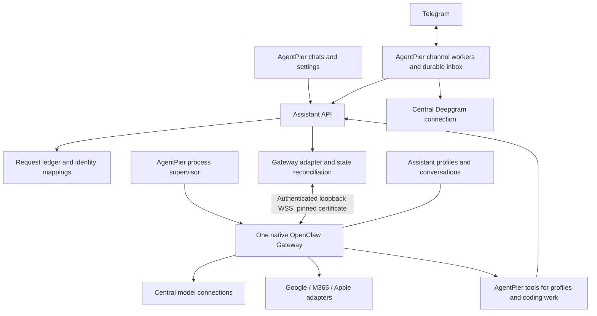

# Managed assistant Gateway design

For setup and everyday use, start with the [agents guide](agents.md).

Status: operating guide for the optional managed agent subsystem. Agents are off
until the owner turns them on; foundation, ChatGPT and provider accounts, Telegram
with Deepgram, visible teams, team coding requests, lead questions and tasks with
@-mentions, native memory, reminders, routines with the agent's tools, check-ins,
web, browser and document tools, MCP servers, shell access, skills, agents' own
Telegram bots, chat attachments and the advanced settings are implemented. Service
adapters (Gmail, Microsoft 365, Google Calendar, Apple) and a sandbox remain
deferred. Date: 2026-10-08, updated 2026-10-14.
Companion to [ADR 0002](adr/0002-managed-openclaw-assistants.md) and the
[status/recovery evidence](research/openclaw-status-recovery-spike.md).
Chronological qualification and spike logs live in `docs/research/`:
[team qualification and owner trials](research/openclaw-team-qualification-log.md)
and [native memory and automation spike](research/openclaw-native-memory-automation-spike.md).

## User-facing shape

Agent chats remain directly reachable in the sidebar, with team members nested
under their assigning assistant in two sections: permanent members (also promoted
ones) and temporary members grouped by team. A permanent member becomes a root agent
only when its lead is archived. The Agents directory manages profiles. Per-agent
settings configure instructions, models, service access and team permission.

Place shared service operation under **Settings → Workspace → Agents → Agent
service**. Call the main card **Agent service**; show OpenClaw as its managed runtime, not another
application the user must administer. The card shows readiness, host, active work,
restart preparation and diagnostics. Central model/service connections remain in
AgentPier. Technical details such as protocol, pin and private state locations are
secondary, expandable information; credentials never appear there.

The private interactive study illustrates three states with synthetic data:
ready, reconnecting, and reachable after an interrupted task. Its controls simulate
UI behavior only. DE/EN copy is included; publication does not deploy a service.

## Runtime boundary

AgentPier owns process lifecycle, user authorization, central connection references,
request identities and its UI projection. OpenClaw owns its agent loop, session
internals and model/tool execution. AgentPier owns Telegram transport and speech
transcription. The browser talks only to the
AgentPier backend. No iframe of the upstream dashboard is needed.

One Gateway hosts several assistant profiles and their conversations. A separate
Gateway is a future deployment choice for independent lifecycle/configuration; it
does not automatically form a team with the first instance. Multiple profiles or
processes on the same native host are not an OS sandbox.

## Opt-in switch

Agents are off by default. **Settings → Workspace → Agents** carries the single switch
("Enable agents"). While it is off the subsystem is dormant: AgentPier creates no `assistants/`
folder or database, starts no Gateway, poller, scheduler or background loop, installs
or downloads nothing, and shows no agent navigation or account sections. Turning it
on provisions the runtime and starts the service. The choice is stored in
`assistant-feature.json` in the data directory. Installations from before the switch
migrate to enabled when they already ran the runtime or hold a stored agent, so
existing users keep their agents. An unsafe `assistants/` folder (a link, a file, or
another owner) reports `ASSISTANT_STORAGE_UNSAFE` and is never followed or created
over.

## Starting and operating the service

1. Provision the tested package and compatible Node runtime through installation
   and update paths. Keep the runtime pin distinct from AgentPier's own Node support.
2. Allocate private state/config/workspace/log locations, a loopback listener and
   backend-only credentials. Launch an owned foreground child with a narrow env.
3. Wait for authenticated readiness. An open port or live PID alone is insufficient.
   The wait is a wall-clock budget: at least 90 s, or three times the previous
   spawn-to-ready time when that was longer, because a restart also loads the agents
   and sessions created since the first start. A Gateway that exits ends it at once.
4. Reconnect subscriptions and reconcile profile/session/run identities before
   presenting current status. Serve stored history while reconciliation is pending.
5. On unexpected exit, restart with bounded backoff. Preserve state, identify
   interrupted work and expose unresolved outcomes instead of replaying everything.
6. For a planned restart, pause new admission and let current work finish. Coordinate
   Gateway and channel ingress, not just AgentPier's HTTP queue. If work cannot drain
   in time, show the outstanding work and a separate explicit cancellation choice.
7. Keep updates explicit, with compatibility checks and backups. Rolling back a
   package does not necessarily reverse a state migration.

The supervisor, authenticated readiness, bounded restarts and the maintenance gate
are implemented (see below and [runtime updates](assistant-runtime-updates.md)).
Native crash behavior on hosts beyond the qualified ones remains a release gate.

### Gateway transport and authentication

Transport: loopback TCP with TLS and a pinned certificate, `wss://127.0.0.1:<port>`.
AgentPier probes for a free loopback port. Another local process can still take that
port before OpenClaw binds it, so the shared gateway token must reach only our own
Gateway. OpenClaw 2026.9.8 has no way for the server to prove it knows the token
during the challenge: its `connect.challenge` carries only a server nonce. It also
cannot listen on an inherited socket descriptor or a Unix domain socket: it only
calls `listen(port, host)`. It does support `gateway.tls`, so AgentPier uses that:

- On every start, AgentPier issues a fresh self-signed ECDSA P-256 certificate,
  valid for one year, in `assistants/tls/` (folder 0700, files 0600). AgentPier writes the DER encoding
  itself, so no `openssl` binary is needed. The config sets `gateway.tls.enabled`
  with these `certPath`/`keyPath` values and `autoGenerate: false`.
- For every connection, the client reads the certificate file from that private
  folder and trusts only that certificate. It also checks that the certificate's
  SHA-256 fingerprint matches. Any other certificate is rejected, even one a public
  CA would accept, and so is plain TCP or `ws://`. The pin is never learned from
  the network. A regenerated certificate takes effect on the next connection.
- The token is sent in `connect` only after the pinned TLS handshake has succeeded.
  If an impostor holds the port, the attempt fails with `ENDPOINT_UNTRUSTED`, the
  child is stopped and a restart on a fresh port follows the crash backoff. Any
  failure after the TCP connection and before the TLS handshake completes counts as
  `ENDPOINT_UNTRUSTED`; a refused connection while the Gateway is still starting is
  retried.

The Gateway serves no browser surface: every start rewrites
`gateway.controlUi.enabled` and `gateway.terminal.enabled` to `false`, also over
values an existing configuration holds. OpenClaw enables the operator terminal by
default; it gives admin-scoped clients a host shell with the Gateway's environment.

### Process ownership and supervision

`assistants/owner.json` records the Gateway's pid, its process start time, the
real path of the runtime's Node executable and the entry path. Before a new start,
the record is checked:

- **Dead pid, or pid reused:** the pid is gone, or now belongs to a process with
  another start time. The record is removed.
- **Our own orphan:** same start time and executable, and argv contains the entry
  path or OpenClaw's own process title (`openclaw-gateway`). AgentPier sends
  SIGTERM, then SIGKILL after 3 s, and then starts. This happens, for example,
  after AgentPier died under systemd's `KillMode=process`, which is kept so that
  tmux sessions survive service restarts.
- **Anything else** (another identity, EPERM, or an old record without identity):
  `OWNERSHIP_CONFLICT`. Nothing is signalled.

An `owner.json` written by an earlier AgentPier version has no `startTime`, so a
live pid in it always ends in `OWNERSHIP_CONFLICT`. Resolve it by hand once: check
the pid from the file (`ps -p <pid> -o pid,command`). If it is a leftover
`openclaw-gateway` from this data directory, stop it (`kill <pid>`); if it is an
unrelated process, leave it running. Then delete `assistants/owner.json` and start
the service under Settings → Workspace → Agents → Agent service. The next start writes a
complete record.

Executable evidence reuses the release-cleanup process checks: `/proc/<pid>/exe`
on Linux, and on macOS `ps` or, for a titled process, its mapped image via `lsof`.

If the connection is lost and five reconnects (1–16 s apart) fail, the still-running
process is restarted. Process exits and failed automatic starts retry at most five
times with exponential backoff. After that the service stays `failed` with
diagnostic `RESTART_LIMIT` until the owner starts or restarts it, which grants a
fresh retry budget.

`assistants/logs/gateway-console.log` is opened with mode 0600, and an existing
file is tightened to 0600. It is rotated at 10 MiB, keeping three files: the active
log plus `.1` and `.2`. Rotation is checked at start and every minute. OpenClaw's
own log runs at level `warn` and rotates at 10 MiB. Diagnostics flags, OTEL export
with content capture, and cache traces are switched off, so prompts are not
logged.

## Installation and update lifecycle

Installation and updates are managed product capabilities. The transactional update
workflow below is implemented for one Gateway instance (see
[runtime updates](assistant-runtime-updates.md)); independent Gateway instances are
not implemented.

The deployment unit is a Gateway instance. One instance initially serves multiple
agent profiles; adding a team member does not install another OpenClaw package.
If independent Gateways are added later, each needs a stable instance identity,
private configuration/state/workspaces/authentication, an owned process and port,
and its own active runtime selection. Verified runtime packages may be reused on
the same host; mutable state must not be shared between instances. Profiles on one
Gateway necessarily share its runtime version and update window.

The update workflow extends the current pinned installer:

1. Stage the AgentPier-qualified OpenClaw/Node combination separately from the active
   runtime. Verify package integrity and the dependency graph, platform support and
   required Gateway contracts. A failed download or validation must leave the active
   selection intact. Do not run an upstream self-updater against managed files.
2. Show current and target versions, affected assistants and blocking work under
   Settings → Workspace → Agents → Agent service. Activation is explicit; downloading a candidate must not
   implicitly migrate live state. Include enabled existing installations in the
   normal AgentPier update path, not a developer-only setup command.
3. Enter maintenance: gate new execution, coordinate Telegram/transcription/delivery
   workers, drain running work and stop the owned Gateway. Pending/uncertain effects
   must remain recorded; a timeout does not authorize cancellation or replay.
4. Take a consistent private backup of the affected Gateway state and corresponding
   AgentPier assistant/channel ledgers, including database journals and version/schema
   metadata. Preserve host-scoped credentials securely; never expose backup contents
   in diagnostic output. Define a restore boundary that excludes unrelated coding
   sessions and central account changes.
5. Activate the candidate, validate authenticated readiness, reconcile profiles,
   history and pending work, then resume admission. Persist each transition so an
   interrupted AgentPier process can recover deterministically.
6. On failure before resuming work, restore the previous compatible runtime and
   matching state snapshot when a tested restore path exists. If migrations cannot
   be safely reversed, remain stopped with a recovery explanation. Restoring only an
   old executable is insufficient. After work has resumed, downgrade is a separate
   recovery operation: restoring stale ledgers could replay real external effects.

Acceptance tests must cover fresh installs, enabled-installation upgrades, interrupted
staging/activation, rejected migrations, occupied ports, insufficient disk space,
concurrent update requests and restoration of the previous runtime/state pair.
Qualify supported macOS/Linux architectures on native hosts. Keep old runtime
packages and backups while referenced by an instance or a recovery operation;
cleanup must never delete assistant history as a side effect of uninstalling a
runtime. The product UI should expose progress, blockers and recovery actions.

The installer verifies pinned Node/npm/OpenClaw archives and a reviewed transitive
dependency lock, checks the installed package version/CLI, and preserves selection
on installation failure. Existing installations retain their selection until
explicit activation through the maintenance, snapshot and transactional update
flow. See [locked installation and transactional updates](assistant-runtime-updates.md)
for the implementation and remaining native platform/version qualification.

## Security boundaries

- **Only owner turns and a routine's own run write natively.** The write guard
  covers every native file tool (`write`, `edit`, `apply_patch`). It admits the
  owner's own turn, an owner-proven member task and, as a deliberate widening of the
  owner-only rule, the run of a routine the owner configured for that agent
  (`TeamBridge.routineWrite`, see [workflows](assistant-workflows.md)). A turn that is
  forwarded, internal, made by a team member without owner proof, or a reminder or
  check-in run, cannot change files, and no turn but the owner's changes memory
  settings, reminders or routines. Forwarded Telegram text or voice is
  quoted data, never authority. Plain-language team requests follow the rule in
  [Visible teams](#visible-teams-operation-and-recovery).
- **Bootstrap and skills protection.** The files OpenClaw loads into every prompt
  (`AGENTS.md`, `SOUL.md`, `TOOLS.md`, `IDENTITY.md`, `USER.md`, `HEARTBEAT.md`,
  `BOOTSTRAP.md`) cannot be rewritten by native tools; AgentPier owns `AGENTS.md` and
  the owner edits `USER.md` through the settings. The check folds case, Unicode
  normalization and OpenClaw's path repairs, so alternative spellings are caught.
  Skills are off unless the owner assigns them: `agents.defaults.skills` is `[]`
  (no skills for an agent without its own list), each eligible agent's
  `agents.entries.<id>.skills` holds only the bundled skills the owner switched on
  (see [Skills](#skills)), and autonomous skill review is off. `skills.allowBundled`
  is not a gate: OpenClaw reads the empty list AgentPier writes as "every bundled
  skill allowed".
- **Every file tool is guarded.** The guard's hook matches `write`, `edit` and
  `apply_patch`, every file-changing tool of OpenClaw's fs section. OpenClaw grants
  `apply_patch` wherever `write` is allowed, and hook matchers compare exact tool
  ids, so `apply_patch` must be named: until it was, a forwarded or otherwise
  unproven turn could add, change or delete workspace files and patch `AGENTS.md`
  (proven against 2026.9.9 by `assistant-write-guard-contract.test.js`, which also
  passes on 2026.10.3). A patch is
  checked on every path a hunk header names (`Add`, `Update`, `Delete`, `Move to`),
  and one refused path, or no recognizable hunk, refuses the whole patch.
  `tests/unit/assistant-write-guard-coverage.test.js` fails when AgentPier grants a
  tool that is neither read-only, guarded nor a shell tool.
- **Write guard handshake.** The bundled `agentpier-teams` plugin registers the tool
  guard inside the Gateway and reports it to AgentPier, bound to the runtime
  generation. The report is dropped on reconnect and repeated periodically (at the
  latest every 15 s). Until a current report exists, agents with memory access stay
  read-only and the status shows `WRITE_GUARD_PENDING`. Reports from a retired plugin
  registry are ignored. Every start compiles all agents without `write` and `edit`;
  once the guard is reported for the current generation and the Gateway is ready
  (whichever comes last), AgentPier re-applies every active agent with memory access
  (`WriteGuardReapply`): a hot `config.patch` per agent, each admitted on its own so
  chat turns interleave, with no restart and no interrupted turn. Agents whose model
  connection is blocked are skipped. Scheduled routines fire inside the Gateway
  without an apply of their own, so without this pass only agents that had a chat
  turn, a settings save or a **Run once** since the start could write. The pass keeps
  its generation open until every agent applied: a reconnect that drops the guard, a
  failed apply or a refused admission stops it, and the next guard report or
  readiness resumes with the remaining agents (one attempt per agent each time; a
  failure is warned once per generation). Once complete, periodic reports of the
  same generation apply nothing. A routine that fires in the seconds between
  readiness and the pass still runs read-only; overdue jobs are deferred 120 s after
  a start (see [routine qualification](assistant-routine-qualification.md)) and are
  not affected.
- **Project folders go through AgentPier, not native file tools.** Native `read`,
  `write` and `edit` keep `tools.fs.workspaceOnly`; with it off, OpenClaw would also
  read any host file for outgoing media. Granted project folders are served by
  `agentpier_workspace` file actions over the team bridge, resolved inside the folder
  on every call (`project-paths.js`: real path, no links out, no `..`, `.git` and
  AgentPier's data dir locked, case-folded), changed only with the proven guard and
  audited with path and size ([folder access](assistant-workflows.md#direct-folder-access)).
- **Approvals are audited.** Every approval, decline and withdrawal of an action
  (memory change, coding start, member coding request) is recorded with its actor,
  source and outcome.
- Profiles on one native host are not an OS sandbox; see ADR 0002 section 8.

## Status model

| Layer           | Examples                                                   | Meaning                                                               |
| --------------- | ---------------------------------------------------------- | --------------------------------------------------------------------- |
| Service         | starting, ready, reconnecting, stopped, failed             | Whether the managed runtime is reachable and usable                   |
| Reconciliation  | current, checking, uncertain                               | Whether displayed task data has been refreshed from the runtime       |
| Run             | queued, running, succeeded, failed, cancelled, interrupted | Outcome of a particular execution attempt                             |
| Action/delivery | pending, confirmed, failed, uncertain                      | Whether a requested external effect actually occurred                 |
| Agent activity  | idle, working, waiting, attention                          | Derived per agent for the sidebar dot, chat header and approval count |

Agent activity is derived on every `GET /api/assistants` from the latest request per
conversation, pending approvals and team state (`assistant-activity.js`); it is never
stored. First match wins: an unreviewed `uncertain` or `interrupted` attempt, or a
member in `uncertain` / `provisioning_uncertain`, needs **attention**; any pending
approval (own actions, team coding requests, team proposals) means **waiting**; an
unreviewed `pending` / `accepted` / `running` attempt, a working or queued member, or an
active own team means **working**; everything else, including a `failed` last attempt,
is **idle**. `pendingApprovals` carries the count shown in the chat. Clients refetch the
list on every `change` event, so a runtime failure publishes `change` after marking
outstanding attempts uncertain.

**Queued owner message.** While a conversation has an unresolved attempt, the owner's
next message waits in `queued_messages` (one row per conversation,
`queued-messages.js`): `POST /api/assistant-conversations/:id/queued` starts or extends
it (text joined on a new line, at most 65,536 characters and five staged files, a new
delivery key per change; a repeated `appendId` changes nothing; a `failed` message or
an archived agent refuses with 409), the history payload carries it as `queued` for
every tab, and `DELETE …/queued` hands it back unless its dispatch began (409), with
its files' staging time restarted. Both routes, like `…/messages`, take JSON bodies up
to 256 KB, so a full-length message in any script fits. After every reconcile pass,
and on the 2-second poll while rows wait, `dispatchQueued` (`queued-dispatch.js`)
claims each waiting row of an idle conversation (no unreviewed pending, uncertain or
interrupted attempt, a ready service, an agent that is not archived) as `sending` and
delivers it through the normal owner send, whose ledger dedupes the delivery key. A
row whose key the ledger already knows counts as delivered and is dropped, also at
startup, so a later append never sends the old text again. A 409, 503 or other server
fault returns it to `waiting` with a per-conversation backoff from 2 to 30 seconds and
publishes no `change`; a backoff behind other turns ends when they do. After ten tries
or ten minutes of retries the row is marked `retrying` (one `change`), and the card
says so while retries continue every 30 seconds. A refusal of the message itself keeps
it as `failed` with the problem text (unexpected errors show only the generic internal
error). A row that has been deliverable for more than a day (`deliverable_since`; the
clock stops while another turn runs, a 409 refusal names one, or the agent is
archived; 5xx faults and an unready service keep it running, so a host that stays down
or is restored lets the message expire) turns `failed` instead of being sent late. Its staged files are
excluded from expiry, the staging cap and removal until the message claims them or is
taken back.

Keep session keys and run IDs separate. A session can be reused for several runs;
even the same run ID can appear when an interrupted request is retried in the tested
runtime. Record AgentPier attempt and action identities separately from runtime IDs.
Do not infer completion from text arriving, a wait timeout, or a diagnostic line.
Use terminal evidence and read back the session when events were missed.

A reconnect may safely reconcile a completed turn without executing it again.
A process crash may leave external effects uncertain. Before retrying, consult the
durable action record and the destination service; surface uncertainty when neither
can establish what happened. This does not change the agreed team autonomy default.

## Creating a permanent colleague

An assistant requests a scoped AgentPier tool operation containing the intended
role, task, lifetime and selected configuration. AgentPier checks authorization and
limits, allocates its durable identity, then calls the appropriate Gateway API.

- Existing profile, new persistent chat: delegate with `sessions_spawn` and
  `visible: true`, retaining parent/task mappings.
- New durable profile: call backend `agents.create`, apply selected settings and
  references, then start its conversation. Do not turn every transient task into a
  profile or grant the model unrestricted configuration-write credentials.

Default autonomous team creation asks first; standing permission is configurable
per assistant, and an explicit team instruction (also in plain words) authorizes
that assignment. Task-bound members can be promoted to permanent colleagues from their settings; a
tool that lets a model provision a brand-new permanent profile on its own is not
implemented.

## First implementation boundary

The build order was supervision, profile/conversation mapping, direct chat and
status reconciliation, then Telegram/Deepgram, teams, memory/reminders and
workflows. Service adapters need their own connection, delivery and recovery tests.
Sandbox design stays deferred as agreed. Remaining release checks are tracked in Plane.

## Implemented foundation

The foundation now provisions OpenClaw 2026.10.3 with Node 26.7.0 in private
application data, starts one owned foreground Gateway, and waits for authenticated
protocol readiness. It is optional: enabling it in Settings → Workspace → Agents provisions
the runtime; enabled installations provision the selected version at startup after
an AgentPier update. Installation failures preserve the previous runtime selection.
The current platform probes cover macOS arm64; the manifest also pins macOS x64
and Linux arm64/x64 packages, which still require native-host qualification.

**Agent roster shape.** OpenClaw 2026.10.3 refuses to start (exit code 78,
`INVALID_CONFIG`) with an `agents.list` array or a boolean `default` marker on an
agent entry; 2026.9.x only warned. A fresh configuration therefore writes
`agents.entries: { main: {} }`, and every compile converts a legacy list into keyed
`agents.entries` (`canonicalAgentRoster()` in `runtime-config.js`). A roster of two
or more agents gets `agents.ownership: "explicit"`, and `agents.defaults.systemAgent`
and `talk` point at the former default agent. 2026.9.8, 2026.9.9 and 2026.10.3 all
accept the converted shape.

AgentPier stores assistant definitions, configuration revisions, conversations,
request identities and execution attempts in its assistant database. OpenClaw owns
its profiles and transcripts. Direct sidebar chats and per-assistant settings use
these mappings. Central API-key connections (OpenRouter, Ollama, llama.cpp, generic and Azure
OpenAI-compatible endpoints; see [model connections](assistant-model-connections.md))
and native ChatGPT OAuth profiles are selectable. Revoked keys are checked
before dispatch. Provider credentials exist only in backend private runtime files,
not public assistant definitions.

The chat/settings UI now follows the approved visual structure: shared assistant
header, direct Conversation/Settings navigation, message cards and a runtime summary
beside individual settings. A sidebar assistant without an existing chat opens its
conversation directly. Delayed chat opening cannot override a newer navigation;
drafts survive view changes. Desktop and mobile browser coverage includes the
composer remaining inside the viewport.

Normal stop/restart rejects outstanding work. Unknown-outcome recovery is a
separate deliberate chat action: review the history, acknowledge uncertainty, stop
the owned process, record that review, then restart. This does not declare the
original request successful or undo previous effects. The record retains its
unknown outcome and can accept later terminal evidence. No recovery path resends
the request automatically; a manually repeated message gets a new delivery ID.

Agents receive `session_status` plus the managed AgentPier tools their settings
enable (team, memory, reminder, routine and coding tools; see the sections below).
Gmail, Microsoft 365, Google Calendar and Apple service tools remain deferred.
This tool boundary is not an OS sandbox.

### Qualification and diagnostics

Run `node scripts/verify-assistant-runtime.mjs --data-dir /absolute/empty-directory`
from the source checkout. Use a new disposable directory: the wrapper rejects
existing application data and marks its own directories for repeated probes. The
probe downloads the pinned runtime when missing, uses a local deterministic model,
checks profile application, tool execution, durable history and crash recovery,
and shuts down its child. It needs no model credentials. Standard `npm test` skips
this opt-in probe.

The service panel separates availability from synchronization and shows a sanitized
technical diagnostic code. Logs are private under `assistants/logs`. Authentication
or startup failure terminates an owned child; invalid configuration does not enter
a restart loop. Foreign live ownership is reported without killing that process.
Unexpected exits retry at most five times with exponential backoff.

A real OpenRouter Gemini Flash request passed streaming, a `session_status` tool
loop and terminal reply verification on macOS arm64. Temporary credential copies
were removed after the test. The pinned OpenAI login uses the native device-code flow: the pinned
runtime's SIWC request differs from current OpenAI host-registration requirements;
a second native device-code attempt completed after user authorization. A real
`openai/gpt-6-astra` response and `session_status` tool call passed through that
OAuth profile. The same profile now passes a complete request through the new AgentPier account,
configuration and service adapters, with a completed durable execution record.

### ChatGPT assistant accounts

Accounts contains a separate **ChatGPT for assistants** section. Start the assistant
service first, connect using the displayed OpenAI device code, and select the
connection plus a model ID in an assistant's settings. The qualified model is
`gpt-6-astra`; availability and subscription access are determined by OpenAI.
Existing Codex CLI credentials are not implicitly imported.

OpenClaw owns OAuth state. AgentPier's private cache stores only profile references,
labels and status; public IDs are opaque hashes. Model references pin the exact
selected native profile. A missing profile fails instead of trying another
identity. The native qualification test also asserts that a missing profile cannot
fall back to an otherwise working provider key.

The device login uses the supported Gateway wizard and remains tied to its
originating connection. Only the official OpenAI URL and current device code reach
the browser. Cancellation, disconnect and expiry terminate or invalidate the
attempt; navigating away preserves its non-secret ID for resuming the display.
Sign-in is not a generic proxy for arbitrary native wizard prompts.

OpenClaw offers only the provider logins of plugins that a restrictive
`plugins.allow` lists, so the team-mode compile always allows the bundled `openai`
plugin; without it `models.authLogin` answers `INVALID_REQUEST` ("That provider login
is no longer available"). `assistant-chatgpt-login-contract.test.js` starts the
device-code sign-in on a team-mode Gateway and cancels it at the first wizard step.
A failed attempt reports one diagnostic to the browser (`LOGIN_UNAVAILABLE`,
`UNSUPPORTED_LOGIN_STEP`, `LOGIN_EXPIRED`, `CONNECTION_LOST` or `LOGIN_FAILED`),
which the Accounts page explains. The server log line adds the Gateway error code,
the wizard status and the Gateway's reason with device codes, bearer values and
token-like strings redacted.

The agent editor offers the ChatGPT model catalog of the native `main` agent. One
Gateway `models.list` read (`agentId: "main"`, `provider: "openai"`, `view: "all"`)
serves every ChatGPT account, because the accounts share that agent. Both the listed
models (live discovery) and each row's `available` flag come from the profile the
Gateway selects for the agent, not from each account: all accounts see the same
list. A profile's own `providerOutcomes` entry still withholds the list from an
account the Gateway rejected. With more than one account, an account without an
outcome is marked as checked against another account, and the editor says so.
Rows of other providers, IDs that are not bare model IDs and rows not marked
available (other than by a cooldown) are dropped; an empty list, a rejected account
and a `refreshFailed` answer whose `openai` outcome is `unavailable` count as a failed
read (`refreshFailed` alone covers every provider and is ignored). `authProfileId`
is not used: OpenClaw scopes it to personal accounts of an authenticated Gateway
user and refuses the agent's own OAuth profiles with `FORBIDDEN`.

The list is cached in memory for ten minutes; a failed or stale read is retried
after one minute, and the retry after a stale `openai` discovery is forced. Loading
the agents page or the account list starts a background read when the cache is
stale; agent runs, checks and logouts never read models. A completed sign-in and
**Refresh models** force a rediscovery: when an unforced read is already running,
the forced one runs right after it. The refresh route shares one owner budget of
twelve requests a minute. When the list cannot be loaded the editor keeps the model
ID field and says so; a custom model ID is always possible.
`assistant-chatgpt-models-contract.test.js` pins the request and row shape against
the pinned Gateway with synthetic credentials. Its discovery goes through a local
proxy that answers 401, so it never contacts chatgpt.com; a signed-in list cannot be
observed offline.

**Check connection** runs the native credential probe. **Disconnect** removes the
selected profile through OpenClaw; pending or unresolved work using that account
blocks removal. Admission is serialized with assistant creation, configuration,
dispatch and service controls so account removal cannot cross a starting request.
Stopped services show cached accounts as unavailable.

Native device-code presentation/cancellation, live credential checking, explicitly
selected OAuth inference and missing-profile rejection were qualified on macOS
arm64. Actual token expiry/renewal and provider-side revocation remain unqualified;
a successful status refresh is not evidence of token renewal. Expired credentials
get a native probe and must return to a usable state before dispatch. If they do
not, reconnect the account. No custom OAuth token refresh implementation is included.

## Telegram text and Deepgram voice

Each saved assistant can own one dedicated Telegram bot and one paired private
chat. Separately, a personal agent without shell can get its own bot for other
people, which OpenClaw runs natively for an allowlist of Telegram user ids; see the
[Telegram senders qualification](assistant-telegram-senders-qualification.md). A
bot serves only one of the two purposes.

The owner's bot has its Telegram section below the assistant settings. Enter the bot token,
open the one-time pairing link and send its `/start` message from your private
chat. Pairing expires after ten minutes. Group chats and other users do not enter
the assistant. The bot must not have another webhook or polling owner; AgentPier
does not delete existing webhooks. Re-pairing is blocked until pending work has
been resolved, both when issuing and redeeming the link. Resuming or changing
credentials invalidates outstanding links. Pause preserves queued work; disconnect
removes the local bot token. Each input retains its source chat/user; delivery
refuses a changed destination. Message deduplication includes the source chat because
Telegram message IDs are chat-local. Older records without source evidence remain
reviewable but cannot be sent by guessing a destination.

The paired conversation shares the assistant's AgentPier history. Only requests
originating in Telegram produce Telegram replies; ordinary AgentPier messages do
not send to Telegram. Input is persisted before polling acknowledgement. Stable
request identities survive duplicate updates and restart. Telegram retains unread
updates for at most 24 hours; that provider limit still applies while disconnected.

Configure Deepgram under **Accounts → Services for agents → Speech recognition**. The key stays in a
private backend store; model and language are shared by all assistant voice inputs.
The adapter uses direct HTTP, smart formatting and model-specific proper-name hints,
following the existing pattern in the user-owned Mimisbrunnr project. Voice notes
use Ogg, with a 10 MiB / ten-minute cap. Downloaded bytes are bounded during reading,
kept transiently in memory and cleared after use; no audio files are retained.
There are at most four active processing workers and eight long polls per process.

Newly accepted inputs receive one best-effort 👀 reaction. During transcription and
response processing, a separate worker refreshes Telegram's typing indicator every
four seconds. Feedback is limited to the paired source chat/user. Typing refreshes stop for blocked
or completed work; Telegram expires the last indicator after at most five seconds.
Feedback workers are aborted/joined on pause, disconnect and shutdown. Its HTTP
calls have a three-second deadline and respect provider rate-limit delays; failures
do not block the model or alter reply-delivery evidence. Reaction attempts are
recorded before HTTP and are not replayed after uncertainty or restart. These are
application acknowledgements, not control over Telegram's own read-check display.

Telegram activity shows transcription, model execution and outgoing delivery
separately, including the recognized text. Blocked inputs remain directly accessible
above recent activity even when newer messages fill the history window.
Transcription errors can be retried
explicitly. Completed model replies are selected by the exact native run identity;
other history cannot be forwarded accidentally. OpenClaw's history pages cut every
message at its default of 8,000 characters and mark the cut. AgentPier reads each
message a page cut again on its own (`chat.history` with `messageId` and `maxChars`
65,536): at most eight per page, newest first and four at a time; concurrent pages
share a running read, and the cache keeps each result, so later pages within the
cached newest messages need no new reads. The cache holds a conversation's newest 300
messages (three full pages: the newest page that the chat polls and server-side
readers use, plus room to scroll back while the Gateway is unavailable) and at most
about 4 MB of text; beyond the newest page, which always stays whole, the oldest
messages leave it first. A history read that changes nothing writes nothing. The AgentPier chat therefore shows long messages whole, the owner's own turns
included, and never shows OpenClaw's marker. A message is served in one of three
states: whole; `cut: true` when its own read confirmed it is still incomplete (over
65,536 characters, or OpenClaw's "message too large" placeholder), with a short note
that the rest is too long to show; or `partial: true` while its own read is still
due (beyond the eight of a page, a failed or unanswered read, or a page served from
the cache while the Gateway is unavailable), with a note that the rest loads
shortly. A failed or unanswered read is never taken as a confirmed cut; it is retried
after 5 seconds, doubling up to 5 minutes, and a message waiting for its retry
leaves room for older ones on the page. Each owner turn with a delivery key is
served with the `requestId` of its request, so the chat replaces the turn it shows
while a run is active by request, not by comparing texts; turns without a key still
match by text. Before a reply goes to Telegram, a partial one is read again on its
own; Telegram gets what is available of an incomplete reply and a closing note
that the reply was shortened and the rest could not be sent; lead relays do the
same. A reply is sent in at most 40
messages; beyond that bound the same note follows. Placeholders and cut markers
are never sent. Replies are split into parts of at most 4,000 UTF-16 code units (see
formatting below), preserving surrogate pairs. Each confirmed
remote message ID is recorded before proceeding to the next part. Known rate limits
wait for the provider's retry deadline.

If a send loses its acknowledgement, its outcome remains unknown across restart.
Check Telegram, then acknowledge without resending to unblock subsequent work.
This action does not resend the uncertain part or declare it delivered. An unknown
model outcome must first be reviewed in the assistant chat using its runtime
recovery flow. There is no automatic replay of uncertain model execution or output.

The automated qualification covers duplicate/foreign updates, credential redaction,
pairing, bounded voice intake, transcription failure, reply identity, Unicode
splitting, rate limits and lost delivery acknowledgement. The pinned native Gateway
contract additionally runs text and voice through the actual assistant service and
model loop with simulated Telegram/Deepgram HTTP responses. On 2026-10-07 the user's
explicitly paired private Telegram chat also passed a live text and voice round trip:
Deepgram produced a nonempty transcript, ChatGPT answered both inputs, and Telegram
acknowledged one outgoing message for each. This establishes the first live path,
not recognition accuracy across languages or long-term reliability. Credentials were
supplied through a private local file; none were imported from Mimisbrunnr.

In that trial, opening the bot manually did not complete pairing. Sending the exact
`/start <code>` command from the pairing screen completed it without the deep link.
Inputs received before pairing are discarded and must be sent again after pairing.

### Notices, language and formatting

Ingress uses long polling (`getUpdates`); there is no webhook. Inputs that cannot be
processed are answered instead of dropped silently: a message from an unpaired
person gets a short refusal (and never reaches the agent), unsupported media or
media with a caption get a notice, and a voice message longer than the limit (ten
minutes by default) is refused with the allowed duration. Inputs held for review
(unknown model outcome, uncertain delivery) sit in a separate review lane above
recent activity and are released through explicit acknowledgement.

Each channel stores two settings besides the token: `appUrl`, the address under which
the owner reaches AgentPier, and `language` (German or English). Notices that
AgentPier writes itself (approvals, decisions, work started, results) use the
channel's language and, when `appUrl` is set, end with a deep link to the team or
chat. Only the origin of `appUrl` is kept. Changing the language or address affects
notices created afterwards; an existing notice is reused unchanged, so a change never
duplicates or rewrites one. Link targets longer than 1,024 escaped characters are
sent as plain text.

Agent replies are Markdown. AgentPier renders a small subset (bold, italic,
strikethrough, code, links) as Telegram HTML and escapes all other
text. If Telegram rejects the formatted message, the same text is sent as plain text;
a send whose outcome is unknown is never retried in another format.

A long message (a reply, a routine result, a reminder, a check-in, a relayed lead
request or a notice) goes out as several messages, in order. Each part holds at most
4,000 UTF-16 code units of HTML, which keeps its visible text below Telegram's 4,096
characters, and ends at the best break that leaves it at least half full: a blank
line, a line break, a sentence end, then a space. Breaks outside any formatting are
preferred; a part never ends inside a link or inline code, and a code block only
between its lines. The whitespace at the break is dropped (in a code block only the
line break, so indentation stays). Formatting still open at a
break (bold text, a code block) is closed and reopened in the next part. Only text
without any such break, such as a single overlong word or URL, is cut at the limit,
never inside a tag, entity or surrogate pair. Parts are not numbered.

API references: [Telegram polling](https://core.telegram.org/bots/api#getupdates),
[Telegram messages](https://core.telegram.org/bots/api#sendmessage),
[Telegram files](https://core.telegram.org/bots/api#getfile),
[Telegram photos](https://core.telegram.org/bots/api#sendphoto) and
[documents](https://core.telegram.org/bots/api#senddocument) (files agents share,
see [Files agents share](#files-agents-share-2026-10-17)),
[Deepgram transcription](https://developers.deepgram.com/reference/speech-to-text/listen-pre-recorded).

## Visible teams: operation and recovery

The assigning assistant offers a team proposal by default. Approve or decline it
in the parent chat or through its paired private Telegram chat. A `/team <task>`
text command or the one-message team switch behind the composer’s "+" options
button authorizes one proposal for that request; while it is on, a "Team allowed"
chip next to the button shows it and turns it off again when tapped. An explicit
owner request in ordinary words ("build a team that …") authorizes that one team as
well: the team proposal tool carries
`ownerRequestedTeam` and a verbatim `ownerRequestQuote` (at most 300 characters),
and AgentPier admits the team without confirmation only when the quote has at
least three words, contains "team" (also inside compounds such as "Rechercheteam")
and appears as whole words in the owner's own prose of the stored user text of the
same request after whitespace and case normalization, by the same rules as a lead's
task quote (below): not in code, block quotes, links or other text the owner quoted
or pasted (also Telegram quote, code and link formatting), not after a quotation
mark, and not in a message with a negation anywhere ("do not build a team …",
"kein Team …"); such a request needs the owner's approval. The turn context comes from AgentPier's own records, never from the
model. The owner's own web and Telegram messages qualify, including transcribed
Telegram voice; forwarded content (text or voice), scheduled turns and internal
member/result turns never authorize, and one request authorizes at most one team.
The authorization records its source (`command`, `checkbox` or `ownerRequest`).
Parent settings can enable standing team permission; a plain-language request never
changes it.

Known limits: AgentPier cannot tell third-party text pasted into the web composer
from the owner's own words (only Telegram forwards are detected), and an owner
message that mentions a team in another sense ("my team meets at three") can still
be quoted by the model. The mitigation is visibility: the team card (in the proposal
and under the lead's agent settings → **Work → Teams**) and the Telegram start notice show "Started because you wrote: “…”" with the quote, and the owner
can stop the team at any time.

Default limits are four members, eight concurrent members per host and ten minutes
per member. Team size is configurable from one to eight, deadlines from one to sixty
minutes, and host capacity from four to thirty-two (never below a configured team
size). All members may run concurrently. One active team per parent, one automatic
turn per member and no nested delegation keep accepted work bounded. Cancellation
of a parent response does not cancel its team. Stop member and Stop team are separate
operations. A deadline requests cancellation; it does not prove completion or free
an uncertain slot.

Each member has its own profile, chat, instructions and model reference copied at
creation. Service and project grants start empty. Completion retains the member and
its history. Settings support explicit permanent promotion and archive/restore;
active or uncertain work blocks lifecycle and configuration changes. Promoted
members reuse the same identity and history and remain unable to create subteams
in this stage.

Provisioning persists identities before RPC. A lost profile/session acknowledgement
can only adopt a unique matching profile or labelled session. Missing or ambiguous
evidence remains blocked. Unknown setup can be explicitly acknowledged in member
settings after other requests finish. Sidebar and parent-team member buttons open
those settings when no conversation exists yet: the owned Gateway is stopped/restarted and
the member is marked failed without creating a replacement. Unknown execution uses
the existing chat recovery action. Neither recovery route replays work.

The bundled `agentpier-teams` plugin is staged privately and verified on fresh
installation and every existing-runtime provisioning path. Compatibility is pinned
to OpenClaw 2026.10.3 and its qualified rollback predecessors 2026.9.9 and 2026.9.8. Eligible parents receive the eleven managed team tools (propose, status,
stop, grant ([team member grants](#team-member-grants-2026-10-17)) and the [member tools](#lead-questions-and-tasks-for-members)) and
`session_status`; members receive only `session_status`. Direct native spawning
and alternative session mutation tools are not offered; `exec` and `process` only
under [agent shell access](#agent-shell-access-2026-10-12), which temporary members
get only through their lead's [explicit setting](#team-member-grants-2026-10-17). The private loopback
bridge binds 30-second prepare/commit tickets to the exact active attempt and
runtime generation. Credentials are never part of public team projections.

Results form one durable batch and one parent synthesis request per team. A busy
parent delays synthesis. Unknown synthesis is not resent. A terminal member without an exact-run textual
report still completes its batch with `reportAvailable: false`; unavailable or
paginated history does not turn terminal work back into running work. The member
chat retains any later history. A member's report is its run's last assistant
message with text (as OpenClaw's own channel reply; text written before a tool call
is commentary), read on its own when the history page cut it and kept whole up to
65,536 characters. Beyond that, or when OpenClaw serves it only as "message too
large", the batch entry is cut by code point and marked `cut`, and the team card
says "Shortened" with a link to the member's chat. The team record keeps only the
first 2,000 code points of each report (`truncated` when longer); the whole report
lives in its own `text` row of the team store, so the team list, the scheduler pass
and the Telegram scan stay small. The card loads the whole report from
`GET /api/assistant-teams/:id/reports/:memberId` when it is opened, and the lead's
`agentpier_team_status` tool returns the excerpts marked `shortened: true` with a
note that the whole report is in the member's chat. The synthesis request stays
below 60,000 characters (the request limit is 65,536), JSON escaping included:
when the reports do not fit, the longest are shortened first to one common length,
then the members' coding runs (tasks shortened, then only counted); every shortened
or cut entry carries `shortened: true` with the instruction that the whole report
is in that member's chat. A failed send is retried like any other admission
failure. Only a synthesis text that send's own validation rejects ends without a
retry: the team shows "The results could not be passed to the agent"
(`resultState: unsent`, `RESULT_UNSENDABLE`), the lead's chat gets a note after the
team's end, the server logs it, and a Telegram origin receives the individual
reports instead. A completed synthesis without available text sends
an explicit fallback with attributed individual reports. A Telegram team result
is read whole like a direct reply; one that stays incomplete, or a fallback over
65,536 characters, ends with "Reply shortened – the rest could not be sent." Telegram approvals and
late results use a separate durable outbox tied to the original channel/chat/user.
Telegram approval includes the full objective, names, roles and assignments. Long
proposals use ordered chunks, with buttons attached only to the last chunk after all
earlier chunks were acknowledged. Buttons expire after 24 hours and authorize only
the stored proposal revision.
UI decisions invalidate stale buttons. Pause retains notifications; unresolved
notifications block re-pairing/disconnect and remain visible in Telegram activity.
Changed destinations are rejected. Unknown delivery requires acknowledgement without
resending; ordinary replies and notifications share the same intent-before-send
and confirmed-message-ID logic.

### Lead questions and tasks for members

A lead reaches its own members without the owner relaying anything
(`lead-requests.js`, `lead-request-store.js`):

- **Tools.** `agentpier_team_members` lists the lead's members that are not
  archived with their latest questions and tasks; `agentpier_team_ask` asks one of
  them (temporary or permanent, running or finished); `agentpier_team_delegate`
  hands a task to a permanent member (one open task per member);
  `agentpier_team_cancel` cancels an open one; `agentpier_team_archive` archives the
  lead's finished temporary members without asking; `agentpier_team_member_update`
  edits a temporary member and `agentpier_team_promote` keeps one as a permanent
  agent (see below). Members never get these tools,
  and the bridge refuses them to member turns, so there are no chains.
- **Authorisation.** The server resolves the lead from the attempt and checks every
  target: own member, not archived, `lifetime: "permanent"` for tasks, finished and
  temporary for archive (checked again inside the archiving transaction). By the
  owner's decision questions and tasks never wait for an approval; they run as soon
  as the member is free. A member therefore acts on the lead's text with its own
  capabilities: a member with full shell access or bound MCP servers uses them for
  a lead's request without asking. A member whose shell is set to approval still
  asks the owner before every command of such a turn (exec approvals do not depend
  on who started the turn), and an agent with its own Telegram bot for other people
  should only lead members whose shell and servers the owner accepts for that.
- **Files.** Questions never write. A task may use `write`/`edit`/`apply_patch` in the member's
  own workspace only when the owner explicitly asked for it in this very turn
  (AgentPier chat or Telegram, not forwarded). The tool's quote must be a
  whole-word, verbatim excerpt of the owner's own prose in that message, which is
  read as for mentions (below): never code, block quotes, struck-through text,
  links, images, footnotes or HTML, nor a Telegram message's quote, code, pre,
  link or strikethrough formatting, and nothing of a message over 20000 characters
  or nested more than 24 levels. The quote must:
  - name the member: its whole display name as whole words (not when a longer name
    of another member is meant, "Max Ops" for "Max"), or a word of it of three
    letters or more that no other member carries and that is no everyday word;
  - say to ask or delegate in a verb form (`ask`, `delegate`, `assign`, `frag`,
    `fragt`, "frage den/die …", `delegier…`, `beauftrag…`, `übergib`, "gib … an",
    "lass … machen", "let … do", "hand … over"; `lead-request-proof.js`);
  - stand in a message without any negation or limit to reading, anywhere in it,
    as for mentions (owner decision; `nicht`, `kein…`, `nie`, `niemals`, "don't",
    "do not", `not`, `never`, `no`, "read only", …); the owner can send such an
    instruction on its own;
  - not follow a quotation mark, so pasted or quoted text is never the owner's
    instruction.

  An @mention is a second way (AGENTPIER-68, owner decision): when the owner's own
  message of the turn mentions a member with `@<display name>`, a task to that
  member in that turn may write without any quote or ask verb. AgentPier finds the
  mention itself, and the lead's quote never counts one. The message is parsed as
  the chat renders it (`treeMentions` in `member-mentions.js`, shared by the proof
  and the chat's chips), so a mention counts only where the owner sees a chip:
  - never in code, block quotes, struck-through text, links, URLs, images,
    footnotes or HTML, nor in a Telegram message's blockquote, code, pre,
    text_link or strikethrough entities (kept by the channel inbox as `hidden`
    ranges of the turn context), never from a character reference (`&#64;`) or an escape
    (`\@`), and never right after a letter, digit or path or markup character;
  - names match case-insensitively by a simple per-character fold, without
    normalisation, so look-alike or invisible characters mention nobody; a name two
    members share proves nothing;
  - any negation or limit to reading anywhere in the message (`nicht`, `nichts`,
    `kein…`, `ohne`, "nur lesen", "Finger weg", "in Ruhe", "don't", "isn't",
    "read-only", "just read", "hands off", "leave … alone", …) means no mention
    proves anything; the owner can send such an instruction on its own;
  - no quotation mark may come before the mention;
  - messages over 20000 characters, nested more than 24 levels or that fail to parse
    have no mentions, and at most the first 20 are looked at.

  Each mention proves one task. One owner sentence proves one task per member across
  both ways, each quote is used once and a turn proves at most three; standing team permission does not count. The grant is
  stored with the request (`writeAllowed`, `ownerProof`) and holds only during the
  task's own running attempt (`TeamBridge.toolPolicy`, `LeadRequests.mayWrite`).
  `MEMORY.md` and `memory/` stay read-only in every spelling the write guard repairs
  and through links in the workspace (`lead-request-writes.js`), so a task cannot
  plant instructions for the owner's own chats. Every other task runs read-only.
  The lead's agent settings → **Work → Teams** mark each task "may write" or "read-only".

- **Limits.** At most 16 open requests per lead, 6 per lead and minute and 8 per
  owner turn (`RATE_LIMITED` beyond), so a member answer that keeps the lead asking
  ends quickly.
- **Delivery.** A request waits until the member is free (no running turn, no
  active team assignment) and then runs as an ordinary turn in the member's chat,
  shown there as the lead's bare text with "from <lead>". The member sees only the
  question or task, never the lead's conversation. The ask tool holds the lead's
  call for at most 110 seconds counted from the moment the bridge received it:
  OpenClaw's embedded harness gives plugin tools no own timeout, and its
  stuck-session diagnostics flag a call only after two minutes. Outside pull
  requests the team plugin contract holds an ask for 115 seconds against the
  pinned Gateway. An answer that misses the wait, or whose response could not be
  written to the caller, a task result or a failure reaches the lead as a hidden
  follow-up turn (at most 60,000 characters) once its chat is idle, and from there
  the paired Telegram chat when the request came from Telegram. Follow-ups that
  keep failing end as `FOLLOW_UP_FAILED`, shown on the request.
- **Answers.** The member's answer or result is its run's last reply, kept whole
  up to 65,536 characters; the request record keeps its first 2,000 code points
  (`answerTruncated`) and the whole answer has its own `text` row, pruned with the
  request. A longer one is cut by code point and stored with `answerCut`, also when
  OpenClaw serves it only as "message too large" (no `NO_TEXT` then); the ask tool result and the follow-up then carry `shortened: true`
  and tell the lead that the whole text is in the member's chat, as does a
  follow-up shortened to fit its own limit. The request in **Work → Teams** shows
  "Shortened" with a link to that chat.
- **Tool calls and scheduled runs.** Plugin tools receive the session key but no
  run id (OpenClaw 2026.9.8 and 2026.9.9 tool context), so the bridge binds a call to the
  session's single active AgentPier attempt. Native runs never reach these tools,
  and only routine runs reach `write`/`edit`: they run in their own `cron:<job>`
  session, which has no attempt; check-ins run with `toolsAllow: ["memory_search", "memory_get"]`,
  reminders with no tools, and routines with `routineTools`, which leaves out the
  plugin's tools (pinned by the native heartbeat, reminder and routine tests). A
  routine run's `write`/`edit` pass the guard as their own origin
  (`TeamBridge.routineWrite`, see [workflows](assistant-workflows.md)).
- **Recovery.** Requests are durable records in the team store; settled ones are
  pruned after 30 days or beyond the newest 200 per lead, and the scheduling pass
  reads only open or undelivered ones. A send whose outcome is unknown at a restart
  is adopted by its stable request id instead of sent again; an unknown member
  outcome ends `failed` once reviewed and is reported to the lead. Archiving a
  member fails its queued requests.

### Coding requests from team members

Members in a team turn can request coding runs on the parent's current project
grants; [agent workflows](assistant-workflows.md#coding-requests-from-team-members)
describes the full behaviour. For operation:

- **Owner approval:** every member request waits for the owner's exact approval,
  in the parent's chat, the team card or the bound Telegram chat. The parent's
  standing permission to start pipelines never applies.
- **`GRANT_REVOKED`:** access or the pipeline definition changed between request
  and start, so the action failed and nothing ran. Grant the project again and let
  the member ask again; AgentPier never replays it.
- **Withdrawal on stop:** stopping the team or the requesting member declines its
  pending requests with `TEAM_STOPPED` (audited); they can no longer be approved.
  Runs that already started keep running and can be cancelled from their pipeline.
- **Follow-ups:** requests still open when the team finishes appear as pending in
  the team result; the parent's chat receives each one's final outcome later.

## Managed native memory and reminders (2026-10-08)

Agent settings now expose independent memory and Telegram reminder capabilities.
Existing definitions default to both disabled. Task-scoped team members get what
their lead grants them: a read-only copy of its memory and reminders created on it (see
[Team member grants](#team-member-grants-2026-10-17)); promoted permanent
members can opt in with their own settings and channel.
OpenClaw owns memory files, indexing, schedules, execution and run history.
AgentPier owns capability configuration, UI, original destination bindings and the
existing durable channel delivery outbox. It has no second memory index or clock.

### Memory

Enable **Remember information** in the agent's settings, then ask it to remember a
fact in chat. The settings panel reads and edits native `MEMORY.md` and `USER.md`,
and searches all indexed memory in that agent's workspace. Saving carries the
native expected file hash (or expected-missing flag): concurrent agent edits cause
a conflict instead of being overwritten. Reload before reconciling such a conflict.
Saving an empty note clears that file; it does not purge chat history or other
workspace notes. Native file tools stay within the workspace.

The initial managed search uses OpenClaw's keyword provider `none`, requiring no
embedding account. Transcript indexing and cross-conversation recall stay off,
scheduled check-ins replace OpenClaw's own heartbeat, and dreaming stays off (see
[Proactivity](#proactivity-check-ins-2026-10-12)).
`skills.workshop.autonomous.mode` is explicitly `off`, so
enabling cron does not also start OpenClaw's default weekly skill collection reviews.
Explicit repository memory access is now described in [agent workflows](assistant-workflows.md).
Semantic search and comprehensive deletion/re-ingestion remain follow-ups.

#### Persistence, compaction and visible failures (AGENTPIER-99)

An agent once said it had saved a plan without ever calling `write`; the conversation
was compacted and the plan was gone. Four rules close that gap:

- **Guidance.** `skipBootstrap` keeps OpenClaw's own workspace templates (and their
  "write it down" routine) out, so the managed `AGENTS.md` section
  (`assistant-bootstrap.js`) carries a short `## Memory` routine whenever memory is
  on: the conversation is compacted and is not memory; durable facts and plans go
  to `MEMORY.md`, day notes to `memory/YYYY-MM-DD.md`, written when the owner shares
  them; never claim "saved" without a successful write in the same turn; say plainly
  when a write is refused. Team members also learn that memory is read-only in
  turns their lead asks or delegates. When the agent's `write` and `edit` are
  withheld (no live guard), the section says memory is read-only right now. Turn
  admission rewrites `AGENTS.md`, so existing workspaces pick the text up on their
  next turn.
- **Pre-compaction flush.** OpenClaw 2026.10.3 runs its memory flush as a separate
  run (`trigger: "memory"`) in a detached internal session
  `agent:<id>:internal-session-effects:<runId>-<sha16>`, whose only file tool is an
  append-only `write` restricted to the day note (`memory/<date>.md`,
  "memory-triggered compaction runs expose only read and append-only write"). No
  AgentPier attempt is bound to that key, so the guard used to refuse it and the day
  note stayed empty. The source run reports the flush on its own session as the
  Gateway agent event `run_status` / `memory_flushing` (and leaves it with the next
  phase); `MemoryFlushes` follows those events. The team plugin forwards the hook's
  `runId`, and `flushWrite` (`memory-write-policy.js`) admits a write only when all
  of these hold: the tool is `write`; the key is the calling agent's flush key and
  names exactly the reported run id; the path is `memory/YYYY-MM-DD.md` for today or
  yesterday in the Gateway's user timezone (`agents.defaults.userTimezone`, else the
  host's); exactly one flush of the agent is reported, its session's single active
  attempt is the flushing run (attempt id or Gateway run id) and an owner or paired
  Telegram turn that is not forwarded, or the session is a routine run with routine
  writes; and the flush is still pinned to the first internal session that wrote for
  it. Every other key, path, tool, origin and ambiguity is refused and logged once
  per session; a flush report older than ten minutes is ignored.
  `assistant-memory-flush-contract.test.js` forces a compaction on the pinned
  runtime, checks that a forwarded run's flush writes nothing and that the owner
  run's flush appends to an existing day note.
  Residual risk: the hook sees only the tool name, path and content, not whether the
  `write` is OpenClaw's append-only flush writer, and the run-id match only ties the
  key to its own run: it does not tell a flush run from another internal
  `internal-session-effects` run. Within an owner run's flush window, another
  internal run of the same agent that wrote first could replace that day's note.
  The exposure is limited by the first-session pin (one internal session per
  flush) and the date bound (today's or yesterday's note only). Nothing in
  AgentPier starts other `internal-session-effects` runs today.
- **Summarising status.** A long conversation makes OpenClaw shorten its history
  before it answers, which can take minutes. The pinned runtime signals it on the
  source session with Gateway `agent` events: before a run (preflight,
  `runSessionCompactionIfNeeded`) `run_status` / `memory_flushing` for the flush,
  then `preparing_context` when the flush ends and the compaction model call
  follows, then `preparing_workspace` for the run itself; inside a run the
  `compaction` stream with phase `start` and `end` (`willRetry: true` keeps it
  going). OpenClaw has no own run status for the compaction call
  (`preflight_compacting` stays internal), and a preflight compaction without a
  memory flush is not signalled at all. `Compactions` (`compactions.js`) follows
  these events per session with the run id; `lifecycle` `end` or `error`, and any
  event of another run on the session (the end of a cancelled or dead run may be
  lost), ends it, a reconnect clears it and a status older than an hour expires on
  the next event or read. Only a start or end of a known conversation's compaction
  publishes `change`; the history carries `compacting: true` only while that run is
  the conversation's active attempt (its id or `runtimeRunId`), and the chat then
  shows "Summarising the conversation so far — this can take a few minutes for long
  chats." in the run
  line and "Summarising conversation" in the header. The finished compaction is a
  system message `__openclaw.kind: "compaction"` with `tokensBefore` and
  `tokensAfter` in `chat.history`; the chat history (and its cache) turns it into a
  note `compaction:<id>` at that place, which the chat shows as "Earlier messages
  were summarised (about N k → M k tokens)." Readers of replies (Telegram delivery,
  team results) take assistant turns only, and AgentPier never sets
  `agents.defaults.compaction.notifyUser`, so Telegram receives nothing.
  `assistant-compaction-contract.test.js` checks on the pinned runtime that the
  status covers the flush and the summary call but not the answer, and that the
  marker carries both token counts.
- **No silent read-only window.** After a start or reconnect the guard reports
  within one interval (15 s). An owner or paired Telegram turn of a memory agent
  waits for it, outside the admission lock, but only until 20 s after the Gateway
  became ready (`write-guard-wait.js`); turns of one conversation keep their order
  while they wait. A guard that never reports holds no later turn: it is logged once
  per readiness, and the turns run read-only. Whether a turn ran read-only is
  decided after its apply: its `AGENTS.md` then says memory is read-only, and the
  chat shows a note.
- **Visible refusals.** A refused write to `MEMORY.md` or `memory/` records one
  chat note per turn and reason (`memory-notes.js`, table `assistant_memory_notes`,
  newest 100 per conversation): forwarded content, a scheduled or automatic turn,
  a lead's task, another non-owner turn, or a refused flush. A refused flush the
  Gateway did not report (for example after a runtime change renamed the event) is
  attributed to the agent's single active owner turn, so it never goes unnoticed.
  The chat renders them as quiet lines ("Memory not saved: …").
  A declined, expired or failed project knowledge write (`memory_write`) hands one
  attributed follow-up turn (`memory-result`) to the requesting agent's
  conversation, so the agent can correct an earlier claim
  ([agent workflows](assistant-workflows.md)).

### Reminders

Enable **Allow Telegram reminders** and pair that agent's Telegram channel. Request
a reminder in chat or create a one-time/daily reminder in its settings. One-time
form values use the browser's displayed local timezone; daily schedules carry an
explicit IANA timezone. Native OpenClaw handles scheduling and timezone calculation.
The UI lists native state, next execution, run history and separate Telegram
outbox delivery status, with pause/resume and remove controls.

The `agentpier_reminder` tool is a thin authorized adapter to native
`cron.add/list/update/remove`; it does not implement scheduling. Chat mutations
require a current owner/Telegram turn. Creation keys bind the attempt and tool call;
the UI retains its creation key across retries of an unchanged form. Source bindings
store an agent, original paired destination and operation identity, not the schedule
or reminder text. Native jobs use a stable `declarationKey`; the pinned Gateway
returns declaration-based creation as `{ created, job, deliveryPreview }`.

Preparation failures can retry before submission. After uncertain submission,
recovery searches by the declaration key and never blindly creates another job.
Unresolved items remain visible for inspection/removal. Pausing and removing revoke delivery
before the native mutation, including lost acknowledgements, queued output and late
completion reconciliation. Only confirmed explicit resume restores paused delivery. Disabling reminders or archiving a permanent member/team
pauses its native jobs; restoring or re-enabling does not automatically resume them.
Runtime stop/restart refuses known active native scheduled turns as well as chats.

A private loopback receiver keeps its port and bearer token in
`assistants/reminder-webhook.json` across full application restarts; runtime updates
and rollbacks leave it in place. Host backups leave it out on purpose, because it holds a bearer secret bound to this host's port: a
restored data directory starts a new receiver, and reminders created before the
backup still name the old address, so delete and create them again after a host
restore. An occupied saved port
fails startup rather than silently changing job destinations. Incoming completions
must match the bound native job; job ID plus `runAtMs` deduplicates durable outbox
handoff. A changed Telegram pairing cannot redirect an existing reminder. The
browser receives no webhook credentials, native destinations or raw diagnostics.

Scheduled reminders have an empty tool allow-list and only return reminder text;
they do not initiate teams or service mutations. The model account and Gateway must
be available. Saved-prompt routines and manual/coding-completed events are now described in
[agent workflows](assistant-workflows.md). Service actions remain deferred. Native DST and extended downtime behavior are
covered by [schedule qualification](assistant-routine-qualification.md). Native webhook acknowledgement is
durable transfer into AgentPier, not Telegram delivery acknowledgement.

### Product qualification

The actual managed product configuration passed against pinned OpenClaw 2026.9.8
on macOS arm64 with a real ChatGPT account in disposable state:

- Agent-written synthetic memory, native read/edit/search and fresh-conversation
  recall after Gateway restart.
- Conversational native reminder creation, restart before its deadline, scheduled
  execution and exactly one acknowledged send through the existing Telegram
  adapter using a simulated transport.
- Native daily creation, pause and removal, plus full application restart with the
  same webhook endpoint, retained memory and no replay of completed delivery.

No synthetic personal Telegram messages were sent. Regression tests cover native
response shapes, stale note writes, repeated/lost acknowledgements, original source
binding, delivery deduplication, capability isolation and archival. Independent
review findings for late removal reconciliation, retryable preparation and archived
schedules were reproduced, fixed and rechecked without remaining blockers.

Historical product-stage validation: `npm run check` passed with 3,518 tests passed, 18 conditional skips and
zero failures. The relevant assistant suites passed 23/23 in Chromium and 23/23 in
WebKit; the new memory/reminder settings flow also passed on a 390-pixel viewport
in both engines after the final layout adjustment. All disposable qualification
state and copied credentials were removed after stopping the owned runtimes.

For the later merged branch, see the [release qualification](assistant-release-qualification.md).

## Web, browser and document capabilities (2026-10-11)

Agent settings group four more switches under **Web & documents**. All default to
off. Like memory and reminders, they are set only on permanent agents; archived
agents do not count. Task-scoped team members have no switches of their own and use
what their lead grants them (see [Team member grants](#team-member-grants-2026-10-17)).
The tools exist only in team mode (native teams), where AgentPier compiles them into
the Gateway's startup configuration.

| Switch             | Grants       | What it does                                                                                    |
| ------------------ | ------------ | ----------------------------------------------------------------------------------------------- |
| **Search the web** | `web_search` | Searches with the provider chosen under **Accounts → Services for agents → Web search**         |
| **Read web pages** | `web_fetch`  | Fetches a public address and reads its text; private, loopback and internal targets are refused |
| **Use a browser**  | `browser`    | Drives a separate, headless browser profile owned by AgentPier                                  |
| **Read images**    | `view_image` | Looks at images; needs a model that accepts images                                              |

Web content is untrusted data. OpenClaw wraps fetched and browsed content as
external content, and the switches do not grant any other tool.

### Managed agent browser

**Install browser** in an agent's **Agent browser** settings (shown while no separate
browser app is there) and the **Chrome for Testing** card on the dashboard install a
pinned [Chrome for Testing](https://github.com/GoogleChromeLabs/chrome-for-testing)
build without Homebrew or administrator rights (`server/features/tools/`
`chromium-installer.js`, `chromium-manifest.js`):

- The version and, per platform (`mac-arm64`, `mac-x64`, `linux64`, `linux-arm64`),
  the download URL, size and SHA-256 are pinned in `chromium-manifest.js`. Chrome for
  Testing publishes no checksums, so they were computed from the downloads when the
  version was pinned. Downloads come only from `storage.googleapis.com` over HTTPS,
  without redirects; size or hash mismatches fail before anything is unpacked.
- The archive is unpacked into `<data>/clis/.packages/chromium-<id>`, keeping file
  modes and the app bundle's relative links. `..` entry names, names that differ only
  in case, special files, absolute links and links leaving the browser folder are
  refused; no entry is written through a link unpacked before it; and once all are
  unpacked, every link must resolve (`realpath`) inside the browser folder, so a chain
  of links that leaves it together is refused as well. `<data>/clis/chromium` links to
  the active version and is switched atomically.
- macOS: AgentPier clears extended attributes (`xattr -cr`), so a quarantine flag
  never blocks the service. Chrome for Testing is only linker-signed (ad hoc, no sealed
  resources), so `codesign --verify` refuses even an untouched copy; the pinned
  SHA-256 is the integrity check.
- Every platform: `--version` must report the pinned version, and a short real start
  (`--headless=new --dump-dom about:blank` with a temporary profile, the sandbox on)
  must render a page. The sandbox is never switched off.
- Linux: `ldd` must resolve every shared library; missing ones are named in the
  error, for the owner to install with the package manager. Where the start fails and
  `kernel.apparmor_restrict_unprivileged_userns` is 1 (Ubuntu 23.10 and later), the
  error says the sandbox is blocked and points to [linux.md](linux.md).
- A full disk is reported as such. A server start sweeps an interrupted install's
  work folders and never-published version directories while no job runs; one
  process prunes at a time (the server runs one job, the installers hold the setup
  lock before the service starts).
- Detection compiles the versioned real path, so an install, update or removal
  changes the browser block. The agent settings then offer **Restart agent service**
  (`restartNeeded` in `GET /api/assistant-runtime`), with the usual confirmation.
- The dashboard card shows the installed version, **Update browser** when the
  pinned version is newer and **Remove** (`DELETE /api/tools/chromium`). Removal is
  refused (409) while an agent browser runs or the running agent service was started
  with the managed browser; stop the agent service first. An update keeps the
  previous version until the next install, so a browser still running from it is not
  pulled away.

Update path: raising the pinned version in `chromium-manifest.js` ships with an
AgentPier release. At the next server start an installed managed browser is updated
in the background (`ToolInstaller.keepChromiumCurrent`), and the installers
(`--with-agent-browser`, or any installer run on a host that has it) bring it to
the pinned version as well (`chromium-provisioning.js`). Without a managed browser
nothing is downloaded.

### Browser isolation

On request AgentPier installs its own agent browser (see "Managed agent browser"
below). `detectBrowser()` prefers that managed build, then looks in the platform's
standard locations for a browser app of the agents' own (Brave, then Chromium, then
Chrome for Testing) before Chrome, Brave, Edge or Chromium in general; the compiled
`browser` block names that one executable for every agent profile, so a profile is
always opened by the same app. The block:

- uses only OpenClaw-managed profiles (`driver: "openclaw"`). OpenClaw's implicit
  `user` profile (which attaches to the signed-in system browser) and `chrome`
  profile (extension relay) are redefined as managed profiles on their own CDP
  ports, so no profile name reaches the owner's browser;
- gives every permanent agent with **Use a browser** a persistent profile of its own,
  `agent-<id>`, with its own CDP port from Gateway port + 20. Logins and cookies
  survive restarts. Temporary team members borrow one of three member slots
  (`member-1` to `member-3`, or `member-visible-1` to `-3` when their lead's
  window is visible); AgentPier discards a slot's data when the member ends, and a
  promoted member takes it along as its own `agent-<id>` profile. Slot data no member
  holds (for example after AgentPier restarted) is discarded too;
- keeps the profile data in the Gateway's state directory
  (`assistants/state/browser/<profile>/user-data`), never in the owner's browser
  profile;
- sets `allowSystemProfileImport: false`, so the agent cannot copy cookies from a
  system browser profile, and `evaluateEnabled: false`;
- runs every profile `headless` unless the owner switches on **Visible browser** for
  the agent (**Agents → agent → Capabilities → Agent browser**). A visible window needs
  the separate agent app and a display; with only the owner's Chrome, or on Linux
  without `DISPLAY`/`WAYLAND_DISPLAY`, the profile stays headless and the setting
  says why. AgentPier passes `DISPLAY`, `WAYLAND_DISPLAY` and `XDG_RUNTIME_DIR` to
  the Gateway when they are set; it provisions no Xvfb;
- passes `--use-mock-keychain` through the global `extraArgs`. OpenClaw otherwise
  uses the macOS keychain for a new profile it launches visibly, which can prompt the
  owner from the service context. The cookies of every profile are then encrypted with
  Chromium's fixed mock key, as they already were for OpenClaw's headless profiles,
  so the profile folders count as credentials (see backups below);
- sets no `ssrfPolicy`: OpenClaw's default already blocks loopback and private
  networks, while an explicit `dangerouslyAllowPrivateNetwork: false` would make every
  navigation fail. `browser.noSandbox` is never set.

The team plugin's `before_tool_call` guard asks AgentPier (`/browser-policy`, in
`agent-browsers.js`) before every browser call. The answer pins the call to the
calling agent's own profile on the Gateway host, whatever profile the model named,
and refuses `importprofile` in any spelling; without an answer the call is refused.
Like guarded writes, the `browser` tool is offered only once the Gateway's tool guard
has reported (`guardGatedTools`); a fresh start compiles it out and the guard's report
brings it back (`write-guard-reapply.js`), also after a reconnect that lost the guard.
Owner turns of a browser agent wait for the guard like those of a memory agent, and
the runtime status reports `WRITE_GUARD_PENDING` meanwhile. AgentPier also keeps the
limits:

- at most three visible agent browsers run at once. A fourth stops the least recently
  used one that is not busy; a browser is busy while it was used in the last five
  minutes, while its agent has a run in progress, or while the owner has one of its
  windows open. With all three busy the call is refused with a message the agent
  passes on. Only calls that can launch a browser count: `status`, `profiles`,
  `doctor` and `stop` never start one;
- AgentPier watches each browser it saw launched on its CDP port. A browser that
  ended (a stop elsewhere, a crash) no longer counts, and the next launching call
  watches the new one. A Gateway reconnect keeps the tracking; a failure or a new
  start drops it;
- a browser unused for 15 minutes is stopped (`browser.request` `POST /stop`), unless
  the owner has one of its windows open; then it stops after an hour at the latest;
- a visible browser starts minimized. A small CDP client of AgentPier's on the
  profile's loopback port minimizes the windows a fresh launch opens and keeps
  focus emulation on every page, so minimized pages keep rendering for screenshots,
  clicks and typing. Windows opened later, such as a login popup or a window the owner
  restored from the Dock, are left alone. The CDP port is loopback-only and
  unauthenticated, like OpenClaw's own.

Switching the browser on for another agent, or switching a window on or off, changes
the compiled profiles and restarts the agent service after the owner confirms, like
other web tool changes. **Reset browser profile** stops the agent's browser and
deletes its profile. An archived agent keeps its profile, since archiving can be
undone, and can still reset it. While an agent's browser runs, its chat header shows
**Browser running**.

Logged-in profiles widen what a misled agent can do: a page can try to make it act on
the accounts the owner signed in to. The browser stays an opt-in per agent; sign in
only where the agent needs it, and reset the profile to sign it out everywhere. The
guard covers the browser tool only: an agent with shell access runs as the owner and
can reach every agent's unauthenticated loopback CDP port and read the profile files,
whose cookies are encrypted only with Chromium's fixed mock key.

The `browser`, `mcp`, `secrets`, `env`, `plugins` and `tools` paths are locked
against configuration overrides; the compiler rewrites the browser block on each
start and removes any `mcp` block it did not write. `channels`, `bindings`,
`session`, `commands`, `approvals`, `accessGroups` and `models.providers.deepgram`
belong to the agents' own Telegram bots and are locked as well.

Owner overrides (layer 3, `openclaw-config/overrides.js`) reach only the paths on the
allow list in `openclaw-config/advanced-settings.js`, with a value their qualified
schema accepts; every other path, including any key a future OpenClaw adds, stays
AgentPier's. Each start first removes every allow-listed path from the existing
configuration and then writes the stored overrides, so a reset override never
survives in `openclaw.json`. Stored rows that are no longer allowed or valid are
skipped and logged by path. Overrides apply only to the runtime version the allow
list was qualified against; a rolled-back runtime starts with OpenClaw's defaults.
The owner edits them under **Settings → Workspace → Agents → Agent service → Advanced settings**
(`GET`/`PUT /api/assistant-advanced-settings`, `advanced-config.js`). Labels and help
are AgentPier's own German and English texts. A `hot` or `none` setting is patched into
the running Gateway and stored only once OpenClaw accepted it; a `restart` setting
asks the owner to confirm a maintenance restart. While the Gateway is stopped, a
saved value applies at its next start. Each stored change is audited as
`setting.updated` (resourceType `setting`, the setting's `id` as resource id) with
`details.setting`, `from` and `to`; the audit schema keeps a value only as a scalar of
that setting's own type. A change undone because the confirmed restart failed is
audited as `setting.rolled-back` with outcome `failure`.

### Live view

The owner watches an agent's own browser at `/agents/<id>/browser` (**Open live view**
in the agent browser settings, or the live preview in the chat header while the
browser runs). It is view only for now; the transport carries owner commands, so a
later takeover can send input the same way.

- `browser-live-view.js` keeps one upstream screencast per agent, shared by every
  viewer. It asks the Gateway through `browser.request` for `GET /` (does the
  profile's browser run), `GET /tabs` and `POST /screencast` on the agent's own
  profile, and opens the ticket's `wsPath` on a second WebSocket pinned like the RPC
  connection (`GatewayClient.openStream`). The upstream closes when the last viewer
  leaves.
- The ticket is single-use and valid for 60 seconds; every connection mints a fresh
  one. Close code 4004 (tab closed) reconnects at once to the browser's selected tab,
  4003 (address blocked by the navigation policy) shows "This page may not be
  shown", other closes retry after two seconds.
- Without a pick the view follows the browser's selected tab and switches when the
  agent opens or closes one; the owner can pick a tab and **Follow the agent** again.
- A stopped browser shows **Start browser**, which launches the agent's profile
  within the visible-browser limit (`AgentBrowsers.ownerStart`). A watched browser
  stays tracked, so the window keeper's focus emulation keeps a minimized window
  delivering frames; an untracked running one (after an AgentPier restart) is tracked
  again within the visible limit. Only the full live view keeps a browser from the
  idle stop, for at most an hour; the chat header's preview never does, so an open
  chat cannot keep a browser running or block another agent's.
- At most eight viewers watch one agent's browser (close code 1013 beyond). An
  upstream socket that does not open within ten seconds is retried; a refresh asked
  for during another (a tab pick) runs right after it. The status line of a refused
  upgrade names its status (401 Unauthorized, 403 Forbidden). A login that ends
  closes the view with 1008, and the page then stops reconnecting.
- The web app connects to `/api/assistants/<id>/browser-stream` behind the login
  and the origin check of the chat stream. The server sends JSON state messages and
  forwards OpenClaw's binary frames unchanged (a four-byte header length, a JSON
  header, the JPEG); the chat header's preview asks for one frame a second
  (`?preview=1`). A viewer that cannot keep up loses frames instead of queuing them.
  Viewers send `select`, `follow` and `start`; anything else, and any binary
  message, closes the socket.
- Frames are never stored on disk or logged. The server keeps each stream's newest
  frame in memory and sends it to a viewer who joins, because the screencast sends a
  frame only when the page repaints (and once when it starts); a dropped upstream
  forgets it. The browser keeps only the newest as an object URL while the view is
  open, so the app's Content-Security-Policy allows `blob:` images
  (`img-src 'self' data: blob:` in `server/http/security.js`); without it every
  browser refuses the picture. The artifact viewer's policy stays without `blob:`.

### Takeover

**Take over** in the live view (or **Take over** beside the chat header's preview,
which opens the live view taking control) lets the owner use the agent's browser to
sign in, solve a check or search, and **Hand back** returns it.

- One login session of the owner holds the lease per agent (`browser-takeover.js`).
  Other devices see "You are controlling this browser on another device" and can
  **Take over here**, which moves the lease; other tabs of the same session share it.
  A chat preview never takes over or sends input. Opened with `?takeover=1`, the
  live view takes over once the picture is live and then drops the parameter.
- While the owner holds it, the tool guard refuses the agent's browser calls with
  "The owner is using this browser right now … Wait until the owner hands it back"
  (`ownerControl`). A call that was already running finishes; it may overlap the
  owner's first input.
- The lease ends on **Hand back**, after ten minutes without owner input (a warning
  a minute before), 30 seconds after the session's last full view closed, or when
  the browser stops. If the agent was refused during the lease, the end (except at a
  shutdown) queues a note in the agent's most recent chat, in English like the
  refusal: "The owner has handed the browser back to you. Continue the browser task
  where you left off." It is delivered once the agent is idle; a message the owner
  queued there already is kept and no note is added. A lease the agent never
  noticed wakes no chat. The takeover bar with **Hand back** stays visible whatever
  the picture's state.
- Input travels on the live-view socket as `pointer` (move/down/up with button,
  buttons and click count; a drag is down, moves with the button held, up),
  `wheel`, `key` (down/up with key, code and modifiers), `text` and `paste`
  (text from the owner's paste event; AgentPier never reads the clipboard). Pointer
  positions are fractions of the shown picture; `browser-input.js` maps them to the
  page with the latest frame's `cssWidth`/`cssHeight`, which are viewport
  coordinates as CDP's mouse events expect, so no scroll offset is added. Commands
  are validated, limited to 120 a second with bursts of 240 per socket, and sent in
  order as raw CDP `Input.*` events to the shown tab on the agent's own loopback
  CDP port (`CdpInput`). That channel connects only to
  `ws://127.0.0.1:<port>/devtools/browser/…` with time limits on the lookup and
  the socket, and once the lease ends (or moves) nothing queued is sent any more.
- Keys with text go as `keyDown` events: Chromium ignores the text of a
  `rawKeyDown`, so Enter (`"\r"`) submits a form and breaks a line only that way.
- A hidden text field takes the keyboard, so phones show their on-screen keyboard,
  IME composition arrives as finished text, and characters go in as inserted text;
  Enter, Backspace, Tab, Escape, Delete, arrows and page keys, and Ctrl/Cmd
  shortcuts, go as key events. A phone keyboard's Backspace and Enter arrive as
  `beforeinput` (Android reports key 229) and are sent as keys as well. A tap is a
  click and a one-finger drag scrolls (as wheel events); pinch zoom is off on the
  picture. Shift+Escape leaves the browser and focuses **Hand back**; every other key
  goes to the page.
- While the owner holds the browser, a tab it opens (an OAuth popup) is shown at once.
- Not in the picture: the browser's own windows (file pickers, HTTP sign-in dialogs,
  permission prompts) and open drop-down lists, which Chromium draws outside the
  page. A focused drop-down list follows the arrow keys and Enter. HTML drag and drop
  between elements is not supported; drags that follow the mouse (sliders) work.

### Search provider

**Accounts → Services for agents → Web search** selects one provider for all agents:

- **DuckDuckGo** (default) needs no key.
- **Perplexity** uses an existing OpenRouter connection's key; searches are billed to
  that OpenRouter account.
- **Brave Search** takes its own API key, stored in `assistants/web-search.sqlite`.
  The browser only learns whether a key is stored.

The provider plugins are bundled with the managed runtime (see
[runtime updates](assistant-runtime-updates.md#bundled-search-plugins)). The key is
written only into the provider plugin's entry in the Gateway configuration, which
OpenClaw redacts on read; it is not passed as an environment variable.

### Restart confirmation

In team mode `plugins.allow` is restrictive, and OpenClaw needs a Gateway restart to
activate the browser or a search plugin. AgentPier therefore compares the global
web-tools sections (the global tool allow list, `tools.web`, the browser block and
the search plugin) that a save would compile with those of the running Gateway:

- If they are unchanged (for example, a second agent switches on a tool another agent
  already uses), the save applies live.
- If they change, the save answers `409 ASSISTANT_RESTART_REQUIRED` and stores
  nothing. The settings page shows **Restart the agent service?** with the agents
  that will be briefly unavailable. Confirming resends the save; AgentPier then runs
  the maintenance restart used for provider changes. If an agent is busy, the save is
  refused and nothing changes.
- Switching off the last agent that uses a tool also changes the sections and asks
  for a restart.
- With the Gateway stopped, the save is stored and compiled at the next start.

Creating or archiving an agent with web capabilities, and rotating the OpenRouter
key that Perplexity uses, take effect at the next Gateway start.

### Unavailable states

- **No browser found:** the **Use a browser** switch is disabled with a hint to install
  Chrome, Brave, Edge or Chromium. An agent that already has it switched on keeps
  the setting but is not granted `browser`.
- **Search not set up** (Perplexity without a usable OpenRouter connection, Brave
  without a key): the **Search the web** switch is disabled and the web search
  settings show **Not configured**. `web_search` is withheld; OpenClaw would
  otherwise offer it and fail every call.
- **Runtime without the bundled plugins** (an installation not yet updated, or a
  rollback target): web search is unavailable until the staged update is activated.
- **Documents:** OpenClaw 2026.9.8 offers `view_image` only for models that accept
  images. `pdf` is not offered: OpenClaw needs a global `agents.defaults.pdfModel`
  for it, which AgentPier does not compile (tracked separately), so the switch
  grants `view_image` only (see [web tools qualification](assistant-web-tools-qualification.md)).
- **New agents:** the web, browser and image switches are disabled while creating an
  agent ("Available after saving the agent"); the server stores them as off on
  create. Switch them on in the agent's settings after saving.

## Agent SSH access (2026-10-16)

`agentpier_ssh` (actions `hosts`, `execute`) is compiled into an agent's `tools.allow`
only while the agent holds an SSH grant, and it is part of `routineTools`. The bridge
admits `action: "ssh"` for owner and permanent-member turns like the other personal
tools, for a temporary member only while it was granted SSH on its lead's grants
([Team member grants](#team-member-grants-2026-10-17)), and, as the only action, for a routine's run session without an attempt
(`TeamBridge.routineRun`, a bound, enabled routine with routines on). The plugin's
call budget for `ssh` is 245 seconds: a 110-second approval hold plus a 120-second
command. Forwarded, member-result, reminder, check-in and unknown turns are refused
with `SSH_ORIGIN_REFUSED`; a routine may run only on `routines` hosts
(`SSH_ROUTINE_NOT_TRUSTED`). Late approvals return as an `ssh-result` follow-up turn
that keeps the original turn's origin class. Agents with SSH grants never own a bot
for other people.

## Lead promotions of team members (2026-10-17)

`agentpier_team_promote` (lead-only, `member-promotion.js`) keeps one of the lead's
own task members as a permanent agent, directly and through the same path as the
owner's **Keep as permanent agent** (`TeamStore.promoteByLead`, the model is frozen
and the instructions are flagged for the owner's review as there). The member must
be reachable (`reachableMember`) and between turns (`active` while a turn runs);
it need not have finished its task. The promotion runs under admission, so no
turn's apply mirrors the lead's memory meanwhile; the flip, the member's history
entry and the agent's new settings are written in one transaction, then its
servers are bound, a pending shell or SSH card for it is cancelled
(`MEMBER_PROMOTED`), and its profile and check-ins are applied. Unlike the owner's
promotion:

- What the member ran with becomes its own settings, independent of the lead from
  then on: its effective capabilities (web, images, memory, reminders) and skills,
  and its MCP servers (proposal and later grants) within the lead's bindings at that
  moment, recorded as granted so the team never adds to them again.
- Shell and SSH are never carried over: its shell level is Off and it holds no SSH
  grants; the owner sets them.
- It keeps only its own memory (memory on, read and write; what it saved as a
  member carries over as it is): the copy of the lead's
  memory is removed (owner's decision: a promoted agent is a specialist, steered by
  the lead and reachable by the owner directly, with its own knowledge).
- Name and instructions stay, including the lead's edits; it stays the lead's
  member in the sidebar.

It is visible like every lead change: an entry in the member's history, a note in
the member's and the lead's chats, an audit record (`kind: "member-promote"`) and a
notice in the lead's paired Telegram chat that links to the agent's settings. The
owner can archive the agent at any time.

## Lead edits of team members (2026-10-17)

`agentpier_team_member_update` (lead-only, `member-edits.js`) changes one of the
lead's own temporary members that works on its task or is finished but still
reachable (not archived, not kept as permanent, with a chat; `reachableMember` in
`member-reach.js`, the same rule as later grants):

- `name` (as for any agent, at most 100 characters), `role` (200) and `assignment`
  (8192) update the member's record, which the sidebar, the team card and the
  Telegram texts show. Role and assignment replace the composed `Role:` and
  `Assignment:` block in the member's current instructions: the whole block (a
  multi-line assignment too), only where it starts a line and ends a paragraph, and
  the last such block before the lead's own section, so matching text in the
  lead's snapshot stays. When the owner changed or removed that block, a fresh one
  is added before the lead's section instead of editing anything.
- `extraInstructions` (8192) puts the lead's own delimited section at the end of
  the instructions, replacing an earlier one; an empty value removes it. Restating a value whose text
  the owner removed from the instructions restores it.
- `instructions` (65536) replaces the member's whole instructions, whatever the
  owner wrote before (owner's decision: the lead may rewrite them completely, since
  earlier text could interfere). It cannot be combined with `extraInstructions`.

Owner edits never block the lead. Every result is recorded as the lead's
(`leadInstructions` on the member's team record), so the member's settings show an
instructions override only for owner edits made after it. Each change is visible:
an entry in the member's log (team card and **Capabilities → Granted by the lead
agent**), a note in the
member's and the lead's chats, and an audit record (`assistant.updated`, `kind:
"member-edit"`) that names the changed fields only. The member's new revision
applies from its next turn; a running member is re-applied at once. The member's
profile and its team record change in one transaction.

The instructions an edit replaced are for the owner only. They live in a text row of
their own beside the member's record (`team-texts.js`), never in team lists or in
what the lead's tools return; the log entry names the row (`replaced`), and the
history loads the text on opening from
`GET /api/assistant-team-members/:id/replaced/:entryId`. Only the last five edits
keep their replaced text; older entries keep the changed field names only.

## Team member grants (2026-10-17)

Task-bound (temporary) team members have no capability settings of their own. Their
lead agent decides per member what it gets, when it proposes the team and later
while the member works, and it can only grant what it holds itself. What a member
runs with is resolved on every read of the member (`AssistantStore.getAssistant`,
`memberInheritance` in `member-grants.js`): each grant within what the lead holds
right now. Nothing is copied into the member's record, so the owner's **Keep as
permanent agent** keeps none of its grants: only the MCP servers named in the proposal the
owner saw stay bound, never servers granted later. The copy of the lead's memory is
removed and memory is on for its own memory, and a pending shell or SSH card for it
is cancelled. A lead's own promotion keeps the
member's effective grants instead (see
[lead promotions](#lead-promotions-of-team-members-2026-10-17)).

| Grant (proposal `grants`, tool `agentpier_team_grant`) | How a temporary member uses it                                                                                 |
| ------------------------------------------------------ | -------------------------------------------------------------------------------------------------------------- |
| `webSearch`, `webFetch`, `browser`, `documents`        | The lead's web and image tools, with the same global network and browser safety                                |
| `skills` (`true` for all of the lead's, or names)      | Those of the lead's skills                                                                                     |
| `mcpServers` (names of servers bound to the lead)      | Those servers, while the member works ([bindings](#bindings))                                                  |
| `memory`                                               | A read-only copy of the lead's memory beside the member's own memory (see below)                               |
| `reminders`                                            | Reminders created on the lead (see below)                                                                      |
| `shell` (`approval` or `full`), `ssh`                  | Only with the lead's **Team members may use shell and SSH**, at most at the lead's level and on its SSH grants |
| `github` (`read` or `write`)                           | The lead's GitHub token profile, at most at the lead's level ([GitHub for agents](#github-for-agents))         |

A member the lead grants nothing explicitly gets `memory`, `webSearch` and
`webFetch`, as far as the lead has them. Members reserved before grants existed
get the same default within the lead's ceiling, and the lead may grant them more. Team and delegation tools, routines and memory writes stay
with the lead.

- **Ceiling.** The proposal (`TeamStore.propose`) and every later grant refuse a
  grant the lead does not hold now (`TEAM_GRANT_NOT_HELD`): a capability or skill it
  lacks, a server not bound to it (`MCP_SERVER_NOT_BOUND`), a shell level above its
  own, or shell and SSH without the setting or without the lead's own shell or SSH
  grants. The grants belong to the proposal's fingerprint and are stored on the
  member's team record.
- **Live.** Every apply of a member compiles its grants within what the lead holds at
  that moment, and every member turn applies first. When the lead's entry changes (a
  capability, a skill, its shell level or its first or last SSH grant) or its team
  settings are saved, AgentPier also re-applies the lead's running members at once
  (`member-follow.js`). A capability the lead loses is gone for its members; one it
  regains comes back only where it was granted. Bridge calls (reminders, SSH) and
  exec approvals check the current state on every call.
- **Later grants.** `agentpier_team_grant` (lead-only) gives a task member of the
  lead's own team more within the same ceiling: one that works on its task, or a
  finished one the lead can still reach with questions and tasks (not archived, not
  kept as permanent, with a chat). Every turn the member runs applies its grants
  first, the turns of its lead's questions and tasks included. The lead takes grants back with
  `revoke: true` at any time (`member-grant-requests.js`). Capabilities, skills and
  MCP servers apply at once without the owner, but visibly (servers granted later
  are kept apart, `grantedMcpServerIds`, and end with the task): the member's record keeps
  a log (shown on the team card and in the member's **Capabilities → Granted by the
  lead agent**), the member's and the lead's chats get a note, and the audit records
  `assistant.updated` with `kind: "member-grant"`, the changed kinds and a server
  count, never names or content. Shell and SSH granted later always become an owner
  approval (an action card in the lead's chat and its paired Telegram chat, the
  Work tab's **Actions** list) and apply only once approved, after the ceiling is
  checked again; a card whose member ended or whose setting went off fails closed
  (`GRANT_REVOKED`). Revoking shell or SSH, the member ending, or the setting going
  off cancels such a pending card like other cancellations: a note in the lead's
  chat now and the result notice in Telegram at the next tick.
- **Memory (2026-10-17, AGENTPIER-119).** Every temporary member has its own
  native memory, always on: its `MEMORY.md` and `memory/` notes in its workspace,
  with `memory_search`, `memory_get`, `read`, `write` and `edit` (writes once the
  write guard reports). The bridge admits a member's write in any of its turns only
  when every spelling of the target, resolved on disk without following links,
  stays in its own workspace, in `MEMORY.md` or below `memory/`, and outside
  `memory/lead/` (`ownMemoryTarget` in `lead-request-writes.js`); anything else is
  refused. The lead's `memory` grant adds a read-only copy of the lead's memory in
  `memory/lead/` (`member-memory.js`): before each member turn AgentPier writes the
  lead's `MEMORY.md`, `USER.md` and `memory/` notes there flat (`note-a--b.md`; same
  name, count and size bounds as the memory panel, no links; each file goes to a
  fresh `O_EXCL` temporary name and is renamed over the target, a planted link is
  removed rather than followed, and a linked folder is never written through) and
  empties the folder once the grant goes. Memory search finds both, and the
  member's instructions say which is which. Copies from the earlier layout (the
  member's own root files identical to the lead's) are removed once. The owner
  reads a member's own memory in its **Capabilities → Own memory**.
- **Reminders.** A member granted reminders gets `agentpier_reminder` (never
  `agentpier_routine`) and may only create a reminder, in a turn its lead gave it
  (`team-member` or `lead-request`). The reminder is created on the lead: it is
  listed in the lead's settings, runs as the lead's job and is delivered to the
  lead's paired Telegram chat, so it never fires from an agent that has ended and
  the owner can pause or remove it there. The members of one team create at most
  five (`MEMBER_REMINDER_LIMIT`); each creation adds a note to the lead's chat and
  an audit record (`kind: "member-reminder"`), never the reminder's text.
- **Shell and SSH.** The lead's **Work → Team → Team members may use shell and
  SSH** is off by default. It is recorded with each team when it is proposed and
  also read live: a team proposed while it was off never gets shell or SSH.
  Switching it off latches (`TeamStore.latchShellSsh`): the lead's teams lose the
  setting for good, their members lose their shell and SSH grants (logged as the
  owner's change), pending cards are cancelled, and switching it on again restores
  nothing. A member granted shell runs at most at the lead's level; its own
  allowlist stays empty and its cards never offer **Always allow** (refused on the
  server too), so with approval every command asks and nothing outlives the task; a member granted SSH runs `agentpier_ssh` on the lead's grants as a
  delegated caller (`AssistantAccess.sshHolder`): the host's mode decides as for a
  permanent member's delegated turn, and approvals also ask in the lead's chat.
- **Approval card.** The proposal (web and Telegram) lists every member's grants and
  marks members with shell or SSH with a warning. A proposal that grants any member
  shell or SSH always waits for the owner's approval, even with a task or standing
  authorization; other teams approved automatically follow their grants.

**Security trade-offs.** Leads and members act unattended. Everything they read
from the web, documents, MCP servers or remote output is untrusted data that can try
to steer them. A prompt injection that reaches a lead can make it grant its members
more, and one that reaches a member can use every tool the member holds: web
requests (still under the private-network block), its granted MCP servers including
stdio ones, reminders to the owner's chat and, only with the setting on, shell and
SSH on the lead's grants. The mitigations are the ceiling (a lead never grants more
than it holds), visibility (notes in both chats, the team card, the member's
Capabilities tab and the audit) and the owner's approval for every shell or SSH
grant after the proposal. A member cannot change the lead's memory, start teams or
schedule routines. Keep the shell and SSH setting off unless the lead's work needs
it, and prefer `approval` modes for its shell level and SSH hosts.

## MCP servers for agents (2026-10-11)

Agents can use tools from MCP servers that the owner manages in one central list
(AGENTPIER-29). The facts behind this section are recorded in the
[MCP qualification](assistant-mcp-qualification.md).

### Central list

**Accounts → MCP servers** lists, adds, edits and removes servers. The list is
stored in `<data>/mcp-servers/servers.sqlite` (a private directory, mode 0700) and
is independent of the coding CLIs' own MCP configuration.

- **Name:** 1 to 30 letters, digits, `-` or `_`, starting with a letter, unique
  regardless of case. OpenClaw uses the name unchanged as the tool prefix, so an
  agent sees the server's tools as `<name>__<tool>`.
- **Responses** never contain header or environment values, only their names. An
  address is shown as origin and path; a query string or fragment, which can carry
  a token, stays in the store.
- **Removing** a server removes its bindings and stored values with it; the agents
  using it lose it at once.

### Transports

| Connection             | Stored                               | Compiled into `mcp.servers.<name>`                                  |
| ---------------------- | ------------------------------------ | ------------------------------------------------------------------- |
| HTTP (Streamable HTTP) | address, headers                     | `{ url, transport: "streamable-http", headers }`                    |
| SSE                    | address, headers                     | `{ url, transport: "sse", headers }`                                |
| HTTP or SSE with OAuth | address, optional scope              | `{ url, transport, auth: "oauth", oauth: { redirectUrl, scope? } }` |
| Local command (stdio)  | command, arguments, cwd, environment | `{ command, args, env, cwd? }`, `command` always an absolute path   |

`transport` is always written: without it OpenClaw falls back to SSE, which offers no
tools from a Streamable HTTP server.

### Local commands (stdio)

A stdio server runs its command with the owner's operating-system user rights and
without a sandbox. OpenClaw has no per-agent server scope: once a stdio server is
compiled, **it starts for every session of every agent**, including agents that
are not bound to it and are never offered its tools. The processes stay up until
the server is removed or the Gateway stops.

AgentPier therefore asks for explicit consent. Adding a stdio server, binding one to
an agent, and changing a stdio server's command, arguments, working directory or
environment are refused with `409 MCP_STDIO_CONFIRMATION_REQUIRED` until the owner
confirms the warning; nothing is stored before that.

**Command resolution.** On save, a bare command (`npx`, `uvx`) is resolved on the
AgentPier service's own `PATH`, not on an interactive login shell's, and the
absolute path is stored and shown as **Resolved path**. An absolute command must be
an existing executable file. The Gateway starts the process with its own
environment: its private `HOME` (`<data>/assistants/home`), no `TMPDIR`, and a
restricted `PATH`. A command found only on the owner's interactive `PATH` (nvm,
`~/.local/bin`) must be entered as an absolute path, and a server that expects the
owner's `HOME` or a `TMPDIR` does not find them.

### Bindings

- **Personal agents and permanent team members** are bound by the owner in the
  agent's settings (**MCP servers**). Archived agents get no servers.
- **Temporary team members** cannot be bound directly; the agent update refuses it.
  They get servers only through their lead's grants: optional `mcpServers` per
  member in the proposal, or later with `agentpier_team_grant` (names of servers
  bound to the lead, at most 16; any other name rejects the call with
  `MCP_SERVER_NOT_BOUND`). The approval (in the web UI and on Telegram) shows each
  member's servers by name with a stdio marker, never addresses, commands or values.
- A granted temporary member holds exactly its granted servers that its lead still
  holds, and only while it works: on its task, or on an open question or task of
  its lead after the task finished (bound when that request is dispatched, patched
  into the Gateway at the next scheduler tick). When it ends, is stopped, the
  request finishes, the lead revokes a server or loses it, the binding goes at the
  next scheduler tick; every Gateway
  start runs the same reconciliation first.
- A member approved as permanent receives its named servers once; the owner manages
  them afterwards.

**Owner decision: automatic teams.** A team that is approved automatically (by a
task authorization, `/team`, or a standing autonomous policy) passes the servers
its lead grants to the members, including stdio servers, without a per-server
approval, and so do later grants. The members can only receive servers the lead
already holds. By enabling
automatic teams the owner accepts this.

### Compilation and live changes

Only servers bound to at least one eligible agent are compiled, and only in team
mode with the native interfaces ready (the same gate as the web tools). A start
adds `bundle-mcp` to the global `tools.allow` and `<name>__*` to each bound agent's
own `tools.allow`; `plugins.allow` stays unchanged, because `bundle-mcp` is not a
plugin. A bound server that cannot be compiled (for example an unreadable stored
value) is skipped by name, with a warning, and never blocks the start.

OpenClaw reloads `mcp` and `tools.allow` hot, also under the team plugin's
restrictive `plugins.allow`. Every change (binding, unbinding, editing or removing a
server, and team members gaining or losing servers) is applied to a running Gateway
with `config.patch`, without a restart. A removed server is written as a `null`
merge with each of its arrays (`mcp.servers.<name>.args`) in `replacePaths`. Agents
whose globs change are re-applied afterwards. With the Gateway stopped, the next
start compiles the store.

### Secrets

Header and environment values are stored in the server store and reach only the
compiled `openclaw.json` (mode 0600). OpenClaw returns them redacted on
`config.get`; the contracts verify that no transcript, log or other state file
holds them. Rotated values remain in OpenClaw's configuration backups
(`openclaw.json.bak*`, `.last-good`) until those rotate out.

Runtime update backups and host backups seal every `headers` and `env` member of
`openclaw.json` (at any depth) with the backup's own key, like the other
credentials, and treat each copy beside it that parses as JSON (`.bak*`,
`.last-good`) the same way; a copy that does not parse (an unfinished atomic-write
temporary) is left out. A rollback or restore with the key restores the values;
after a credential revocation destroyed the key, they are withheld and the restore
reports `credentialsWithheld`, so the servers need their values entered again. A
host backup without credentials leaves the values out.

Host backups also capture the server store (`<data>/mcp-servers/servers.sqlite`,
AGENTPIER-42; for a packaged server this includes the package record and its lock,
but not the installed files, which **Reinstall** recreates) as a consistent SQLite
snapshot. The public archive member is a sanitized copy that keeps only the tables
and columns the store defines: server definitions and agent and CLI bindings stay. A
stdio server's command, arguments and working directory are definitions and stay
public, so put tokens into its environment, never into its arguments. Header and
environment values, the query string and fragment of each address, the OAuth login
state (`oauth_connected`, the registered login redirect) and pending or remembered
OAuth logouts are removed. So are the records of the native CLI entries AgentPier
wrote for a server with removed values or a removed address token, or for a deleted
server: an entry's hash covers its values and would let anyone test guesses of a
short one. The copy is vacuumed so no removed value survives in a free page.

A backup with credentials seals the values, the full addresses and those entry
records in its passphrase capsule (`mcp-server-secrets/servers.json`). The restore
checks them with the store's own rules, writes them back into the restored store
and never leaves that member in the new data directory; a sealed member the store
would refuse aborts the restore before anything is written, while an address it
would refuse is left out and reported. A restore without them lists each affected
server in `credentialsNeedingLogin`: `mcp:<name>` when its header or environment
values are missing, `mcp-address:<name>` when the token in its address is missing.
Enter them again under **Accounts**.

The restored instance's next start reconciles the coding CLIs: it writes managed
entries a CLI lacks and leaves entries the owner changed as conflicts. A server
restored without its values or address token has no record of the native CLI
entries AgentPier wrote (its bindings stay): an entry still in a CLI's file shows
as a taken name that **Adopt** takes over with its values, and AgentPier never
rewrites or removes it. Runtime update snapshots do not include the server store:
it stays on the host. Builds before AGENTPIER-42 refuse a backup with the store
("Unexpected backup component"); older backups, which declared the store as left
out, restore without it.

### OAuth logins (AGENTPIER-37)

A remote server (HTTP or SSE) authenticates with one of two methods, chosen under
**Authentication** in its form:

- **Headers (token):** static header values, as above. Use this for providers
  without dynamic client registration, for example GitHub: create a token there and
  enter it as an `Authorization` header.
- **OAuth:** the owner logs in once from the list; OpenClaw stores the tokens and
  refreshes them unattended. An optional scope sits under **Advanced**. Switching a
  server with stored headers to OAuth deletes those headers after a confirmation.

OAuth needs a provider that supports dynamic client registration (RFC 7591):
OpenClaw registers itself as a public client for exactly AgentPier's redirect URL.
There is no field for a client ID or secret. A provider without registration fails
the login with a message that points to the token option.

**Redirect rule.** OAuth servers compile with
`oauth.redirectUrl = <origin>/api/mcp-servers/oauth/callback`, where the origin is
the configured HTTPS remote origin (Tailscale Serve, see
[remote access](remote-access.md)) when there is one, and otherwise AgentPier's own
loopback listener `http://127.0.0.1:<port>`. A login must start from a browser that
can reach that address: from the HTTPS origin, or on the AgentPier host itself.
AgentPier refuses the start beforehand (`409`) on a plain-HTTP network address
(`plain-http-remote`: plain-HTTP network mode cannot log in) and on a remote browser
when only the loopback redirect exists (`loopback-redirect`). Changing the origin
changes the redirect, which needs a new client registration; the next login logs out
first so OpenClaw registers again.

**Login.** **Log in** runs `openclaw mcp login <name>` with the Gateway's private
environment. Because AgentPier's listener holds the redirect port, the CLI prints the
authorization URL and exits; the browser opens it. The provider redirects to the
callback, which accepts only the unguessable, single-use `state` of a login the owner
started in the last 10 minutes, runs `openclaw mcp login <name> --code <code>`, and
returns to **Accounts** with the result. Codes and tokens are never logged or
returned. After a successful login AgentPier makes one hot `mcp` change
(`mcp.sessionIdleTtlMs` toggles between unset and `0`, which mean the same): a turn
that tried the server without credentials backs it off for up to 10 minutes, and
only such a change lifts that backoff. It restarts the MCP runtimes of every session
once (stdio servers too), without a Gateway restart.

**Failure reasons.** AgentPier classifies a failed `openclaw mcp` command by its
`[openclaw] Reason:` line. OpenClaw 2026.10.3 prints that line only with
`OPENCLAW_DEBUG`, so AgentPier runs the CLI with `OPENCLAW_DEBUG=1`. OpenClaw reads
it only when it formats a failure; the stack trace it then adds on stderr is
ignored.

**Status** (from `openclaw mcp status --json`, cached for 10 seconds and refreshed
after a login or logout):

| Status            | Meaning                                                                                                                                          |
| ----------------- | ------------------------------------------------------------------------------------------------------------------------------------------------ |
| Connected         | OpenClaw holds a valid login; the expiry is shown when known. Agents bound to the server get its tools.                                          |
| Login in progress | A login started in AgentPier awaits the provider's redirect.                                                                                     |
| Login required    | The server was logged in before, or the provider revoked or refused the tokens; or an old login under this name and URL still awaits its logout. |
| Not connected     | Never logged in, or logged out.                                                                                                                  |
| Status unknown    | OpenClaw could not be asked.                                                                                                                     |

A bound server without a valid login is left out of the agent's tools; the turn
runs on without them.

**Logout, rename and delete.** **Log out** runs `openclaw mcp logout <name>`.
OpenClaw keys a login by server name and URL, so a rename, a URL change, a switch to
headers and a delete first log out under the old name and URL; the edit is saved
afterwards. Such a logout never blocks the edit: when it fails, AgentPier records
it, answers with the warning `oauth-logout-deferred`, keeps any server with the old
name and URL uncompiled ("Login required", logout pending), and retries in the
background and before every Gateway start compiles.

**Backups.** Logins live in OpenClaw's `state/openclaw.sqlite` (`mcp_oauth_stores`,
`mcp_oauth_pending_authorizations`). Host backups leave them out, with or without
credentials, and the server store's backup copy keeps no login state; a restored
host starts "Not connected" and needs a new login. Runtime
update snapshots stay on the host and keep them sealed with the other credentials,
so a rollback keeps logins; every login logged out since the snapshot is logged out
again after the rollback, before the Gateway starts (see
[runtime updates](assistant-runtime-updates.md)). The facts behind this section are
recorded in the [MCP OAuth qualification](mcp-oauth-qualification.md).

## GitHub for agents

An agent works on GitHub with one of the owner's token profiles from **Settings →
Access → GitHub connections** (AGENTPIER-129). The Work tab's **GitHub** page chooses the level
(**No access**, **Read**, **Read and write**) and the profile; the host's **Default
for agents** is preselected. The access is stored with the agent's access record
(`github: { credentialId, level }`), audited as `assistant.updated` with
`kind: "github-access"`, the profile id and both levels (never the token or the
profile's name), and named in the agent's instructions (profile, host, level and its
tool prefix). Temporary members cannot hold one of their own (409; they get it from
their lead's `github` grant); an agent with its own Telegram bot
for other people is refused it (409), and an agent with GitHub
access counts like one with a stdio server, so no such bot is compiled for it.

### MCP server

The official [GitHub MCP server](https://github.com/github/github-mcp-server) is
compiled beside the central list's servers, one stdio server per profile and level,
named `github_ro_<hash>` or `github_rw_<hash>` (the hash comes from the profile id).
An agent sees its tools as `<name>__<tool>`.

| Level   | Arguments (toolsets `repos,issues,pull_requests,actions` for both)                                           |
| ------- | ------------------------------------------------------------------------------------------------------------ |
| `read`  | `stdio --toolsets … --read-only`                                                                             |
| `write` | `stdio --toolsets … --exclude-tools actions_run_trigger,create_repository,fork_repository,delete_repository` |

`write` adds issue and pull request writes and repository contents, including
merging pull requests (`merge_pull_request`), pushing (`push_files`) and deleting
files (`delete_file`). It keeps Actions readable for CI status but never triggers,
re-runs or cancels a workflow (`actions_run_trigger`), and never creates, forks or
deletes a repository. The tool names were checked against the pinned 2.0.2 release. The server itself also hides tools whose classic
scopes the token lacks. The token reaches the server only through its environment
(`GITHUB_PERSONAL_ACCESS_TOKEN`; `GITHUB_HOST` for a GitHub Enterprise host) in the
compiled `openclaw.json`, like every stdio server's values: never in its arguments,
the agent's instructions, a response or AgentPier's own state. Because OpenClaw
starts every compiled stdio server for every session (see
[stdio servers](#local-commands-stdio)), agents that share a profile and level share
one server. Each distinct profile and level still costs one server process per OpenClaw
session, about 45 MB of memory each; read and write stay separate servers because the
server-side `--read-only` is the stronger limit. A store server with the same name
wins.

A rotated token, a deleted profile and every access change are patched into a running
Gateway at once (the compiled signature includes the env values) and the affected
agents are re-applied; a deleted profile removes the server. A lead's grant change
converges at the next scheduler tick. Members get the lead's server at the lower of
both levels.

**Installation.** The server is a managed tool below `<data>/clis`: a pinned release
(`server/features/tools/github-mcp-manifest.js`, version and per-platform SHA-256 and
size for macOS and Linux on x64 and arm64), unpacked to `clis/.packages/github-mcp-*`
and activated through the `clis/github-mcp-server` link after its `--version`
matches. AgentPier installs it in the background when an agent first gets GitHub
access; the Work tab shows the state and **Try again** after a failure. An AgentPier
update that pins a newer version updates an installed server at the next server start
and through the installer (`setup.sh`, `release-install.mjs`); the previous version
stays until the next update, so running servers keep their files. Without the server
the agent has no GitHub tools, and its instructions say so.

**Token scopes.** When a profile's token check records its classic scopes, the page
warns if `repo` is missing. Fine-grained tokens report no scopes and are not checked;
their permissions set the limit.

### Shell

An agent with shell and GitHub access gets its own folder
`<data>/github-sessions/agent-<id>/`, laid out like a session's (`config.yml`,
`hosts.yml` with the token, `selection.json`), plus `shell-env.sh` and an empty
`bin/`. `bin/` comes first in the agent's `tools.exec.pathPrepend`; the exec wrapper
(`exec-shell.js`) sources `shell-env.sh` from the first such entry on `PATH`. It sets
`GH_CONFIG_DIR` to the folder, unsets `GH_TOKEN`, `GITHUB_TOKEN` and the other
override variables, and routes git's HTTPS authentication for that host through
AgentPier's helper alone (`credential.https://<host>.helper` and
`gist.<host>`, owner helpers cleared, the quit helper after it; the shared
`gitCredentialConfig()` with the stable helper location of sessions, started with
`--session <folder>` like an owner shell's), plus the profile's commit identity and, for a GitHub
Enterprise profile, `GH_HOST`. The same directories (the marker and the managed
`gh`) also feed the approval analysis, so **Always allow** resolves `gh` as it runs. `shell-env.sh` holds no
token, so `env` in the agent's shell shows none; `gh` and the helper read it from
`hosts.yml`. Token rotation and deletion update `hosts.yml` with the sessions' sync. An
agent without shell or without GitHub access has no folder on its `PATH`, and the
folder is removed at the next refresh or Gateway start. The token never appears in the
agent's instructions or files, but with shell access the agent runs as the owner and
can read it like the owner can. Like sessions, this separates
configurations, not operating-system users: a command with shell runs as the owner.

## Agent shell access (2026-10-12)

Agents can run command-line programs on the host through OpenClaw's `exec` and
`process` tools (AGENTPIER-25). The facts behind this section are recorded in the
[shell qualification](assistant-shell-qualification.md).

### Levels

Each personal agent and each permanent team member has a shell level in its
settings (**Shell access**). New agents start with **Off**.

| Level         | Compiled for the agent                                | Behavior                                                        |
| ------------- | ----------------------------------------------------- | --------------------------------------------------------------- |
| Off           | no `exec` or `process` in the agent's `tools.allow`   | The agent is offered no shell tool at all.                      |
| With approval | `tools.exec: { mode: "ask", strictInlineEval: true }` | Every command not on the agent's allowlist waits for the owner. |
| Full access   | `tools.exec: { mode: "full" }`                        | Every command runs at once, without asking.                     |

Both shell levels also carry `pathPrepend` (see below). While any eligible agent
has shell, the global `tools.allow` includes `exec` and `process`; the global
`tools.exec.mode` stays `deny`, and an agent without shell keeps both tools out of
its own `tools.allow`, because a global `deny` alone still offers the tool.

- **Temporary (task-bound) team members have no shell level of their own.** The
  agent update refuses any level other than Off with 400, the compiler ignores a
  stored level, and the allowlist routes refuse them. They get at most their lead's
  level only when granted while the lead's **Team members may use shell and SSH** is on (see
  [Team member grants](#team-member-grants-2026-10-17)). Archived agents
  have none.
- **Confirmation.** Raising the level needs the owner's confirmation of the
  warning (`confirmShell`); raising it to Full access needs a second one
  (`confirmFull`). Without them the update (and the creation of an agent with
  shell) answers `409 ASSISTANT_SHELL_CONFIRMATION_REQUIRED` naming the missing
  confirmations, and nothing is stored. Lowering never asks.
- **Live changes.** Every level change applies to the running Gateway with
  `config.patch`, without a restart. Lowering applies even while a turn of the agent
  runs; a settings form that also sends its unchanged fields counts as a lowering
  only. Switching to Off first denies the agent's requests still awaiting the
  owner (their actions end with diagnostic `SHELL_OFF`; a deny the Gateway could
  not receive is sent again at the next ready), then aborts the agent's running
  turns, which ends a command running in the foreground. **A command moved to the
  background (`process`) keeps running:** OpenClaw 2026.9.8 offers no way to end
  background sessions from outside the agent's own `process` tool, and neither an
  abort nor a session reset stops them. A Gateway stop or restart (including stopping or
  updating AgentPier) ends them on Linux, where OpenClaw starts commands through
  its spawn broker, which terminates its children when the Gateway goes away; on
  macOS they keep running (see the
  [shell qualification](assistant-shell-qualification.md#h-aborting-turns-and-background-commands)).
  If a lowering cannot be
  applied, AgentPier tries once more, then aborts the agent's running turns and
  denies its pending requests, so nothing keeps running at the higher level; the
  level stays pending (shown in the settings) and is retried with backoff and at
  every ready. A stopped Gateway compiles the stored level at its next start.

**Warning shown before shell is turned on:** with shell access the agent works as
the owner's user account, with the owner's logins, files and keys, and it can read
AgentPier's own data. The team write guard does not cover shell commands. There is
no sandbox (see [ADR 0002](adr/0002-managed-openclaw-assistants.md)). With Off, the
settings explain that skills and tools needing command-line programs (gh, git, mail
programs) do not work.

### Environment of shell commands

Commands run as the owner: **with the owner's real `HOME` and login `PATH`, while
the Gateway itself keeps its private `HOME`, state and configuration.**

- OpenClaw has no exec environment setting and refuses a per-call `HOME`, so every
  Gateway start points its `SHELL` to a wrapper,
  `<data>/assistants/exec-shell/sh` (mode 0500 in a private folder), that exports
  the owner's `HOME` (shell-quoted) and hands over to `/bin/sh`. The wrapper is
  Gateway-wide; only agents with shell are offered `exec`.
- The owner's `HOME` comes from the user database (`os.userInfo().homedir`), not
  from `$HOME`. The `PATH` is computed without starting a login shell (which would
  run the owner's profile scripts): the AgentPier service's own `PATH` plus the
  package manager directories that exist (`/opt/homebrew/bin`, `/usr/local/bin`,
  `/home/linuxbrew/.linuxbrew/bin`). It reaches the agents with shell as
  `tools.exec.pathPrepend`, so the approval analysis resolves the same programs
  that run. A tool found only on the owner's interactive `PATH` (nvm,
  `~/.local/bin`) must be called by its absolute path or added to the service's
  `PATH`.
- Behind these directories OpenClaw adds the `PATH` of a system login shell
  (`/bin/sh -l` with the Gateway's private `HOME`, so `/etc/profile` and on macOS
  `path_helper`, never the owner's profile) and the Gateway's own `PATH`. Programs
  installed system-wide (`/usr/bin`, and the Homebrew directories) are therefore
  found even without the owner `PATH`.
- The Gateway process itself gets the same directories in its own `PATH`, behind
  the runtime's Node and ahead of `/usr/bin:/bin`. OpenClaw checks the programs a
  skill requires on the Gateway's `PATH`, so without them Homebrew tools such as
  `gh` or `himalaya` would count as missing and their skills would not load. This
  grants nothing beyond what exec already receives (the owner's directories come
  before `/usr/bin:/bin`, so a user-writable one such as `~/bin` can shadow system
  tools for the Gateway process as it already can for exec); the directories are computed
  at every Gateway start, so an AgentPier update applies it without manual steps.
- If the owner account cannot be resolved, the Gateway starts without the wrapper
  and logs a diagnostic; commands then run with the private `HOME`, and the
  Gateway's `PATH` is only the runtime's Node, `/usr/bin` and `/bin`.
- The Gateway token is only in `gateway.auth.token`; `OPENCLAW_GATEWAY_TOKEN` is
  not in the Gateway's environment, so no command sees it.

### Approvals in the web and on Telegram

Under With approval, each request (`exec.approval.requested`, received by the
supervisor's own client with the `exec-approvals` cap) becomes an agent action
awaiting the owner, attributed through the request's agent and session to the
agent and conversation. A request AgentPier cannot attribute (unknown agent or
session, or shell Off) is denied at once. The action shows the command, folder,
agent, expiry (30 minutes) and OpenClaw's notes, with **Allow once**, **Always
allow** and **Deny**.

- The card appears in the agent chat, a permanent team member's own chat included,
  and under Settings → Work → Actions. When the member's turn was delegated by its
  lead (a lead's question or task, or a team assignment), the action also records
  `leadAssistantId`: the lead's chat lists the same action and counts it in its
  approval strip, so the owner can decide from either chat; the decision ends it in
  both. A direct chat with the member asks only there. The lead agent's own
  `actions` tool does not list it. A turn that came from Telegram also gets the
  three buttons in that private chat, for the owner only; the existing stale and
  private-chat rules apply. So does a member's turn for a lead's request or a team
  assignment whose lead turn the owner sent from Telegram (not forwarded): the
  member's turn context carries that chat (`telegram`, `ownerTelegram` in
  `team-coding.js`), and the approval is offered there and in the web (owner
  decision). Each decision goes to the Gateway exactly once and is
  audited (`assistant.answered`, with the allowlist outcome).
- While a turn waits for an approval, the chat header says **Awaiting approval**, as
  the sidebar does, instead of the turn's accepted or running state.
- Allow once runs the command once; Deny never runs it.
- Events missed while disconnected are reconciled at every ready against
  `exec.approval.list` and `approval.history`. A Gateway restart cancels pending
  requests; their actions end as cancelled, never stay waiting, and a late
  decision answers 409. The command does not run.

### Always allow

- **Offered by OpenClaw** (programs in system directories, such as `/usr/bin/git`):
  OpenClaw adds an entry bound to the exact arguments and folder, plus a command
  companion. The same command then runs without asking; other arguments ask again.
- **AgentPier's fallback (owner decision).** OpenClaw withholds Always allow for
  programs in folders the owner can write to (Homebrew, `~/.local/bin`, npm global
  bins). AgentPier still offers it: it resolves the request with allow-once and
  writes one program-path entry per program of the command, each allowing that
  program **with any arguments**; a pipeline gets one entry per program. The plan
  is computed when the request arrives, shown on the card before the owner
  confirms, and written unchanged. The card warns that programs whose arguments can
  run other commands (git hooks, aliases) are covered too, and names the
  owner-writable programs: if one is replaced, the new version runs without asking.
- **Never an entry** (the command is allowed once and asks again next time):
  interpreters, shells, launchers and wrappers, package managers and build drivers
  (a superset of OpenClaw's own lists, checked against the installed runtime by a
  contract); inline scripts; commands with substitutions, subshells, control
  structures, background jobs, environment assignments or variables; programs that
  cannot be resolved to a real path. OpenClaw itself always denies commands with
  redirections (`>` or `<`) for owner-writable programs, with or without an entry.
- **"Unresolved" is expected, not an error.** AgentPier computes the plan when the
  request arrives, from its own view of the file system: it resolves each program
  through the agent's `pathPrepend` and the system directories and compares the
  first one with OpenClaw's `resolvedPath`. When they differ (for example when a
  tool exists in two `PATH` folders and OpenClaw picks the other one), or a program
  cannot be found, the plan is `unresolved`: Always allow then allows the command
  once and asks again next time.

### Allowlist management

The agent settings list **Always allowed commands** (`GET
/api/assistants/:id/shell-allowlist`): the program or command, whether it allows any
arguments or only the approved ones, who added it (AgentPier, OpenClaw, elsewhere),
the command it was approved for where AgentPier knows it, and the last use.
OpenClaw's command companions are folded into their program entry. **Delete**
(`DELETE /api/assistants/:id/shell-allowlist/:entry`) removes the entry with its
companions through `exec.approvals.set` with the current base hash; the next
matching command asks again. Deletes are audited.

### Backups and stored levels

A host backup holds the agents' records and the Gateway's private state, so
restoring it brings back each agent's stored shell level and its allowlist entries
**without a new confirmation**. That is deliberate: the owner starts the restore
and returns to levels and entries they confirmed before. The same holds when an
archived permanent member is restored, and when a level is raised again over
entries that survived an earlier lowering (entries are only removed by deleting
them). Check the agent settings after a restore if in doubt.

## Skills

OpenClaw bundles skills: short instructions (`SKILL.md`) that teach an agent a tool,
mostly a command-line program such as `gh`, `himalaya` or `tmux`. In **Capabilities →
Skills** the owner switches bundled skills on per agent. Only personal agents and
promoted permanent members have a selection of their own; temporary members use
their lead's current selection, archived agents have none, and a new agent starts
without any.

- **Compilation.** The selection is stored on the agent profile (`skills`, sorted
  names) and compiled into `agents.entries.<id>.skills`, which OpenClaw reads as the
  agent's final allow list. `agents.defaults.skills` stays `[]`, so every agent
  without its own list has no skills, and every Gateway start removes lists from
  entries AgentPier does not manage. `skills.allowBundled` is not a gate: OpenClaw reads the empty list
  as "every bundled skill allowed"; the agents' own lists are.
- **Live changes.** A save applies with `config.patch` (`reloadKind: "hot"`); a shorter
  or removed list names `agents.entries.<id>.skills` in `replacePaths`. OpenClaw
  refreshes the skill snapshot at the agent's next turn, without a Gateway restart.
  The save is audited as `assistant.updated` with the skill names. Like any other
  capability change, a save waits while the agent works on a turn (409 `active`),
  although skills only apply at its next turn.
- **Status.** `GET /api/assistants/:id/skills` reads `skills.status` for the agent
  from the running Gateway (503 while it is not ready). Each skill is **ready**,
  **missing** something (programs, any-of programs, environment variables or API
  keys, configuration, or the operating system), **unsupported** on this system,
  **disabled**, **unavailable** (an assigned name the runtime no longer bundles) or
  **shadowed**. The browser never receives file or base paths, install options or
  configuration checks, and host directories are cut out of every text. Upstream
  descriptions stay in their original language. Entering API keys is not offered;
  the page only names what is missing.
- **Only bundled skills.** A save is refused (409 `skillUnavailable`) for a name that
  the running Gateway does not report as an `openclaw-bundled` skill: ClawHub,
  managed, Custodian and workspace skills are never assignable. Names already
  assigned can always be kept or removed, also while the Gateway is down.
- **Shadowed skills are never compiled.** OpenClaw matches an agent's list by name
  across all sources, and a skill in the agent's workspace (`skills/`,
  `.agents/skills/`) or in the Gateway's managed or personal folders wins over the
  bundled one. Shell commands run as the owner and could plant such a folder, so the
  owner's switch for a bundled skill must not load it. Every compile (Gateway start
  and live apply) drops an assigned name that a skill in those folders carries (by
  folder or frontmatter name, a few levels deep, which over-approximates OpenClaw's
  discovery), and a live apply also drops any name `skills.status` resolves to
  another source. The owner's choice stays stored: the page shows the skill as
  **shadowed** and off for this agent, adding such a skill is refused, and it applies
  again once the other skill is gone. Owner turns apply the agent before they start,
  and the Gateway's `skills.changed` event re-applies every agent with skills.
- **Programs.** OpenClaw checks the programs a skill requires on the Gateway's
  `PATH`, which carries the owner's login `PATH` (see
  [Environment of shell commands](#environment-of-shell-commands)). Most skills run
  those programs through `exec`: the page marks them **needs shell access** while the
  agent's shell is off. An allow list is visibility, not an authorization boundary;
  shell remains the real gate.
- **Warnings.** Every bundled skill is listed. Skills that install foreign code
  (`clawhub`, `skill-creator`), steer the Gateway (`control-ui`, `node-connect`),
  change the host (`healthcheck`), duplicate an AgentPier feature (`coding-agent`,
  `visualize`, `mcporter`) or reach secrets (`1password`) show a warning before they
  are switched on.
- **`skills_read`.** OpenClaw 2026.10.3 also grants the read-only `skills_read` tool
  to every agent whose allow list contains `read`: all agents with memory, and
  routine runs. It returns only skills that are installed and eligible for that
  agent. The owner accepted this grant.
- **macOS privacy.** Programs such as `remindctl`, `memo` or `peekaboo` need Reminders,
  Notes or Screen Recording permission for the process that runs them. A background
  service cannot show the prompt; grant it in System Settings if a skill fails.

## Proactivity: check-ins (2026-10-12)

The **Acting on its own** group in an agent's settings (section **Proactivity**)
holds the check-in opt-in. It is off by default, and only personal agents and
promoted permanent members have it. Changes are audited as `assistant.updated` with
`kind: "proactivity"`, `fields: ["heartbeat"]` and the new on/off flag; never a
schedule, time zone or text. Clients that do not send the field keep the stored
value.

### Check-ins (heartbeat)

**Check in on its own** lets the agent look at its conversation at set times: every
hour, 2 hours, 4 hours or once a day, within active hours (start to before end, whole
hours, within one day) in the owner's time zone, which the browser supplies; the
settings offer to adopt the browser's zone when the saved one differs. The agent is
asked whether something needs the owner's attention and to answer exactly
`NO_REPLY` otherwise. The settings show the cost as model runs per day, each reading
the recent conversation.

Check-ins need **Remember information** (`heartbeatMemoryRequired`, 409): the
agent's notes are what it checks against. The settings disable the switch without
memory, and switching memory off switches check-ins off in the same save. A save
that sends check-ins switched on without memory is refused; a client that does not
send them (an older one) may still switch memory off, and the stored flag then has
no effect: the agent keeps no job. They also need a paired, enabled Telegram chat
(`heartbeatChannelRequired`, 409); a new agent switches check-ins on after saving.

It is not OpenClaw's native heartbeat, which stays at `agents.defaults.heartbeat.every:
"0m"`: that one delivers through OpenClaw channels, which AgentPier leaves empty. Each
opted-in agent instead gets one native cron job
(`server/features/assistants/native-heartbeats.js`) bound to the conversation its
Telegram chat is paired with (the session `openConversation` created):

- `sessionTarget: "current"` with that conversation's `sessionKey`: a detached run
  that reads the conversation's recent tail and the agent's instructions
  (`lightContext: false`), then commits its visible result into that conversation.
  Each run reads the conversation as it is then, not as it was when the job was
  created, and after an owner `/reset` or `/new` it reads and commits into the new
  session, so the job is never recreated for that. OpenClaw waits for a running
  turn there to end before it commits, so a check-in that comes due while the
  owner's turn runs appears after that turn's answer, never inside it; the run
  itself does not wait, so it may not know that answer yet. The owner's next
  message, in AgentPier or on Telegram, has the check-in in its context.
- AgentPier sends a check-in to Telegram only when the completion event reports the
  commit into the conversation as `delivered`; a check-in that did not reach the
  conversation stays in the run history. In the AgentPier chat it shows as a plain
  agent message, without the `Check-in:` marker Telegram gets.
- MEMORY.md is not part of a detached run's prompt (a chat turn's is), so the
  check-in prompt asks the agent to read it with `memory_get` first; the run's tools
  are `memory_search` and `memory_get` only, so nothing is written unattended.
- `delivery: { mode: "announce", completionDestination: { mode: "webhook" } }`:
  announce is the session commit (no channels are configured), the completion
  webhook is the reminder receiver. A `NO_REPLY` result is silent: nothing is
  committed (the conversation shows no message; OpenClaw records the run as
  not delivered), and AgentPier drops the posted `NO_REPLY` summary.
- A new or re-paired conversation retires the job and creates one for the new
  session key.

The binding (kind `heartbeat`, hidden from reminder and routine lists) fixes the
paired Telegram destination when the job is created. AgentPier drops an empty or
`NO_REPLY` summary and failed runs; anything else goes, prefixed with `Check-in:`
(server message `heartbeatPrefix`, in the chat's language), to the outbox of that
paired chat (kind `heartbeat`) plus an `agent-checkin` push notice that names only the
agent. The model's text never chooses a recipient. The push is sent when the
check-in is handed to the outbox, not after Telegram accepted it. Native
`chat.inject` was evaluated for the reply context first and rejected: gateway-injected
notes appear in the transcript but never reach the model.

A saved change converges the job at once (update in place, or removal when switched
off). So do changes of the paired chat (`ChannelService.channelChanged`): starting a
new pairing or disabling, disconnecting or halting the chat retires the job,
completing a pairing creates one bound to the new chat. Archiving a member retires
its job and restoring it schedules one again. Every Gateway ready and every end of
maintenance repeats the convergence for all agents. Maintenance switches the whole
scheduler off. Agents whose model connection is blocked, archived members, agents
without memory and agents without a paired chat keep no job, and queued check-ins of
such agents are not sent. Switching reminders off pauses an agent's jobs, and the
same save schedules its check-ins again. A creation whose acknowledgement was lost
stays tracked until a listing shows its job; the job's first completion adopts it.

The heartbeat contract (`tests/integration/assistant-heartbeat-contract.test.js`)
force-runs the job on the pinned runtime with the compiled native configuration: the
check-in sees the agent's instructions and the conversation, reads MEMORY.md through
`memory_get`, reaches the paired chat once with its prefix, appears in the
conversation, and is in the model input of the owner's next reply. `NO_REPLY` leaves
no visible message and sends nothing. A check-in due during a running owner turn is
committed after that turn's answer. A message sent after the job was created reaches
the next check-in's model input, and after an owner `/reset` and `/new` the same job
reads only the new session and commits into it (`deliveryStatus: "delivered"`). The
agent's native heartbeat job stays disabled, and switching off removes the job.

### Recall across conversations is not offered yet

AgentPier keeps OpenClaw's cross-conversation recall off
(`memory.search.rememberAcrossConversations: false`, transcripts not indexed). Each
agent has one conversation, which its AgentPier chat and its paired Telegram chat
share, so the recall pass would have little to find while costing extra model calls.

`tools.sessions.visibility` is `"agent"` on every Gateway: OpenClaw's default
`"all"` lets session tools reach other agents' transcripts. Teams do not use
OpenClaw session tools (members run in their own sessions and report through the
AgentPier bridge), and the team plugin contract passes with it.

### Dreaming is not offered

OpenClaw's dreaming (`plugins.entries.memory-core.config.dreaming`) stays disabled
and the agents runtime settings have no switch for it. The dreaming contract
(`tests/integration/assistant-dreaming-contract.test.js`) shows why: once enabled on the
pinned runtime, memory-core schedules one nightly sweep (`0 3 * * *`) over every
configured agent workspace. AgentPier conversations count as interactive sessions,
so it does process them, but it also copied the transcripts of an agent without the
memory capability into that agent's `memory/.dreams/session-corpus` and wrote light
and REM phase notes and a Dream Diary there. 2026.9.8 offers no per-agent scope
(`memoryPolicy.excludeSessions` filters by channel, chat type or hook source only),
so a switch limited to agents with memory cannot be built yet.

## Chat attachments (2026-10-13)

The owner can attach up to five files of at most 10 MB each to a message in the
agent chat, to the lead agent and in the direct chat with a team member: "+" >
"Attach file, image or video", paste or drag and drop. Accepted are JPEG, PNG, WebP,
GIF and HEIC images, PDF and UTF-8 text files with a known text or code extension, and
videos (see below). The server decides by the bytes, never by the name or the browser's
type.

- **Storage.** Each file is uploaded when it is picked and copied into
  `attachments/` of the receiving agent's own workspace under a generated name
  (`<date>-<time>-<random>-<safe name>`), mode 0600. The folder must be a real
  directory inside the agent's real workspace; a link there refuses the upload. The
  index (name, type, size, request) lives in the assistants database, never in the
  workspace. Unsent uploads expire after a day, and a page that is closed or reloaded
  discards its own. A conversation keeps at most 20 unsent uploads; a further one
  replaces the oldest, so files abandoned elsewhere never block a new message. Each
  agent holds at most 1 GB or 1000 files there. When the agent deletes a sent copy,
  the chat history keeps the message without that file.
- **Delivery.** `sessions.send` carries the owner's text followed by a note that
  names each saved copy by its workspace-relative path, so the agent can read it with
  its tools. Images the agent's model accepts also travel inline as `attachments`
  (OpenClaw's `ChatAttachmentSchema`: `type`, `mimeType`, `fileName`, base64
  `content`); the pinned Gateway refuses inline images above 6 MiB, and AgentPier
  keeps all inline images of one turn below 15 MiB so the RPC frame fits. HEIC is
  converted to JPEG in browsers that can decode it (Safari); otherwise it stays a
  workspace file. Image input comes from the model: endpoint models declare it, ChatGPT
  accounts have it, and an OpenRouter model has it when OpenRouter's catalog lists
  `image` among its `architecture.input_modalities`. AgentPier then compiles that
  model with `input: ["text", "image"]`, which the Gateway's `modelSupportsInput`
  reads; without it the Gateway treats the model as text-only and describes images
  instead. A model outside the catalog stays text-only. The composer says so before
  sending when the agent's model cannot see images.
- **History.** OpenClaw keeps the sent text; the history strips the note again and
  returns the files by id. Thumbnails and downloads are served by
  `GET /api/assistant-attachments/:id` behind the login, with `nosniff`, a sandboxed
  content policy and no file system path. Uploads and reads are rate limited.
- **Untrusted names.** File names lose controls, invisible formatting (bidi,
  zero-width) and line separators, are NFC-normalised and cut by whole characters
  within 200 UTF-8 bytes. The note quotes each path as a JSON string and tells the
  agent that names and contents are untrusted data, not instructions.
- **Copies on disk.** Each copy is created by descriptor (`O_EXCL|O_NOFOLLOW`) and
  written only after its inode is proven to be in the checked folder. The index keeps
  its size and SHA-256 (not its inode: Linux reuses inode numbers at once and a restore
  assigns new ones); reads and inline delivery refuse changed, hard-linked or grown
  files and check the inline limits on the bytes read. JPEG and WebP above
  80 megapixels are refused like PNG and GIF. The quota counts the folder itself, and
  index rows whose copy is gone are dropped.
- **Backups.** Copies and their index are part of host backups and runtime update
  snapshots (see [backups](backups.md)).
- **Limits.** Agents cannot be deleted today (only archived), so the copies follow
  the workspace; `AgentAttachments.purge` removes an agent's folder and index for a
  future deletion path. OpenClaw also stages inline images it receives under
  `media/inbound/` of the workspace, so such an image exists twice.

### Chat videos (2026-10-18)

The owner can also attach MP4, QuickTime (MOV, as iPhones record in HEVC or H.264)
and WebM videos of up to 200 MB (`agent-video-types.js`, `agent-video-uploads.js`).

- **Recognition.** A video is recognised by its first bytes: an `ftyp` box whose
  major brand is `qt  ` (QuickTime) or an MP4 brand (`isom`, `mp42`, `M4V `, …),
  or, failing that, a compatible brand of either; HEIF brands (`heic`, `mif1`,
  `msf1`, …) stay images. WebM needs an EBML header with DocType `webm`; other
  Matroska files are refused. A completed MP4 or MOV must contain its `moov` box;
  otherwise it is refused and its copy removed.
- **Chunked upload.** `POST /api/assistant-conversations/:id/video-uploads?name=&size=&upload=`
  carries the first chunk and announces the full size; `PUT
…/video-uploads/:upload?offset=` carries the next ones, each at most 8 MiB and
  streamed to disk, so no request meets Node's five-minute request timeout and no
  video is held in memory. The copy is created by descriptor like every attachment
  (`O_EXCL|O_NOFOLLOW`, proven before the first byte) and the chunks are written
  through that descriptor at their offsets. A chunk at the wrong offset gets a 409
  naming the received length, so the composer resumes there; more bytes than
  announced, or a larger chunk, end the upload. The SHA-256 is computed while the
  chunks arrive. Only the completed, checked copy is indexed as a staged attachment,
  making room among the conversation's unsent files like any upload.
- **Retries.** The page chooses the upload id (a UUID), so every chunk can be sent
  again when its reply is lost: a repeated first chunk continues the upload, and for
  ten minutes a finished upload's id answers with its staged file. The composer has
  no fixed request timeout for video chunks; it gives up a chunk after 60 seconds
  without progress and retries it up to three times, and any progress resets that
  budget.
- **Housekeeping.** An upload idle for ten minutes is removed. An agent has at most
  three open uploads; a fourth takes the place of one without a chunk for two
  minutes, or is refused with 429 while all three are moving. Entering maintenance
  (backup, restore, update) drops every open upload with its partial copy. Copies a
  crash or restart left half-written (AgentPier-named files without an index row,
  untouched for ten minutes) are removed at startup and before every quota check.
  Videos still arriving count with their announced size against the per-agent quota
  (1 GB, shared with all other attachments).
- **Metadata.** Duration and display size come from the container without decoding:
  `mvhd` and the video track's `tkhd` (a quarter-turn matrix, as iPhones write for
  portrait videos, swaps width and height) or WebM's `Info` and `Tracks`. The note
  names them, for example `(video/quicktime, 12.3 MB, 0:42, 1080x1920)`, and adds a
  line that the agent cannot watch videos directly.
- **No video understanding.** OpenClaw 2026.10.3 can describe inbound video through
  `tools.media.video` with Google, Moonshot or Qwen (50 MB default), but AgentPier
  configures no such provider, and an RPC frame carries at most 25 MiB. Videos
  therefore never travel inline and no keyframes are extracted (no ffmpeg is
  provisioned).
- **Playback.** `GET /api/assistant-attachments/:id` serves a video inline with its
  type, `nosniff` and the sandboxed content policy, and answers `Range` requests with
  206 (Safari plays nothing otherwise) or 416. Its bytes are checked against the
  recorded size and SHA-256 once per file identity (device, inode, size, change
  times), so a seek does not hash 200 MB again. The app's content policy needs no
  `media-src`: `default-src 'self'` covers the route. The chat shows
  `<video controls playsinline preload="metadata">` without a server-side poster; a
  `#t=0.001` media fragment makes Safari draw the first frame.
- **Not yet.** Files agents share stay downloads, also when they are videos, and
  Telegram videos are not received.

### Files agents share (2026-10-17)

`agentpier_share_file {path, caption?}` is compiled into every non-archived agent's
`tools.allow`, team members included, and into a routine's `toolsAllow`. The bridge
serves it in a turn with an active attempt and in a bound routine's run session (as
for SSH), never in a sender bot's session, and routes it to `AgentShares`
(`agent-shares.js`). While AgentPier is in maintenance or recovering it refuses.

- **Source.** `path` is relative to the agent's workspace or absolute inside it. The
  roots come from `shareRoots()` (`agent-share-source.js`): the agent's own
  workspace, which must not itself be a link. With `projectId` the root is a granted
  project folder instead (AGENTPIER-123): only in the turns that may use project
  folders (`AssistantWorkflows.context`: the owner's own, a task member's team
  turns, never a routine), read access suffices
  (`AgentProjectFiles.shareRoot`), the path is first resolved with `projectTarget`
  (never `.git`, links out of the folder or AgentPier's data directory; links that
  stay inside it are resolved, as for folder reads), and the audit event names the
  project. Below the root no component
  may be a symbolic link (even one pointing back inside). Every folder on the way is
  checked with `lstat` (a real directory, its identity recorded), then the file is
  opened with `O_NOFOLLOW|O_NONBLOCK` and must be a regular, non-empty file of at most
  25 MiB with a single hard link. After the open, strictly in order, the folders are
  checked again, the file's own identity is compared with the descriptor, and the
  folders once more; the bytes are read through the descriptor. On Linux the
  descriptor's own path (`/proc/self/fd`) closes the gap. Node offers no `openat`,
  so on macOS an agent with a shell that swaps a folder for a link fast enough can in
  principle win the race: the checks there are best effort, and the copy lives where
  the agent cannot read it back (below). A path in the wrong case is a missing file. Refusals return a stable code and an English reason to the model
  (`SHARE_OUTSIDE`, `SHARE_NOT_FOUND`, `SHARE_TOO_LARGE`, `SHARE_EMPTY`).
- **Store.** The copy goes outside every workspace, into
  `<data>/assistants/shares/<agent id>/` (mode 0700; `SharedFiles`,
  `agent-share-store.js`), written by descriptor like an upload. Shares have their own
  budget per agent, 1 GiB or 2000 files, separate from the owner's uploads; a copy
  expires after 90 days (no longer served, removed by an hourly sweep), and a full
  store gives up its oldest copies. Its type is decided by the bytes: JPEG, PNG, WebP,
  GIF, HEIC and PDF keep theirs, anything else (text, CSV, office files, archives) is
  stored as `application/octet-stream` and only ever downloaded. The index row in
  `agent_attachments` names `share:<request id>` (`share:routine:<run id>` for a
  routine) as its request, so no delivery, claim, history note or upload quota of an
  owner turn ever picks it up. The owner deletes a copy with
  `DELETE /api/assistant-conversations/:id/shared-files/:file` from a chat that shows
  it; every message showing it is then marked gone. Copies and index are part of host
  backups.
- **History.** `AgentAttachments.sharedFor` adds one agent message per shared file to
  the history page it falls into (`withSharedFiles`), at the time it was shared, with
  the caption as text and the file in `attachments`; `shared: true` marks it, and
  `unavailable: true` replaces the file when the copy is gone. A change event makes
  the open chat read it at once, also while the turn still runs. The browser's
  history cache keeps it while AgentPier is unreachable.
- **Members.** A member's file joins the member's chat. For a lead's question or task
  (`lead-request`) and a team assignment (`team-member`) a second index row shows the
  same copy in the lead's chat, with `from` set to the member's name.
- **Telegram.** When the turn came from the paired owner chat (`telegram` context),
  or a member works for a lead turn that did (its context's `telegram`), the share is
  queued as a durable outbox notice of kind `file` for that chat, while the chat and
  user still match. The worker reads the copy back by its recorded size and SHA-256
  and uploads it as `multipart/form-data`: `sendPhoto` for JPEG, PNG and WebP up to
  10 MB, `sendDocument` otherwise (up to 50 MB); a photo Telegram refuses outright is
  sent once more as a document. The caption is plain text, at most 1,024 characters.
  `TelegramClient.upload` admits only these two methods; every other method stays
  JSON-only. The caption is stored with the outbox entry, apart from the text the
  activity list shows. A file gone before delivery ends as `FILE_UNAVAILABLE`. A
  routine's run sends to the chat its routine delivers to. Each share writes an
  `assistant.sent` audit event with `kind: "share"`.

## Continuous integration

The `Assistant runtime` workflow runs the opt-in native contracts in a
`native-contracts` job (Ubuntu and macOS, nightly and on pull requests touching
assistants). It provisions the pinned runtime with
`scripts/provision-assistant-contracts.mjs`, uses simulated model endpoints, accounts
and channels, needs no secrets, and fails if any contract skips. It also points the
compiled web tools contract at the runner's preinstalled Google Chrome and fails
when none is installed. The live provider
test and the cross-version test stay manual. The browser matrix runs every
`assistant*.spec.js` in Chromium and WebKit; a Playwright `tablet` project (820x1180,
touch) repeats those specs at iPad size. The slim `Assistant runtime (queue)` workflow
(`assistant-runtime-queue.yml`) is the required merge-queue gate: it passes at once
when no assistant runtime path changed and otherwise runs the core native contracts.

Dependabot must never update `server/features/assistants/runtime-lock/`; the
exclusion and the refresh procedure for security alerts there are described in
[runtime updates](assistant-runtime-updates.md). Changing the OpenClaw version
follows the requalification checklist in
[ADR 0002](adr/0002-managed-openclaw-assistants.md#openclaw-coupling-and-version-requalification).

## Deferred work and known limits

- **Team spend budgets** are deferred (Plane AGENTPIER-7). Team size, concurrency and
  deadlines bound a team; token or cost budgets do not exist yet.
- **Azure qualification pending an endpoint.** Ollama and llama.cpp were qualified
  with small local models on 2026-10-10 (see [provider qualification](assistant-provider-qualification.md)).
  Azure OpenAI-compatible connections are verified against simulated endpoints only.
- **Not started:** Gmail, Microsoft 365, Google Calendar and Apple service adapters, a
  sandbox design, independent Gateway instances and Linux or other architectures
  beyond the qualified hosts.
- **MCP servers:** SSE servers (with headers or OAuth), OpenClaw's idle eviction of
  stdio processes and its stdio environment filtering are not qualified; OAuth is
  qualified against a local authorization server on Streamable HTTP only, and Linux
  runs only in CI (see [MCP qualification](assistant-mcp-qualification.md#boundaries)
  and [MCP OAuth qualification](mcp-oauth-qualification.md)).
- **Shell access:** no sandbox; commands moved to the background keep running
  when the level goes to Off (OpenClaw offers no way to end them from outside the
  agent) until they end, or on Linux until the Gateway stops; `process` actions, a
  real 30-minute approval expiry and allow-always availability on Linux are not
  qualified locally (see
  [shell qualification](assistant-shell-qualification.md#boundaries)).
- Plain-language team authorization has the accepted limits described under Visible
  teams. Rollback or restore after a credential revocation needs a new login, and
  works on the same host only (see [runtime updates](assistant-runtime-updates.md)).
