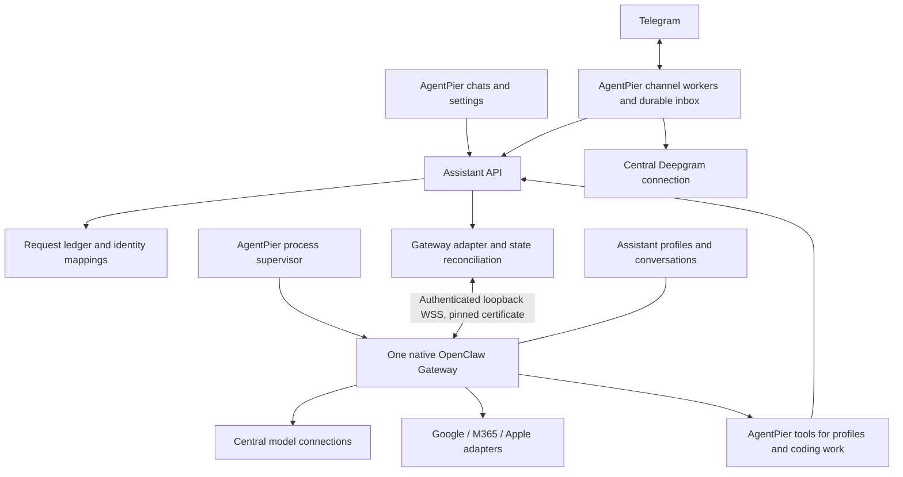

# Managed assistant Gateway design

Status: operating guide for the optional managed agent subsystem. Agents are off
until the owner turns them on; foundation, ChatGPT and provider accounts, Telegram
with Deepgram, visible teams, team coding requests, native memory, reminders and
routines are implemented. Service adapters (Gmail, Microsoft 365, Google Calendar,
Apple) and a sandbox remain deferred. Date: 2026-10-08, updated 2026-10-09.
Companion to [ADR 0002](adr/0002-managed-openclaw-assistants.md) and the
[status/recovery evidence](research/openclaw-status-recovery-spike.md).
Chronological qualification and spike logs live in `docs/research/`:
[team qualification and owner trials](research/openclaw-team-qualification-log.md)
and [native memory and automation spike](research/openclaw-native-memory-automation-spike.md).

## User-facing shape

Agent chats remain directly reachable in the sidebar, with team members nested
under their assigning assistant. The Agents directory manages profiles. Per-agent
settings configure instructions, models, service access and team permission.

Place shared service operation under **Settings > Agents > Agent service**. Call the
main card **Assistant service**; show OpenClaw as its managed runtime, not another
application the user must administer. The card shows readiness, host, active work,
restart preparation and diagnostics. Central model/service connections remain in
AgentPier. Technical details such as protocol, pin and private state locations are
secondary, expandable information; credentials never appear there.

The private interactive study illustrates three states with synthetic data:
ready, reconnecting, and reachable after an interrupted task. Its controls simulate
UI behavior only. DE/EN copy is included; publication does not deploy a service.

## Runtime boundary

AgentPier owns process lifecycle, user authorization, central connection references,
request identities and its UI projection. OpenClaw owns its agent loop, session
internals and model/tool execution. AgentPier owns Telegram transport and speech
transcription. The browser talks only to the
AgentPier backend. No iframe of the upstream dashboard is needed.

One Gateway hosts several assistant profiles and their conversations. A separate
Gateway is a future deployment choice for independent lifecycle/configuration; it
does not automatically form a team with the first instance. Multiple profiles or
processes on the same native host are not an OS sandbox.

## Opt-in switch

Agents are off by default. **Settings > Agents** carries the single switch ("Enable
agents"). While it is off the subsystem is dormant: AgentPier creates no `assistants/`
folder or database, starts no Gateway, poller, scheduler or background loop, installs
or downloads nothing, and shows no agent navigation or account sections. Turning it
on provisions the runtime and starts the service. The choice is stored in
`assistant-feature.json` in the data directory. Installations from before the switch
migrate to enabled when they already ran the runtime or hold a stored agent, so
existing users keep their agents. An unsafe `assistants/` folder (a link, a file, or
another owner) reports `ASSISTANT_STORAGE_UNSAFE` and is never followed or created
over.

## Starting and operating the service

1. Provision the tested package and compatible Node runtime through installation
   and update paths. Keep the runtime pin distinct from AgentPier's own Node support.
2. Allocate private state/config/workspace/log locations, a loopback listener and
   backend-only credentials. Launch an owned foreground child with a narrow env.
3. Wait for authenticated readiness. An open port or live PID alone is insufficient.
   The wait is a wall-clock budget: at least 90 s, or three times the previous
   spawn-to-ready time when that was longer, because a restart also loads the agents
   and sessions created since the first start. A Gateway that exits ends it at once.
4. Reconnect subscriptions and reconcile profile/session/run identities before
   presenting current status. Serve stored history while reconciliation is pending.
5. On unexpected exit, restart with bounded backoff. Preserve state, identify
   interrupted work and expose unresolved outcomes instead of replaying everything.
6. For a planned restart, pause new admission and let current work finish. Coordinate
   Gateway and channel ingress, not just AgentPier's HTTP queue. If work cannot drain
   in time, show the outstanding work and a separate explicit cancellation choice.
7. Keep updates explicit, with compatibility checks and backups. Rolling back a
   package does not necessarily reverse a state migration.

The supervisor, authenticated readiness, bounded restarts and the maintenance gate
are implemented (see below and [runtime updates](assistant-runtime-updates.md)).
Native crash behavior on hosts beyond the qualified ones remains a release gate.

### Gateway transport and authentication

Transport: loopback TCP with TLS and a pinned certificate, `wss://127.0.0.1:<port>`.
AgentPier probes for a free loopback port. Another local process can still take that
port before OpenClaw binds it, so the shared gateway token must reach only our own
Gateway. OpenClaw 2026.9.8 has no way for the server to prove it knows the token
during the challenge: its `connect.challenge` carries only a server nonce. It also
cannot listen on an inherited socket descriptor or a Unix domain socket: it only
calls `listen(port, host)`. It does support `gateway.tls`, so AgentPier uses that:

- On every start, AgentPier issues a fresh self-signed ECDSA P-256 certificate,
  valid for one year, in `assistants/tls/` (folder 0700, files 0600). AgentPier writes the DER encoding
  itself, so no `openssl` binary is needed. The config sets `gateway.tls.enabled`
  with these `certPath`/`keyPath` values and `autoGenerate: false`.
- For every connection, the client reads the certificate file from that private
  folder and trusts only that certificate. It also checks that the certificate's
  SHA-256 fingerprint matches. Any other certificate is rejected, even one a public
  CA would accept, and so is plain TCP or `ws://`. The pin is never learned from
  the network. A regenerated certificate takes effect on the next connection.
- The token is sent in `connect` only after the pinned TLS handshake has succeeded.
  If an impostor holds the port, the attempt fails with `ENDPOINT_UNTRUSTED`, the
  child is stopped and a restart on a fresh port follows the crash backoff. Any
  failure after the TCP connection and before the TLS handshake completes counts as
  `ENDPOINT_UNTRUSTED`; a refused connection while the Gateway is still starting is
  retried.

The Gateway serves no browser surface: every start rewrites
`gateway.controlUi.enabled` and `gateway.terminal.enabled` to `false`, also over
values an existing configuration holds. OpenClaw enables the operator terminal by
default; it gives admin-scoped clients a host shell with the Gateway's environment.

### Process ownership and supervision

`assistants/owner.json` records the Gateway's pid, its process start time, the
real path of the runtime's Node executable and the entry path. Before a new start,
the record is checked:

- **Dead pid, or pid reused:** the pid is gone, or now belongs to a process with
  another start time. The record is removed.
- **Our own orphan:** same start time and executable, and argv contains the entry
  path or OpenClaw's own process title (`openclaw-gateway`). AgentPier sends
  SIGTERM, then SIGKILL after 3 s, and then starts. This happens, for example,
  after AgentPier died under systemd's `KillMode=process`, which is kept so that
  tmux sessions survive service restarts.
- **Anything else** (another identity, EPERM, or an old record without identity):
  `OWNERSHIP_CONFLICT`. Nothing is signalled.

An `owner.json` written by an earlier AgentPier version has no `startTime`, so a
live pid in it always ends in `OWNERSHIP_CONFLICT`. Resolve it by hand once: check
the pid from the file (`ps -p <pid> -o pid,command`). If it is a leftover
`openclaw-gateway` from this data directory, stop it (`kill <pid>`); if it is an
unrelated process, leave it running. Then delete `assistants/owner.json` and start
the service under Settings > Agents > Agent service. The next start writes a
complete record.

Executable evidence reuses the release-cleanup process checks: `/proc/<pid>/exe`
on Linux, and on macOS `ps` or, for a titled process, its mapped image via `lsof`.

If the connection is lost and five reconnects (1–16 s apart) fail, the still-running
process is restarted. Process exits and failed automatic starts retry at most five
times with exponential backoff. After that the service stays `failed` with
diagnostic `RESTART_LIMIT` until the owner starts or restarts it, which grants a
fresh retry budget.

`assistants/logs/gateway-console.log` is opened with mode 0600, and an existing
file is tightened to 0600. It is rotated at 10 MiB, keeping three files: the active
log plus `.1` and `.2`. Rotation is checked at start and every minute. OpenClaw's
own log runs at level `warn` and rotates at 10 MiB. Diagnostics flags, OTEL export
with content capture, and cache traces are switched off, so prompts are not
logged.

## Installation and update lifecycle

Installation and updates are managed product capabilities. The transactional update
workflow below is implemented for one Gateway instance (see
[runtime updates](assistant-runtime-updates.md)); independent Gateway instances are
not implemented.

The deployment unit is a Gateway instance. One instance initially serves multiple
agent profiles; adding a team member does not install another OpenClaw package.
If independent Gateways are added later, each needs a stable instance identity,
private configuration/state/workspaces/authentication, an owned process and port,
and its own active runtime selection. Verified runtime packages may be reused on
the same host; mutable state must not be shared between instances. Profiles on one
Gateway necessarily share its runtime version and update window.

The update workflow extends the current pinned installer:

1. Stage the AgentPier-qualified OpenClaw/Node combination separately from the active
   runtime. Verify package integrity and the dependency graph, platform support and
   required Gateway contracts. A failed download or validation must leave the active
   selection intact. Do not run an upstream self-updater against managed files.
2. Show current and target versions, affected assistants and blocking work under
   Settings > Agents. Activation is explicit; downloading a candidate must not
   implicitly migrate live state. Include enabled existing installations in the
   normal AgentPier update path, not a developer-only setup command.
3. Enter maintenance: gate new execution, coordinate Telegram/transcription/delivery
   workers, drain running work and stop the owned Gateway. Pending/uncertain effects
   must remain recorded; a timeout does not authorize cancellation or replay.
4. Take a consistent private backup of the affected Gateway state and corresponding
   AgentPier assistant/channel ledgers, including database journals and version/schema
   metadata. Preserve host-scoped credentials securely; never expose backup contents
   in diagnostic output. Define a restore boundary that excludes unrelated coding
   sessions and central account changes.
5. Activate the candidate, validate authenticated readiness, reconcile profiles,
   history and pending work, then resume admission. Persist each transition so an
   interrupted AgentPier process can recover deterministically.
6. On failure before resuming work, restore the previous compatible runtime and
   matching state snapshot when a tested restore path exists. If migrations cannot
   be safely reversed, remain stopped with a recovery explanation. Restoring only an
   old executable is insufficient. After work has resumed, downgrade is a separate
   recovery operation: restoring stale ledgers could replay real external effects.

Acceptance tests must cover fresh installs, enabled-installation upgrades, interrupted
staging/activation, rejected migrations, occupied ports, insufficient disk space,
concurrent update requests and restoration of the previous runtime/state pair.
Qualify supported macOS/Linux architectures on native hosts. Keep old runtime
packages and backups while referenced by an instance or a recovery operation;
cleanup must never delete assistant history as a side effect of uninstalling a
runtime. The product UI should expose progress, blockers and recovery actions.

The installer verifies pinned Node/npm/OpenClaw archives and a reviewed transitive
dependency lock, checks the installed package version/CLI, and preserves selection
on installation failure. Existing installations retain their selection until
explicit activation through the maintenance, snapshot and transactional update
flow. See [locked installation and transactional updates](assistant-runtime-updates.md)
for the implementation and remaining native platform/version qualification.

## Security boundaries

- **Owner turns only write natively.** A turn that is forwarded, scheduled,
  internal or made by a team member receives no native write tools (`write`, `edit`)
  and cannot change memory, reminders or routines. Forwarded Telegram text or voice is
  quoted data, never authority. Plain-language team requests follow the rule in
  [Visible teams](#visible-teams-operation-and-recovery).
- **Bootstrap and skills protection.** The files OpenClaw loads into every prompt
  (`AGENTS.md`, `SOUL.md`, `TOOLS.md`, `IDENTITY.md`, `USER.md`, `HEARTBEAT.md`,
  `BOOTSTRAP.md`) cannot be rewritten by native tools; AgentPier owns `AGENTS.md` and
  the owner edits `USER.md` through the settings. The check folds case, Unicode
  normalization and OpenClaw's path repairs, so alternative spellings are caught.
  Workspace skills are disabled (`skills.allowBundled` is empty, per-agent skills are
  removed and autonomous skill review is off).
- **Write guard handshake.** The bundled `agentpier-teams` plugin registers the tool
  guard inside the Gateway and reports it to AgentPier, bound to the runtime
  generation. The report is dropped on reconnect and repeated periodically (at the
  latest every 15 s). Until a current report exists, agents with memory access stay
  read-only and the status shows `WRITE_GUARD_PENDING`. Reports from a retired plugin
  registry are ignored.
- **Approvals are audited.** Every approval, decline and withdrawal of an action
  (memory change, coding start, member coding request) is recorded with its actor,
  source and outcome.
- Profiles on one native host are not an OS sandbox; see ADR 0002 section 8.

## Status model

| Layer           | Examples                                                   | Meaning                                                               |
| --------------- | ---------------------------------------------------------- | --------------------------------------------------------------------- |
| Service         | starting, ready, reconnecting, stopped, failed             | Whether the managed runtime is reachable and usable                   |
| Reconciliation  | current, checking, uncertain                               | Whether displayed task data has been refreshed from the runtime       |
| Run             | queued, running, succeeded, failed, cancelled, interrupted | Outcome of a particular execution attempt                             |
| Action/delivery | pending, confirmed, failed, uncertain                      | Whether a requested external effect actually occurred                 |
| Agent activity  | idle, working, waiting, attention                          | Derived per agent for the sidebar dot, chat header and approval count |

Agent activity is derived on every `GET /api/assistants` from the latest request per
conversation, pending approvals and team state (`assistant-activity.js`); it is never
stored. First match wins: an unreviewed `uncertain` or `interrupted` attempt, or a
member in `uncertain` / `provisioning_uncertain`, needs **attention**; any pending
approval (own actions, team coding requests, team proposals) means **waiting**; an
unreviewed `pending` / `accepted` / `running` attempt, a working or queued member, or an
active own team means **working**; everything else, including a `failed` last attempt,
is **idle**. `pendingApprovals` carries the count shown in the chat. Clients refetch the
list on every `change` event, so a runtime failure publishes `change` after marking
outstanding attempts uncertain.

Keep session keys and run IDs separate. A session can be reused for several runs;
even the same run ID can appear when an interrupted request is retried in the tested
runtime. Record AgentPier attempt and action identities separately from runtime IDs.
Do not infer completion from text arriving, a wait timeout, or a diagnostic line.
Use terminal evidence and read back the session when events were missed.

A reconnect may safely reconcile a completed turn without executing it again.
A process crash may leave external effects uncertain. Before retrying, consult the
durable action record and the destination service; surface uncertainty when neither
can establish what happened. This does not change the agreed team autonomy default.

## Creating a permanent colleague

An assistant requests a scoped AgentPier tool operation containing the intended
role, task, lifetime and selected configuration. AgentPier checks authorization and
limits, allocates its durable identity, then calls the appropriate Gateway API.

- Existing profile, new persistent chat: delegate with `sessions_spawn` and
  `visible: true`, retaining parent/task mappings.
- New durable profile: call backend `agents.create`, apply selected settings and
  references, then start its conversation. Do not turn every transient task into a
  profile or grant the model unrestricted configuration-write credentials.

Default autonomous team creation asks first; standing permission is configurable
per assistant, and an explicit team instruction (also in plain words) authorizes
that assignment. Task-bound members can be promoted to permanent colleagues from their settings; a
tool that lets a model provision a brand-new permanent profile on its own is not
implemented.

## First implementation boundary

The build order was supervision, profile/conversation mapping, direct chat and
status reconciliation, then Telegram/Deepgram, teams, memory/reminders and
workflows. Service adapters need their own connection, delivery and recovery tests.
Sandbox design stays deferred as agreed. Remaining release checks are tracked in Plane.

## Implemented foundation

The foundation now provisions OpenClaw 2026.9.8 with Node 26.7.0 in private
application data, starts one owned foreground Gateway, and waits for authenticated
protocol readiness. It is optional: enabling it in Settings > Agents provisions
the runtime; enabled installations provision the selected version at startup after
an AgentPier update. Installation failures preserve the previous runtime selection.
The current platform probes cover macOS arm64; the manifest also pins macOS x64
and Linux arm64/x64 packages, which still require native-host qualification.

AgentPier stores assistant definitions, configuration revisions, conversations,
request identities and execution attempts in its assistant database. OpenClaw owns
its profiles and transcripts. Direct sidebar chats and per-assistant settings use
these mappings. Central API-key connections (OpenRouter, Ollama, llama.cpp, generic and Azure
OpenAI-compatible endpoints; see [model connections](assistant-model-connections.md))
and native ChatGPT OAuth profiles are selectable. Revoked keys are checked
before dispatch. Provider credentials exist only in backend private runtime files,
not public assistant definitions.

The chat/settings UI now follows the approved visual structure: shared assistant
header, direct Conversation/Settings navigation, message cards and a runtime summary
beside individual settings. A sidebar assistant without an existing chat opens its
conversation directly. Delayed chat opening cannot override a newer navigation;
drafts survive view changes. Desktop and mobile browser coverage includes the
composer remaining inside the viewport.

Normal stop/restart rejects outstanding work. Unknown-outcome recovery is a
separate deliberate chat action: review the history, acknowledge uncertainty, stop
the owned process, record that review, then restart. This does not declare the
original request successful or undo previous effects. The record retains its
unknown outcome and can accept later terminal evidence. No recovery path resends
the request automatically; a manually repeated message gets a new delivery ID.

Agents receive `session_status` plus the managed AgentPier tools their settings
enable (team, memory, reminder, routine and coding tools; see the sections below).
Gmail, Microsoft 365, Google Calendar and Apple service tools remain deferred.
This tool boundary is not an OS sandbox.

### Qualification and diagnostics

Run `node scripts/verify-assistant-runtime.mjs --data-dir /absolute/empty-directory`
from the source checkout. Use a new disposable directory: the wrapper rejects
existing application data and marks its own directories for repeated probes. The
probe downloads the pinned runtime when missing, uses a local deterministic model,
checks profile application, tool execution, durable history and crash recovery,
and shuts down its child. It needs no model credentials. Standard `npm test` skips
this opt-in probe.

The service panel separates availability from synchronization and shows a sanitized
technical diagnostic code. Logs are private under `assistants/logs`. Authentication
or startup failure terminates an owned child; invalid configuration does not enter
a restart loop. Foreign live ownership is reported without killing that process.
Unexpected exits retry at most five times with exponential backoff.

A real OpenRouter Gemini Flash request passed streaming, a `session_status` tool
loop and terminal reply verification on macOS arm64. Temporary credential copies
were removed after the test. The pinned OpenAI login uses the native device-code flow: the pinned
runtime's SIWC request differs from current OpenAI host-registration requirements;
a second native device-code attempt completed after user authorization. A real
`openai/gpt-6-astra` response and `session_status` tool call passed through that
OAuth profile. The same profile now passes a complete request through the new AgentPier account,
configuration and service adapters, with a completed durable execution record.

### ChatGPT assistant accounts

Accounts contains a separate **ChatGPT for assistants** section. Start the assistant
service first, connect using the displayed OpenAI device code, and select the
connection plus a model ID in an assistant's settings. The qualified model is
`gpt-6-astra`; availability and subscription access are determined by OpenAI.
Existing Codex CLI credentials are not implicitly imported.

OpenClaw owns OAuth state. AgentPier's private cache stores only profile references,
labels and status; public IDs are opaque hashes. Model references pin the exact
selected native profile. A missing profile fails instead of trying another
identity. The native qualification test also asserts that a missing profile cannot
fall back to an otherwise working provider key.

The device login uses the supported Gateway wizard and remains tied to its
originating connection. Only the official OpenAI URL and current device code reach
the browser. Cancellation, disconnect and expiry terminate or invalidate the
attempt; navigating away preserves its non-secret ID for resuming the display.
Sign-in is not a generic proxy for arbitrary native wizard prompts.

OpenClaw offers only the provider logins of plugins that a restrictive
`plugins.allow` lists, so the team-mode compile always allows the bundled `openai`
plugin; without it `models.authLogin` answers `INVALID_REQUEST` ("That provider login
is no longer available"). `assistant-chatgpt-login-contract.test.js` starts the
device-code sign-in on a team-mode Gateway and cancels it at the first wizard step.
A failed attempt reports one diagnostic to the browser (`LOGIN_UNAVAILABLE`,
`UNSUPPORTED_LOGIN_STEP`, `LOGIN_EXPIRED`, `CONNECTION_LOST` or `LOGIN_FAILED`),
which the Accounts page explains. The server log line adds the Gateway error code,
the wizard status and the Gateway's reason with device codes, bearer values and
token-like strings redacted.

The agent editor offers the ChatGPT model catalog of the native `main` agent. One
Gateway `models.list` read (`agentId: "main"`, `provider: "openai"`, `view: "all"`)
serves every ChatGPT account, because the accounts share that agent. Both the listed
models (live discovery) and each row's `available` flag come from the profile the
Gateway selects for the agent, not from each account: all accounts see the same
list. A profile's own `providerOutcomes` entry still withholds the list from an
account the Gateway rejected. With more than one account, an account without an
outcome is marked as checked against another account, and the editor says so.
Rows of other providers, IDs that are not bare model IDs and rows not marked
available (other than by a cooldown) are dropped; an empty list, a rejected account
and a `refreshFailed` answer whose `openai` outcome is `unavailable` count as a failed
read (`refreshFailed` alone covers every provider and is ignored). `authProfileId`
is not used: OpenClaw scopes it to personal accounts of an authenticated Gateway
user and refuses the agent's own OAuth profiles with `FORBIDDEN`.

The list is cached in memory for ten minutes; a failed or stale read is retried
after one minute, and the retry after a stale `openai` discovery is forced. Loading
the agents page or the account list starts a background read when the cache is
stale; agent runs, checks and logouts never read models. A completed sign-in and
**Refresh models** force a rediscovery: when an unforced read is already running,
the forced one runs right after it. The refresh route shares one owner budget of
twelve requests a minute. When the list cannot be loaded the editor keeps the model
ID field and says so; a custom model ID is always possible.
`assistant-chatgpt-models-contract.test.js` pins the request and row shape against
the pinned Gateway with synthetic credentials. Its discovery goes through a local
proxy that answers 401, so it never contacts chatgpt.com; a signed-in list cannot be
observed offline.

**Check connection** runs the native credential probe. **Disconnect** removes the
selected profile through OpenClaw; pending or unresolved work using that account
blocks removal. Admission is serialized with assistant creation, configuration,
dispatch and service controls so account removal cannot cross a starting request.
Stopped services show cached accounts as unavailable.

Native device-code presentation/cancellation, live credential checking, explicitly
selected OAuth inference and missing-profile rejection were qualified on macOS
arm64. Actual token expiry/renewal and provider-side revocation remain unqualified;
a successful status refresh is not evidence of token renewal. Expired credentials
get a native probe and must return to a usable state before dispatch. If they do
not, reconnect the account. No custom OAuth token refresh implementation is included.

## Telegram text and Deepgram voice

Each saved assistant can own one dedicated Telegram bot and one paired private
chat. Separately, a personal agent without shell can get its own bot for other
people, which OpenClaw runs natively for an allowlist of Telegram user ids; see the
[Telegram senders qualification](assistant-telegram-senders-qualification.md). A
bot serves only one of the two purposes.

The owner's bot has its Telegram section below the assistant settings. Enter the bot token,
open the one-time pairing link and send its `/start` message from your private
chat. Pairing expires after ten minutes. Group chats and other users do not enter
the assistant. The bot must not have another webhook or polling owner; AgentPier
does not delete existing webhooks. Re-pairing is blocked until pending work has
been resolved, both when issuing and redeeming the link. Resuming or changing
credentials invalidates outstanding links. Pause preserves queued work; disconnect
removes the local bot token. Each input retains its source chat/user; delivery
refuses a changed destination. Message deduplication includes the source chat because
Telegram message IDs are chat-local. Older records without source evidence remain
reviewable but cannot be sent by guessing a destination.

The paired conversation shares the assistant's AgentPier history. Only requests
originating in Telegram produce Telegram replies; ordinary AgentPier messages do
not send to Telegram. Input is persisted before polling acknowledgement. Stable
request identities survive duplicate updates and restart. Telegram retains unread
updates for at most 24 hours; that provider limit still applies while disconnected.

Configure Deepgram under **Accounts → Speech recognition**. The key stays in a
private backend store; model and language are shared by all assistant voice inputs.
The adapter uses direct HTTP, smart formatting and model-specific proper-name hints,
following the existing pattern in the user-owned Mimisbrunnr project. Voice notes
use Ogg, with a 10 MiB / ten-minute cap. Downloaded bytes are bounded during reading,
kept transiently in memory and cleared after use; no audio files are retained.
There are at most four active processing workers and eight long polls per process.

Newly accepted inputs receive one best-effort 👀 reaction. During transcription and
response processing, a separate worker refreshes Telegram's typing indicator every
four seconds. Feedback is limited to the paired source chat/user. Typing refreshes stop for blocked
or completed work; Telegram expires the last indicator after at most five seconds.
Feedback workers are aborted/joined on pause, disconnect and shutdown. Its HTTP
calls have a three-second deadline and respect provider rate-limit delays; failures
do not block the model or alter reply-delivery evidence. Reaction attempts are
recorded before HTTP and are not replayed after uncertainty or restart. These are
application acknowledgements, not control over Telegram's own read-check display.

Telegram activity shows transcription, model execution and outgoing delivery
separately, including the recognized text. Blocked inputs remain directly accessible
above recent activity even when newer messages fill the history window.
Transcription errors can be retried
explicitly. Completed model replies are selected by the exact native run identity;
other history cannot be forwarded accidentally. Replies are split into plain-text
parts of at most 4,000 UTF-16 code units, preserving surrogate pairs. Each confirmed
remote message ID is recorded before proceeding to the next part. Known rate limits
wait for the provider's retry deadline.

If a send loses its acknowledgement, its outcome remains unknown across restart.
Check Telegram, then acknowledge without resending to unblock subsequent work.
This action does not resend the uncertain part or declare it delivered. An unknown
model outcome must first be reviewed in the assistant chat using its runtime
recovery flow. There is no automatic replay of uncertain model execution or output.

The automated qualification covers duplicate/foreign updates, credential redaction,
pairing, bounded voice intake, transcription failure, reply identity, Unicode
splitting, rate limits and lost delivery acknowledgement. The pinned native Gateway
contract additionally runs text and voice through the actual assistant service and
model loop with simulated Telegram/Deepgram HTTP responses. On 2026-10-07 the user's
explicitly paired private Telegram chat also passed a live text and voice round trip:
Deepgram produced a nonempty transcript, ChatGPT answered both inputs, and Telegram
acknowledged one outgoing message for each. This establishes the first live path,
not recognition accuracy across languages or long-term reliability. Credentials were
supplied through a private local file; none were imported from Mimisbrunnr.

In that trial, opening the bot manually did not complete pairing. Sending the exact
`/start <code>` command from the pairing screen completed it without the deep link.
Inputs received before pairing are discarded and must be sent again after pairing.

### Notices, language and formatting

Ingress uses long polling (`getUpdates`); there is no webhook. Inputs that cannot be
processed are answered instead of dropped silently: a message from an unpaired
person gets a short refusal (and never reaches the agent), unsupported media or
media with a caption get a notice, and a voice message longer than the limit (ten
minutes by default) is refused with the allowed duration. Inputs held for review
(unknown model outcome, uncertain delivery) sit in a separate review lane above
recent activity and are released through explicit acknowledgement.

Each channel stores two settings besides the token: `appUrl`, the address under which
the owner reaches AgentPier, and `language` (German or English). Notices that
AgentPier writes itself (approvals, decisions, work started, results) use the
channel's language and, when `appUrl` is set, end with a deep link to the team or
chat. Only the origin of `appUrl` is kept. Changing the language or address affects
notices created afterwards; an existing notice is reused unchanged, so a change never
duplicates or rewrites one. Link targets longer than 1,024 escaped characters are
sent as plain text.

Agent replies are Markdown. AgentPier renders a small subset (bold, italic,
strikethrough, code, links) as Telegram HTML and escapes all other
text. If Telegram rejects the formatted message, the same text is sent as plain text;
a send whose outcome is unknown is never retried in another format. Parts are
split at 4,000 UTF-16 code units.

API references: [Telegram polling](https://core.telegram.org/bots/api#getupdates),
[Telegram messages](https://core.telegram.org/bots/api#sendmessage),
[Telegram files](https://core.telegram.org/bots/api#getfile),
[Deepgram transcription](https://developers.deepgram.com/reference/speech-to-text/listen-pre-recorded).

## Visible teams: operation and recovery

The assigning assistant offers a team proposal by default. Approve or decline it
in the parent chat or through its paired private Telegram chat. A `/team <task>`
text command or the one-message team switch behind the composer’s "+" options
button authorizes one proposal for that request; while it is on, a "Team allowed"
chip next to the button shows it and turns it off again when tapped. An explicit
owner request in ordinary words ("build a team that …") authorizes that one team as
well: the team proposal tool carries
`ownerRequestedTeam` and a verbatim `ownerRequestQuote` (at most 300 characters),
and AgentPier admits the team without confirmation only when the quote has at
least three words, contains "team" (also inside compounds such as "Rechercheteam")
and appears in the stored user text of the same request after whitespace and case
normalization. The turn context comes from AgentPier's own records, never from the
model. The owner's own web and Telegram messages qualify, including transcribed
Telegram voice; forwarded content (text or voice), scheduled turns and internal
member/result turns never authorize, and one request authorizes at most one team.
The authorization records its source (`command`, `checkbox` or `ownerRequest`).
Parent settings can enable standing team permission; a plain-language request never
changes it.

Known limits: AgentPier cannot tell third-party text pasted into the web composer
from the owner's own words (only Telegram forwards are detected), and an owner
message that mentions a team in another sense ("my team meets at three") can still
be quoted by the model. The mitigation is visibility: the team card (in the proposal
and under Settings → Work → Teams) and the Telegram start notice show "Started because you wrote: “…”" with the quote, and the owner
can stop the team at any time.

Default limits are four members, eight concurrent members per host and ten minutes
per member. Team size is configurable from one to eight, deadlines from one to sixty
minutes, and host capacity from four to thirty-two (never below a configured team
size). All members may run concurrently. One active team per parent, one automatic
turn per member and no nested delegation keep accepted work bounded. Cancellation
of a parent response does not cancel its team. Stop member and Stop team are separate
operations. A deadline requests cancellation; it does not prove completion or free
an uncertain slot.

Each member has its own profile, chat, instructions and model reference copied at
creation. Service and project grants start empty. Completion retains the member and
its history. Settings support explicit permanent promotion and archive/restore;
active or uncertain work blocks lifecycle and configuration changes. Promoted
members reuse the same identity and history and remain unable to create subteams
in this stage.

Provisioning persists identities before RPC. A lost profile/session acknowledgement
can only adopt a unique matching profile or labelled session. Missing or ambiguous
evidence remains blocked. Unknown setup can be explicitly acknowledged in member
settings after other requests finish. Sidebar and parent-team member buttons open
those settings when no conversation exists yet: the owned Gateway is stopped/restarted and
the member is marked failed without creating a replacement. Unknown execution uses
the existing chat recovery action. Neither recovery route replays work.

The bundled `agentpier-teams` plugin is staged privately and verified on fresh
installation and every existing-runtime provisioning path. Compatibility is pinned
to OpenClaw 2026.9.8 and its qualified 2026.9.7 rollback predecessor. Eligible parents receive the three managed team tools and
`session_status`; members receive only `session_status`. Direct native spawning
and alternative session mutation tools are not offered; `exec` and `process` only
under [agent shell access](#agent-shell-access-2026-10-12), which temporary members
never get. The private loopback
bridge binds 30-second prepare/commit tickets to the exact active attempt and
runtime generation. Credentials are never part of public team projections.

Results form one durable batch and one parent synthesis request per team. A busy
parent delays synthesis. Unknown synthesis is not resent. A terminal member without an exact-run textual
report still completes its batch with `reportAvailable: false`; unavailable or
paginated history does not turn terminal work back into running work. The member
chat retains any later history. A completed synthesis without available text sends
an explicit fallback with attributed individual reports. Telegram approvals and
late results use a separate durable outbox tied to the original channel/chat/user.
Telegram approval includes the full objective, names, roles and assignments. Long
proposals use ordered chunks, with buttons attached only to the last chunk after all
earlier chunks were acknowledged. Buttons expire after 24 hours and authorize only
the stored proposal revision.
UI decisions invalidate stale buttons. Pause retains notifications; unresolved
notifications block re-pairing/disconnect and remain visible in Telegram activity.
Changed destinations are rejected. Unknown delivery requires acknowledgement without
resending; ordinary replies and notifications share the same intent-before-send
and confirmed-message-ID logic.

### Coding requests from team members

Members in a team turn can request coding runs on the parent's current project
grants; [agent workflows](assistant-workflows.md#coding-requests-from-team-members)
describes the full behaviour. For operation:

- **Owner approval:** every member request waits for the owner's exact approval,
  in the parent's chat, the team card or the bound Telegram chat. The parent's
  standing permission to start pipelines never applies.
- **`GRANT_REVOKED`:** access or the pipeline definition changed between request
  and start, so the action failed and nothing ran. Grant the project again and let
  the member ask again; AgentPier never replays it.
- **Withdrawal on stop:** stopping the team or the requesting member declines its
  pending requests with `TEAM_STOPPED` (audited); they can no longer be approved.
  Runs that already started keep running and can be cancelled from their pipeline.
- **Follow-ups:** requests still open when the team finishes appear as pending in
  the team result; the parent's chat receives each one's final outcome later.

## Managed native memory and reminders (2026-10-08)

Agent settings now expose independent memory and Telegram reminder capabilities.
Existing definitions default to both disabled. Task-scoped team members receive
neither; promoted permanent members can opt in with their own settings and channel.
OpenClaw owns memory files, indexing, schedules, execution and run history.
AgentPier owns capability configuration, UI, original destination bindings and the
existing durable channel delivery outbox. It has no second memory index or clock.

### Memory

Enable **Remember information** in the agent's settings, then ask it to remember a
fact in chat. The settings panel reads and edits native `MEMORY.md` and `USER.md`,
and searches all indexed memory in that agent's workspace. Saving carries the
native expected file hash (or expected-missing flag): concurrent agent edits cause
a conflict instead of being overwritten. Reload before reconciling such a conflict.
Saving an empty note clears that file; it does not purge chat history or other
workspace notes. Native file tools stay within the workspace.

The initial managed search uses OpenClaw's keyword provider `none`, requiring no
embedding account. Transcript indexing and cross-conversation recall stay off,
scheduled check-ins replace OpenClaw's own heartbeat, and dreaming stays off (see
[Proactivity](#proactivity-check-ins-2026-10-12)).
`skills.workshop.autonomous.mode` is explicitly `off`, so
enabling cron does not also start OpenClaw's default weekly skill collection reviews.
Explicit repository memory access is now described in [agent workflows](assistant-workflows.md).
Semantic search and comprehensive deletion/re-ingestion remain follow-ups.

### Reminders

Enable **Allow Telegram reminders** and pair that agent's Telegram channel. Request
a reminder in chat or create a one-time/daily reminder in its settings. One-time
form values use the browser's displayed local timezone; daily schedules carry an
explicit IANA timezone. Native OpenClaw handles scheduling and timezone calculation.
The UI lists native state, next execution, run history and separate Telegram
outbox delivery status, with pause/resume and remove controls.

The `agentpier_reminder` tool is a thin authorized adapter to native
`cron.add/list/update/remove`; it does not implement scheduling. Chat mutations
require a current owner/Telegram turn. Creation keys bind the attempt and tool call;
the UI retains its creation key across retries of an unchanged form. Source bindings
store an agent, original paired destination and operation identity, not the schedule
or reminder text. Native jobs use a stable `declarationKey`; the pinned Gateway
returns declaration-based creation as `{ created, job, deliveryPreview }`.

Preparation failures can retry before submission. After uncertain submission,
recovery searches by the declaration key and never blindly creates another job.
Unresolved items remain visible for inspection/removal. Pausing and removing revoke delivery
before the native mutation, including lost acknowledgements, queued output and late
completion reconciliation. Only confirmed explicit resume restores paused delivery. Disabling reminders or archiving a permanent member/team
pauses its native jobs; restoring or re-enabling does not automatically resume them.
Runtime stop/restart refuses known active native scheduled turns as well as chats.

A private loopback receiver keeps its port and bearer token in
`assistants/reminder-webhook.json` across full application restarts; runtime updates
and rollbacks leave it in place. Host backups leave it out on purpose, because it holds a bearer secret bound to this host's port: a
restored data directory starts a new receiver, and reminders created before the
backup still name the old address, so delete and create them again after a host
restore. An occupied saved port
fails startup rather than silently changing job destinations. Incoming completions
must match the bound native job; job ID plus `runAtMs` deduplicates durable outbox
handoff. A changed Telegram pairing cannot redirect an existing reminder. The
browser receives no webhook credentials, native destinations or raw diagnostics.

Scheduled reminders have an empty tool allow-list and only return reminder text;
they do not initiate teams or service mutations. The model account and Gateway must
be available. Saved-prompt routines and manual/coding-completed events are now described in
[agent workflows](assistant-workflows.md). Service actions remain deferred. Native DST and extended downtime behavior are
covered by [schedule qualification](assistant-routine-qualification.md). Native webhook acknowledgement is
durable transfer into AgentPier, not Telegram delivery acknowledgement.

### Product qualification

The actual managed product configuration passed against pinned OpenClaw 2026.9.8
on macOS arm64 with a real ChatGPT account in disposable state:

- Agent-written synthetic memory, native read/edit/search and fresh-conversation
  recall after Gateway restart.
- Conversational native reminder creation, restart before its deadline, scheduled
  execution and exactly one acknowledged send through the existing Telegram
  adapter using a simulated transport.
- Native daily creation, pause and removal, plus full application restart with the
  same webhook endpoint, retained memory and no replay of completed delivery.

No synthetic personal Telegram messages were sent. Regression tests cover native
response shapes, stale note writes, repeated/lost acknowledgements, original source
binding, delivery deduplication, capability isolation and archival. Independent
review findings for late removal reconciliation, retryable preparation and archived
schedules were reproduced, fixed and rechecked without remaining blockers.

Historical product-stage validation: `npm run check` passed with 3,518 tests passed, 18 conditional skips and
zero failures. The relevant assistant suites passed 23/23 in Chromium and 23/23 in
WebKit; the new memory/reminder settings flow also passed on a 390-pixel viewport
in both engines after the final layout adjustment. All disposable qualification
state and copied credentials were removed after stopping the owned runtimes.

For the later merged branch, see the [release qualification](assistant-release-qualification.md).

## Web, browser and document capabilities (2026-10-11)

Agent settings group four more switches under **Web & documents**. All default to
off. Like memory and reminders, they apply only to permanent agents: task-scoped
team members never get them, and archived agents do not count. The tools exist only
in team mode (native teams), where AgentPier compiles them into the Gateway's
startup configuration.

| Switch             | Grants       | What it does                                                                                    |
| ------------------ | ------------ | ----------------------------------------------------------------------------------------------- |
| **Search the web** | `web_search` | Searches with the provider chosen under **Accounts → Web search**                               |
| **Read web pages** | `web_fetch`  | Fetches a public address and reads its text; private, loopback and internal targets are refused |
| **Use a browser**  | `browser`    | Drives a separate, headless browser profile owned by AgentPier                                  |
| **Read images**    | `view_image` | Looks at images; needs a model that accepts images                                              |

Web content is untrusted data. OpenClaw wraps fetched and browsed content as
external content, and the switches do not grant any other tool.

### Browser isolation

AgentPier installs no browser. `detectBrowser()` looks for Chrome, Brave, Edge or
Chromium in the platform's standard locations, and the compiled `browser` block
names that executable. The block:

- uses only OpenClaw-managed profiles (`driver: "openclaw"`). OpenClaw's implicit
  `user` profile (which attaches to the signed-in system browser) and `chrome`
  profile (extension relay) are redefined as managed profiles on their own CDP
  ports, so no profile name reaches the owner's browser;
- keeps the profile data in the Gateway's state directory below the AgentPier data
  directory, never in the owner's browser profile;
- sets `allowSystemProfileImport: false`, so the agent cannot copy cookies from a
  system browser profile, and `evaluateEnabled: false`;
- runs `headless`, so no window appears;
- sets no `ssrfPolicy`: OpenClaw's default already blocks loopback and private
  networks, while an explicit `dangerouslyAllowPrivateNetwork: false` would make every
  navigation fail. `browser.noSandbox` is never set.

The `browser`, `mcp`, `secrets`, `env`, `plugins` and `tools` paths are locked
against configuration overrides; the compiler rewrites the browser block on each
start and removes any `mcp` block it did not write. `channels`, `bindings`,
`session`, `commands`, `approvals`, `accessGroups` and `models.providers.deepgram`
belong to the agents' own Telegram bots and are locked as well. Overrides of the parents
`models` and `models.providers` are refused for that reason (individual providers
below them stay configurable).

### Search provider

**Accounts → Web search** selects one provider for all agents:

- **DuckDuckGo** (default) needs no key.
- **Perplexity** uses an existing OpenRouter connection's key; searches are billed to
  that OpenRouter account.
- **Brave Search** takes its own API key, stored in `assistants/web-search.sqlite`.
  The browser only learns whether a key is stored.

The provider plugins are bundled with the managed runtime (see
[runtime updates](assistant-runtime-updates.md#bundled-search-plugins)). The key is
written only into the provider plugin's entry in the Gateway configuration, which
OpenClaw redacts on read; it is not passed as an environment variable.

### Restart confirmation

In team mode `plugins.allow` is restrictive, and OpenClaw needs a Gateway restart to
activate the browser or a search plugin. AgentPier therefore compares the global
web-tools sections (the global tool allow list, `tools.web`, the browser block and
the search plugin) that a save would compile with those of the running Gateway:

- If they are unchanged (for example, a second agent switches on a tool another agent
  already uses), the save applies live.
- If they change, the save answers `409 ASSISTANT_RESTART_REQUIRED` and stores
  nothing. The settings page shows **Restart the agent service?** with the agents
  that will be briefly unavailable. Confirming resends the save; AgentPier then runs
  the maintenance restart used for provider changes. If an agent is busy, the save is
  refused and nothing changes.
- Switching off the last agent that uses a tool also changes the sections and asks
  for a restart.
- With the Gateway stopped, the save is stored and compiled at the next start.

Creating or archiving an agent with web capabilities, and rotating the OpenRouter
key that Perplexity uses, take effect at the next Gateway start.

### Unavailable states

- **No browser found:** the **Use a browser** switch is disabled with a hint to install
  Chrome, Brave, Edge or Chromium. An agent that already has it switched on keeps
  the setting but is not granted `browser`.
- **Search not set up** (Perplexity without a usable OpenRouter connection, Brave
  without a key): the **Search the web** switch is disabled and the web search
  settings show **Not configured**. `web_search` is withheld; OpenClaw would
  otherwise offer it and fail every call.
- **Runtime without the bundled plugins** (an installation not yet updated, or a
  rollback target): web search is unavailable until the staged update is activated.
- **Documents:** OpenClaw 2026.9.8 offers `view_image` only for models that accept
  images. `pdf` is not offered: OpenClaw needs a global `agents.defaults.pdfModel`
  for it, which AgentPier does not compile (tracked separately), so the switch
  grants `view_image` only (see [web tools qualification](assistant-web-tools-qualification.md)).
- **New agents:** the web, browser and image switches are disabled while creating an
  agent ("Available after saving the agent"); the server stores them as off on
  create. Switch them on in the agent's settings after saving.

## MCP servers for agents (2026-10-11)

Agents can use tools from MCP servers that the owner manages in one central list
(AGENTPIER-29). The facts behind this section are recorded in the
[MCP qualification](assistant-mcp-qualification.md).

### Central list

**Accounts → MCP servers** lists, adds, edits and removes servers. The list is
stored in `<data>/mcp-servers/servers.sqlite` (a private directory, mode 0700) and
is independent of the coding CLIs' own MCP configuration.

- **Name:** 1 to 30 letters, digits, `-` or `_`, starting with a letter, unique
  regardless of case. OpenClaw uses the name unchanged as the tool prefix, so an
  agent sees the server's tools as `<name>__<tool>`.
- **Responses** never contain header or environment values, only their names. An
  address is shown as origin and path; a query string or fragment, which can carry
  a token, stays in the store.
- **Removing** a server removes its bindings and stored values with it; the agents
  using it lose it at once.

### Transports

| Connection             | Stored                               | Compiled into `mcp.servers.<name>`                                  |
| ---------------------- | ------------------------------------ | ------------------------------------------------------------------- |
| HTTP (Streamable HTTP) | address, headers                     | `{ url, transport: "streamable-http", headers }`                    |
| SSE                    | address, headers                     | `{ url, transport: "sse", headers }`                                |
| HTTP or SSE with OAuth | address, optional scope              | `{ url, transport, auth: "oauth", oauth: { redirectUrl, scope? } }` |
| Local command (stdio)  | command, arguments, cwd, environment | `{ command, args, env, cwd? }`, `command` always an absolute path   |

`transport` is always written: without it OpenClaw falls back to SSE, which offers no
tools from a Streamable HTTP server.

### Local commands (stdio)

A stdio server runs its command with the owner's operating-system user rights and
without a sandbox. OpenClaw has no per-agent server scope: once a stdio server is
compiled, **it starts for every session of every agent**, including agents that
are not bound to it and are never offered its tools. The processes stay up until
the server is removed or the Gateway stops.

AgentPier therefore asks for explicit consent. Adding a stdio server, binding one to
an agent, and changing a stdio server's command, arguments, working directory or
environment are refused with `409 MCP_STDIO_CONFIRMATION_REQUIRED` until the owner
confirms the warning; nothing is stored before that.

**Command resolution.** On save, a bare command (`npx`, `uvx`) is resolved on the
AgentPier service's own `PATH`, not on an interactive login shell's, and the
absolute path is stored and shown as **Resolved path**. An absolute command must be
an existing executable file. The Gateway starts the process with its own
environment: its private `HOME` (`<data>/assistants/home`), no `TMPDIR`, and a
restricted `PATH`. A command found only on the owner's interactive `PATH` (nvm,
`~/.local/bin`) must be entered as an absolute path, and a server that expects the
owner's `HOME` or a `TMPDIR` does not find them.

### Bindings

- **Personal agents and permanent team members** are bound by the owner in the
  agent's settings (**MCP servers**). Archived agents get no servers.
- **Temporary team members** cannot be bound directly; the agent update refuses it.
  They get servers only through their lead's team proposal. The lead's proposal
  tool lists optional `mcpServers` per member: names of servers bound to the lead,
  at most 16. Any other name rejects the whole proposal (`MCP_SERVER_NOT_BOUND`).
  The approval (in the web UI and on Telegram) shows each member's servers by name
  with a stdio marker, never addresses, commands or values.
- An approved temporary member holds exactly its approved servers that its lead
  still holds, and only while it runs. When it ends, is stopped or the lead loses a
  server, the binding goes at the next scheduler tick; every Gateway start runs the
  same reconciliation first.
- A member approved as permanent receives its servers once; the owner manages them
  afterwards.

**Owner decision: automatic teams.** A team that is approved automatically (by a
task authorization, `/team`, or a standing autonomous policy) passes the servers
its lead lists to the members, including stdio servers, without a per-server
approval. The members can only receive servers the lead already holds. By enabling
automatic teams the owner accepts this.

### Compilation and live changes

Only servers bound to at least one eligible agent are compiled, and only in team
mode with the native interfaces ready (the same gate as the web tools). A start
adds `bundle-mcp` to the global `tools.allow` and `<name>__*` to each bound agent's
own `tools.allow`; `plugins.allow` stays unchanged, because `bundle-mcp` is not a
plugin. A bound server that cannot be compiled (for example an unreadable stored
value) is skipped by name, with a warning, and never blocks the start.

OpenClaw reloads `mcp` and `tools.allow` hot, also under the team plugin's
restrictive `plugins.allow`. Every change (binding, unbinding, editing or removing a
server, and team members gaining or losing servers) is applied to a running Gateway
with `config.patch`, without a restart. A removed server is written as a `null`
merge with each of its arrays (`mcp.servers.<name>.args`) in `replacePaths`. Agents
whose globs change are re-applied afterwards. With the Gateway stopped, the next
start compiles the store.

### Secrets

Header and environment values are stored in the server store and reach only the
compiled `openclaw.json` (mode 0600). OpenClaw returns them redacted on
`config.get`; the contracts verify that no transcript, log or other state file
holds them. Rotated values remain in OpenClaw's configuration backups
(`openclaw.json.bak*`, `.last-good`) until those rotate out.

Runtime update backups and host backups seal every `headers` and `env` member of
`openclaw.json` (at any depth) with the backup's own key, like the other
credentials, and treat each copy beside it that parses as JSON (`.bak*`,
`.last-good`) the same way; a copy that does not parse (an unfinished atomic-write
temporary) is left out. A rollback or restore with the key restores the values;
after a credential revocation destroyed the key, they are withheld and the restore
reports `credentialsWithheld`, so the servers need their values entered again. A
host backup without credentials leaves the values out.

Host backups also capture the server store (`<data>/mcp-servers/servers.sqlite`,
AGENTPIER-42) as a consistent SQLite snapshot. The public archive member is a
sanitized copy that keeps only the tables and columns the store defines: server
definitions and agent and CLI bindings stay. A stdio server's command, arguments
and working directory are definitions and stay public, so put tokens into its
environment, never into its arguments. Header and environment values, the query
string and fragment of each address, the OAuth login state (`oauth_connected`, the
registered login redirect) and pending or remembered OAuth logouts are removed. So
are the records of the native CLI entries AgentPier wrote for a server with removed
values or a removed address token, or for a deleted server: an entry's hash covers
its values and would let anyone test guesses of a short one. The copy is vacuumed
so no removed value survives in a free page.

A backup with credentials seals the values, the full addresses and those entry
records in its passphrase capsule (`mcp-server-secrets/servers.json`). The restore
checks them with the store's own rules, writes them back into the restored store
and never leaves that member in the new data directory; a sealed member the store
would refuse aborts the restore before anything is written, while an address it
would refuse is left out and reported. A restore without them lists each affected
server in `credentialsNeedingLogin`: `mcp:<name>` when its header or environment
values are missing, `mcp-address:<name>` when the token in its address is missing.
Enter them again under **Accounts**.

The restored instance's next start reconciles the coding CLIs: it writes managed
entries a CLI lacks and leaves entries the owner changed as conflicts. A server
restored without its values or address token has no record of the native CLI
entries AgentPier wrote (its bindings stay): an entry still in a CLI's file shows
as a taken name that **Adopt** takes over with its values, and AgentPier never
rewrites or removes it. Runtime update snapshots do not include the server store:
it stays on the host. Builds before AGENTPIER-42 refuse a backup with the store
("Unexpected backup component"); older backups, which declared the store as left
out, restore without it.

### OAuth logins (AGENTPIER-37)

A remote server (HTTP or SSE) authenticates with one of two methods, chosen under
**Authentication** in its form:

- **Headers (token):** static header values, as above. Use this for providers
  without dynamic client registration, for example GitHub: create a token there and
  enter it as an `Authorization` header.
- **OAuth:** the owner logs in once from the list; OpenClaw stores the tokens and
  refreshes them unattended. An optional scope sits under **Advanced**. Switching a
  server with stored headers to OAuth deletes those headers after a confirmation.

OAuth needs a provider that supports dynamic client registration (RFC 7591):
OpenClaw registers itself as a public client for exactly AgentPier's redirect URL.
There is no field for a client ID or secret. A provider without registration fails
the login with a message that points to the token option.

**Redirect rule.** OAuth servers compile with
`oauth.redirectUrl = <origin>/api/mcp-servers/oauth/callback`, where the origin is
the configured HTTPS remote origin (Tailscale Serve, see
[remote access](remote-access.md)) when there is one, and otherwise AgentPier's own
loopback listener `http://127.0.0.1:<port>`. A login must start from a browser that
can reach that address: from the HTTPS origin, or on the AgentPier host itself.
AgentPier refuses the start beforehand (`409`) on a plain-HTTP network address
(`plain-http-remote`: plain-HTTP network mode cannot log in) and on a remote browser
when only the loopback redirect exists (`loopback-redirect`). Changing the origin
changes the redirect, which needs a new client registration; the next login logs out
first so OpenClaw registers again.

**Login.** **Log in** runs `openclaw mcp login <name>` with the Gateway's private
environment. Because AgentPier's listener holds the redirect port, the CLI prints the
authorization URL and exits; the browser opens it. The provider redirects to the
callback, which accepts only the unguessable, single-use `state` of a login the owner
started in the last 10 minutes, runs `openclaw mcp login <name> --code <code>`, and
returns to **Accounts** with the result. Codes and tokens are never logged or
returned. After a successful login AgentPier makes one hot `mcp` change
(`mcp.sessionIdleTtlMs` toggles between unset and `0`, which mean the same): a turn
that tried the server without credentials backs it off for up to 10 minutes, and
only such a change lifts that backoff. It restarts the MCP runtimes of every session
once (stdio servers too), without a Gateway restart.

**Status** (from `openclaw mcp status --json`, cached for 10 seconds and refreshed
after a login or logout):

| Status            | Meaning                                                                                                                                          |
| ----------------- | ------------------------------------------------------------------------------------------------------------------------------------------------ |
| Connected         | OpenClaw holds a valid login; the expiry is shown when known. Agents bound to the server get its tools.                                          |
| Login in progress | A login started in AgentPier awaits the provider's redirect.                                                                                     |
| Login required    | The server was logged in before, or the provider revoked or refused the tokens; or an old login under this name and URL still awaits its logout. |
| Not connected     | Never logged in, or logged out.                                                                                                                  |
| Status unknown    | OpenClaw could not be asked.                                                                                                                     |

A bound server without a valid login is left out of the agent's tools; the turn
runs on without them.

**Logout, rename and delete.** **Log out** runs `openclaw mcp logout <name>`.
OpenClaw keys a login by server name and URL, so a rename, a URL change, a switch to
headers and a delete first log out under the old name and URL; the edit is saved
afterwards. Such a logout never blocks the edit: when it fails, AgentPier records
it, answers with the warning `oauth-logout-deferred`, keeps any server with the old
name and URL uncompiled ("Login required", logout pending), and retries in the
background and before every Gateway start compiles.

**Backups.** Logins live in OpenClaw's `state/openclaw.sqlite` (`mcp_oauth_stores`,
`mcp_oauth_pending_authorizations`). Host backups leave them out, with or without
credentials, and the server store's backup copy keeps no login state; a restored
host starts "Not connected" and needs a new login. Runtime
update snapshots stay on the host and keep them sealed with the other credentials,
so a rollback keeps logins; every login logged out since the snapshot is logged out
again after the rollback, before the Gateway starts (see
[runtime updates](assistant-runtime-updates.md)). The facts behind this section are
recorded in the [MCP OAuth qualification](mcp-oauth-qualification.md).

## Agent shell access (2026-10-12)

Agents can run command-line programs on the host through OpenClaw's `exec` and
`process` tools (AGENTPIER-25). The facts behind this section are recorded in the
[shell qualification](assistant-shell-qualification.md).

### Levels

Each personal agent and each permanent team member has a shell level in its
settings (**Shell access**). New agents start with **Off**.

| Level         | Compiled for the agent                                | Behavior                                                        |
| ------------- | ----------------------------------------------------- | --------------------------------------------------------------- |
| Off           | no `exec` or `process` in the agent's `tools.allow`   | The agent is offered no shell tool at all.                      |
| With approval | `tools.exec: { mode: "ask", strictInlineEval: true }` | Every command not on the agent's allowlist waits for the owner. |
| Full access   | `tools.exec: { mode: "full" }`                        | Every command runs at once, without asking.                     |

Both shell levels also carry `pathPrepend` (see below). While any eligible agent
has shell, the global `tools.allow` includes `exec` and `process`; the global
`tools.exec.mode` stays `deny`, and an agent without shell keeps both tools out of
its own `tools.allow`, because a global `deny` alone still offers the tool.

- **Temporary (task-bound) team members never get shell.** The agent update
  refuses any level other than Off with 400, the compiler ignores a stored level,
  and the allowlist routes refuse them. Archived agents have none either.
- **Confirmation.** Raising the level needs the owner's confirmation of the
  warning (`confirmShell`); raising it to Full access needs a second one
  (`confirmFull`). Without them the update (and the creation of an agent with
  shell) answers `409 ASSISTANT_SHELL_CONFIRMATION_REQUIRED` naming the missing
  confirmations, and nothing is stored. Lowering never asks.
- **Live changes.** Every level change applies to the running Gateway with
  `config.patch`, without a restart. Lowering applies even while a turn of the agent
  runs; a settings form that also sends its unchanged fields counts as a lowering
  only. Switching to Off first denies the agent's requests still awaiting the
  owner (their actions end with diagnostic `SHELL_OFF`; a deny the Gateway could
  not receive is sent again at the next ready), then aborts the agent's running
  turns, which ends a command running in the foreground. **A command moved to the
  background (`process`) keeps running:** OpenClaw 2026.9.8 offers no way to end
  background sessions from outside the agent's own `process` tool, and neither an
  abort nor a session reset stops them. A Gateway stop or restart (including stopping or
  updating AgentPier) ends them on Linux, where OpenClaw starts commands through
  its spawn broker, which terminates its children when the Gateway goes away; on
  macOS they keep running (see the
  [shell qualification](assistant-shell-qualification.md#h-aborting-turns-and-background-commands)).
  If a lowering cannot be
  applied, AgentPier tries once more, then aborts the agent's running turns and
  denies its pending requests, so nothing keeps running at the higher level; the
  level stays pending (shown in the settings) and is retried with backoff and at
  every ready. A stopped Gateway compiles the stored level at its next start.

**Warning shown before shell is turned on:** with shell access the agent works as
the owner's user account, with the owner's logins, files and keys, and it can read
AgentPier's own data. The team write guard does not cover shell commands. There is
no sandbox (see [ADR 0002](adr/0002-managed-openclaw-assistants.md)). With Off, the
settings explain that skills and tools needing command-line programs (gh, git, mail
programs) do not work.

### Environment of shell commands

Commands run as the owner: **with the owner's real `HOME` and login `PATH`, while
the Gateway itself keeps its private `HOME`, state and configuration.**

- OpenClaw has no exec environment setting and refuses a per-call `HOME`, so every
  Gateway start points its `SHELL` to a wrapper,
  `<data>/assistants/exec-shell/sh` (mode 0500 in a private folder), that exports
  the owner's `HOME` (shell-quoted) and hands over to `/bin/sh`. The wrapper is
  Gateway-wide; only agents with shell are offered `exec`.
- The owner's `HOME` comes from the user database (`os.userInfo().homedir`), not
  from `$HOME`. The `PATH` is computed without starting a login shell (which would
  run the owner's profile scripts): the AgentPier service's own `PATH` plus the
  package manager directories that exist (`/opt/homebrew/bin`, `/usr/local/bin`,
  `/home/linuxbrew/.linuxbrew/bin`). It reaches the agents with shell as
  `tools.exec.pathPrepend`, so the approval analysis resolves the same programs
  that run. A tool found only on the owner's interactive `PATH` (nvm,
  `~/.local/bin`) must be called by its absolute path or added to the service's
  `PATH`.
- Behind these directories OpenClaw adds the `PATH` of a system login shell
  (`/bin/sh -l` with the Gateway's private `HOME`, so `/etc/profile` and on macOS
  `path_helper`, never the owner's profile) and the Gateway's own `PATH`. Programs
  installed system-wide (`/usr/bin`, and the Homebrew directories) are therefore
  found even without the owner `PATH`.
- If the owner account cannot be resolved, the Gateway starts without the wrapper
  and logs a diagnostic; commands then run with the private `HOME`.
- The Gateway token is only in `gateway.auth.token`; `OPENCLAW_GATEWAY_TOKEN` is
  not in the Gateway's environment, so no command sees it.

### Approvals in the web and on Telegram

Under With approval, each request (`exec.approval.requested`, received by the
supervisor's own client with the `exec-approvals` cap) becomes an agent action
awaiting the owner, attributed through the request's agent and session to the
agent and conversation. A request AgentPier cannot attribute (unknown agent or
session, or shell Off) is denied at once. The action shows the command, folder,
agent, expiry (30 minutes) and OpenClaw's notes, with **Allow once**, **Always
allow** and **Deny**.

- The card appears in the agent chat. A turn that came from Telegram also gets the
  three buttons in that private chat, for the owner only; the existing stale and
  private-chat rules apply. Each decision goes to the Gateway exactly once and is
  audited (`assistant.answered`, with the allowlist outcome).
- Allow once runs the command once; Deny never runs it.
- Events missed while disconnected are reconciled at every ready against
  `exec.approval.list` and `approval.history`. A Gateway restart cancels pending
  requests; their actions end as cancelled, never stay waiting, and a late
  decision answers 409. The command does not run.

### Always allow

- **Offered by OpenClaw** (programs in system directories, such as `/usr/bin/git`):
  OpenClaw adds an entry bound to the exact arguments and folder, plus a command
  companion. The same command then runs without asking; other arguments ask again.
- **AgentPier's fallback (owner decision).** OpenClaw withholds Always allow for
  programs in folders the owner can write to (Homebrew, `~/.local/bin`, npm global
  bins). AgentPier still offers it: it resolves the request with allow-once and
  writes one program-path entry per program of the command, each allowing that
  program **with any arguments**; a pipeline gets one entry per program. The plan
  is computed when the request arrives, shown on the card before the owner
  confirms, and written unchanged. The card warns that programs whose arguments can
  run other commands (git hooks, aliases) are covered too, and names the
  owner-writable programs: if one is replaced, the new version runs without asking.
- **Never an entry** (the command is allowed once and asks again next time):
  interpreters, shells, launchers and wrappers, package managers and build drivers
  (a superset of OpenClaw's own lists, checked against the installed runtime by a
  contract); inline scripts; commands with substitutions, subshells, control
  structures, background jobs, environment assignments or variables; programs that
  cannot be resolved to a real path. OpenClaw itself always denies commands with
  redirections (`>` or `<`) for owner-writable programs, with or without an entry.
- **"Unresolved" is expected, not an error.** AgentPier computes the plan when the
  request arrives, from its own view of the file system: it resolves each program
  through the agent's `pathPrepend` and the system directories and compares the
  first one with OpenClaw's `resolvedPath`. When they differ (for example when a
  tool exists in two `PATH` folders and OpenClaw picks the other one), or a program
  cannot be found, the plan is `unresolved`: Always allow then allows the command
  once and asks again next time.

### Allowlist management

The agent settings list **Always allowed commands** (`GET
/api/assistants/:id/shell-allowlist`): the program or command, whether it allows any
arguments or only the approved ones, who added it (AgentPier, OpenClaw, elsewhere),
the command it was approved for where AgentPier knows it, and the last use.
OpenClaw's command companions are folded into their program entry. **Delete**
(`DELETE /api/assistants/:id/shell-allowlist/:entry`) removes the entry with its
companions through `exec.approvals.set` with the current base hash; the next
matching command asks again. Deletes are audited.

### Backups and stored levels

A host backup holds the agents' records and the Gateway's private state, so
restoring it brings back each agent's stored shell level and its allowlist entries
**without a new confirmation**. That is deliberate: the owner starts the restore
and returns to levels and entries they confirmed before. The same holds when an
archived permanent member is restored, and when a level is raised again over
entries that survived an earlier lowering (entries are only removed by deleting
them). Check the agent settings after a restore if in doubt.

## Proactivity: check-ins (2026-10-12)

The **Acting on its own** group in an agent's settings (section **Proactivity**)
holds the check-in opt-in. It is off by default, and only personal agents and
promoted permanent members have it. Changes are audited as `assistant.updated` with
`kind: "proactivity"`, `fields: ["heartbeat"]` and the new on/off flag; never a
schedule, time zone or text. Clients that do not send the field keep the stored
value.

### Check-ins (heartbeat)

**Check in on its own** lets the agent look at its conversation at set times: every
hour, 2 hours, 4 hours or once a day, within active hours (start to before end, whole
hours, within one day) in the owner's time zone, which the browser supplies; the
settings offer to adopt the browser's zone when the saved one differs. The agent is
asked whether something needs the owner's attention and to answer exactly
`NO_REPLY` otherwise. The settings show the cost as model runs per day, each reading
the recent conversation.

Check-ins need **Remember information** (`heartbeatMemoryRequired`, 409): the
agent's notes are what it checks against. The settings disable the switch without
memory, and switching memory off switches check-ins off in the same save. A save
that sends check-ins switched on without memory is refused; a client that does not
send them (an older one) may still switch memory off, and the stored flag then has
no effect: the agent keeps no job. They also need a paired, enabled Telegram chat
(`heartbeatChannelRequired`, 409); a new agent switches check-ins on after saving.

It is not OpenClaw's native heartbeat, which stays at `agents.defaults.heartbeat.every:
"0m"`: that one delivers through OpenClaw channels, which AgentPier leaves empty. Each
opted-in agent instead gets one native cron job
(`server/features/assistants/native-heartbeats.js`) bound to the conversation its
Telegram chat is paired with (the session `openConversation` created):

- `sessionTarget: "current"` with that conversation's `sessionKey`: a detached run
  that reads the conversation's recent tail and the agent's instructions
  (`lightContext: false`), then commits its visible result into that conversation.
  Each run reads the conversation as it is then, not as it was when the job was
  created, and after an owner `/reset` or `/new` it reads and commits into the new
  session, so the job is never recreated for that. OpenClaw waits for a running
  turn there to end before it commits, so a check-in that comes due while the
  owner's turn runs appears after that turn's answer, never inside it; the run
  itself does not wait, so it may not know that answer yet. The owner's next
  message, in AgentPier or on Telegram, has the check-in in its context.
- AgentPier sends a check-in to Telegram only when the completion event reports the
  commit into the conversation as `delivered`; a check-in that did not reach the
  conversation stays in the run history. In the AgentPier chat it shows as a plain
  agent message, without the `Check-in:` marker Telegram gets.
- MEMORY.md is not part of a detached run's prompt (a chat turn's is), so the
  check-in prompt asks the agent to read it with `memory_get` first; the run's tools
  are `memory_search` and `memory_get` only, so nothing is written unattended.
- `delivery: { mode: "announce", completionDestination: { mode: "webhook" } }`:
  announce is the session commit (no channels are configured), the completion
  webhook is the reminder receiver. A `NO_REPLY` result is silent: nothing is
  committed (the conversation shows no message; OpenClaw records the run as
  not delivered), and AgentPier drops the posted `NO_REPLY` summary.
- A new or re-paired conversation retires the job and creates one for the new
  session key.

The binding (kind `heartbeat`, hidden from reminder and routine lists) fixes the
paired Telegram destination when the job is created. AgentPier drops an empty or
`NO_REPLY` summary and failed runs; anything else goes, prefixed with `Check-in:`
(server message `heartbeatPrefix`, in the chat's language), to the outbox of that
paired chat (kind `heartbeat`) plus an `agent-checkin` push notice that names only the
agent. The model's text never chooses a recipient. The push is sent when the
check-in is handed to the outbox, not after Telegram accepted it. Native
`chat.inject` was evaluated for the reply context first and rejected: gateway-injected
notes appear in the transcript but never reach the model.

A saved change converges the job at once (update in place, or removal when switched
off). So do changes of the paired chat (`ChannelService.channelChanged`): starting a
new pairing or disabling, disconnecting or halting the chat retires the job,
completing a pairing creates one bound to the new chat. Archiving a member retires
its job and restoring it schedules one again. Every Gateway ready and every end of
maintenance repeats the convergence for all agents. Maintenance switches the whole
scheduler off. Agents whose model connection is blocked, archived members, agents
without memory and agents without a paired chat keep no job, and queued check-ins of
such agents are not sent. Switching reminders off pauses an agent's jobs, and the
same save schedules its check-ins again. A creation whose acknowledgement was lost
stays tracked until a listing shows its job; the job's first completion adopts it.

The heartbeat contract (`tests/integration/assistant-heartbeat-contract.test.js`)
force-runs the job on the pinned runtime with the compiled native configuration: the
check-in sees the agent's instructions and the conversation, reads MEMORY.md through
`memory_get`, reaches the paired chat once with its prefix, appears in the
conversation, and is in the model input of the owner's next reply. `NO_REPLY` leaves
no visible message and sends nothing. A check-in due during a running owner turn is
committed after that turn's answer. A message sent after the job was created reaches
the next check-in's model input, and after an owner `/reset` and `/new` the same job
reads only the new session and commits into it (`deliveryStatus: "delivered"`). The
agent's native heartbeat job stays disabled, and switching off removes the job.

### Recall across conversations is not offered yet

AgentPier keeps OpenClaw's cross-conversation recall off
(`memory.search.rememberAcrossConversations: false`, transcripts not indexed). Each
agent has one conversation, which its AgentPier chat and its paired Telegram chat
share, so the recall pass would have little to find while costing extra model calls.

`tools.sessions.visibility` is `"agent"` on every Gateway: OpenClaw's default
`"all"` lets session tools reach other agents' transcripts. Teams do not use
OpenClaw session tools (members run in their own sessions and report through the
AgentPier bridge), and the team plugin contract passes with it.

### Dreaming is not offered

OpenClaw's dreaming (`plugins.entries.memory-core.config.dreaming`) stays disabled
and the agents runtime settings have no switch for it. The dreaming contract
(`tests/integration/assistant-dreaming-contract.test.js`) shows why: once enabled on the
pinned runtime, memory-core schedules one nightly sweep (`0 3 * * *`) over every
configured agent workspace. AgentPier conversations count as interactive sessions,
so it does process them, but it also copied the transcripts of an agent without the
memory capability into that agent's `memory/.dreams/session-corpus` and wrote light
and REM phase notes and a Dream Diary there. 2026.9.8 offers no per-agent scope
(`memoryPolicy.excludeSessions` filters by channel, chat type or hook source only),
so a switch limited to agents with memory cannot be built yet.

## Chat attachments (2026-10-13)

The owner can attach up to five files of at most 10 MB each to a message in the
agent chat, to the lead agent and in the direct chat with a team member: "+" >
"Attach file or image", paste or drag and drop. Accepted are JPEG, PNG, WebP, GIF and
HEIC images, PDF and UTF-8 text files with a known text or code extension. The
server decides by the bytes, never by the name or the browser's type.

- **Storage.** Each file is uploaded when it is picked and copied into
  `attachments/` of the receiving agent's own workspace under a generated name
  (`<date>-<time>-<random>-<safe name>`), mode 0600. The folder must be a real
  directory inside the agent's real workspace; a link there refuses the upload. The
  index (name, type, size, request) lives in the assistants database, never in the
  workspace. Unsent uploads expire after a day; each agent holds at most 512 MB or
  1000 files there.
- **Delivery.** `sessions.send` carries the owner's text followed by a note that
  names each saved copy by its workspace-relative path, so the agent can read it with
  its tools. Images the agent's model accepts also travel inline as `attachments`
  (OpenClaw's `ChatAttachmentSchema`: `type`, `mimeType`, `fileName`, base64
  `content`); the pinned Gateway refuses inline images above 6 MiB, and AgentPier
  keeps all inline images of one turn below 15 MiB so the RPC frame fits. HEIC is
  converted to JPEG in browsers that can decode it (Safari); otherwise it stays a
  workspace file. Image input comes from the connection: endpoint models declare it,
  ChatGPT accounts have it, and OpenRouter transports are compiled text-only, so the
  composer says so before sending.
- **History.** OpenClaw keeps the sent text; the history strips the note again and
  returns the files by id. Thumbnails and downloads are served by
  `GET /api/assistant-attachments/:id` behind the login, with `nosniff`, a sandboxed
  content policy and no file system path. Uploads and reads are rate limited.
- **Limits.** Agents cannot be deleted today (only archived), so the copies follow
  the workspace; `AgentAttachments.purge` removes an agent's folder and index for a
  future deletion path. OpenClaw also stages inline images it receives under
  `media/inbound/` of the workspace, so such an image exists twice.

## Continuous integration

The `Assistant runtime` workflow runs the opt-in native contracts in a
`native-contracts` job (Ubuntu and macOS, nightly and on pull requests touching
assistants). It provisions the pinned runtime with
`scripts/provision-assistant-contracts.mjs`, uses simulated model endpoints, accounts
and channels, needs no secrets, and fails if any contract skips. It also points the
compiled web tools contract at the runner's preinstalled Google Chrome and fails
when none is installed. The live provider
test and the cross-version test stay manual. The browser matrix runs every
`assistant*.spec.js` in Chromium and WebKit; a Playwright `tablet` project (820x1180,
touch) repeats those specs at iPad size.

Dependabot must never update `server/features/assistants/runtime-lock/`; the
exclusion and the refresh procedure for security alerts there are described in
[runtime updates](assistant-runtime-updates.md). Changing the OpenClaw version
follows the requalification checklist in
[ADR 0002](adr/0002-managed-openclaw-assistants.md#openclaw-coupling-and-version-requalification).

## Deferred work and known limits

- **Team spend budgets** are deferred (Plane AGENTPIER-7). Team size, concurrency and
  deadlines bound a team; token or cost budgets do not exist yet.
- **Azure qualification pending an endpoint.** Ollama and llama.cpp were qualified
  with small local models on 2026-10-10 (see [provider qualification](assistant-provider-qualification.md)).
  Azure OpenAI-compatible connections are verified against simulated endpoints only.
- **Not started:** Gmail, Microsoft 365, Google Calendar and Apple service adapters, a
  sandbox design, independent Gateway instances and Linux or other architectures
  beyond the qualified hosts.
- **MCP servers:** SSE servers (with headers or OAuth), OpenClaw's idle eviction of
  stdio processes and its stdio environment filtering are not qualified; OAuth is
  qualified against a local authorization server on Streamable HTTP only, and Linux
  runs only in CI (see [MCP qualification](assistant-mcp-qualification.md#boundaries)
  and [MCP OAuth qualification](mcp-oauth-qualification.md)).
- **Shell access:** no sandbox; commands moved to the background keep running
  when the level goes to Off (OpenClaw offers no way to end them from outside the
  agent) until they end, or on Linux until the Gateway stops; `process` actions, a
  real 30-minute approval expiry and allow-always availability on Linux are not
  qualified locally (see
  [shell qualification](assistant-shell-qualification.md#boundaries)).
- Plain-language team authorization has the accepted limits described under Visible
  teams. Rollback or restore after a credential revocation needs a new login, and
  works on the same host only (see [runtime updates](assistant-runtime-updates.md)).
