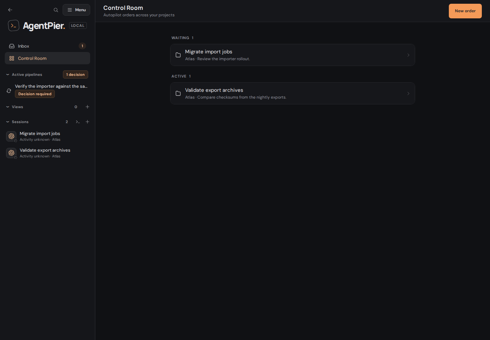

# Autopilot orders

An owner can commission a local project brief in an interactive Composer session. Each order has its own ID, worktree, branch, conversation and merge policy. The title is a display name. Opening an order starts the chat. Composer plans there and uses the ordinary AgentPier pipeline tools for authorized batches. A local brief can be the complete commission.

## Using the Control Room

Open **Control Room** directly below **Inbox** in the owner sidebar or the phone drawer. Quick open (⌘K or Ctrl+K) also finds it by **Autopilot**, **Composer**, **Orders** or **Aufträge**. The overview groups orders from every registered project by their current state. Each row opens one order, including when two orders share a project.



Choose **New order**, select the Git project, enter a title and brief, and choose the CLI, access and launch mode as for an ordinary session. **SSH accesses** and **Secrets** assign hosts and secrets to the session as the new-session dialog does; the project's own hosts and secrets reach it without being picked. **Start order** opens the interactive session for this brief. Discuss the plan there. **Allow implementation** and **Autopilot may merge pull requests** start off and can be edited independently under **Order permissions**. Creating the order starts the conversation. Pipeline execution requires separate authorization.

Open an order to see its saved batch plan. Expand a batch to inspect its items, dependencies, ticket states and linked evidence. The last checkpoint and next step come from Composer. **Order brief** keeps the original commission available. **Open session** returns to the conversation. An entry under **Waiting on you** takes you to the session question, approval or pipeline gate that needs a decision. Each run, ticket and pull request with a source link opens independently. You can bookmark the order address or reopen it after refreshing the browser.

See the [expanded batch plan on desktop](screenshots/control-room-wide.png) and the [same order on a phone](screenshots/control-room-compact.png).

**Pause order** pauses new work on just that order. **Resume order** continues with its existing session. **Recover session** can reuse a stopped session or establish a replacement using the recorded checkpoint. A failed initial launch that reserved the order offers **Open reserved order** so you can correct session access there.

To remove a completed managed order, stop its Composer session, choose **Remove order**, and confirm the displayed title. A blocked cleanup keeps the error in the dialog. Resolve its cause and retry. An interrupted cleanup offers **Finish removal**. The order disappears from the Control Room after successful cleanup. Pipeline history and pull requests remain available. Historical files can show plans and permit explicit policy edits. Only managed orders have session recovery and resource cleanup controls.

## Owner API

All paths below are relative to `/api/autopilot`. The routes use normal owner authentication and origin checks. Restricted users cannot read orders or follow their live topic.

| Method and path           | Request and result                                                                                                                                                                                                                               |
| ------------------------- | ------------------------------------------------------------------------------------------------------------------------------------------------------------------------------------------------------------------------------------------------ |
| GET `/projects`           | Returns `{projects: [{id, name, cwd}]}` for Git projects known through project memory or saved repository clones. Use the returned Git project ID for creation.                                                                                  |
| POST `/orders`            | Requires `projectId`, `requestId`, `title`, `brief` and `session`. Optional fields are `baseBranch`, `implementationAuthorized` and `allowMerge`. Returns the order view with HTTP 201.                                                          |
| GET `/orders`             | Returns `{orders: [...]}`, including discovered local files. The list reads recorded progress and local sources.                                                                                                                                 |
| GET `/orders/:id`         | Returns the order view and attempts bounded refreshes of explicitly identified tickets and PRs in the project's configured sources.                                                                                                              |
| PATCH `/orders/:id`       | Sets either or both boolean policy fields. Unspecified fields retain their values. Returns the order view.                                                                                                                                       |
| POST `/orders/:id/pause`  | Sets `manualPaused`. The session remains available for questions. Returns the order view.                                                                                                                                                        |
| POST `/orders/:id/resume` | Accepts `{}` to continue the existing session, or `{"recover":true}` to explicitly recover when its session is missing or cannot reload. When an initial launch needs a different profile, supply a corrected `session`. Returns the order view. |
| DELETE `/orders/:id`      | Cleans up one completed managed order. Returns HTTP 204. Repeat the same DELETE to finish an interrupted cleanup while the entry still exists.                                                                                                   |

For example, a new order can start with this request body:

```json
{
  "projectId": "<id from GET /projects>",
  "requestId": "migration-plan-01",
  "title": "Migrate the import jobs",
  "brief": "Plan a migration in two independently reviewable batches.",
  "session": { "tool": "codex" },
  "allowMerge": false
}
```

Use a fresh request ID per intended order and reuse it with the same parameters after a timeout. A request ID is 1–128 ASCII letters, digits, periods, underscores or hyphens, starting with a letter or digit. The title accepts up to 100 characters and the brief up to 65,536 UTF-8 bytes. Different request IDs can use identical titles. Reusing a key with different input returns 409, and replaying it after successful removal returns 410. A create retry after a pause returns the paused order.

`session` accepts a coding `tool` or `accountId`, plus the ordinary `providerConnectionId`, `providerModelId`, `nativeModelId` and `launchMode` options. The optional lists `sshAccessIds` (up to 30) and `secretIds` (up to 50) assign SSH hosts and secrets to the session, in addition to those of the order's project. A replacement session started by a later recovery receives the listed ones that still exist. The server owns the session ID and working directory. If a launch needs attention, its response includes `orderId` once the order has been reserved. Keep that ID when fixing settings. Errors include translated message keys and, for order-specific failures, an `AUTOPILOT_*` code. `AUTOPILOT_COMPOSER_SKILL_UNAVAILABLE` calls for the complete current package, including its progress helper, enabled in the selected native profile. See the [shared CLI extension guide](shared-cli-extensions.md).

Both permission flags default to false. An implementation grant covers only the work in the commission. Merge permission covers the specified order and still requires repository checks and branch protection. The normal session MCP grant is restricted to the current project, configured profile resources and reading the catalog, reading runs, starting authorized pipelines and publishing their PRs. Besides that grant the session works like an ordinary interactive one: it has the SSH tools and its own SSH agent, the project's secrets file, and the `preview_open`, `preview_close` and `preview_list` tools for servers it runs itself ([session previews](previews.md)), and `artifact_publish` and `artifacts_list` ([private artifacts](artifacts.md)). Pipeline publication and the final merge are separate operations. AgentPier checks the order again for new starts, including a queued start about to run. An already-running pipeline continues through a manual pause. Composer reads the owner decisions for its own order through the read-only session tool `autopilot_policy` before further external actions, including submitting a PR to a merge queue.

## Progress and links

The view exposes the brief, session and its chat link, project, selected profile, managed worktree and branch, control flags, `planStatus`, `reportedStatus`, `status`, `state`, `checkpoint`, `nextAction` and `limitations`. `state` groups orders into `draft`, `waiting`, `active`, `paused`, `completed` or `unknown`. A session question or pipeline gate links to its original action. The order detail uses the normal session and run routes.

`draftBatches` and `batches` hold the proposed and ordered plans. Each new batch and nested item has a stable string ID, title, task, status and `dependsOn` IDs. Promotion or reordering retains IDs. Batches, items and the order can carry `tickets`, `runs`, `pullRequests` and `findings`. Aggregates are deduplicated and counts include totals and counts by status. The view carries the source and evidence link where supplied. Historical anonymous items can have a null ID. Unavailable sources carry their last reported data or an explicit limitation. A missing timestamp or status remains unknown.

Run data is checked against the registered project. Durable start receipts allow Composer to reconcile an interrupted handoff even when it had no opportunity to write the returned run ID. Unassigned runs stay visible at the order level. A matching request ID on a batch or item associates it with that start. GitHub and Plane ticket reads use configured project adapters. Other ticket systems retain explicit source, instance, project, identifier and URL as reported by Composer. Local file URLs never select an authenticated server to contact.

The live signal `autopilot.orders.changed` follows the global register. Append `:<projectId>` to follow a single project. On open or a change signal, read the list or detail once. Use the existing `pipeline.run`, `pipeline.runs.changed`, `pipeline.queue:<projectId>`, `session.requests` and workspace state topics for changes in those sources. A Composer write from another worktree wakes subscribers through a directory watch.

## Storage, recovery and removal

The brief and progress live in `<git-common-dir>/agentpier-composer/<id>.json`. Worktrees of the same repository share that directory. Composer uses its installed `scripts/order-progress.mjs` to merge progress fields into the current file under a writer lock and replace it atomically. The helper preserves owner-controlled policy, pause, ID and unknown fields. During a pause it accepts only checkpoint and next-action updates.

On macOS every read, write and removal of an order file runs in a short-lived child process that works relative to the pinned order directory. The child receives its request as an already unlinked file in the private per-user folder `/tmp/agentpier-composer-writes-<uid>/`, not through a pipe, and has 30 seconds: a synchronous spawn on macOS occasionally never finishes writing more than 64 KiB to a child's stdin, which blocked the server on an order with a long brief. The server always uses the helper it ships. A Composer package seeded into a CLI profile by 2.21.0-rc.2 or rc.3 has its own earlier copy. AgentPier replaces that copy with the shipped helper the next time a session of the profile starts, as long as the file is unchanged; a helper you edited stays as it is. The writer lock, `writer.sqlite` in that same folder, is one per user and not per data directory or repository: the server and the helper of every CLI session must take the same lock, and they share neither a `TMPDIR` nor AgentPier's data directory. `AGENTPIER_COMPOSER_WRITES_DIR` (an absolute path to a private folder) moves the lock and the request files for a test run; every process that writes the same orders must then be given the same value, and a production installation leaves it unset.

AgentPier stores the authoritative execution, pause and merge decisions for managed orders in the private register. The order file mirrors these decisions for local readers. Changing its copy cannot grant permission. An older managed reference without recorded owner decisions starts paused with both permissions off.

AgentPier keeps references, request receipts, resource identities and cleanup state under `<dataDir>/autopilot/register.json`. Git worktree preparation also records ownership in AgentPier's existing workspace store. Preserve the register, resource metadata and repository Git metadata together when moving an installation. The register can discover compatible historical files by filename and repository identity. Their generated register IDs are stable, and their original files retain their own IDs or lack of one. Their session or worktree fields cannot establish ownership. A valid historical file can receive an explicit policy edit. Session recovery and resource cleanup require a managed reference.

Resume reconciles existing work first. A running session is reused and a stopped, resumable one uses the normal reload path. Explicit recovery preserves the order, checkpoint, run ownership and worktree when it needs a replacement conversation. A rejected delivery can be retried with explicit recovery. An ambiguous pipeline start must be checked against its original request ID before any further launch.

To remove a completed order, stop its Composer session through the session controls. Cleanup checks the registered project and worktree identity, the checked-out branch, active sessions, runs and processes, tracked changes, untracked and ignored files, and Git ancestry against the recorded base. For an origin base it refreshes that branch first. Local commits missing from the base keep the branch and worktree intact. Cleanup journals the checked head before removal and checks it again when deleting the branch. On success it removes the owned session resources and authoritative file, drops the register entry last and retains a removal receipt. Pipeline runs, their worktrees and PR history remain available through their usual routes.
