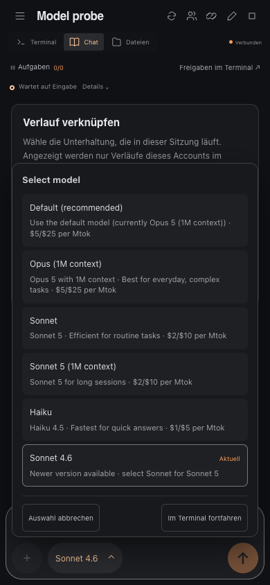

# Chat model switching

First validated on 2026-09-13 with Claude Code 2.1.270 and tmux 3.7c on macOS ARM64;
the picker layout of that release is no longer supported (see
[minimum CLI versions](cli-updates.md#minimum-cli-versions)), and the fixtures now use
the Claude Code 2.1.329 captures described below.

A disposable application and private tmux server reproduced two failures:

- At 50 columns, the native confirmation footer wraps across lines. Reading only
  its last line loses both picker recognition and the session-only action.
- After leaving a 390 × 844 mobile terminal view, the pane retains 43 × 31 cells.
  Claude clips the model dialog. The chat stream's `ignore-size` control client
  remains attached but has no visible terminal.

The native browser probe opened the mobile terminal, entered a native draft,
switched to Chat, entered a chat draft, opened the model picker and selected
Haiku. The real browser, HTTP routes, controller, tmux transport and Claude CLI
completed the switch from Sonnet 4.6 to Haiku 4.5. Both drafts survived, the picker
closed and the browser stayed in Chat. The disposable profile's default model
remained unset. No real account, provider credential or remote model request was
used.

Automated coverage includes native wrapped screen fixtures, controller selection
and cancellation, stale confirmation tokens, default-only dialog rejection and
input blocking after a controller restart. A real tmux integration test includes
the chat observer and verifies that visible terminals retain their dimensions and
reattachment resumes automatic sizing. Mobile browser coverage runs the real model
parser and controller with a controlled CLI boundary in German and English.

## Claude Code 2.1.329

Claude Code 2.1.329 redrew `/model`. A subtitle ("Your pick is the default for new
sessions …") follows the title, an effort row (`◐ Medium effort (default) ←/→ to
adjust`) and a `/fast` hint sit below the options, and the footer starts with the
session-only key: `s to use this session only · Enter to save · Esc to cancel`.
AgentPier did not recognise that footer, so the chat showed "the CLI is waiting for
another selection" without models. A footer without the session-only key would save
the default and stays undriven. Claude Code 2.1.329 is the minimum AgentPier supports,
so the older footer (`Enter to set as default · s to use this session only · Esc to
cancel`) is no longer read.

Subscription accounts also see an unnumbered `▸ More models` row after the first
models. Enter on it toggles the list (`▾ More models`); the hidden models follow it,
numbered on. While the row has the focus, the effort row disappears and the footer
reads `Enter to expand · Esc to cancel`. When the chat opens the picker, AgentPier
arrows to that row, presses Enter only once the screen shows the row focused, and
arrows back to the model that was selected, so the chat lists every model. Selection
counts the row as one arrow-key step. The effort row is not a model and stays in the
terminal.

The API-key layout (no expander) was captured from the installed 2.1.329 in a
disposable HOME, a private tmux socket and the mock Anthropic API, and the controller
opened the picker and switched to Sonnet for the session there. The expander screens
are reconstructed from an owner screenshot and Claude Code's renderer, because the
expander only appears with a subscription's model catalog; see
`tests/fixtures/models/README.md`.

## Codex 0.169.1

**Choose model** opens Codex's picker only when the composer is idle: AgentPier reads
the prompt row and the footer that names the model (`GPT-5.5 default · <working
directory>`) below a blank row, followed by Codex's key hint (`← for agents · ? for
shortcuts`). A long working directory wraps that footer over several rows. AgentPier
read only the last footer row, found no model in it and refused the picker with
"Model selection is not available right now". The footer is now read as one block of
rows between the blank row and the key hint. A capture of the installed 0.169.1 at
80 columns in a disposable HOME and a private tmux socket reproduced the refusal;
with the fix the controller opened the picker there and listed its models.

Run `node --test tests/unit/codex-model-state.test.js` for the captured idle screens.

## Attachments while the picker is open

An open picker (or a selection AgentPier started and has not yet seen finish) holds
the composer: **Send** stays disabled until the picker closes. It no longer holds the
draft's attachments. A file dragged onto the chat while the popover is open, the
popover itself included, is uploaded and listed under the draft like any other drop;
nothing reaches the terminal, and the picker stays open. Before, the chat's drop zone
was disabled while the picker was open, so the drop was swallowed without a message.
`tests/browser/chat-drop-model-picker.spec.js` covers it in English and German.

## Tests

Run `node --test tests/unit/claude-model-picker-2-1-329.test.js tests/unit/models.test.js tests/integration/model-viewport.test.js`
and `npx playwright test tests/browser/claude-model-control.spec.js tests/browser/model-control.spec.js tests/browser/chat-drop-model-picker.spec.js`.
Set `AGENTPIER_TEST_BROWSER=webkit` for the WebKit browser run.
