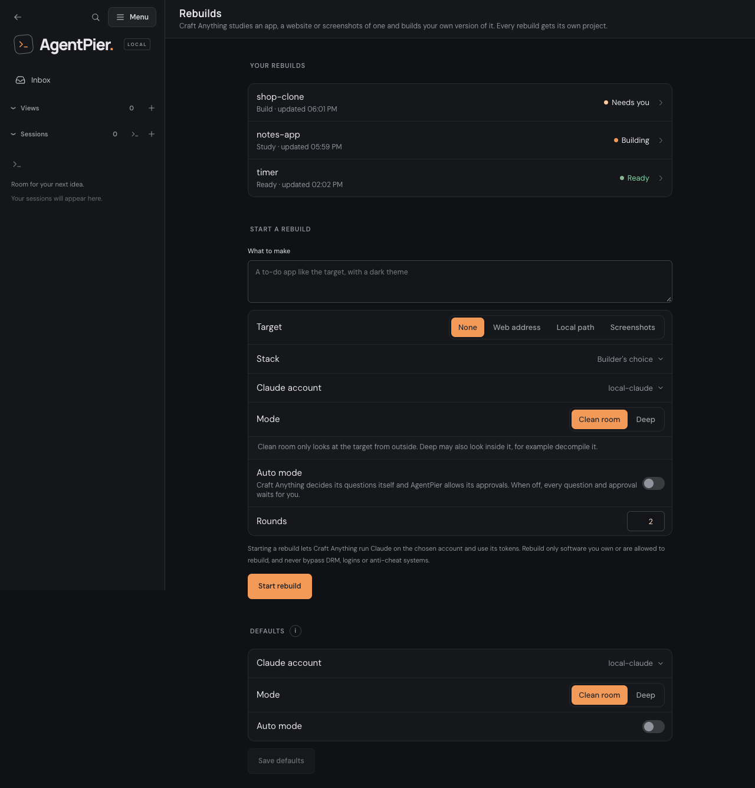
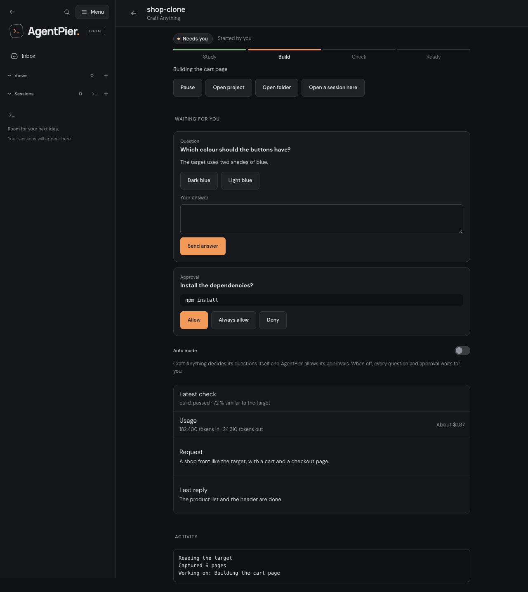

# Rebuilds (Craft Anything)

**Rebuilds** in the sidebar **Menu** (group **Work**) lets [Craft Anything](https://github.com/storytold/craft-anything)
study an app, a website or a file and build your own version of it. Every rebuild
gets its own project, and Craft Anything runs Claude on one of your Claude accounts to
do the work. The page is for the owner only and never shows in the users' app. Until Craft Anything is
[installed](mcp.md#managed-craft-anything) it shows a note instead of the form.

Use it only for software you own or are allowed to rebuild, and never to bypass DRM,
logins or anti-cheat systems. Starting a rebuild uses the chosen account's tokens; the
form says so next to **Start rebuild**.

## Start a rebuild

| Field              | Meaning                                                                                                                                                                                    |
| ------------------ | ------------------------------------------------------------------------------------------------------------------------------------------------------------------------------------------ |
| **What to make**   | The request, in your own words.                                                                                                                                                            |
| **Target**         | **None**, a **Web address** or a **Local path** (an absolute path) of what Craft Anything studies.                                                                                         |
| **Stack**          | What to build with: Builder's choice, Plain HTML and CSS, React + TypeScript (Vite), Next.js + TypeScript, Python, Electron, Rust (console), Rust + egui (eframe), Unity, Unreal or Godot. |
| **Claude account** | Any Claude account that can build: a local or managed account without a provider. The default is your default Claude account, else the local one.                                          |
| **Mode**           | **Clean room** only looks at the target from outside. **Deep** may also look inside it, for example decompile it.                                                                          |
| **Auto mode**      | See [Auto mode](#auto-mode).                                                                                                                                                               |
| **Rounds**         | How many build and check rounds Craft Anything may use.                                                                                                                                    |

**Defaults** on the same page keeps the account, mode and auto mode that new rebuilds
start with (**Save defaults**). Without an eligible Claude account the page says so and
points to **CLIs & extensions › Accounts**.

## The project of a rebuild

Every rebuild creates a fresh folder in your default projects folder, named from the
request (a number is appended when the name is taken), and registers it as an
AgentPier project. AgentPier writes a `.gitignore` for Craft Anything's working
folders (`capture/`, `checks/`, `inbox/`, `investigation.cany/`) and runs `git init`;
the project then becomes a Git project and keeps that id. AgentPier makes no commits.
When the folder cannot be created (for example the default projects folder is not
writable) the start is refused with a message and nothing is left behind. Craft
Anything keeps its records at the root of the folder and the app in `app/`.

## Following a rebuild

The list shows each rebuild with its status (**Starting**, **Building**, **Checking**,
**Needs you**, **Ready**, **Paused**, **Failed**) and its step (**Study**, **Build**,
**Check**, **Ready**). A rebuild opens to its page:

- the request, the latest check (each check passed or failed, and how similar the
  result is to the target), usage and Craft Anything's last reply;
- **Activity**, which refreshes whenever the rebuild's view changes, not continuously;
- **Pause** and **Continue**, **Ask for changes** (another round in the same
  project, sent with **Send request**) and the **Auto mode** switch of this rebuild;
- **Open project**, **Open folder** and **Open a session here**.

There is no preview of the built website yet: open the folder or start a session in the
project to run it.

## Questions and approvals

While Craft Anything builds, it asks questions and asks for approvals (to run
something, for example). They show under **Waiting for you** on the rebuild's page, in
the [inbox](inbox.md) (**Question from a rebuild**, **Approval for a rebuild**) and as a
push notification, **A Craft Anything rebuild waits for you**
([notifications](notifications.md#what-notifies-you)). The notification names the
rebuild and previews a question, never an approval. It has no Allow or Deny buttons:
opening it shows the card. A question answered in two places at once is answered by
the first; the second is refused as already answered. After **Pause** and **Continue**
Craft Anything asks an open approval again and may still list the old one; answering
the old one is refused as no longer open and drops it from the page and the inbox.

### Auto mode

Auto mode is one switch, off by default; the default lives in **Defaults** and each
rebuild can change it.

- **Off:** you answer every question and approval.
- **On:** Craft Anything decides its questions itself and AgentPier allows its
  approvals. Turn it on only for rebuilds you trust to run unattended.

## Accounts and children

A rebuild runs on the account you choose: the builder gets that account's own
`CLAUDE_CONFIG_DIR`, so two rebuilds on different accounts never share a login. AgentPier
starts one Craft Anything MCP process per Claude account and mode, on demand, and closes
it 60 seconds after its last running rebuild ends. While a rebuild runs, AgentPier reads
its state every 2 seconds; nothing is read while none runs.

AgentPier gives the rebuilds their own Craft Anything config under
`<data dir>/craft-anything/rebuilds` (separate from the sessions' one) and names Claude
Code there as the backend that builds (an `[[ai.backends]]` entry in its `config.toml`,
switched on at every start), because Craft Anything does not use a coding
agent from `PATH` until one is configured. The account's login is the one in its
`CLAUDE_CONFIG_DIR`.

## Starting rebuilds from sessions and agents

Your coding sessions with AgentPier tools (full access) and your own agents can start
rebuilds too:

- Sessions get `craft_rebuild_start` and `craft_rebuild_status`
  ([MCP](mcp.md#starting-rebuilds-from-sessions)).
- Agents that may create projects get `agentpier_craft`
  ([agents](agents.md#rebuilds-with-craft-anything)).

They choose only the request, the target and the stack. The account, the mode and
auto mode always follow your defaults. A session's target may be a web address, an
absolute local path or nothing; an agent's only a web address or nothing, never a local
path. The request text still steers the builder, which runs with your account on your
machine (and in auto mode with its approvals allowed), so grant `agentpier_craft` only
to agents you trust with that. A session's `requestId` counts within that session only.
They see a rebuild's status, folder and how many questions wait, not
the questions themselves: you answer those in AgentPier. The rebuild shows **Started by
a session** or **Started by an agent**.

## Shutdown and Continue

Stopping or restarting AgentPier pauses running rebuilds: AgentPier stops each one,
closes Craft Anything and ends the builder with everything it started. After the next
start those rebuilds read **Paused**; **Continue** resumes them. Nothing restarts on
its own, and a rebuild whose Craft Anything process dies unexpectedly reads Paused or
Failed. Pausing a rebuild yourself works the same way. A rebuild that never reached
Craft Anything reads Failed and offers neither **Continue** nor **Ask for changes**.

AgentPier also keeps the process groups of its Craft Anything processes and their
builders in `<data dir>/craft-rebuilds/children.json` while they run. After a crash or
a forced exit, the next start ends those that are still running (only when a recorded
process with the same command line is still in the group) before the rebuilds read
Paused, without waiting for Craft Anything's own start or update.

## Storage and removal

The rebuild list and the defaults live in `<data dir>/craft-rebuilds/rebuilds.json`,
outside Craft Anything's own folder: removing Craft Anything keeps the list and the
rebuilds' projects. While a rebuild runs or one of the rebuilds' Craft Anything
processes is still open (up to 60 seconds after the last one ended, also after opening
a rebuild's page), removing, updating or changing Craft Anything (also removing Ghidra)
is refused as in use, as it is for a session.

## API and live topics

The owner-only routes are `GET /api/craft/rebuilds` (the list with the defaults,
eligible accounts, stacks and whether Craft Anything is installed),
`POST /api/craft/rebuilds` (start), `GET /api/craft/rebuilds/:id`, `.../follow-up`,
`.../pause`, `.../continue`, `.../answer`, `.../auto-mode`, `GET .../activity` and
`PUT /api/craft/settings` (the defaults). The page follows the live topics
`craft.rebuilds` and `craft.rebuild:<id>` ([architecture](architecture.md#live-channel)).
