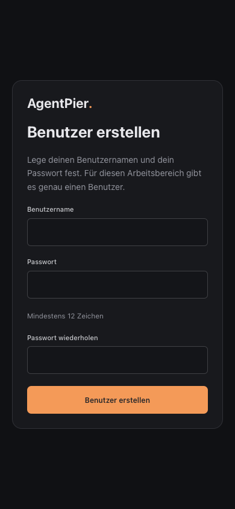

# Anmeldung am Arbeitsbereich

Beim ersten Öffnen zeigt AgentPier **Besitzerkonto anlegen**. Wähle einen Benutzernamen und ein Passwort mit mindestens zwölf Zeichen. Die Einrichtung funktioniert lokal, über Tailscale nur mit dem eigenen Tailscale-Konto und im Netzwerkmodus nur, solange noch keine Benutzer angelegt sind (Details siehe unten). Das erste erfolgreich angelegte Konto ist das Besitzerkonto und gehört zum gesamten Arbeitsbereich; danach ist keine weitere Registrierung möglich. Bereits bestehende Arbeitsbereiche zeigen diese Einrichtung beim ersten Start einer Version mit Anmeldung ebenfalls an.

Anschließend erscheint auf anderen Geräten **Anmelden**. Die Session übersteht einen Neustart des Webdienstes und läuft erst nach 30 Tagen ohne Nutzung ab: Solange der Browser AgentPier verwendet, verlängert der Server sie automatisch, sobald weniger als 15 Tage verbleiben, und erneuert dabei den Cookie. Spätestens 90 Tage nach der Anmeldung ist eine neue Anmeldung nötig. Bestehende Sessions aus älteren Versionen gehen beim Update nicht verloren. **Abmelden** steht im **Menü** der Seitenleiste, auch auf Mobilgeräten. Die Abmeldung widerruft die aktuelle Browser-Session und schließt ihre Terminalverbindungen sofort; laufende CLI-Prozesse in tmux bleiben erhalten. Andere angemeldete Geräte bleiben angemeldet. Die Abmeldung meldet auch die Mitteilungen dieses Browsers ab; meldet sich dort eine andere Person an, erhält der Browser die Mitteilungen der vorherigen Person ebenfalls nicht mehr. Setzt der Besitzer das Passwort eines Benutzers zurück oder schaltet **Anmelden erlaubt** aus, verlieren alle Geräte dieses Benutzers ihre Mitteilungen; ändert der Benutzer sein Passwort selbst, behält sie nur der Browser, in dem er es geändert hat. Es können höchstens zwanzig Browser-Sessions bestehen; eine weitere Anmeldung widerruft die am längsten nicht genutzte.

Die Anmeldung ersetzt nicht die vorhandenen Host-, Origin- und Tailscale-Prüfungen. Der Webdienst lauscht weiter auf Loopback; der konfigurierte Tailscale-Zugang lässt jedes Mitglied des eigenen Tailnets bis zur Anmeldeseite, Anfragen ohne Tailscale-Anmeldung (Funnel, getaggte Geräte) bleiben abgewiesen. Die Einrichtung benötigt weder eine E-Mail-Adresse noch einen externen Kontodienst.

## Benutzer

Neben dem Besitzer kann es eingeschränkte Benutzer geben, etwa für Familienmitglieder. Nur der Besitzer legt sie an und vergibt ein erstes Passwort; eine Selbstregistrierung gibt es nicht. Benutzer melden sich auf derselben Seite mit ihrem eigenen Benutzernamen und Passwort an. Benutzernamen müssen sich ohne Rücksicht auf Groß- und Kleinschreibung vom Besitzer und allen anderen Benutzern unterscheiden; bei der Anmeldung zählt der Name genau so, wie er angelegt wurde. Für Benutzer gelten dieselben Session-Laufzeiten und höchstens zwanzig Sessions je Person. Deaktivieren, Löschen oder ein neues Passwort beendet ihre Sessions und offenen Verbindungen sofort. Deaktivieren beendet außerdem ihre Erinnerungen, Routinen, Check-ins und Telegram-Bots, und ihr Chat nimmt keine neuen Nachrichten mehr an; ihre Agenten und Chats bleiben erhalten; ändert ein Benutzer sein Passwort selbst, bleibt nur die aktuelle Session bestehen.

Ein Benutzer sieht nur seine eigene, schlanke Oberfläche und erreicht keine Bereiche, Daten oder APIs des Besitzers; der Server beantwortet solche Anfragen wie unbekannte Adressen. Der Zugriff ist standardmäßig verweigert: Benutzer erreichen nur die Routen unter `/api/me`, die `server/http/route-access.js` ausdrücklich freigibt, der Besitzer keine davon. WebSockets lässt `server/http/socket-access.js` nach der Session-Prüfung zu: Benutzer öffnen nur den Chat eines eigenen Gesprächs, die Browser-Ansicht eines Agenten, den sie beobachten dürfen, und das Diktat, das die Deepgram-Verbindung des Besitzers nutzt. Jeder `/api`-Router wird über `server/http/api-registry.js` eingehängt; Tests gehen das Routenverzeichnis (`route-inventory.js`) durch, sodass eine neue Route für Benutzer automatisch gesperrt ist und eine neue Agenten-Route in `server/http/owner-content-routes.js` als Inhalt oder Einstellung eingeordnet werden muss. Koppeln, Ändern und Entfernen eines Telegram-Kanals zählen als Inhalt, weil der Kanal in den Hauptchat des Agenten zustellt.

Die Chats eines Benutzers sind privat: Jeder Benutzer hat mit jedem seiner Agenten eigene Chats, auch bei geteilten Agenten. Der Besitzer sieht sie, und Gedächtnis, Anhänge und Browser eines eigenen Agenten des Benutzers, nur mit **Besitzer darf Chats lesen** für diesen Benutzer. Chats sieht er dann erst ab dem Einschalten, Gedächtnis, Dateien und Browser des eigenen Agenten dagegen vollständig, auch ältere Einträge. Der Benutzer sieht diese Einstellung in seiner Oberfläche. Freigaben gehen an die Person, in deren Chat sie entstehen; Erinnerungen, Routinen und Push-Mitteilungen gehören jeweils der Person, die sie angelegt hat, und ihren eigenen Geräten. Beim Löschen eines Benutzers entscheidet der Besitzer, ob dessen eigene Agenten archiviert oder als eigene behalten werden; die Chats werden mit dem Benutzer gelöscht, außer der Besitzer durfte sie lesen. Details: [Private Chats von Benutzern](assistant-gateway.md#private-chats-of-restricted-users). Benutzer legt der Besitzer unter **Einstellungen › Zugriff › Benutzer** an. Ein Benutzer sieht nach der Anmeldung nur seine eigene, schlanke Oberfläche: **Meine Agenten**, seine Chats, die Einstellungen seiner Agenten im Rahmen seiner Stufe und **Konto** (Passwort ändern, ob der Besitzer Chats lesen darf, Mitteilungen seiner Geräte, Abmelden); Details: [Benutzer](agents.md#users) und die englische Anleitung [Users](users.md).

## Speicherung und Wiederherstellung

Im Datenverzeichnis liegt `login/auth.json` mit Benutzername, gesalzenem scrypt-Passworthash und Hashes zufälliger Session-Token. Das Verzeichnis erhält Modus `0700`, die Datei `0600`. Passwörter und unveränderte Session-Token werden nicht in der Datei abgelegt. Benutzer und ihre Sessions liegen getrennt davon in `users/users.json` (ebenfalls `0600` in einem `0700`-Verzeichnis), sodass ältere Versionen eine Benutzer-Session nie als Besitzer-Session lesen. Der Browser verwendet einen Host-gebundenen HttpOnly-Cookie mit `SameSite=Strict`; beim konfigurierten HTTPS-Fernzugriff trägt er zusätzlich `Secure`. Anmeldung und Einrichtung sind zusammen auf zehn Hash-Versuche pro Minute begrenzt, getrennt gezählt für den Rechner selbst, für jedes Tailscale-Konto und für jede Netzwerkadresse. So kann ein Tailnet-Mitglied mit Fehlversuchen nur sich selbst sperren, nicht den Besitzer. Weil ein Prozess auf dem Rechner den Tailscale-Kontokopf selbst setzen kann, zählen alle Tailscale-Anmeldungen zusätzlich gemeinsam gegen dreißig Versuche pro Minute; wechselnde Kontonamen umgehen die Grenze also nicht. Versuche, die das eigene Fenster eines Kontos schon ablehnt, zählen dort nicht mit. Ändert ein Benutzer sein Passwort selbst, gilt für die Prüfung des aktuellen Passworts dieselbe Grenze je Benutzer.

Normale AgentPier-Backups enthalten diese Anmeldedaten und Browser-Sessions nicht. Ein in ein neues Datenverzeichnis wiederhergestellter Arbeitsbereich beginnt daher damit, das Besitzerkonto neu anzulegen. Benutzer sind in Backups enthalten, ihre Passworthashes aber nur im verschlüsselten Teil mit Zugangsdaten und ihre Sessions nie; ohne diesen Teil vergibt der Besitzer nach der Wiederherstellung neue Passwörter ([Benutzer › Backups](users.md#backups)). Für ein vergessenes Passwort gibt es keine Web-Zurücksetzung: Der Besitzer des Server-Benutzerkontos kann bei gestopptem Webdienst die Datei `login/auth.json` aus dem Datenverzeichnis entfernen und anschließend das Besitzerkonto neu anlegen. Dadurch werden alle bisherigen Browser-Sessions des Besitzers ungültig. Benutzer, ihre Passwörter und ihre Sessions in `users/users.json` bleiben erhalten: Solange kein Besitzer eingerichtet ist, gilt niemand als angemeldet, danach sind die Sessions der Benutzer wieder gültig. Wer auch sie beenden will, entfernt zusätzlich `users/users.json`; damit sind alle Benutzer gelöscht.

Den Besitzer richtet nur ein, wer direkt auf dem AgentPier-Rechner arbeitet (auch über einen SSH-Tunnel auf `127.0.0.1`) oder über Tailscale mit dem Tailscale-Konto kommt, das `npm run tailscale` als eigenes gespeichert hat. Andere Tailnet-Mitglieder sehen bis dahin nur einen Hinweis. Im Netzwerkmodus ohne Tailscale ist die erste Einrichtung nur möglich, solange es noch keine Benutzer gibt; die Wiederherstellung findet dann lokal statt.

## Technische Grenzen

`GET /auth/status`, `POST /auth/setup`, `POST /auth/login` und `POST /auth/logout` durchlaufen dieselben Host- und Origin-Prüfungen wie die Oberfläche. Die übrigen HTTP-APIs und Terminal-WebSockets benötigen eine gültige Browser-Session, auch solange noch kein Besitzerkonto angelegt wurde. Öffentlich erreichbare statische Dateien enthalten nur die Anwendung und Anmeldeseite, keine Arbeitsbereichsdaten.

Nur `GET`/`HEAD /api/health` bleiben für direkte lokale Aufrufe ohne Proxy- oder Tailscale-Header ohne Anmeldung erreichbar, damit Dienststart und Release-Aktivierung weiterhin ihre Versionsprüfung durchführen können. Über Fernzugriff benötigt auch dieser Endpunkt eine Anmeldung. MCP-Maschinenzugänge behalten ihre eigene OAuth-/Token-Authentifizierung; ihre Tokens berechtigen weiterhin nicht zum Aufruf normaler Browser-APIs. Native CLI-Anfragen nutzen unverändert ihre eigenen sitzungsgebundenen Kanäle.

`npm run dev` leitet sowohl `/api` als auch `/auth` an den Backend-Port weiter. Die bestehende explizite Freigabe der Entwicklungs-Origin bleibt erforderlich. Browser-Tests legen nur in ihrem isolierten Testserver einen temporären Benutzer an; Tests gegen einen externen Testserver können mit `TUIUI_TEST_STORAGE_STATE` eine vorhandene Playwright-Session verwenden.

