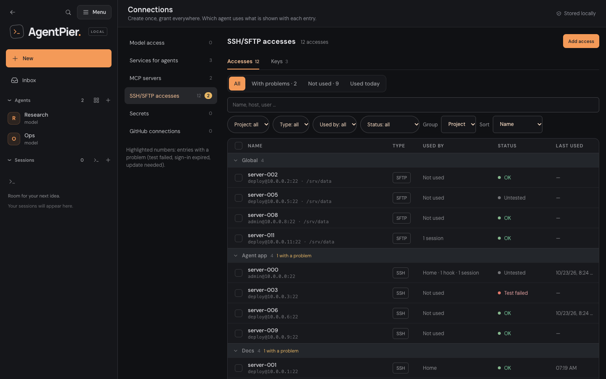

# SSH server accesses

AgentPier manages SSH keys and hosts for projects and individual sessions. Local Codex, Claude Code and OpenCode sessions can provision project access through MCP. Shell sessions can use the manual SSH helper. Sessions can also use [plain SSH](#plain-ssh-from-coding-sessions) (`ssh <alias>`, `scp`, `rsync`, `git`, tunnels) through their own SSH agent. The CLI continues to run on your computer.

## Project ownership and session assignments

A project's hosts are available to its existing and future supported interactive sessions. Git checkouts and their worktrees share a project; separate clones remain separate. An ordinary launch directory is also a project, including a nested directory selected as its own launch root. SSH project binding works independently of the Memory setting.

The project is bound when the session launches. Running `cd` does not change it. AgentPier checks the canonical launch directory and its filesystem identity, as well as the Git common-directory identity where applicable. A removed, replaced or changed project directory requires a new binding; it cannot silently acquire another project's records. This also applies to replacing a worktree at the same path.

Open **Connections › SSH/SFTP accesses** from the sidebar **Menu** (the old address `/settings/ssh` leads there). The **Accesses** and **Keys** tabs list every entry; see [Long lists and bulk actions](#long-lists-and-bulk-actions). Select an entry to open its details beside the list; **Full view** opens the complete page with the form, [Used by](#used-by), the [last test](#last-test-result) and **Manage** (the activity log filtered to the entry, **Reassign project resources** and **Delete access**). On a phone, categories, list and details open one after another. Host fingerprints stay collapsed until opened. Connection tests and private-key downloads still require an explicit action.



The [categories with the model access list](screenshots/connections-desktop.png); on a phone: [Connections categories](screenshots/connections-phone.png).

A host is either an SSH host (commands) or an SFTP host (file transfer, see [SFTP access](sftp-access.md)). The host form has a **Type** choice for it; an SFTP host signs in with a **Password** or a **Key** (**Sign-in**) and can confine every remote path to an optional **Allowed remote folder**. The list's **Sign-in** column shows "Password" or the key's name, and SFTP hosts carry an **SFTP** badge.

Select the project when creating keys or hosts. The current project filter preselects ownership for new entries. A project host must use a key owned by the same project. Existing global entries remain global. Explicit session assignments add access to selected global or other-project hosts without transferring key ownership. The session picker marks inherited hosts as **Project**; manage those hosts in settings. Removing an explicit assignment does not remove independently inherited project access.

### Git initialization in a session folder

One identity change keeps a running session's project: its launch folder was a plain directory and became the root of its own Git work tree, for example after `git init`. AgentPier applies this rebind only when all of the following hold:

- The folder has the same canonical path, device and inode as at launch.
- Git reports that folder as the work-tree root.
- The Git common directory is the folder's own `.git` directory. It must not be a symlink, a separate Git directory, a linked worktree or a parent repository.

Out-of-process SSH tools keep using the launch project ID until the server rebinds the session, so no access is added. The first server-side SSH management call or artifact publication moves the project to its Git identity, along with:

- memory entries, request receipts and session capabilities;
- SSH keys, hosts and their request receipts;
- artifact records and pipeline verification steps;
- the SSH binding of every session launched in that folder.

The move is refused when the Git identity already owns memory entries, SSH keys or SSH hosts, for example after an older `.git` directory was restored. The session then keeps only its launch project's SSH access. A rebind is recorded once, as the `project.updated` audit event, and a folder never rebinds to a second Git identity. If a move is interrupted, or another session registered the new identity first, the next artifact publication finishes it. An SSH management call finishes it only for a session that is still bound to the plain project ID. Verification steps merge into steps the Git project already has: missing steps are appended in order without duplicates, within the step limits. Session and OAuth grants that named the plain project follow it to the new identity; agent project access does not ([agent workflows](assistant-workflows.md#project-access-and-actions)).

After the move, the project follows Git project rules: its hosts, keys and memory are also reachable from subdirectories and linked worktrees of the new repository.

Every other change is rejected as before: a replaced folder, Git to plain directory, a different root or another common directory. Artifact tools answer "The project of this session changed. Reload the session to continue." (`ARTIFACT_PROJECT_CHANGED`), SSH answers `SSH_PROJECT_CHANGED` with "The project of this session changed. Reload the session to keep using SSH.", and server-side denials are audited as `artifact.denied` and `ssh.denied`. Removing `.git` stays strict, because a Git identity can be shared by linked worktrees and clones of the same common directory, so splitting it into a directory project is not equally safe.

Owner-only project reassignment moves the project's resources together. Colliding key identities or host endpoint/user combinations reject the whole move. The source project's sessions lose inherited access and the target project's sessions gain it; explicit assignments remain separate. Reload affected sessions to bind them to a changed launch project.

## Manage named keys

Create a named SSH key in settings. Generate a dedicated Ed25519 key or import an unencrypted OpenSSH private key. Pasted keys tolerate missing final newlines, CRLF line endings and surrounding whitespace. Passphrase-protected keys remain unsupported.

Names can be changed without changing the key or its host assignments. One key may be selected by multiple hosts; its entry shows the hosts using it. A referenced key cannot be deleted. To rotate a key, create a replacement, select it on the relevant hosts, then delete the unused old key. Deleting a host leaves its reusable key available. Editing, rotation, deletion and ownership changes are owner UI operations.

Ordinary API results and every MCP result contain public metadata only. **Download private key** is an explicit owner action in settings for generated and imported keys. It downloads the **unencrypted private key** through an authenticated POST; it does not render the contents in the page. Protect the downloaded file as a credential. No private key needs to be pasted into a conversation.

## Add a server

In the hosts section, enter a name, hostname/IP address, SSH port and username, then select a saved key. For file transfer choose **Type** → **SFTP** instead; [SFTP access](sftp-access.md) describes the password sign-in, the allowed remote folder and the transfer tools.

Fetch the server's host key, compare the displayed SHA256 fingerprint with an independently trusted source such as the server console, and confirm it. Scanning alone does not authenticate a server. Save the host, copy the selected key's public key and install that public key for the intended user on the target system. **Test connection** explicitly authenticates; saving or assigning an access makes no remote connection. See [Test connection](#test-connection) for what it checks.

### Legacy algorithms (ssh-rsa)

Older network switches, routers and appliances may only accept RSA signatures with SHA-1 (`ssh-rsa`), which OpenSSH 8.8 and later disable. Such a host fails with "Permission denied (publickey,password)" although the key is installed. For these hosts only, turn on **Legacy algorithms (ssh-rsa)** (German: **Alte Algorithmen (ssh-rsa)**) in the host's add or **Edit** dialog. It is off by default; the details show its state and, while it is on, a warning that SHA-1 is outdated and meant only for old devices.

When it is on, every OpenSSH connection to that host adds `-o PubkeyAcceptedAlgorithms=+ssh-rsa` and `-o HostKeyAlgorithms=+ssh-rsa`: **Test connection**, `ssh_test_host`, `ssh_execute` from coding CLIs, agents' SSH tool and the manual helper. Other hosts are unaffected, and no other SSH options can be added. Fetching the host key already scans RSA host keys. Only the owner can change the switch; agents and CLIs cannot set it when they register a host, but `ssh_list_hosts` and the agents' host list report `legacyAlgorithms: true` for such a host. Changing it changes the host's connection revision, so pending agent approvals for that host must be requested again. A project reassignment keeps it. SFTP hosts have no switch: their built-in client already accepts `ssh-rsa` from servers that offer nothing newer.

### Interactive shell (network devices)

Some switches and routers (for example TP-Link JetStream switches) accept the SSH sign-in but offer only an interactive console: `ssh host 'command'` ends with "Connection closed by remote host". For such hosts only, turn on **Interactive shell (network devices)** (German: **Interaktive Shell (Netzwerkgeräte)**) in the host's add or **Edit** dialog. It is off by default and the details show its state.

When it is on, every command for that host runs through the console instead of as a remote command: agents' SSH tool, `ssh_execute` from coding CLIs and the manual helper with ` -- <remote command>`. AgentPier connects with the same pinned options plus `-tt` and `-e none` (so a typed line such as `~.` is never an OpenSSH escape), and the [legacy algorithms](#legacy-algorithms-ssh-rsa) if that switch is on. It waits for the first prompt, then types each line of the command and waits for the prompt again after each line. Enter is typed as a carriage return (CR), as a terminal sends it: raw-mode device CLIs such as TP-Link JetStream switches accept only CR, and a Unix shell's pseudo-terminal turns it into a line feed. A prompt counts once the device has answered the typed line with CR or LF, including a prompt redrawn on the same line after a lone CR (for example `Core-Switch#` after `enable`). A command with several lines therefore sends several lines, for example `enable` and then `show running-config`. Pager prompts that fill their whole line (`--More--`, `-- More --`, `<--- More --->`, `Press any key …`, `Press SPACE …`) are answered with a space. At the end AgentPier types `exit` only if the console shows a prompt; after a question such as `Proceed? [confirm]` or a file name prompt it hangs up instead, so `exit` never answers it.

The result is the console text with terminal control sequences removed, carriage returns and backspaces applied like a terminal (later characters overwrite earlier ones), pager prompts removed, line ends normalised and the echo of the typed lines dropped. It reports `interactive: true` and no exit code (`exitCode: null`); chat notes and approval cards show **Interactive shell · no exit code** instead. Only when the connection fails before the first prompt (for example a refused key) is OpenSSH's own status (255) reported, and nothing was typed. The timeout and the 64 KiB output limit apply as for other commands; the manual helper uses 120 seconds and 64 KiB for a console host. Output is never written to disk. Approvals, the **With approval** and **Trusted** modes, the activity log and the stored command text are the same as for other commands. The approved text is what is typed: its lines one by one (CRLF counts as one line break), each ended with CR, followed by `exit` only at a prompt. A command for a console host may contain no control characters other than line breaks (no tab, lone carriage return, escape, DEL, Ctrl+C, Ctrl+U or Ctrl+W, which would edit the device's line); such a command is refused with `SSH_CONSOLE_CONTROL` before an approval card is shown.

When the typed lines produced nothing but prompts (for example only `enable`, or a device that ignored the commands), the result also carries `consoleTrace`: the raw console of the run with control characters made visible (`\r`, `\n`, `\t`, `\b`, `\x1b` and other `\xNN`, a backslash as `\\`) and `[typed "…\r"]` before what followed each typed line, including the final `exit`. It shows how the device echoes, redraws and ends lines, so an agent can diagnose a console that seems to ignore commands. It is at most 4 KiB; a longer trace keeps its beginning and end. Like the output it is returned only to the caller (the manual helper prints it to stderr), is untrusted remote data, and is never written to disk, the activity log or chat notes.

Limits: the prompt is recognised by a last line that ends in `>`, `#`, `$` or `]` (plus at most one space), except a status word in capitals such as `[OK]` and a question with an answer hint such as `[confirm]`; a device that shows anything else, or a question such as `Password:`, is considered ready after 1.5 seconds without output. A command that pauses longer than that before printing more may be followed by the next line or `exit` too early; split such work into separate calls. Success or failure can only be judged from the output. The console is not a terminal emulator: full-screen programs do not work. Only the owner can change the switch; agents and CLIs cannot set it when they register a host, and `ssh_list_hosts` and the agents' host list report `interactiveShell: true`. Changing it changes the host's connection revision, so pending agent approvals for that host must be requested again. A project reassignment keeps it. SFTP hosts have no switch.

### Test connection

**Test connection** in the host details and `ssh_test_host` check that AgentPier can sign in with the pinned host key and the selected key; they do not check that the device knows a command. They run `true` after the sign-in. Only an OpenSSH error (exit status 255: network, host key or authentication) fails the test. Any other status passes: devices such as MikroTik RouterOS that do not know `true` report "Signed in successfully; the device rejected the test command true." in the settings and `commandRejected: true` from `ssh_test_host`. For a host in interactive shell mode the test opens the console, waits for its first prompt and logs out (`interactive: true`); it fails when no prompt appears within 20 seconds. A device that asks for its own login after the SSH sign-in (for example `User Name:`) passes the test, because any console output counts as ready, but its commands then answer that login question; such devices need their own login turned off for SSH or are not supported.

For a Proxmox host, use an account with the permissions needed for the intended administration. AgentPier does not provision VMs simply because an access is assigned.

### Last test result

AgentPier keeps the last result of **Test connection** for each access: whether it
succeeded, when, and for a failure one diagnostic line from OpenSSH (or the SFTP
client's problem code). Key material, passwords, tokens and other long opaque values
are removed from that line before it is stored, and it holds at most 200 characters;
command output is never stored. The result survives restarts and shows in the list
(**OK**, **Test failed**, **Host key changed** or **Untested**), in the details and in
the full view (**Last test** with **Test again**). Editing the access makes the old
result stale, so it shows as untested until you test again. A failed test or a changed
host key counts as a problem: the entry appears under **With problems**, and the
**Connections** entry of the sidebar **Menu** shows the number of problems.

### Host key changed

When a test reports that the host's key no longer matches the pinned one, the full
view shows **Host key changed** with the pinned fingerprint. Connections stay blocked
until you decide. **Fetch current host key** shows the key the host offers now;
compare it with a trusted source and accept it only if you know why it changed (for
example a reinstall). **Accept new key** pins it for every agent, hook and session that
uses the access after a confirmation; **Keep blocked** leaves everything as it is.

### Used by

The details and the full view list who uses an access: agents with their mode
(including grants shared by a lead and temporary team members), hooks, and the number
of running coding sessions. **Add agent …** at the end of the list adds agents with a mode
in one step; changing a mode or **Revoke** changes the same grant as the agent's
**Access › SSH/SFTP** tab, with the same confirmations. When a source cannot be read,
the list says that who uses the entry is not known right now instead of showing zero.
Shares from a lead are changed in the lead's settings.

### Long lists and bulk actions

The list has the views **All**, **With problems** and **Not used**, plus **Used today**
when last use is known. Last use covers agents' SSH commands and SFTP transfers, SFTP
transfers of sessions and [plain ssh connections of sessions](#activity-log-and-last-use);
commands run by coding sessions through `ssh_execute` or the SSH helper are not counted,
and the page says so. Search covers name, host, user and project; filters
narrow by **Project**, **Type**, **Used by** and **Status**; **Group** by project shows
the first five entries of each group with **Show n more**; **Sort** by name, last change
or last use. Arrow keys move through the rows and Space selects.

Selecting rows shows the bulk actions: **Grant agent …** (agents and a mode),
**Test** (one access after another, at most two at a time, with progress), **Assign
project …** (moves every access and key of one project, because a key belongs to its
project), **Revoke …** and **Delete** (a confirmation lists the affected agents, hooks
and sessions; keys stay). Each bulk action calls the same per-access operations and
lists the result of each access; nothing is retried on its own.

## Provision from a coding session

Codex, Claude Code and OpenCode receive the `agentpier_ssh` MCP integration independently of the AgentBus setting, including when the project has no hosts yet. The startup SSH hint composes with existing Memory, AgentBus and user hooks. When the session has a secrets file, the same startup hint also names it ([Secrets](secrets.md#coding-sessions)). Login sessions and headless pipeline sessions do not receive this integration; shell sessions have the manual helper without a model hint.

The provisioning sequence is:

1. Discover project keys with `ssh_list_keys` and effective hosts with `ssh_list_hosts`.
2. Use `ssh_generate_key` or `ssh_import_key`, then retrieve the public key with `ssh_get_public_key`.
3. Install the public key using an already authorized SSH access or a provider console/API. Preserve existing authorized keys and use the intended remote account. There is no automatic installer or password bootstrap.
4. Verify the target host key through an independent trusted channel. `ssh_scan_host` returns an unverified observation. `ssh_register_host` requires a supplied pin and provenance from an assigned pinned access, provider verification or user verification. Stop and obtain trusted verification when none is available.
5. Register the project host, call `ssh_test_host`, then use `ssh_execute` for authorized work.

Import accepts a local absolute path or `~/...`, including a key outside the project. It copies an unencrypted key into managed storage and leaves the source bytes and permissions unchanged. It rejects final-component symlinks, special files, oversized inputs, managed AgentPier identities and any file in AgentPier's data directory, recognised by device and inode on every folder, so another case or the macOS firmlink `/System/Volumes/Data` does not get past. Matching public identities within the same project reuse the existing key. MCP never accepts or returns private-key contents.

Generation, import and registration require a caller-generated `requestId`. After an uncertain connection outcome, retry the same operation with the same request ID and input. A committed import retry does not reread a changed or missing source. Changing the input conflicts. Deleting or reassigning the resulting resource makes its old request receipts terminal; retries cannot recreate it or transfer authority. Host registration reuses an identical saved connection and rejects conflicting keys or pins that require an owner UI change.

## Plain SSH from coding sessions

Besides `ssh_execute`, a session can reach its SSH hosts with plain OpenSSH: `ssh <alias>`, `scp`, `sftp`, `rsync -e ssh`, `git` over SSH and tunnels (`-L`, `-R`, `-D`). Each such session gets its own SSH agent in the AgentPier process. The private key never enters the session: the agent signs the sign-in for a granted host and refuses everything else. There is no approval per connection; the grant is the permission.

### How it works

Every host the session can use (its project's hosts and its explicit assignments) gets an **alias**: the host's name in lower case, with every run of other characters than `a-z` and `0-9` turned into `-`, at most 40 characters. A name that is empty, only digits or `localhost` gets the prefix `host-`. When two hosts would share an alias, the older one keeps it and the next gets `-2`, `-3` and so on; a host keeps its alias while it stays available. `ssh_list_hosts` reports each host's `alias`, and the session's **SSH accesses** dialog shows one `ssh <alias>` row per host.

For each session AgentPier writes a private folder `<dataDir>/ssh-agents/<session id>/` (0700) with:

- `ssh_config` (0600): one `Host <alias>` block per host with its address, port and user, the pinned host key (`StrictHostKeyChecking yes`, its own `known_hosts`, no global known hosts, no DNS or `UpdateHostKeys`), the session agent as `IdentityAgent`, the host's public key from `keys/<keyId>.pub` with `IdentitiesOnly yes`, public-key sign-in only, and `ForwardAgent no`, `ProxyCommand none`, `ProxyJump none`, `ControlMaster no` and `PermitLocalCommand no`. A host with [legacy algorithms](#legacy-algorithms-ssh-rsa) also gets `+ssh-rsa`. The file has no `Host *`, `Match` or `Include`.
- `known_hosts`, `keys/<keyId>.pub` (public keys only), `aliases.json` (all 0600).
- `bin/ssh`, `bin/scp` and `bin/sftp` (0700): small wrappers for the OpenSSH programs found on the session's `PATH`. A wrapper adds `-F <session ssh_config>` only when the destination (for `scp` any remote operand, also `scp://` and `sftp://` forms) or a `-J` jump host names one of the session's aliases, and never when you pass your own `-F`. Everything else reaches the real program unchanged, so `ssh github.com` keeps your own configuration.

The session's environment gets:

- `PATH` with the wrapper folder first.
- `GIT_SSH_COMMAND` and `RSYNC_RSH` pointing at the `ssh` wrapper, so `git clone <alias>:repo.git` and `rsync <alias>:/path .` work. Values the session's environment already sets are kept.
- `SSH_AUTH_SOCK` set to the session agent only when the session has none. Your own agent stays in `SSH_AUTH_SOCK` when you started AgentPier with one; the aliases still use the session agent through `IdentityAgent`, and other hosts still use your keys.
- `AGENTPIER_SSH_CONFIG` (the session's `ssh_config`) and `AGENTPIER_SSH_AUTH_SOCK` (the agent socket). Codex, Claude Code and OpenCode also get `AGENTPIER_SSH_AGENT=1`; their startup hint then names the aliases and the fallback `ssh -F "$AGENTPIER_SSH_CONFIG" <alias>`.

The agent socket is `~/.agentpier-ssh/<hash>/<token>/agent.sock` (folders 0700, socket 0600), where the hash names the data folder and the token is random per session. When that path would be longer than a Unix socket path allows (a home folder longer than about 41 characters), it falls back to `/tmp/agentpier-sshagent-<uid>-<hash>/<token>/agent.sock` and logs `SSH_AGENT_SOCKET_TMP_FALLBACK`. The socket keeps its path across [Reload & resume](session-reload.md) and a web-service restart; stopping the session removes the socket and the session folder.

### What the agent signs

The agent signs only a sign-in that OpenSSH has first bound to the connection (the `session-bind@openssh.com` extension), and only when all of these hold:

- the server's host key is the pinned key of a host granted to this session right now;
- the user is that host's user and the key is that host's key;
- the connection was never used for agent forwarding.

So it refuses `ssh -A` (a forwarded agent gets no signature), `-l otheruser`, `-o HostName=…` that points the alias at another server, any host that is not granted, and other keys. `ssh-add -L` lists the granted public keys; `ssh-add -D` and adding keys fail. SHA-1 (`ssh-rsa`) signatures and binds, and RSA host or user keys under 2048 bits, are accepted only for hosts with **Legacy algorithms (ssh-rsa)** on. A refusal is a plain agent failure, so OpenSSH reports `Permission denied (publickey)`.

Removing an assignment, a project host or a grant takes effect at the next signature: a new connection fails at once and the alias disappears from the files. Connections and tunnels that are already open stay open until they close; the dialog says so. Close them yourself when that matters.

### Which hosts and sessions

SFTP hosts get no alias; use the `sftp_*` tools ([SFTP access](sftp-access.md)). Hosts in [interactive shell](#interactive-shell-network-devices) mode get no alias either; they keep `ssh_execute` and the manual helper.

Shell sessions always get an agent. Codex, Claude Code and OpenCode sessions get one when they have the SSH tools. Login sessions, headless pipeline sessions and agents do not. The agent needs OpenSSH 8.9 or newer on the AgentPier host (detected with `ssh -V` at service start) and an `ssh` on the session's `PATH`. Otherwise the session's **SSH accesses** dialog says why plain ssh is not available ("Plain ssh needs OpenSSH 8.9 or newer on this computer. ssh_execute still works.", "Plain ssh needs OpenSSH on this computer. …", "Plain ssh could not be started for this session. …" or "Plain ssh is not available in this session.") and `ssh_execute` keeps working. When it works, the dialog says "Plain ssh works in this session. Use the alias of a host for ssh, scp, sftp, rsync, git and tunnels."

### The marked block in your SSH config

So that bare `ssh <alias>` also works where no wrapper runs (for example a program that calls `/usr/bin/ssh` directly), AgentPier adds one marked block at the top of `~/.ssh/config` once the first session has an alias. A session without aliases, such as a shell session in a project without SSH hosts, leaves `~/.ssh/config` untouched. Once written, the block stays while sessions come and go; only `include.conf` changes:

```
# BEGIN AgentPier <id> (managed, do not edit)
Match exec "printenv AGENTPIER_SSH_CONFIG >/dev/null"
  Include "<dataDir>/ssh-agents/include.con[f]"
Match all
# END AgentPier <id>
```

`<id>` names the data folder, so each installation keeps its own block. The block is active only when `AGENTPIER_SSH_CONFIG` is set, that is inside a session. `include.conf` (0600) lists, for each session, its aliases and its own `ssh_config`, so every session resolves only its own aliases. Every other line of the file stays as it is, including its mode and line endings. A missing `~/.ssh` is created with 0700 and a missing file with 0600. After each change AgentPier runs `ssh -G` with the variable unset and set; if the output differs from the file without the block, or a session's aliases fail, it leaves that session out or removes the block again. The dialog then shows the reason and the `ssh -F "$AGENTPIER_SSH_CONFIG" <alias>` fallback. AgentPier never writes through a linked, hard-linked, unreadable or damaged file.

In your own terminal the block changes nothing, but OpenSSH runs the `Match exec` check through your shell (`$SHELL`, else `/bin/sh`): every `ssh` you start there starts that shell once to run `printenv`, which adds your shell's start-up time. The check uses `printenv` so that it prints nothing in common shells (tested with sh, bash, zsh, dash, tcsh and csh).

Before its first change AgentPier copies your file to `~/.ssh/config.agentpier-backup`. When AgentPier writes its block (once per service start, at the first session with an alias), it also removes blocks of data folders that no longer exist. To take this installation's block out, run `npm run ssh-config:remove` with the installation's `AGENTPIER_DATA_DIR` ([installation](installation.md)); the backup stays. Dev runs (`AGENTPIER_DEV=1`), data folders under the temp folder and instances started with `AGENTPIER_SSH_USER_CONFIG=0` never write the block; the wrappers and `ssh -F` keep working there.

### Activity log and last use

Each signature is recorded as `ssh.connected` with the session, the host and its project: the first per session and host at once, later ones counted per minute (`count`). Each refusal is recorded as `ssh.denied` with a code (`SSH_AGENT_UNBOUND`, `SSH_AGENT_FORWARDING`, `SSH_AGENT_NOT_GRANTED`, `SSH_AGENT_LEGACY` or `SSH_AGENT_KEY_UNSUPPORTED`), at most once per session, code and minute. Neither row contains a key, the user or signed data. Plain ssh connections count for **Last used** and **Used today** in [Long lists and bulk actions](#long-lists-and-bulk-actions).

### Known gaps

- The wrappers recognise jump hosts only as `-J`. With `-o ProxyJump=<alias>` and a destination that is not an alias, no `-F` is added and the alias does not resolve; use `-J` or `ssh -F "$AGENTPIER_SSH_CONFIG"`.
- Revoking a host stops new signatures, not open connections or tunnels.
- On a sandbox profile with network access, a sandboxed session can reach another session's agent socket by its path ([sandbox limitation 7](sandbox.md#known-limitations)).

## Session lifecycle and manual access

Select explicit accesses in the new-session dialog, or open **SSH accesses** in an existing running session. The dialog reports whether the tools are ready, still starting, or require **Reload & resume**; while they start, the server checks every 1.5 s and pushes the change over the [live channel](architecture.md#live-channel), and choices not yet saved stay. Existing CLI processes need [Reload & resume](session-reload.md) to acquire new tool schemas and startup hints while retaining their native conversation. Once updated, later project and explicit assignment changes take effect on the next call without another reload.

The explicit connection command remains available as a manual fallback, including for shell sessions. Append ` -- <remote command>` to run a command, or invoke the helper alone for an interactive SSH shell. For a host in [interactive shell](#interactive-shell-network-devices) mode the helper types the remote command into the device console and prints the console text. Native shell/network approvals may still apply.

No remote command is automatically run when an access is assigned or a session is reloaded. Capabilities rotate for each CLI launch. Each call checks the current session and effective grants; MCP execution also checks revocation and connection revision periodically. An already-started manual SSH connection may continue after revocation, and so may an open [plain SSH](#plain-ssh-from-coding-sessions) connection or tunnel; the session agent refuses the next sign-in at once. The aliases follow assignment and project changes without a reload. Stopping/removing a session clears its ephemeral assignments, while project resources remain. Reloading and restarting only the AgentPier web service preserve compatible session bindings and explicit assignments.

## Existing configurations and upgrades

The application service migrates legacy keys and hosts into one private SSH catalog. Host IDs, reusable keys, identity files and explicit session grants are preserved; legacy records remain global and are not automatically shared with a project. Older per-host identities are deduplicated by canonical public identity when converted to reusable keys.

The first unified-catalog migration invalidates persisted SSH capabilities. Existing coding sessions require **Reload & resume**. Ordinary subsequent service restarts preserve compatible capabilities. Migration records its cutover phase so an interrupted startup can recover, publishes the new catalog atomically, and archives the old active `keys.json` and `accesses.json` files as `.legacy` files. It does not read personal `~/.ssh/config` or scan unrelated keys.

Stop the old service before upgrading; concurrent old and new catalog writers are unsupported. Installations with a unified SSH catalog cannot downgrade to releases that do not support it. The earlier reusable-key catalog's version 1.8 minimum is insufficient for this format.

## Agents

Agents use SSH accesses through AgentPier, never through the session MCP server. Grant
hosts per agent in the agent's settings under **Access › SSH/SFTP**, or from the access's
[Used by](#used-by) list, and choose a mode:
**With approval**, **Trusted** or **Trusted incl. routines** (see
[agents](agents.md#work)). Any host can be granted, global or project-owned; the
project badge only says where the key lives. Temporary team members never hold SSH
accesses of their own. A lead can grant them SSH on its own accesses only while
its **Team › Team members may use shell and SSH** is on, for teams proposed while it
is on; a later SSH grant waits for the owner's approval (see [agents](agents.md)).

SFTP hosts are granted the same way and show **SFTP** in the picker; the tool lists,
downloads, uploads and syncs on them with approvals as described in
[SFTP access](sftp-access.md#agent-actions-and-approvals). On SSH hosts, the agent's
`agentpier_ssh` tool can list its granted hosts and run one command at a
time; it cannot create, import, scan, test or download keys or hosts, only
[propose a new access](#proposals-from-agents) for you to confirm. AgentPier runs
the command with the same pinned connection as sessions (`-F /dev/null`, only the
pinned host key, no agent forwarding), with at most 16 KiB of command, 120 seconds and
64 KiB of output. On a host in [interactive shell](#interactive-shell-network-devices) mode each line
of the command is typed into the device console and the result has no exit code. Removing a host here first revokes it from every agent and cancels
its open approvals. Editing a host's address, port, user, key or pin stops running
commands on it, and its open approvals can no longer run: allowing one marks it
**Access changed**. The activity log records `ssh.executed` and `ssh.denied` with a
SHA-256 digest and length of the command, never its text or output.

A coding session's `sftp_*` tools run inside its SSH MCP server, which cannot write the
activity log. After each transfer or remote write the server reports the outcome to
AgentPier, which checks the session and its grant and records `sftp.completed` or
`sftp.failed` (`sftp.denied` for a host the session was never granted). These rows carry
`reported: "session"`: the operation, counts, bytes, paths and code are what the
session reported; AgentPier never records passwords, keys or file contents.

Every finished run leaves a note in the chat it ran from, in **With approval** mode as
well as in the trusted modes; a denied, expired or cancelled request leaves none. The
note is an activity row with the host, the shortened command and its outcome; opened,
it shows the whole command with a copy button, the exit code and the duration. Runs
that follow one another share one group row ("SSH activity · 13 calls · proxmox-2")
that names failed runs while it is shut. Trusted
runs therefore keep up to 8 KiB of their command with the action, the newest 500 per
agent (runs from before this change kept only an 80-character preview); the output is
never stored. Recognisable secrets (password, token and key flags, `Authorization`
and API key headers, `user:password@` URLs, variables such as `DB_PASSWORD=`, JWTs and
well-known key prefixes) are stored as `•••`, best effort: a trusted run's at once, an
approval's once it has run or was declined, expired or cancelled, since the owner
decides on the exact text. The row then says **Secrets hidden**. The approval
message for the paired Telegram chat is rewritten the same way in AgentPier; a message
Telegram already delivered keeps the text it was sent with. Commands stored before
this redaction existed are redacted once at the first start after the update, also in
the database files; backups taken before keep them (see docs/backups.md).

Downgrading to a release without agent SSH keeps the stored SSH rows but no longer
understands them. Such a release shows a finished run's note as a generic coding-run
note without project or pipeline, and a waiting SSH request as a generic memory-proposal card
without the command. Allowing that card cannot run the command: the older release
checks it as a project action, finds no project grant and marks it failed. Commands
that were running when the service stopped are marked as unknown on its next start.
The grants themselves stay stored and take effect again after upgrading.

### Proposals from agents

An agent cannot add hosts or keys, but it can **propose** a new SSH access with its
`agentpier_ssh_access` tool (`agent-ssh-proposals.js`) when you ask for one in your own
message: a name, host, port, remote user, purpose and optionally a project. Own
agents and permanent team members have the tool; temporary members, user agents and
agents with a Telegram bot for other people do not, and forwarded, scheduled,
routine, hook and member turns are refused (`SSH_PROPOSAL_OWNER_ONLY`). Host, port and
user pass the same checks as **Add a server**, so nothing the agent writes can reach
`ssh` or `ssh-keyscan` as an option. At most two proposals of an agent wait at a
time, and an agent makes at most five per hour, failed host-key scans included.

AgentPier reads the host key with `ssh-keyscan` (an unverified observation) and shows
you an **SSH access proposal** card in the agent's chat, in the Inbox **Agents** tab
and, with **Confirm access** and **Decline**, in the paired Telegram chat: the login
(`user@host:port`), the project, the purpose and the scanned fingerprint, with the
note to check the fingerprint through a channel you trust (the server's console, your
provider or an administrator). A host, port and user that already exist as an
access are refused (`SSH_PROPOSAL_EXISTS`); ask for a grant instead.

Nothing exists until you confirm. In the browser you can pick an existing key of the
proposal's project instead of a new managed key, and another mode than **With
approval**; Telegram confirms with a new managed key and **With approval**.
Confirming reads the host key again: when it changed, the proposal fails
(**Host key changed**) and the agent has to propose again; when the host cannot be
reached, the proposal stays open. Otherwise AgentPier registers the host pinned to
the key you checked, with **user verification** as the pin's provenance (as
`ssh_register_host` records it), creates the managed key when you did not pick one,
and grants the access to the agent in the chosen mode. The card, the Telegram result
and **Overview › Actions and coding tasks** then show the public key: install it for
the remote user in `~/.ssh/authorized_keys` yourself. AgentPier never installs keys and
never uses passwords. Declined and expired proposals (after 24 hours) leave no key,
host or grant behind; a grant that cannot be written removes the new host and key
again.

The agent hears the outcome once in the chat it proposed in, with the access's id,
mode and public key when it was created, and can check its proposals with action
`status`. The activity log records `ssh.proposed`, `ssh.accepted`, `ssh.denied`,
`ssh.expired` and `ssh.failed` with the agent and proposal ids, the access id and mode
or a code, never the purpose, the host key or a key; the host itself is recorded as
`ssh.created` and the grant as an `assistant.updated` with reason `proposal`.

## Scope and storage

This is convenience scoping under one OS user, **not an operating-system sandbox**. Processes with that user's filesystem permissions may read the same private files. Use OS/container isolation when that must be prevented. Existing personal `~/.ssh` access is not revoked. The only change to `~/.ssh` is the [marked block in your SSH config](#the-marked-block-in-your-ssh-config), which acts only inside sessions.

Private keys live in owner-only files (0600) under `AGENTPIER_DATA_DIR/ssh/identities`, inside owner-only directories (0700). The versioned `ssh/catalog.json` contains keys, hosts, project records and mutation receipts. The application owns catalog writes through a private local management socket; standalone MCP/helper processes read published state and delegate mutations. Prepared identities use `ssh/staging`; each connection receives an immutable pin snapshot under `ssh/connections` and cleans up its own snapshot. Session agents keep their per-session files under `ssh-agents/<session id>` and their sockets under `~/.agentpier-ssh` ([plain SSH](#how-it-works)); neither holds a private key.

Catalog publication is atomic. Receipts are retained, with a 16 MiB limit on new catalog growth; deletion and size-reducing changes remain available. Legacy migration preserves oversized catalogs instead of dropping records. Generated keys are unencrypted at rest and rely on local account/filesystem protection. Private bytes are excluded from ordinary responses, prompts and audit records; the explicit authenticated owner download is the export path. Host keys are pinned, and the managed helper disables inherited SSH configuration, other agents, password fallback, agent forwarding and connection multiplexing.

SFTP hosts live in the same catalog (`sftpHosts`). Their passwords are 0600 files under `ssh/passwords/<host>/`, unencrypted at rest like keys. Ordinary backups omit them; a backup with a passphrase and credentials seals password hosts (see [backups](backups.md#sftp-hosts-in-backups)).

SSH accesses, private keys, project records, receipts and session grants are **omitted from AgentPier backups**, including backups with credentials. Keep an independent secure key backup through the owner download or retain imported source keys. Do not put the runtime SSH directory into Git.

OpenSSH (`ssh`, `ssh-keygen`, `ssh-keyscan`) must be installed on the AgentPier host; plain SSH from sessions needs OpenSSH 8.9 or newer. No Proxmox-specific integration or remote CLI hosting is included. A session's aliases can serve as each other's jump host (`ssh -J <alias> <alias>`); AgentPier adds no other jump-host configuration.
