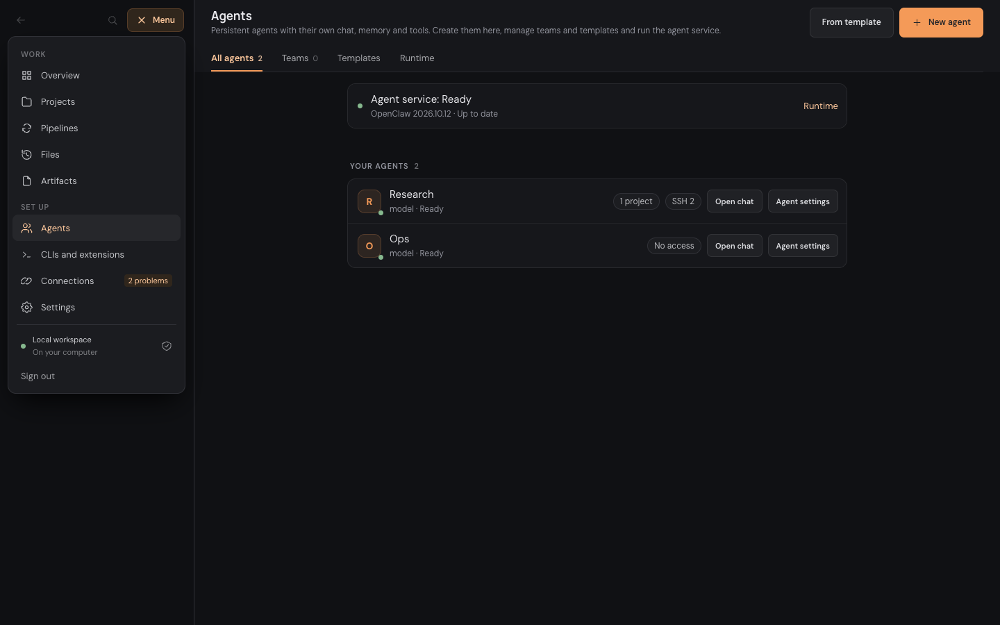

# UI guide

How AgentPier's web UI is built: the design tokens, the shared components and the
rules every new or changed screen follows. The settings layout and save model are in
the [settings pattern](settings-pattern.md); this guide links to it instead of
repeating it.

A live gallery shows every shared component with its variants and states:
**Settings › Operations › Development › Components** (`/settings/components`,
`web/features/gallery/`). Use it to check a component before reaching for a new one.

Contents: [Foundations](#foundations) · [Components](#components) ·
[Rules](#rules) · [Copy](#copy-de-and-en) · [Glossary](#glossary) ·
[Enforcement](#enforcement)

## Foundations

All tokens live in `:root` of `web/styles/base.css`, in three layers:

1. **Palette:** raw colours named by hue and step (`--neutral-01` … `--neutral-31`
   from dark to light, `--warm-*`, `--orange-*`, `--green-*`, `--amber-*`,
   `--red-*`, `--blue-*`). Only `base.css` holds hex literals.
2. **Semantic colours:** what a colour is for. Features use only these.
3. **Scales:** spacing, radius, type, weight, elevation, z-index, focus, touch and
   safe areas.

The app is dark only. A light theme will redefine the semantic layer (for example
under `:root[data-theme="light"]`) with other palette steps; features that use
semantic tokens then need no change. Alpha tints (`--accent-soft`, `--success-line`,
…) keep their literal value and are redefined together with their base colour.

### Colours

| Token                                                                                                                                                                                                                                                                                       | Use                                                                                                                                                                                                                                                             |
| ------------------------------------------------------------------------------------------------------------------------------------------------------------------------------------------------------------------------------------------------------------------------------------------- | --------------------------------------------------------------------------------------------------------------------------------------------------------------------------------------------------------------------------------------------------------------- |
| `--surface-page`, `--panel`, `--surface-input`, `--surface-raised`                                                                                                                                                                                                                          | Page background, cards and rows, inputs, raised areas                                                                                                                                                                                                           |
| `--sidebar-bg`, `--header-bg`, `--header-line`                                                                                                                                                                                                                                              | Shell regions                                                                                                                                                                                                                                                   |
| `--popover-bg`, `--popover-raised`, `--scrim`                                                                                                                                                                                                                                               | Menus, popovers, the scrim behind the navigation drawer                                                                                                                                                                                                         |
| `--backdrop`                                                                                                                                                                                                                                                                                | Opaque backdrop of every modal dialog, sheet and side panel                                                                                                                                                                                                     |
| `--text`, `--text-row`, `--text-message`, `--text-menu`                                                                                                                                                                                                                                     | Body text, row labels, chat text, menu items                                                                                                                                                                                                                    |
| `--muted`, `--text-meta`, `--text-group`, `--text-faint`, `--hint`                                                                                                                                                                                                                          | Secondary text, metadata, group labels, hints                                                                                                                                                                                                                   |
| `--line`, `--divider`, `--divider-soft`                                                                                                                                                                                                                                                     | Borders and dividers                                                                                                                                                                                                                                            |
| `--accent`, `--accent-text`, `--on-accent`                                                                                                                                                                                                                                                  | Brand accent, accent text on dark, text on the accent                                                                                                                                                                                                           |
| `--accent-faint`, `--accent-soft`, `--accent-line`, `--surface-accent`                                                                                                                                                                                                                      | Accent tints for selected and highlighted surfaces                                                                                                                                                                                                              |
| `--success`, `--success-muted`, `--warning`, `--error-text`                                                                                                                                                                                                                                 | Message text in a tone                                                                                                                                                                                                                                          |
| `--button-secondary-*`, `--pill-*`, `--switch-*`, `--approval-*`                                                                                                                                                                                                                            | The matching component surfaces                                                                                                                                                                                                                                 |
| `--status-working`, `--status-waiting`, `--status-ok`, `--status-error`, `--status-idle`                                                                                                                                                                                                    | Status dots, chips and row states (see [Status](#status-colours))                                                                                                                                                                                               |
| `--skeleton`, `--skeleton-shine`                                                                                                                                                                                                                                                            | Skeleton placeholders (`Skeleton`) and the highlight that moves across them                                                                                                                                                                                     |
| `--chart-cpu`, `--chart-memory`, `--chart-memory-text`, `--chart-agentpier`, `--chart-other`, `--chart-grid`                                                                                                                                                                                | Chart series (`HistoryChart`, `ValueChart`, `ShareBar`, inline bars): CPU in the accent, RAM in blue (other hue and lightness), AgentPier light grey, other programs grey, grid lines                                                                           |
| `--syntax-bg`, `--syntax-text`, `--syntax-keyword`, `--syntax-string`, `--syntax-number`, `--syntax-property`, `--syntax-function`, `--syntax-type`, `--syntax-tag`, `--syntax-attribute`, `--syntax-comment`, `--syntax-punctuation`, `--syntax-meta`, `--syntax-link`, `--syntax-invalid` | Code highlighting: the file editor and its conflict view (`editorHighlightStyle` in `web/components/editor-highlight.js`) and highlighted tool output. Each colour keeps WCAG AA (4.5:1) on `--syntax-bg`; never use CodeMirror's light `defaultHighlightStyle` |

### Spacing, radius and type

| Scale     | Tokens                                                                                                                      |
| --------- | --------------------------------------------------------------------------------------------------------------------------- |
| Spacing   | `--space-1` 4px, `-2` 8px, `-3` 12px, `-4` 16px, `-5` 20px, `-6` 24px, `-8` 32px, `-10` 40px                                |
| Radius    | `--radius-sm` 4px (small controls), `--radius-md` 8px (rows, buttons), `--radius-lg` 12px (cards, dialogs), `--radius-pill` |
| Font size | `--font-size-xs` 11px (the floor), `-sm` 12px, `-md` 13px, `-base` 14px, `-lg` 15px, `-xl` 17px, `-2xl` 20px, `-3xl` 24px   |
| Weight    | `--font-weight-regular` 400, `-medium` 500, `-semibold` 600, `-bold` 700                                                    |

No text is smaller than 11px. Text-entry controls are 16px on phones and touch screens
(the iOS zoom rule in `base.css`, see the
[settings pattern](settings-pattern.md#components-webcomponents-styles-in-webstylessettings-patterncss)).

### Elevation and stacking

| Token                                                                              | Use                                                |
| ---------------------------------------------------------------------------------- | -------------------------------------------------- |
| `--elevation-1`                                                                    | Sticky bars that sit above scrolled content        |
| `--elevation-2`                                                                    | Menus, popovers, dropdowns                         |
| `--elevation-3`                                                                    | Dialogs and sheets                                 |
| `--z-base` 1, `--z-sticky` 20, `--z-dropdown` 50, `--z-overlay` 80, `--z-toast` 90 | Stacking order; no other z-index values in new CSS |

Native modal dialogs (`Modal`, `Sheet`, `SidePanel`, `ImageViewer`) use the browser's
top layer and need no z-index. Their backdrop is the opaque `--backdrop`, so a page
that keeps updating behind a dialog (session rows, status polls) never shows through,
and while one is open the page behind it does not scroll (`web/components/forms.css`).

### Focus, touch and safe areas

- `--focus-ring` (`2px solid var(--accent)`) and `--focus-ring-offset`: every focus
  outline is `outline: var(--focus-ring)` on `:focus-visible`. `base.css` already
  gives buttons, links and fields this ring; add one only for custom controls.
- `--touch-target` (44px): the minimum size of a tap target on phones and touch
  screens.
- `--safe-area-inset-top`, `-right`, `-bottom`, `-left`: the device safe areas
  (`env(safe-area-inset-*)`). Use the variables, not `env()`, so browser tests can
  emulate a notch or home indicator. `--safe-area-inset-bottom` is 0 inside a dialog
  while the on-screen keyboard is open, since the home indicator is behind it.
- `--keyboard-inset`, `--visual-viewport-top`, `--visual-viewport-height`: while an
  on-screen keyboard covers the bottom of the page, the covered height and the visible
  area ([Mobile and touch](#mobile-and-touch)). They are unset otherwise, so always give
  a fallback (`0px`, `100dvh`).

### Breakpoints

| Name   | Width    | CSS                                                          | JS (`web/lib/breakpoints.js`)                     |
| ------ | -------- | ------------------------------------------------------------ | ------------------------------------------------- |
| phone  | ≤ 700px  | `@media (max-width: 700px)`; above it `(min-width: 701px)`   | `mediaQueries.phone`, `mediaQueries.abovePhone`   |
| tablet | ≤ 1150px | `@media (max-width: 1150px)`; above it `(min-width: 1151px)` | `mediaQueries.tablet`, `mediaQueries.aboveTablet` |
| wide   | ≥ 1500px | `@media (min-width: 1500px)`                                 | `mediaQueries.wide`                               |

Media queries cannot read custom properties, so CSS repeats these numbers. JS uses
`breakpoints` or `mediaQueries` from `web/lib/breakpoints.js` with `useMediaQuery`
(`useMobileLayout` is the phone query). A view that can render inside a split pane
uses `useNarrow(query, maxWidth)` (`web/lib/useNarrow.js`): inside a pane the pane's
width decides, elsewhere the media query. `(any-pointer: coarse)` is fine next to a
width for touch rules.

## Components

Shared components live in `web/components/`. Before building a control, check the
gallery; if nothing fits, add the primitive there (and to this table and the gallery)
instead of building a one-off in a feature.

### Page structure

| Component                        | Purpose and use                                                                                                                                                                                                                                                                                                                                                                                                                                                                                                                                                                                         | Accessibility                                                                                                                                                                               | File                                                                  |
| -------------------------------- | ------------------------------------------------------------------------------------------------------------------------------------------------------------------------------------------------------------------------------------------------------------------------------------------------------------------------------------------------------------------------------------------------------------------------------------------------------------------------------------------------------------------------------------------------------------------------------------------------------- | ------------------------------------------------------------------------------------------------------------------------------------------------------------------------------------------- | --------------------------------------------------------------------- |
| `SettingsShell`                  | Page header (title, subtitle, description, actions), tabs row, 720px content column, bottom bar slot. Use for every settings-like page; `leading="menu"` on top-level pages, `"back"` on subpages. Not for chat, terminal or file views.                                                                                                                                                                                                                                                                                                                                                                | One `h1`; the leading button carries `aria-label` and `aria-expanded` for the menu.                                                                                                         | `web/components/SettingsShell.jsx`                                    |
| `PageHeader`                     | The header of an overview page with a wide content column (the start page, about 1180px): eyebrow, title, summary line and actions; on phones the actions become full-width 48px buttons below. Not for settings-like pages (use `SettingsShell`).                                                                                                                                                                                                                                                                                                                                                      | The title is the page's one `h1`; the summary is plain text, so counts are read with it.                                                                                                    | `web/components/PageHeader.jsx`                                       |
| `UnderlineTabs`                  | Tabs of a page. Fills the row on phones, scrolls with an edge fade. Use instead of custom tablists. Not for a two- or three-way value choice (use `Segmented`).                                                                                                                                                                                                                                                                                                                                                                                                                                         | `role="tablist"`, roving `tabIndex`, arrow keys, Home/End; panels need matching ids.                                                                                                        | `web/components/UnderlineTabs.jsx`                                    |
| `ListDetail`                     | List beside its detail on desktop, list then detail on phones. `list` replaces the item buttons with a page's own list (Projects).                                                                                                                                                                                                                                                                                                                                                                                                                                                                      | The list is a `nav` with a label; the selected item has `aria-current`.                                                                                                                     | `web/components/ListDetail.jsx`                                       |
| `GroupLabel`                     | Uppercase label above a card, with optional ⓘ hint and one text action ("+ Add"). On a narrow phone the action wraps to the next line.                                                                                                                                                                                                                                                                                                                                                                                                                                                                  | Renders a heading (`h2` by default); give its `id` to the card's `labelledBy`.                                                                                                              | `web/components/GroupLabel.jsx`                                       |
| `ListCard`                       | A group of rows. `disabled` dims a group that does not apply yet.                                                                                                                                                                                                                                                                                                                                                                                                                                                                                                                                       | `role="group"` named by `label` or `labelledBy`.                                                                                                                                            | `web/components/ListCard.jsx`                                         |
| `SplitLayout`                    | Lays a binary split tree (`{ type: "split", dir, ratio, a, b }`) out as absolutely positioned panes in a flat keyed list, so moving a pane never remounts it; `renderPane(leaf, { width, height })` gets the pixel size. Dividers are 8px wide, resize by pointer (one `onRatio(path, ratio)` on release) or arrow keys (5 % steps), and stop at `minPane`. Only for views of several live panes.                                                                                                                                                                                                       | Dividers are `role="separator"` with `aria-orientation`, `aria-valuenow/min/max` in percent, a label and `tabIndex=0`.                                                                      | `web/components/SplitLayout.jsx`                                      |
| `DockedPanel`                    | A non-modal panel docked at the right of its parent (a flex row with `position: relative`), width `--docked-panel-width` (380px), header with title, optional subtitle and a close icon button; the content beside it stays usable (the agent chat's pinboard). Covers its parent on phones. `resizeKey` adds a divider on its left edge: drag or arrow keys (24px; Home / End for the bounds) widen it from 380px up to its parent's width less 360px, a double-click resets it, and the width is remembered per browser under that key (none on phones). For a modal form or preview use `SidePanel`. | An `aside` named by its title; the close button carries `closeLabel`; the divider is a focusable `role="separator"` with `aria-orientation`, `aria-valuenow/min/max` in pixels and a label. | `web/components/DockedPanel.jsx`                                      |
| `DropZoneOverlay`, `useDropZone` | Highlights the left, right, top, bottom or centre zone of a pane under a drag. The hook only claims drags its `accepts(types)` allows, so file drops on the same element keep working; `allowed(side)` hides zones.                                                                                                                                                                                                                                                                                                                                                                                     | The overlay is `aria-hidden`; announce the result of the drop in a status text.                                                                                                             | `web/components/DropZoneOverlay.jsx`, `web/components/useDropZone.js` |

### Rows and controls

| Component                                           | Purpose and use                                                                                                                                                                                                                                                                                                                                           | Accessibility                                                                                                   | File                                |
| --------------------------------------------------- | --------------------------------------------------------------------------------------------------------------------------------------------------------------------------------------------------------------------------------------------------------------------------------------------------------------------------------------------------------- | --------------------------------------------------------------------------------------------------------------- | ----------------------------------- |
| `ListRow`                                           | Label and sub line, trailing `value` (`unknownValue` "—" until known) or `status` (`ok`, `warn`, `error`) that wraps beside the label, which keeps up to 70 % of the row (an empty value shows nothing and leaves the row to the label), chevron when it navigates, ⋯ `menu`, trash `onDelete`, ⓘ `hint`, `disabled`, `current`. Variants in the gallery. | Navigating rows are links (`href` + `onClick`) or buttons; icon buttons have labels.                            | `web/components/ListRow.jsx`        |
| `ToggleRow`                                         | A binary setting: a switch (`<input type="checkbox" role="switch">`).                                                                                                                                                                                                                                                                                     | The row's label names the switch; the sub line describes it.                                                    | `web/components/ListRow.jsx`        |
| `NumberRow`, `SelectRow`, `RadioRow`, `CheckboxRow` | Number, native select (an option with `disabled` is listed but cannot be chosen, its reason in its label); the select takes at most 60% of the row and ends a long option in an ellipsis, radio and checkbox rows (with optional pill such as "stdio").                                                                                                   | As `ToggleRow`.                                                                                                 | `web/components/ListRow.jsx`        |
| `TextRow`                                           | One line of short text in a row, such as a name; longer text belongs in a form field.                                                                                                                                                                                                                                                                     | As `ToggleRow`.                                                                                                 | `web/components/ListRow.jsx`        |
| `CheckRow`                                          | A checkbox whose whole surface toggles it, for multi-select lists in dialogs.                                                                                                                                                                                                                                                                             | Title names, subtitle describes the checkbox.                                                                   | `web/components/CheckRow.jsx`       |
| `ReferenceRow`                                      | Dashed row "Managed centrally in Accounts" into the owning page.                                                                                                                                                                                                                                                                                          | A link with `href`, else a button.                                                                              | `web/components/ReferenceRow.jsx`   |
| `Segment`, `Segmented`                              | A choice between two to four short values. `Segmented` is the settings look. Not for page navigation (use `UnderlineTabs`).                                                                                                                                                                                                                               | Native radios in a `radiogroup`.                                                                                | `web/components/Segment.jsx`        |
| `FilterChips`                                       | Toggle chips with a count for three to six filters of one list, such as the session states on the start page (`options`: `{ value, label, count, dot }`). Counts follow any search. The row scrolls sideways when it does not fit; chips are 44px on phones. `Segment` covers two to four values without counts.                                          | A labelled `group` of buttons with `aria-pressed`.                                                              | `web/components/FilterChips.jsx`    |
| `AnchoredSelect`                                    | A select whose options open anchored below it (above when only there is room), optionally with search (`searchLabel`). The menu sits in a fixed layer, so no card, scroll container or sticky bar clips or covers it. Use for long or searchable option lists.                                                                                            | A native `select` with a listbox; keyboard and typeahead work.                                                  | `web/components/AnchoredSelect.jsx` |
| `SearchSelect`                                      | A searchable picker with a trigger button and optional footer, for remote option lists. Its panel opens in the flow and scrolls clear of a sticky save bar.                                                                                                                                                                                               | Combobox with listbox.                                                                                          | `web/components/SearchSelect.jsx`   |
| `AddPicker`                                         | The inline add field: the last row of a list card that grants several items from a long list (see [Adding from long lists](#adding-from-long-lists)). Not for picking one value (use `AnchoredSelect` or `SearchSelect`).                                                                                                                                 | ARIA 1.2 combobox with a multi-select listbox; arrows, Space, Enter, Escape.                                    | `web/components/AddPicker.jsx`      |
| `GrantPicker`                                       | Chooses what a session may use from a long list in a dialog: search and compact rows beside the allowed list, or the allowed list ending in `AddPicker` (see [Choosing what a session may use](#choosing-what-a-session-may-use)). Not for options of one action (use `CheckRow`).                                                                        | Search field and native checkboxes in a labelled fieldset; the allowed list is a labelled group.                | `web/components/GrantPicker.jsx`    |
| `LanguageSelect`                                    | The language choice (login and general settings).                                                                                                                                                                                                                                                                                                         | Labelled native select.                                                                                         | `web/components/LanguageSelect.jsx` |
| `Switch`                                            | A labelled binary setting outside a list card (`role="switch"`); `ToggleRow` is its row form.                                                                                                                                                                                                                                                             | The label names the switch; the whole label is the target.                                                      | `web/components/Switch.jsx`         |
| `Checkbox`                                          | A labelled option of an action or one choice among several; `CheckboxRow` and `CheckRow` are the row forms.                                                                                                                                                                                                                                               | The label names the box; the whole label is the target.                                                         | `web/components/Checkbox.jsx`       |
| `PermissionList`                                    | Granted capabilities with check marks.                                                                                                                                                                                                                                                                                                                    | A labelled list.                                                                                                | `web/components/PermissionList.jsx` |
| `CapabilityGate`                                    | Wraps a control that needs a capability of the agent's runtime (`runtime`: the agent's `runtimeInfo`, `capability`: a sub-port id). Offered, the children render unchanged; lacking, they stay visible but disabled below the translated reason (ADR 0006: never hidden). Agent settings use `AgentCapability` (`surface` → capability).                  | A `fieldset` disabled and described by the reason (`role="note"`); clicks inside are swallowed.                 | `web/components/CapabilityGate.jsx` |
| `AsyncForm`                                         | A dialog form with Cancel and a primary (or danger) submit, busy state and error.                                                                                                                                                                                                                                                                         | Errors render through `ErrorMessage` (`role="alert"`); a new `resetError` value clears one the caller resolved. | `web/components/AsyncForm.jsx`      |
| `Pagination`, `usePagination`                       | Pages of 20 for long client-side lists.                                                                                                                                                                                                                                                                                                                   | A labelled `nav`; the page number is a polite live region.                                                      | `web/components/Pagination.jsx`     |

#### Adding from long lists

`AddPicker` is the last row of a list card: a plus icon and a field "<Typ> hinzufügen …"
/ "Add <type> …" (`typeLabel` is the type in the current language, lower case in
English: "SSH access", "MCP server"). Typing filters `candidates`
(`{ id, name, sub, group }`: `sub` is the monospace line such as a host, package or
path, `group` a project or group label) by every word, or calls an async
`search(query, { signal })` after 250 ms for lists the server searches (keep its
identity stable; it returns items or `{ items, total }`). The field shows "n Treffer" /
"n matches".

- The attached listbox checks several rows at once. Ids in `granted` (or candidates
  with `granted: true`) stay visible but disabled with "hat er schon" / "already
  granted"; `grantedLabel` words it for other owners.
- `modes` (`{ value, label }`, optional) adds a **Modus** select (`AnchoredSelect`)
  that applies to all new items, such as the SSH mode or the folder level; each item
  stays changeable after adding.
- The footer has **Abbrechen** and the primary "n hinzufügen" / "Add n".
  `onAdd(items, mode)` writes into the caller's draft; the save bar saves as usual.
- At most `limit` rows (50) render; the rest is counted as "n weitere – Suche
  verfeinern", so lists of 500 and more stay fast.
- Keyboard: arrows open the list and move through it (skipping granted rows), Space
  toggles the active row, Home/End jump, Enter adds the checked rows (or the active
  one), Escape closes the list and keeps the focus in the field; a second Escape clears
  it. Clicking or tapping elsewhere closes an untouched list once that click is
  delivered (the list lies in the page's flow, so a control below it would otherwise
  move away under the pointer; a tap's click arrives a moment after the touch ends,
  and the list waits up to 350 ms for it); checked rows keep it open. Rows are 44px
  on phones and touch screens.
- `direct` drops the checking step: a click, Space or Enter adds that row at once
  through `onAdd`, the row then shows as granted and the list stays open; there is no
  footer. For a picker whose surrounding dialog confirms with its own button
  (`GrantPicker` with `stacked`); not together with `modes`.
- With the on-screen keyboard open the list is as high as the space it leaves (at
  least three rows), and the field and the top of its list scroll into view.

The filter, selection and keyboard rules live in `web/components/add-picker.js`
(`tests/unit/add-picker.test.js`).

#### Choosing what a session may use

`GrantPicker` grants a session items from a list of any length (SSH accesses, agents,
secrets, Android devices), in one look whether the list has 2 entries or 600. Its `entries` are
`{ id, name, sub, group, badge, locked, notes, action }`: `sub` is the monospace line,
`group` is matched by the search, `badge` a short tag such as "SFTP", `notes` extra
texts on the allowed row. `selected` holds the granted ids, and `onChange(ids)` hands
the next ids to the caller's draft; nothing saves until the dialog's **Speichern** /
**Save**. `typeLabel` is the singular as in `AddPicker` ("SSH access"), `listLabel` the
plural ("SSH accesses"); `heading` replaces the default "Erlaubt in dieser Session · n" /
"Allowed in this session · n"; `children` follow the allowed list. Settings that belong
to a granted entry go there as a list card of `ToggleRow`s, one per entry and named
after it, as the **Berechtigungen** / **Permissions** of a session's Android devices
(`web/features/devices/DeviceGrantFields.jsx`); the rows of the picker hold no switches.

- **Split** (above the phone breakpoint): on the left a search field ("SSH-Zugänge
  durchsuchen" / "Search SSH accesses"), the count "n von m" / "n of m" and one 36px row
  per match with a checkbox, name, `sub` and `badge`; on the right, 320px wide, the
  allowed entries as a list card with a remove button each. Each side scrolls on its
  own. The search uses the rules of `AddPicker` and renders at most 50 rows ("n weitere
  – Suche verfeinern"); a search without matches names the query. `autoFocus` puts the
  focus in the search field, with a fine pointer only: when the dialog opens, or when
  the picker appears in an open dialog after loading. On touch screens the focus stays
  where it is, so no on-screen keyboard opens. Escape in the search field clears a query
  first; with an empty field it closes the dialog.
- **List** (phones): one checklist under the heading, with the same search and count.
  A tap on a row grants or revokes at once; there is no allowed list and no second
  step, the dialog's Save is the only confirmation. A row is at least 56px high and
  shows name, `sub` and `notes` below each other, the `badge` beside them and the
  `action` below the row. Allowed entries come first; a row keeps its place while the
  owner ticks and the order is renewed with the next search. The list is as long as
  its rows, so only the dialog scrolls, and in a grant dialog the search field stays
  below the dialog's heading. The keyboard opens only on a tap in the search field.
- **Stacked** (with `stacked`, at every width, for a picker that is one section of a
  larger form such as the new-session dialog): the allowed list card ends in an
  `AddPicker` with `direct`, so a click on an option adds it at once and the list stays
  open for the next one; allowed entries show there as "erlaubt" / "allowed". An entry
  without `group` shows its `badge` in the options instead, so "SFTP" stays visible and
  searchable.
- `locked` marks an entry the session has anyway (from the project): it counts as
  allowed, its checkbox is checked and disabled and its row has no remove button. The
  checkbox's accessible description carries the entry's `notes`, so a screen reader
  hears why it cannot be switched off. `action` (`{ label, onClick }`) adds a text
  button to the allowed row. When a remove or action button disappears after its click,
  the focus moves to the next allowed row's remove button, else the previous one, else
  the search or add field (not on touch screens, so no on-screen keyboard opens). An
  allowed row stacks name, `sub` and the `badge` and `notes` line below each other,
  with the `action` on a line of its own, so long notes stay readable in the 320px
  column.
- `disabled` (a save is running) disables the checkboxes, the remove and action buttons
  and the add field; the search stays usable. Without entries the picker shows
  `emptyText` and the `children` only.
- A dialog with a split picker passes `className={grantDialogClass}` to `Modal`: it
  becomes about 920px wide and 760px high (less in a lower window), and keeps that
  height while the search narrows the list. The picker fills the body, at least 320px
  (half the window in very low ones); when that does not fit, the dialog scrolls
  between its sticky header and footer, so every row and **Save** stay reachable.
  Outside a dialog each column is at most 560px high.

Not for checkbox lists that set options of one action (use `CheckRow`). The allowed and
locked rules live in `web/components/grant-picker.js` (`tests/unit/grant-picker.test.js`).

### Buttons and icons

Buttons are CSS classes on a native `<button>` (`.button` variants in `web/app/layout.css`;
`.compact`, `.icon-button`, `.badge`, `.error` and `.loading` in
`web/components/primitives.css`), no component yet:

| Class                 | Use                                                                            |
| --------------------- | ------------------------------------------------------------------------------ |
| `.button.primary`     | The one main action of a view, dialog or bar.                                  |
| `.button.secondary`   | Other actions, Cancel.                                                         |
| `.button.danger`      | The confirming action of a destructive confirmation (Delete, Remove, Discard). |
| `.button.destructive` | A quieter destructive action shown next to others (Revoke).                    |
| `.button.text`        | A low-emphasis action in sheets (Cancel).                                      |
| `.compact`            | Dense rows and toolbars on desktop only; phones keep the 44px target.          |
| `.icon-button`        | An icon-only action; always with `aria-label`. A toggle sets `aria-pressed`.   |

`Icon` (`web/components/Icon.jsx`) draws the line icons; the gallery lists every name.
`ProviderMark` draws CLI marks. Icons are `aria-hidden`; the button carries the label.
A Unicode symbol that iOS draws as colour emoji by default (✳, ⚠, ▶, ➡ and similar) is written as an escape followed by U+FE0E, for example `"\u26A0\uFE0E"`, so phones show it as text like the desktop does; `tests/unit/text-presentation-glyphs.test.js` enforces this.

### Dialogs and overlays

| Component             | Purpose and use                                                                                                                                                                                                                                                                                                                                                                                                                                                                                                                                                                 | Accessibility                                                                                                                        | File                                     |
| --------------------- | ------------------------------------------------------------------------------------------------------------------------------------------------------------------------------------------------------------------------------------------------------------------------------------------------------------------------------------------------------------------------------------------------------------------------------------------------------------------------------------------------------------------------------------------------------------------------------- | ------------------------------------------------------------------------------------------------------------------------------------ | ---------------------------------------- |
| `Modal`               | A dialog with title and close button; `footer` gives a scrolling body and sticky actions. A bottom sheet on phones, whose footer buttons share the width equally so a busy label never moves them. `opener` names the element focus returns to (Safari does not focus a clicked button).                                                                                                                                                                                                                                                                                        | Native modal `<dialog>`, labelled by its title; Escape and a drag down honour `closeDisabled`.                                       | `web/components/Modal.jsx`               |
| `ConfirmDialog`       | Every confirmation (see [Confirmations](#confirmations)): `title` names the object, `body` the consequence, `confirmLabel` repeats the verb; `destructive` for danger, else primary; `focusCancel`; async `onConfirm` with busy state and error; `children` for details; `confirmDisabled` until a typed name matches.                                                                                                                                                                                                                                                          | As `Modal`; a destructive one starts on Cancel.                                                                                      | `web/components/ConfirmDialog.jsx`       |
| `Sheet`               | A short choice with more than two answers: bottom sheet on phones, centred 420px dialog on desktop.                                                                                                                                                                                                                                                                                                                                                                                                                                                                             | As `Modal`.                                                                                                                          | `web/components/Sheet.jsx`               |
| `UnsavedChangesSheet` | "Save changes?" with Save and switch (or `saveLabel` "Save and continue"), Discard, Cancel; `body` and `children` for page-specific text and errors; `saveDisabled` while nothing can be saved. The only unsaved-changes dialog (settings, Pipelines, Files).                                                                                                                                                                                                                                                                                                                   | As `Sheet`.                                                                                                                          | `web/components/UnsavedChangesSheet.jsx` |
| `CommandPalette`      | Quick open: a `Modal` with a search field over grouped results. The caller filters: `query`/`onQueryChange`, `groups` (`{ id, label, items }`, items `{ id, label, detail, icon }`), `onChoose(item)`; `empty` (`{ title, hint, resetLabel }`) words a search without results, `status` the live count, `loading` and `error` a status line or alert, `keys` the footer's key hints (hidden on phones, where it is a bottom sheet), `opener` as for `Modal`. Matching and ranking for it live in `web/app/search-index.js`. Used by the app's search and the user app's search. | ARIA 1.2 combobox with a grouped listbox; arrows (wrapping), Home/End on an empty field, Enter, Escape; focus returns to the opener. | `web/components/CommandPalette.jsx`      |
| `SidePanel`           | A side panel for a longer form or preview beside the page (an agent template, a Markdown file or a PDF from the agent chat); a bottom sheet on phones. `opener` names the element focus returns to (Safari does not focus a clicked button).                                                                                                                                                                                                                                                                                                                                    | Native modal dialog; Escape and a click beside it close it; focus returns to the opener.                                             | `web/components/SidePanel.jsx`           |
| `ImageViewer`         | Full-size image, whole at rest however tall, with zoom (pinch, double tap, ctrl + wheel; a long screenshot up to twice its full width, and a double tap fills the width from its top) and pan (drag, wheel), download and share.                                                                                                                                                                                                                                                                                                                                                | Native modal dialog; focus returns to the opener.                                                                                    | `web/components/ImageViewer.jsx`         |
| `useAlertDialogFocus` | The inline variant: a `role="alertdialog"` confirmation inside a row or card, for cheap or reversible actions and wizard steps. Same texts, colours and order as `ConfirmDialog`.                                                                                                                                                                                                                                                                                                                                                                                               | Focus moves in, Tab cycles, Escape cancels, focus returns.                                                                           | `web/components/useAlertDialogFocus.js`  |
| `SaveBar`             | Bottom bar of a draft: Cancel and Save; Reload and Overwrite on a conflict; partial and error notes.                                                                                                                                                                                                                                                                                                                                                                                                                                                                            | A labelled region; notes are alerts.                                                                                                 | `web/components/SaveBar.jsx`             |

### Feedback

| Component       | Purpose and use                                                                                                                                                                                                                                                                                                                                                                                                                                                                                                                                                                                                                                                                                                                                                                                                                                                                                                                                                                                                                                                 | File                               |
| --------------- | --------------------------------------------------------------------------------------------------------------------------------------------------------------------------------------------------------------------------------------------------------------------------------------------------------------------------------------------------------------------------------------------------------------------------------------------------------------------------------------------------------------------------------------------------------------------------------------------------------------------------------------------------------------------------------------------------------------------------------------------------------------------------------------------------------------------------------------------------------------------------------------------------------------------------------------------------------------------------------------------------------------------------------------------------------------- | ---------------------------------- |
| `StatusDot`     | The only status dot: tones `working`, `waiting`, `ok`, `error`, `warning`, `idle`, `pending`, `unknown`; `pulse`; `label` when it is the only sign (`title` shows it on hover). Map feature states with `activityTone` / `chipTone` (`status-tones.js`); `className` only positions it.                                                                                                                                                                                                                                                                                                                                                                                                                                                                                                                                                                                                                                                                                                                                                                         | `web/components/StatusDot.jsx`     |
| `StatusChip`    | A state with a dot: `ok`, `error`, `neutral`, `pending`, `running`, `waiting`; `decision`; `pill`.                                                                                                                                                                                                                                                                                                                                                                                                                                                                                                                                                                                                                                                                                                                                                                                                                                                                                                                                                              | `web/components/StatusChip.jsx`    |
| `ErrorMessage`  | An error as `role="alert"`; renders nothing without an error. `id` lets a field name its own error in `aria-describedby`, shown in place of the browser's validation bubble.                                                                                                                                                                                                                                                                                                                                                                                                                                                                                                                                                                                                                                                                                                                                                                                                                                                                                    | `web/components/ErrorMessage.jsx`  |
| `HistoryChart`  | A line chart of percentages (0–100 %) over a time window: `series` (`{ id, label, field, tone, dashed }`, tones `cpu`, `memory`, `agentpier`, `other`), `points` (`{ t, …fields }`), `start`, `end`, `xLabels`, `formatValue`, `formatTime`, `timeLabel`, and `heading`, `toolbar` (such as a `Segment` for the range) and `footer` slots. Points more than 90 s apart are hatched and break the lines (`history-chart.js`); `gapNote` explains the hatching under the chart, with a hatched swatch, only while the window shows such a gap. Legend buttons toggle a line (`aria-pressed`); their sample is drawn like the line, dashed for a `dashed` series. The plot is `role="img"` with a summary `label`; it takes focus, the arrow keys move a crosshair with a tooltip (Home/End jump, Escape hides it), a polite live region reads the values, and a visually hidden table holds the last ones. The pointer shows the same tooltip.                                                                                                                    | `web/components/HistoryChart.jsx`  |
| `ValueChart`    | A small line or bar chart of labelled values (an agent card's chart): `kind` `line` or `bar`, `points` (`{ label, value }` in order), `label` for screen readers (who get a table of every value), `unit`, `formatValue`. The y axis starts at 0 unless a value is negative; the first and last labels mark the x axis; the series uses `--chart-cpu`. For percentages over time use `HistoryChart`.                                                                                                                                                                                                                                                                                                                                                                                                                                                                                                                                                                                                                                                            |
| `ShareBar`      | A stacked bar of shares of one whole with a legend: `segments` (`{ id, label, value, tone, text }`, tones `cpu`, `memory`, `other`, `free`; `free` is the empty track and shows only in the legend), `total`, `legend`. For a part of a whole, such as AgentPier's share or a drive; a single percentage stays a meter. The bar is `role="img"` named by `label`; the legend repeats each share as text.                                                                                                                                                                                                                                                                                                                                                                                                                                                                                                                                                                                                                                                        | `web/components/ShareBar.jsx`      |
| `Skeleton`      | A grey placeholder where content is still loading, sized like that content so nothing moves when it arrives: `shape="text"` (default) is one line of the surrounding font, `width` long (put it in the element the text will fill, such as a row's `strong` or `small`); `"block"` is `width` × `height` (a mark, a button, a sparkline); `"circle"` an avatar. A slow highlight moves across it; with reduced motion it stands still. The busy region (a card, a tile) carries `aria-busy="true"` and one `SkeletonLabel` ("Loading", plain text, not a live region, so it is read once and never announced again); the bars are `aria-hidden`. Used by the start page's tiles.                                                                                                                                                                                                                                                                                                                                                                                | `web/components/Skeleton.jsx`      |
| `InfoHint`      | ⓘ disclosure that reveals a hint verbatim; never a tooltip. Built into `ListRow` and `GroupLabel`.                                                                                                                                                                                                                                                                                                                                                                                                                                                                                                                                                                                                                                                                                                                                                                                                                                                                                                                                                              | `web/components/InfoHint.jsx`      |
| `LearnMore`     | A short hint with the full explanation behind a disclosure.                                                                                                                                                                                                                                                                                                                                                                                                                                                                                                                                                                                                                                                                                                                                                                                                                                                                                                                                                                                                     | `web/components/LearnMore.jsx`     |
| `CopyButton`    | Copies `text` and reports Copied / failed in a live region; the label names what it copies; `iconOnly`; `onFailed` to reveal the text. `useCopy` is its hook, `writeClipboard` (`web/lib/clipboard.js`) the plain write.                                                                                                                                                                                                                                                                                                                                                                                                                                                                                                                                                                                                                                                                                                                                                                                                                                        | `web/components/CopyButton.jsx`    |
| `CodeBlock`     | Code with an icon copy button (built on `useCopy`).                                                                                                                                                                                                                                                                                                                                                                                                                                                                                                                                                                                                                                                                                                                                                                                                                                                                                                                                                                                                             | `web/components/CodeBlock.jsx`     |
| `ActivityRow`   | One step an agent took (an SSH or shell command, a tool call) as a compact row: icon, label, one-line `detail` with an ellipsis, a `StatusChip` (`status`, `tone`); it opens to `children` (rendered only while open unless `keepMounted`), e.g. a wrapping `CodeBlock` (`className="activity-row-code"`, `copyText`, `copyLabel`) and an `.activity-row-facts` list. The head is a button with `aria-expanded`; `onToggle(open)` hears each change.                                                                                                                                                                                                                                                                                                                                                                                                                                                                                                                                                                                                            | `web/components/ActivityRow.jsx`   |
| `ActivityGroup` | Consecutive tool calls of one agent turn as one `ActivityRow`, shut by default, in agent chats and session chats alike: `label` ("Agent activity", or e.g. "SSH activity" and "SFTP activity" for SSH and SFTP rows, which join the same group), "`count` calls · `summary`" (the host, or the main tools from `toolSummary`, e.g. "Bash 5 · Edit 2"), and one chip: "Running" while `running`, "N failed" for `failed` (error tone, visible while shut), "N stopped" for `stopped` (neutral tone, like a stopped call's own row), "Done" when `done`. `children` are the calls' own rows and stay mounted. A single call stays a plain row. The agent chat's "Events" strip under its header is one too (`AgentEventArea.jsx`, icon `inbox`): its `detail` ("N events · N new") replaces the call count, and its rows are routine, check-in and hook events whose body loads on open (the payload as plain text in a `CodeBlock`, never Markdown); a routine's row nests its run's SSH and SFTP rows (`SshRunNote`, `SftpRunNote`) under "What the agent did". | `web/components/ActivityGroup.jsx` |

### Code and diffs

Code editors (CodeMirror) colour syntax with `editorHighlighting()` from
`web/components/editor-highlight.js`, built on the `--syntax-*` tokens.

| Component       | Purpose and use                                                                                                                                                                                                                                                                                                                                                                                                                                                                                                                                                                        | File                                    |
| --------------- | -------------------------------------------------------------------------------------------------------------------------------------------------------------------------------------------------------------------------------------------------------------------------------------------------------------------------------------------------------------------------------------------------------------------------------------------------------------------------------------------------------------------------------------------------------------------------------------- | --------------------------------------- |
| `DiffRows`      | The rows of one parsed diff (`rows` of `parseGitDiff`) with line numbers and lazy syntax highlighting (`language`). Read-only unless `onSelect` is given; `selected` marks a row and `renderAfter(index)` adds content below it. Chat diffs use it read-only.                                                                                                                                                                                                                                                                                                                          | `web/components/diff/DiffRows.jsx`      |
| `DiffReview`    | A diff with line comments: file list, one `DiffFile` per file and the comments on files that are no longer changed. Files past a budget of 1200 first-page lines (`openByDefault`; commented files within a second 1200) start collapsed and name their comments in the heading and the file list; the open set only grows while mounted; the file list opens a file. `files`, `comments` (of one `workspace`), `onCreate`, `onUpdate`, `onDelete`, `readOnly`, `truncated`, `toolbar`, `empty`. Fed by `useReviewComments`; the gallery specimens keep their comments in local state. | `web/components/diff/DiffReview.jsx`    |
| `DiffFile`      | One file of a review: heading (a button with `aria-expanded` that opens and closes the file), rows in pages of 400 ("Show N more"), threads under their row, then comments whose row is not shown yet ("Show more lines to see it in place") and outdated ones. The diff region is one tab stop (`role="region"`, "Diff of path").                                                                                                                                                                                                                                                     | `web/components/diff/DiffFile.jsx`      |
| `CommentThread` | One comment: Markdown body with Edit, Resolve and Delete (inline "Delete this comment?" confirmation, no dialog); resolved comments collapse to one line with Reopen; an outdated comment shows an "Outdated" chip and its stored excerpt; "Sent in batch N" once handed to an agent. Read-only hides every action.                                                                                                                                                                                                                                                                    | `web/components/diff/CommentThread.jsx` |
| `CommentEditor` | The Markdown text field under a row: Save and Cancel, Ctrl/Cmd+Enter saves, Escape cancels, Save stays disabled for blank text, the byte count shows near the 8,192-byte limit. The caller keeps the draft until the save succeeds.                                                                                                                                                                                                                                                                                                                                                    | `web/components/diff/CommentEditor.jsx` |

Keyboard and touch: the diff region takes focus as a whole; ArrowUp/ArrowDown (and Home/End) move the selected row, Enter shows "Comment on line N" under it, and Escape hides it. Rows are not tab stops and nothing depends on hover. Tapping a row selects it and shows the same button. The comment button and the thread buttons are at least 44px on phones. Long lines scroll inside the diff region, never the page.

### Planned components

These do not exist yet; they are planned in follow-up tickets.
Until they land, follow the rule for each and use the closest existing piece.

| Component    | Replaces                                      | Until then                                                                              |
| ------------ | --------------------------------------------- | --------------------------------------------------------------------------------------- |
| `Menu`       | Five `role="menu"` implementations            | `extensions/RowMenu.jsx` (roving focus, `sheet` on phones; in the gallery) as reference |
| `Notice`     | 17 notice and banner classes                  | `ErrorMessage`, `.save-bar-note`                                                        |
| `EmptyState` | 17 empty-state classes                        | A short sentence plus one action                                                        |
| `Loading`    | Three spinner animations, ad-hoc loading text | `
` with the loading copy; `Skeleton` where content keeps its place     |

## Rules

### Confirmations

- Confirm only what is destructive or hard to undo: deleting, removing access,
  discarding work, overwriting. Do not confirm cheap, reversible actions.
- Use `ConfirmDialog`. The inline variant (`useAlertDialogFocus`) is only for cheap or
  reversible actions inside a row or a wizard step. Never `window.confirm`, `alert` or
  `prompt` (`nativeDialogs` in [Enforcement](#enforcement)).
- The title asks the question with the object's name ("Delete backup 'nightly'?"), the
  body says what is lost, the buttons repeat the verb ("Delete", not "OK" or "Yes").
- A permanent delete that loses a lot (an agent with its chats and memory) lists what
  is lost and asks for the object's name: `ConfirmDialog` with an input in `children`
  and `confirmDisabled` until the typed name matches exactly.
- The confirming destructive button is `.button.danger`; Cancel is secondary or text.
  On desktop Cancel comes first and the action last (right); in a phone sheet the
  action is on top and Cancel below. Danger buttons have the same height as primary
  ones.
- Do not use danger styling for actions that are not destructive (creating a pull
  request, continuing after a gate). Primary styling never marks a destructive action.

### Verbs

- One verb per concept, as the [glossary › actions](ui-glossary.md#actions) defines:
  **Delete** (the data is gone), **Remove** (a reference is detached), **Revoke**
  (access ends), **Discard** (a draft is dropped).
- A confirm button repeats the verb of the button that opened it ("Delete" →
  "Delete now").
- Buttons are verbs or verb phrases in sentence case: "Save changes", "Open settings".

### Saving, unsaved changes and conflicts

- Settings pages keep a draft and save through one `SaveBar` per tab or subpage
  ([settings pattern › drafts](settings-pattern.md#drafts-and-the-save-chain-weblibsettings)).
  Real actions (add, delete, log in, run) stay immediate.
- Leaving a dirty draft asks with `UnsavedChangesSheet` through the navigation guard
  ([settings pattern › unsaved changes](settings-pattern.md#unsaved-changes-and-navigation-weblibnavigation-guardjs)),
  for the sidebar, tabs, Back/Forward and reload as well as the page's own actions.
  Settings drafts use `useUnsavedChangesGuard`, Pipelines editors `useDraftGuard`
  (Save and continue runs the editor's own save), the file editor
  `useFileNavigationGuard`. No other unsaved-changes dialogs.
- A conflict (the record changed elsewhere) offers "Reload" and "Overwrite anyway" in
  the save bar, never just a "please reload" text.

### Feedback, empty, loading and error states

- Loading: a short status line (`role="status"`) or the component's busy label
  ("Saving …"); keep the old content visible while refreshing. Where a page shows
  several tiles that load on their own (the start page), every tile is in place from
  the first paint with `Skeleton` placeholders in the shape of its content, so nothing
  moves when the data arrives; a tile that turns out empty or unavailable keeps its
  place and says so.
- Empty: one sentence saying what is missing and, where possible, the one action that
  fills it, using the same verb as the page's add button.
- Errors: `ErrorMessage` near the action that failed, in plain words with what to do
  next. Warnings and errors stay visible; explanations move behind ⓘ.
- Success needs no message when the result is visible; otherwise a short status.

### Forms and disabled controls

- Every field has a visible label. Help text sits below the field or behind ⓘ.
- A disabled control says why: a sub line, hint or note next to it states the reason
  and, if possible, how to enable it. Prefer hiding a control that can never apply.
- A control the agent's runtime does not offer is the exception: it stays visible in a
  `CapabilityGate`, disabled with the runtime's reason, so the owner sees what differs.
- Validate on submit and next to the field; keep typed values on errors.

### Binary settings

A setting that is on or off is a switch: `ToggleRow` in a list card, `Switch`
elsewhere, saved through the save bar. Checkboxes (`Checkbox`, `CheckboxRow`,
`CheckRow`) choose several items from a list or set an option of one action. Both share
one look (`web/components/choice.css`); no `accent-color` or bespoke switch styles.

### Navigation and headers

- Page headers come from `SettingsShell` (title, back or menu button, description,
  actions). Overview pages with a wide column, such as the start page, use
  `PageHeader`. No bespoke hero headers or bare `h1`s.
- A `SettingsShell` page with a menu or back button replaces the app's phone header:
  its stylesheet hides `.mobile-header` at phone width
  (`.app:has(.<page>) .mobile-header`), so phones show one menu button.
- Page tabs are `UnderlineTabs`. The back arrow means "back"; do not reuse it for
  collapse or close.
- Routes, cross-links and the back arrow follow the
  [settings pattern › routes](settings-pattern.md#routes).

#### Session header on a phone

At phone width the session header keeps the name, **Previews** and **Artifacts**; reload,
switch account, session tools, SSH, agent access, Android devices, rename and stop or
remove move into one **More actions** menu (`RowMenu`). The title keeps at least 8rem and the actions wrap to their
own row before they could cover it or leave the screen (`session-header-phone.spec.js`).

#### Sidebar, menu and search

On a phone: [drawer with the menu](screenshots/navigation-menu-phone.png). Search:
[⌘K dialog](screenshots/search-desktop.png), on a phone the same search as a
[bottom sheet](screenshots/search-phone.png).

The information architecture is recorded in
[ADR 0005](adr/0005-navigation-information-architecture.md).

- **Sidebar** (`web/app/Sidebar.jsx`): head (collapse, **Search (⌘K)** on macOS or **Search (Ctrl+K)** elsewhere, **Menu**), brand
  with the LOCAL, TAILNET or NETWORK badge (how AgentPier is reached), **Inbox**, **Control Room**, **Active pipelines** while runs are running or awaiting a decision, the **Views** group (only wider than 1150 px), the
  **Agents** group, the **Sessions** group and the host status. A pipeline awaiting a decision appears first and opens its run. The group header shows how many decisions are pending, including when collapsed. The Agents and Sessions heads carry two icon buttons each: Agents → **Manage all agents**
  (`/agents`) and **New agent** (wizard), hidden while agents are off; Sessions → **CLIs
  and extensions** (`/coding/clis`) and **New session**. These "+" buttons are the
  sidebar's only way to create; it has no **New** button. The phone drawer shows the
  same icon buttons at `--touch-target` size, and each closes the drawer. Once the
  agent list has loaded, the Agents group shows even without agents, with a hint and
  its "+". The compact **+ New** menu (`web/app/SidebarNewMenu.jsx`: **Session**, and
  **Agent** while agents are on) stays in the phone header and the floating bar of a
  collapsed sidebar. While the agent service is stopped, agent rows are dimmed with
  "offline".
  Within **Agents**, lasting agent groups have collapsible headings, root-agent
  counts and a work/attention status dot that includes hidden members. Group and agent
  menus rename/reorder/delete groups or move a root agent; team members follow their
  lead. **Agents › All agents › Agent groups** uses the same group order and
  assignments ([agent groups](agents.md#agent-groups)). Root agents are reordered in
  both lists, which share one saved order, by dragging their row (mouse) or a long
  press and drag (touch), with **Move up** and **Move down** in the agent's ⋯ menu as
  the keyboard way; a line marks where the agent lands
  (`web/features/assistants/order/`, [agent order](agents.md#agent-order)).
- **Agent chat header** (`web/features/assistants/AgentChatTop.jsx`, owner app, every
  width): the chat selector sits under the agent name (a main chat shows its title in the
  status line, not the model id). On a phone the status there is the dot alone (its word
  is the dot's label and tooltip), so the title stays readable, and every header icon is
  a 44px touch target. The work goal (with **Stop**, in a sheet) and the events (with a
  working dot while one runs) are header icons, beside the chat's usage and **Talk**.
  While the agent's browser capability is on, **Browser** (`globe` icon) sits left of
  them, labelled like **Settings** on a computer, in ⋯ in a pane; the live preview
  replaces it while the browser runs. **New chat** and
  **Summarize this chat** (`summarise` icon) live in the Chats sheet, which the chat
  title opens, and in ⌘K, never as loose icons. On a phone the header keeps only the
  navigation button, the agent's name, the chat's title and **Settings**, so name and
  title read in full. The one row under it is the header's second line: a segmented
  **Chat | Pinboard** switch (Pinboard as the `pin` icon with its count, named
  "Pinboard (n)") and, at its end, the work goal, the events, the usage, **Talk** and
  **Browser** as icons; more than fit scroll sideways, and a row with nothing in it
  hides. In a split view's pane the row holds the full **Chat | Pinboard (n)** switch
  and a labelled **Chats** button (`chats` icon) that opens the sheet. A team member's
  chat has no row, only its icons and a pin icon in the header. On a computer the header carries
  **Pinboard**, and the pinboard docks beside the chat as a resizable `DockedPanel`.
  Pinboard list titles are `h3` headings. A pinned file opens in the pinboard's reader;
  on a phone the reader is full screen with its own bar (Back, the file, its list and
  place, Download) and previous / next at the bottom, while the chat's header, row and
  composer step aside. A pinned HTML page shows in a sandboxed frame on a light canvas,
  with **Back to the page** above it once the frame left the page.
  A restricted user's chat keeps its layout.
- **Agent cards** (`web/features/assistants/cards/AgentCard.jsx`, owner and user app): an
  agent's card in the chat is an `article` at most 640px wide on `--panel` with
  `--radius-lg`, its title an `h3` with version and time in `--text-meta`. Blocks use
  the primitives only: `Checkbox` for checklist items (44px rows), `StatusDot` in status
  tiles, `ValueChart` for charts, `.button` (primary or secondary, 44px) for buttons,
  figures in the semantic tones (`--success`, `--warning`, `--error-text`). A wide table
  scrolls inside the card on a phone. A moved card leaves an `assistant-note` button
  with the `down` icon that scrolls to it.
- **Views group** (`web/features/views/ViewsSidebarGroup.jsx`): below **Control Room** and any active pipeline runs, above
  **Agents**, shown only wider than 1150 px. Its head has one "+" (**New view**); each
  view row shows the name and pane count. Sessions and agent chats shown in the current
  view carry a marker ("Shown in this view"). Behavior: [Views](views.md);
  [screenshot of a view](screenshots/split-view-desktop.png).
- **Menu popover** (`web/app/SidebarMenu.jsx`, model in `web/app/sidebar-menu-model.js`):
  the only place for areas, in two groups. **Work**: Overview, Projects, Craft Anything, Pipelines, Files,
  Artifacts. **Set up**: Agents, CLIs and extensions, Connections, Settings. Below them
  the host status, **Open remotely** (as before) and **Sign out**. The current area has
  `aria-current="page"` (`menuArea()`, which reads old addresses as their new place).
  Entries may carry a status hint (decisions or failed runs, running pipelines, agents
  off/stopped/update ready, CLI updates, connection problems, AgentPier update). Hints
  come only from data the app already has or reads once when the menu opens
  (`useMenuHints.js`); a source that is unknown or fails shows no hint, never a zero.
  **Agents** stays in the menu while agents are off and leads to the page that turns
  them on. Escape, an outside click and navigation close the popover and return focus
  to the **Menu** button.
- **Phone**: the drawer includes **Inbox**, **Control Room**, active pipeline runs, Agents and Sessions. The mobile header also links to Inbox. The menu popover opens inside the drawer at full width with a
  **Search** row first.
- **Search** (quick open; `web/app/SearchDialog.jsx` on the `CommandPalette` primitive;
  index in `web/app/search-entries.js`, `area-search-entries.js`,
  `agent-search-entries.js` and `web/features/quick-open/`, matching in
  `search-index.js`, catalog `search.js`): opens from the sidebar button, the search
  button of the phone header and of the phone drawer, the phone menu row and ⌘K (macOS) /
  Ctrl+K (others).
  - **Shortcut and the terminal** (`search-shortcut.js`): on macOS ⌘K opens the search
    everywhere, the terminal, the code editor and text fields included, because the
    Command key types nothing there (xterm sends no input for ⌘ chords; CodeMirror and
    text fields bind no ⌘K). On Linux and Windows Ctrl+K is a typing key: readline's
    kill-line in the terminal, an editing key in the code editor and in text fields. It
    stays with them; there the search opens from its buttons. Ctrl+K on macOS also stays
    with the terminal.
  - **Index:** every area, tab, settings group and subpage in both languages plus old
    names as aliases ("Settings › Access › SSH accesses"), the loaded agents and their
    tabs, connection names (loaded on first open), and the owner's own things:
    sessions (by name, project, CLI and account; opened in their last view), projects
    and each project's tabs ("alpha Knowledge"), the owner's chats with agents, the
    first page of pipeline runs, pipeline definitions, task profiles, saved views, CLI
    accounts (also as "Konten" or "Claude-Login") and inbox items. They come only from
    what the owner's pages read under the owner's session: the workspace state, agent
    list and saved views the app already holds, the pushed run list and inbox, and the
    project, pipeline and task profile lists, read while the search is open
    (`useQuickOpenSources.js`). The Control Room is indexed by “Autopilot”, “Composer” and “Aufträge”. Order-specific actions appear while their controls are available. Actions: "New order", "New session", "Start run", "Open inbox", "New
    agent", "Add SSH access", "Add email account" and the other connection actions,
    "Install skill", "Update CLI", "Chrome for Testing", "New device" (Settings › General ›
    Android devices, opens its dialog), "Upload" (Files, opens the
    upload panel), "Send test notification" and "Install app"; each agent's "Duplicate",
    "Archive", "Restart main chat" and "Clear attachments"; each session's "Reload &
    resume", "Continue with another account", "AgentPier tools", "Stop" or "Remove" and
    "Background tasks". An action that needs its page ("New view", "Sign out", a chat's
    "Archived chats") is offered only while that page can take it; dialogs behind an
    action still ask first.
  - **Coverage guard:** `tests/unit/search-coverage.test.js` derives the routed areas
    and tabs from their route definitions and lists the settings groups inside pages; a
    new page, tab or group without a search entry fails it.
  - **Matching:** every word of the query must match one entry, in either language;
    exact, prefix and word matches rank first, then inner matches, then fuzzy ones
    (the word's letters in order from a word start, at most as many skipped letters as
    the word is long, so "flaky logn" finds "Fix the flaky login test"). A word of four
    letters or more with two neighbouring letters swapped ("Tailsacle") matches as a
    word start, ranked with the fuzzy matches.
  - **Results:** grouped (**Recent**, **Sessions**, **Projects**, **Chats**, **In
    agents**, **Pipelines**, **Inbox**, **Pages**, **Actions**) with their path; a query
    orders the groups by their best match. An empty query shows the recent results
    first (the ids of the last eight opened in this browser, per person, in
    `localStorage`; one that no longer exists is left out), then the areas and the main
    actions. Arrows move, Enter opens, Escape closes. A new page or tab gets an entry
    in the index and in both catalogs.

#### User app

A restricted [user](users.md) gets her own shell (`web/features/users/UserApp.jsx`),
not the owner's sidebar:

- `UserPage` frames every page with `UserHeader`: title, back arrow to **My agents**,
  the search button and the menu button. The user's search (`UserSearch.jsx`, the same
  `CommandPalette` and shortcut) finds only their own agents' chats, settings and memory
  and **My agents** and **Account** (`user-search-entries.js`); their recent results are
  kept apart from the owner's. The menu is a `Sheet` with **My agents**, **Account** and **Sign
  out**; there are no other destinations.
- Pages reuse the shared components (`ListCard`, `ListRow`, `ToggleRow`, `Sheet`,
  `AsyncForm`) and the owner's chat; a user's agent settings show only what her level
  allows and say "The owner manages this." for the rest.
- Notices that concern her privacy (shared agent, **Owner may read chats**) sit above
  the chat, never in a dismissible toast.
- Her app makes HTTP requests only to `/auth` and `/api/me`, and opens only the chat,
  browser-view and dictation WebSockets listed in [Users](users.md#the-users-app); an
  owner path shows "This page does not exist here." under its own address.

### Status colours

One colour per state, from the tokens: working `--status-working` (orange),
waiting `--status-waiting` (light orange), ok `--status-ok` (green), error
`--status-error` (red), idle `--status-idle` (grey). Dots are `StatusDot`; status
text uses `--success` and `--error-text`. "Ready" and "connected" are ok (green), not
accent. Never encode a state by colour alone: add text or an icon.

### Mobile and touch

- Phones are ≤ 700px. Lay out in one column; lists open details as subpages.
- Tap targets are at least `--touch-target` (44px) on phones: `primitives.css` raises
  `.button`, `.compact`, `.icon-button` and labels around a checkbox or radio to 44px
  below 700px. `.compact` and 33px icon buttons are desktop sizes; do not cap them with
  a smaller `min-height` in feature CSS (`tests/browser/touch-target-size.spec.js`).
- Dialogs become bottom sheets on phones (`Modal`, `Sheet` do this already); actions
  stay visible above the home indicator (`--safe-area-inset-bottom`).
- The on-screen keyboard never covers a dialog. iOS Safari, and Chrome on Android by
  default, shrink only the visual viewport for it, so `web/lib/keyboard-inset.js`
  (started once in `web/main.jsx`) publishes the covered height and the visible area on
  the document root (`--keyboard-inset`, `--visual-viewport-top`,
  `--visual-viewport-height`, `data-keyboard-open`); pinch zoom is ignored. A bottom
  sheet (`Modal`, `Sheet`, `SidePanel`, `ConfirmDialog`) then sits on the keyboard and
  grows at most to the visible height, a centred dialog centres in the visible area,
  and the full-height launch dialog fills it (`web/components/forms.css`,
  `side-panel.css`). A text field focused in an open dialog is scrolled into the
  visible part of its scroll container, clear of sticky bars (the container's
  `scroll-padding`), when the keyboard opens or another field takes focus. Mark a block
  that should come into view with its field as `data-keyboard-reveal` (`SearchSelect`
  reveals its search with the results, `AnchoredSelect` its field). A dialog that
  places itself uses the same variables, never its own `visualViewport` listener.
- A button right below a text field answers a tap even when iOS swallows its click.
  While the field has focus, iOS hands a tap close to the text cursor to its own text
  interaction, so a send button under the last line gets the finger down and up but no
  click. Spread `useTouchTap` (`web/lib/useTouchTap.js`) onto such a button: when no
  click follows a tap within 350 ms it runs the action itself, and where clicks work
  nothing changes. The session and agent composers use it for send, send later and
  stop.
- Search and filter fields set `autoComplete="off"` and `autoCorrect="off"` (with
  `autoCapitalize="none"` and `spellCheck={false}`), so iOS does not offer contact
  autofill (`SearchSelect`, `AnchoredSelect`, `AddPicker`, `CommandPalette`, and every
  `type="search"` field: `tests/unit/ui-guide-rules.test.js`).
- A bottom sheet with a grab handle closes when it is dragged down
  (`web/components/useSheetDrag.js`, used by `Modal` and `Sheet`). The drag starts on the
  heading (`.dialog-heading`, a `Sheet`'s handle and title) or, with touch, as a
  downward swipe on content scrolled to the top; controls keep their taps. A release
  past 30% of the sheet's height or 120px, or a fast flick, dismisses it through the
  same path as Escape (`close` unless `closeDisabled`, `onCancel`); otherwise it snaps
  back, without animation under reduced motion. With `closeDisabled` the sheet only
  stretches like a rubber band. A tap or drag on the backdrop never moves it. Full-height panels without a handle
  (`SidePanel`, `ImageViewer`, the launch dialog) do not drag.
- A row's ⋯ menu may open as a sheet on phones: given `sheet` (title and optional
  subtitle), `RowMenu` shows the same items in a `Sheet` with Cancel (the Projects page
  does this for projects and groups; the gallery's **Dialogs and sheets** shows both).
- No horizontal page scroll; long values wrap or truncate with the full text available.

### Accessibility

- Every control is reachable and operable by keyboard and shows `--focus-ring`.
- Icon-only buttons have an `aria-label`; decorative icons are `aria-hidden`.
- Dialogs are native `<dialog>` elements labelled by their title, with focus moved in
  and returned on close.
- Text contrast follows the semantic tokens; text is never below 11px.

## Copy (DE and EN)

- Every visible text lives in both catalogs (`web/lib/i18n/de/`, `web/lib/i18n/en/`)
  with matching keys and arguments; import from `web/lib/i18n/messages/`. Shared
  labels (Cancel, Save, Delete, Remove, Retry, …) come from `commonCopy`; do not
  redefine them per feature.
- The catalog tests and the translation lock render a message function with
  placeholder arguments and again with each argument set to 1, so a singular branch
  (`count === 1 ? … : …`) is checked and reviewed like the rest of the text.
- English uses sentence case for buttons, titles and labels. German uses the informal
  "du" as the rest of the app.
- Ellipses take a space before them in both languages ("Saving …").
- UI paths use "›" with spaces: "Settings › Operations › Backups".
- Terms, action verbs and writing rules are fixed in the [glossary](#glossary).

## Glossary

The DE/EN product terms (Accounts, Session, Tool, Zugang, Berechtigung, Freigabe, …),
the action verbs and the writing rules are in the [UI glossary](ui-glossary.md).
`tests/unit/i18n-terminology.test.js` checks the rules it marks as checked.

## Enforcement

`tests/unit/ui-guide-rules.test.js` checks every file under `web/`:

| Rule             | Fails on                                                                                    |
| ---------------- | ------------------------------------------------------------------------------------------- |
| `hexColours`     | a hex colour in a stylesheet other than `web/styles/base.css`                               |
| `smallFontSizes` | a `font-size`, or the size in a `font:` shorthand, below 11px (px or rem)                   |
| `mediaWidths`    | a media query width other than the [breakpoints](#breakpoints), in CSS or a JS query string |
| `focusOutlines`  | a `:focus` outline that does not use `var(--focus-ring)`                                    |
| `nativeDialogs`  | `window.confirm`, `alert` or `prompt`                                                       |

Existing offenders are listed per file in `tests/fixtures/ui-guide-allowlist.json`. The
list only shrinks: a new offender fails the test, and so does a file with fewer
offenders than allowed until its count is lowered (or the entry removed). When you
clean up a file, lower its numbers in the same change; never raise them.

New UI must use these components and tokens. When a screen needs a primitive that does
not exist, add it to `web/components/`, to this guide and to the gallery
(`web/features/gallery/`) in the same change.
