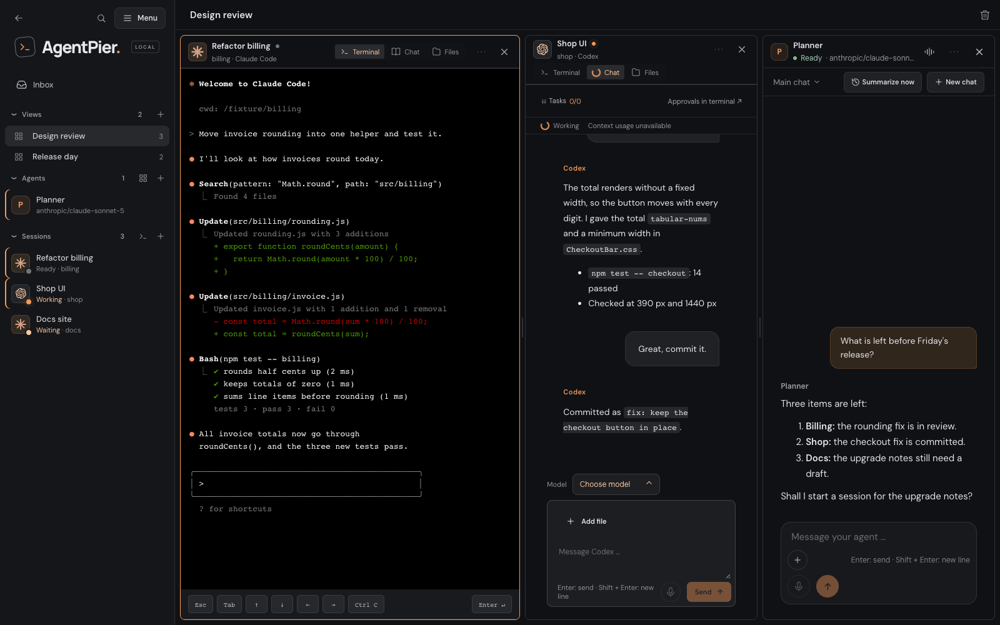
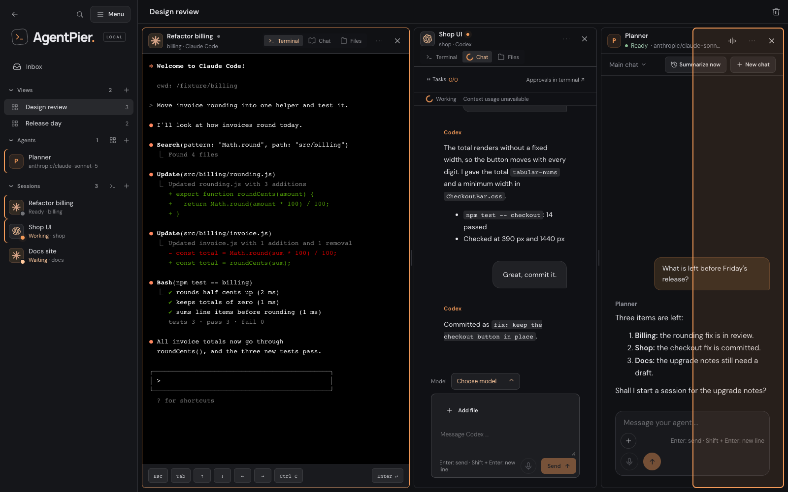

# Views

A view shows up to six sessions and agent chats side by side in one window. Use it to
watch a build session while you talk to an agent, or to keep two terminals next to each
other. Views belong to the owner and are saved on the host, so every browser shows the
same ones.

Views exist only in a window wider than 1150 px. On a phone and in a narrow window the
sidebar has no **Views** group (see "Narrow windows" below).

## What a view is

A view has a name (1 to 60 characters) and one to six panes. A pane is either a session
(with its tab: terminal, chat or files) or an agent chat. The sidebar group **Views**
(German: **Ansichten**) sits between **Inbox** and **Agents**; its rows show the view's
name and pane count and open the view at `/views/:id`.

An item appears once per view. Dragging a session or chat that is already in the view
moves it instead of adding a second copy. In the sidebar, sessions and agent chats shown
in the current view carry a marker (tooltip "Shown in this view").

## Creating a view

- Choose **+** in the head of the **Views** group ("New view"). This creates an empty view
  named "View 1", "View 2" and so on; drag sessions and agents into it from the sidebar.
- Open a session or agent chat on its own page and drag a second session or agent from
  the sidebar onto it. The two form a new view.

Rename a view by clicking its name in the view header ("Rename view"); Enter saves and
Esc cancels.

## Arranging panes

Drag a session or agent row from the sidebar, or a pane by its header, over a pane:

| Drop target      | Result                                                      |
| ---------------- | ----------------------------------------------------------- |
| Edge of a pane   | Splits the pane; the dropped item takes the side you chose  |
| Centre of a pane | Replaces the pane's content with the dropped item           |
| Pane header      | Moves the pane; dropped on a pane's centre it swaps the two |

A dropped session opens on the tab it was last shown on in this browser tab (terminal,
chat or files; shell and login sessions never open on chat), as it would on its own page.
A tab chosen inside a pane is remembered the same way, so **Open alone** and the next
drop land on it.

While you drag, a highlighted overlay shows the side the item will take, or the whole
pane when it would replace it:

Drag the divider between two panes to resize them. Dividers keep the split ratio between
15 % and 85 % and stop where a pane would get smaller than 280 × 220 px, so a terminal
always keeps at least 20 columns and 5 rows.

Adding, moving and replacing panes works only by drag and drop for now; there is no
keyboard-only way to do it yet. The pane menu (**Open alone**) and the **×** button work
from the keyboard.

The **×** on a pane header removes only that pane; the session or chat itself keeps
running. The trash button in the view header (**Delete view**) deletes the whole view; AgentPier
asks first, and sessions and chats stay as they are.

## Limits

- At most 6 panes per view. From 5 panes the view shows the hint "5 of 6 panes";
  dragging another item over a full view shows "The view is full (at most 6 panes)."
- At most 30 views.
- View names have 1 to 60 characters.

## Opening items: the click rule

A click on a session or agent chat in the sidebar, a search result or an in-app
notification never replaces a pane. AgentPier picks the first match:

1. The current view, if it contains the item: the pane gets the focus.
2. Otherwise the most recently used other view that contains the item.
3. Otherwise the item's own single page (`/sessions/:id`, `/agents/:agent/chats/:chat`).

Exceptions:

- A direct URL load of `/sessions/:id` or `/agents/:agent/chats/:chat` (a bookmark, a link
  from outside) opens the single view.
- A click that stays on the current route focuses the pane without switching the pane's
  tab.
- Below 1151 px the rule does not apply; items open alone.

To open an item alone regardless of the rule, use **Open alone** (German: **Einzeln
öffnen**) in the pane's menu.

## Inside a pane

A pane up to 900 px wide shows its session's chat like a narrow window: **Tasks**
opens the task list as a drawer on the pane's left edge, inside the pane, while the other
panes stay usable. Escape, its **×** or a click outside it closes it.

## Unsaved edits

A file editor with unsaved edits asks before its pane closes, before another item
replaces it, and before you leave or delete the view.

## Stale panes

If a pane's item disappears, the pane stays and says why instead of vanishing: "Session
removed" for a deleted session, "Chat deleted" for a deleted chat, "Agent deleted" for a
deleted agent, "Agents are switched off" while the agent service is off, and
"Disconnected" when the live connection is lost. **Remove from view** drops the stale
pane.

## Narrow windows

Between 701 px and 1150 px, and on phones, there is no **Views** group. A `/views/:id`
URL opened there shows the view's first pane alone with the note "Panes side by side need
a window wider than 1150 px. The first pane is shown here." Widening the window restores
the full view.

## Storage and access

- Views are stored in `views.json` in the data directory (written privately, mode 0600).
- `GET /api/views` and the other `/api/views` routes are owner only, as is the live topic
  `views`. Every write signals the topic; the sidebar and the view pages read it instead
  of polling.
- The topic carries a random per-instance `epoch`. A browser that sees another epoch,
  for example after a restore, adopts the host's document even if its version number is
  lower.
- `views.json` is part of every [host backup](backups.md) and comes back on a restore as
  saved. Restricted users have no views.

See also: [UI guide › Sidebar, menu and search](ui-guide.md#sidebar-menu-and-search) and
[ADR 0005](adr/0005-navigation-information-architecture.md).
